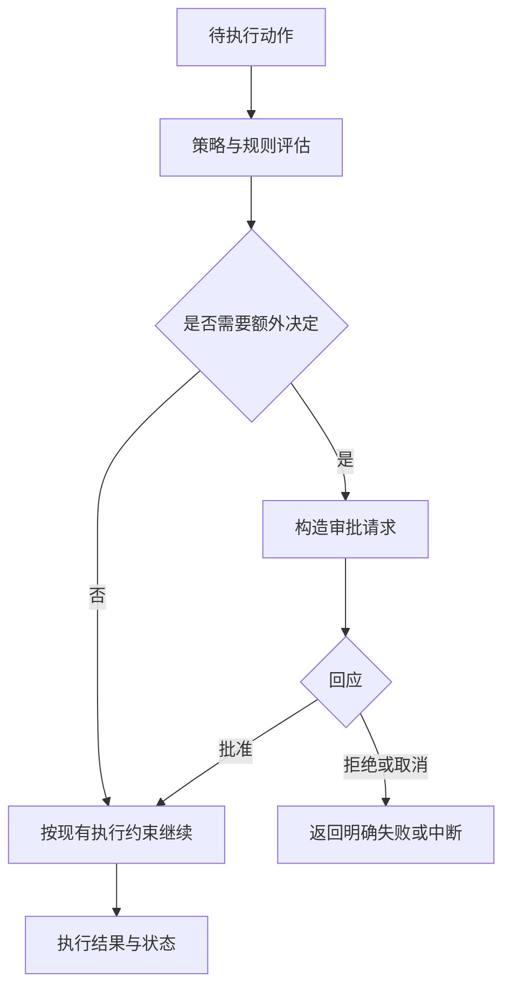

# 第 7 章：审批决定谁来作出下一步判断

<!-- block: codex-ch07.b-opening -->
审批策略决定何时请求决定、由谁回应；它与沙箱执行能力、命令规则和 Hook 信任分别生效。

“允许代理执行”这句话缺少范围。允许的是这一次命令、这一类前缀、当前会话，还是某个目录的写入能力？如果界面把它们都简化成一个确认按钮，使用者很容易以为自己只批准了一次动作，而实际规则已经影响后续运行。

## 7.1 先看固定版本接受哪些值

本机 0.167.0 顶层帮助的 `--ask-for-approval` 只列出 `on-request` 和 `never`。前者允许模型在需要时请求审批；后者不询问用户，执行失败直接返回给模型。这些文字来自同版本程序，不能用旧教程的枚举替换。

```powershell
codex.cmd --sandbox read-only --ask-for-approval on-request
```

这条命令把执行能力与审批策略都写明。`never` 并不是“自动批准一切”的同义词：不询问与获得额外能力没有逻辑等价关系，沙箱、规则和管理约束仍然存在。理解这个区别，就不会把无交互模式当作放开权限的捷径。

钉版配置实现还明确拒绝旧的 `approval_policy = "untrusted"` 显式设置。遇到这种升级错误，应按当前配置契约迁移，而不是不断尝试同一个旧值。历史文档中的用词可能仍有参考意义，但实际解析结果以固定版本为准。

## 7.2 审批发生在一条具体动作上

有效审批至少应让人看见命令或文件变更、工作目录、请求原因与影响范围。用户批准“运行单元测试”，不能自动推出“发布包到公共仓库”也已经获准。两者都可能出现在同一任务里，但外部副作用与目标不同。



图 7-1：审批改变的是动作能否继续以及继续的范围，执行仍受实际运行环境约束。

## 7.3 非交互 exec 为什么需要单独设计

钉版 `exec` 源码明确说明无界面运行默认不向人询问，并使用进程内 app-server 客户端。它还处理自动审查等配置路径，不能只从一个默认值推导全部行为。最稳妥的 CI 设计是事先配置必要能力，将需要人工决策的发布环节放到可审阅的工作流节点。

若脚本遇到审批请求，却没有实现应答通道，任务不应假装成功。本书第 14 章的完成条件会同时检查退出码、回合状态和项目测试。把审批失败写进机器可读结果，比让脚本停在后台无限等待更容易维护。

## 7.4 自动审查不是用户已作决定

本版提供 `--approve-for-me`，其帮助描述为使用 workspace-write 沙箱把审批请求交给自动审查。它是一种审批机制，不能替代用户对任务目标的授权，也不能被教程写成“任何命令都安全”。

上游 app-server 文档还描述了实验性的 managed human command checkpoint：匹配管理规则中 `prompt-user` 的命令需要新的人工决定，即使线程使用自动审查。客户端需要公布相应能力；没有能处理这种请求的连接时，命令会被拒绝。此处是特定管理配置与协议契约，不是 `review.rules` 中普通前缀规则的第四个通用取值。

把这两类规则区分清楚很重要。普通 `execpolicy check` 文档列出的决策是 `allow`、`prompt`、`forbidden`；管理要求使用的扩展能力应按其自己的配置入口和客户端能力核对。相似名称并不保证可以放进同一个文件。

## 7.5 如何评估一次请求是否应批准

先看动作是否属于当前目标，再看它是否使用最小必要范围，然后确认执行结果怎样检查。批准安装测试依赖之前，应知道它会写哪个环境；批准提交之前，应看暂存内容；批准外部发布之前，应看目标和版本。审查内容应具体，避免在一项长任务开始时给出没有边界的总批准。

如果请求被拒绝，后续步骤应根据原因调整任务，或报告缺少的能力。不要自动换壳、换路径或改写命令去获得同样的副作用。拒绝是运行条件的一部分，像测试失败一样需要被认真处理。

本书没有执行涉及真实账号或外部发布的审批实验。已实跑的是规则层的三种决策，完整用户界面、自动审查和管理 checkpoint 以钉版源码说明，未把源码分支标成实际审批记录。

## 来源

[exec 默认审批与客户端设置](https://github.com/openai/codex/blob/086ccc833bc9cf01024ad2dd6af7dbd421b6bf9a/codex-rs/exec/src/lib.rs)、[配置实现](https://github.com/openai/codex/blob/086ccc833bc9cf01024ad2dd6af7dbd421b6bf9a/codex-rs/core/src/config/mod.rs)、[managed human checkpoint](https://github.com/openai/codex/blob/086ccc833bc9cf01024ad2dd6af7dbd421b6bf9a/codex-rs/app-server/README.md)。
