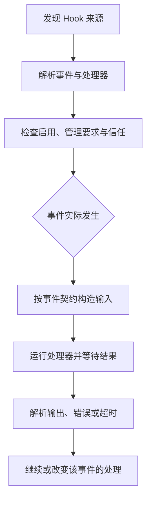
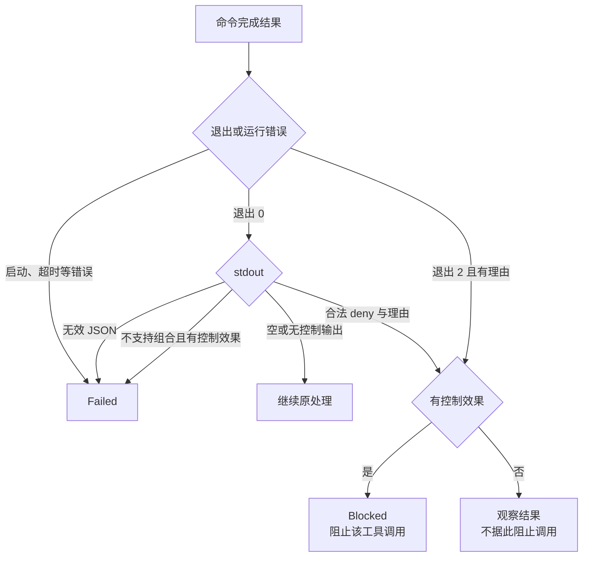

# 第 12 章：Skills、Hooks 与插件如何配合

<!-- block: codex-ch12.b-opening -->
技能提供任务方法，Hook 在特定事件运行，插件把多类资源打包；安装、发现、信任与实际执行是四个不同阶段。

“加个插件”经常包含几种完全不同的需求。你想让代理知道怎样做发布，可能需要技能；想在命令前检查条件，可能需要 Hook；想连接外部系统，可能需要 MCP；想把这些能力分发给团队，才涉及插件包装。先选对扩展层，比照抄另一套代理的回调接口更重要。

## 12.1 Codex 插件不等于 OpenCode 的 Hooks 对象

钉版 `PluginManifestPaths` 列出的资源包括 skills、onboarding skill、MCP server 声明、apps 和 hooks。它是资源清单，宿主根据资源类型分别加载。OpenCode 分册介绍的 `Plugin(input) => Hooks` 属于另一套插件接口，Codex 不会据此自动调用同名 TypeScript 函数。

| 需求 | 合适入口 | 需要另外确认 |
| --- | --- | --- |
| 告诉代理怎样完成项目任务 | Skill | 是否被发现、何时读取正文 |
| 在某个生命周期点运行程序 | Hook | 事件字段、信任状态、超时与输出契约 |
| 提供外部工具或数据 | MCP | 连接、认证、权限和错误处理 |
| 分发一组扩展资源 | Plugin | 清单、版本、来源、安装与启用状态 |

本版 CLI 确实有 `plugin add/list/marketplace/remove` 子命令，本机帮助已核对。帮助证明入口存在，不能证明你指定的 marketplace 可访问，或其中某个插件适合当前版本。自动化安装前应固定来源与版本，阅读实际资源。

## 12.2 写一个只解决一件事的 Skill

下面是原创技能的核心写法，完整文件在 [review-change/SKILL.md](https://github.com/zhuguang-ZFG/claude-code-book/blob/main/codex/examples/review-change/SKILL.md)。它指导代理检查已有差异，不替用户自动发布。

```markdown
---
name: review-change
description: 检查当前 Git 差异与项目测试，给出可定位的修改意见。
---

先读项目指令和 git status，区分本次变化与原有修改。
对每个发现写清触发条件、文件位置和可观察影响。
优先运行与改动有关的检查；不要将没有运行的命令写成通过。
没有发现问题时，说明检查范围与仍存在的验证空缺。
```

技能描述是触发线索，正文是工作方法。把所有细节都塞进描述，会增加常驻信息而不一定提高使用效果；把描述写得过于泛化，则容易在不相关任务里被触发。这里围绕“已有差异审查”限定范围，避免把安装、修复、提交和发布混成一个无边界流程。

技能可以引用脚本或参考资料，但这些文件仍需要通过实际工具读取和执行。Markdown 写着“运行测试”，并不会自动变成一个测试进程；脚本可执行也不代表用户已经授权它产生外部副作用。

## 12.3 发现与注入是两个时刻

宿主可以先列出技能名称与简述，只有相关任务发生时才读取详细内容。钉版 core 的 skills 入口区分被提及与已注入的技能，并处理相关记录。由此可见，目录里存在 `SKILL.md`、候选列表出现名称、正文进入当前上下文，分别需要不同证据。

排查技能没生效时，先确认目录是否在当前宿主的发现范围，再检查名称和描述是否有效，最后确认该次任务是否真的加载正文。不要在正文末尾不断追加更强硬的口号；若宿主根本没读它，修改语气不会解决发现问题。

本书提供的技能文件只作为原创资源与格式例子，未在本轮启动真实模型会话验证触发率。它不应被包装成“已证明代理一定遵循全部步骤”。

## 12.4 Hook 的生命周期更具体

固定版本公开十四个事件名称，涵盖模型请求前后、工具前后、权限请求、压缩前后、会话开始结束、用户输入、子代理开始结束、停止与中断。并不是每个事件都使用 matcher：钉版常量单独列出有意义的 matcher 事件，说明不能随便给所有事件加正则后期待同样过滤。



图 12-1：Hook 从配置到执行的路径。不同事件的输出含义不同，不能统一理解成返回一段文字即可。

比如 `PreToolUse` 面向工具执行前，`PostToolUse` 面向之后，`PermissionRequest` 面向审批相关流程。把日志写在后置 Hook，不能用它阻止已经完成的工具副作用；把前置检查写成耗时网络请求，则可能拖慢每次工具调用。这是选择事件时的真实取舍。

## 12.5 JSON 与 TOML 会一起加载

钉版 discovery 从有效配置层查找 `hooks.json` 与 inline TOML Hook。若同层两种表示都含事件，会发出警告并加载两者；它不是“后写的那份自动替换前一份”。配置重复时，处理器可能执行多次。

```json
{
  "hooks": {
    "PostToolUse": [
      {
        "matcher": "Bash",
        "hooks": [
          {
            "type": "command",
            "command": "python scripts/observe_tool.py",
            "timeout": 10
          }
        ]
      }
    ]
  }
}
```

这是配置形状示意，需要结合你真正使用的工具名称与钉版输入输出 schema 编写处理器。不能因为一个程序在终端可运行，就认为它已经遵守 Hook 返回契约。也不要把示例直接写进个人配置来测试，以免影响所有项目。

本书建议给每个 Hook 保存来源、事件、目的与失败处理。重复加载时先查配置层，不要立刻在脚本里加一个全局“只运行一次”标记；后者可能把合法的第二次调用也吞掉。

## 12.6 信任绑定的是具体定义

官方当前 Hook 文档说明，非管理 Hook 运行前需要审查和信任，变化后的定义会重新需要审查。钉版插件信任实现进一步比较声明哈希，并在适用时比较插件内容哈希。仅记住“我曾经信任过这个插件名字”，不足以解释后来修改的文件是否还能运行。

这对开发很实际：你改了脚本，发现 Hook 没执行，原因可能是信任基线改变，而不是事件没有触发。先看 Hook 列表与警告，区分“未发现”“未启用”“未信任”“事件未发生”和“已运行但返回错误”。五种情况对应五种修复。

管理来源和普通项目来源也不同。管理要求可以限制只允许管理 Hook，或者要求某些 Hook 必须可加载。普通用户配置不能简单覆盖这类约束。教程中不应把危险的跳过信任旗标当作默认安装步骤；这个旗标的存在不意味着每个开发环境都应该使用它。

## 12.7 状态和清理由扩展作者负责设计

Hook 可能是一个短命进程，MCP 服务可能长期运行，技能只是文件，插件清单又只是资源组织。它们没有一套共同的 `dispose` 回调可以解决所有状态。写扩展之前先确定资源属于哪一层：单次调用、会话、服务进程，还是磁盘文件。

只记录摘要的观察器可以把每次调用当成独立事件；需要关联前后状态的处理器则应使用明确 ID，考虑并发与缺失事件。不要用工具名字当唯一键，同一种工具可能同时运行多次。

卸载插件也不应被理解为撤销历史副作用。已经写入的项目文件、发出的外部消息、创建的数据库记录，除非扩展另有明确撤销机制，否则不会因为清单消失而自动恢复。分发插件时应写清数据位置、备份方式与清理步骤。

## 12.8 为一个插件准备发布材料

一份可维护的插件至少应有固定版本、许可说明、资源清单、安装与卸载方法、适用 CLI 版本和最小验证命令。例子应包含失败，不只展示正常截图。Hook 需要注明输入输出契约，MCP 需要说明认证位置，技能需要说明触发范围。

升级时逐项核对资源：新技能是否改变工作方法，Hook 内容是否改变信任哈希，MCP 是否增加能力，默认启用状态是否变化。把所有内容压成“修复若干问题”会让用户无法判断应该重新审查什么。

## 12.9 把运费检查做成一个技能

项目说明负责长期约束，技能负责一种可重复的方法。对本书的小仓库，可以把“检查整数边界”写成技能：

```markdown
---
name: parcel-boundary-review
description: 检查整数克计费函数的边界与类型行为，修复前先复现失败。
---

# 运费边界检查

读取项目 AGENTS.md、parcel.py 与 test_parcel.py。
运行 python -B -m unittest -v，记录失败的输入与实际价格。
按 1、1000、1001、2000、2001、30000 克检查区间。
保留整数分和整数克，不增加依赖，不删除现有类型检查。
修复后重跑同一命令，检查 Git 差异，再解释公式变化。
```

这个技能把输入文件、判断方法和结束证据写全。description 要说明何时使用；正文则给模型足够具体的步骤。把长长的任务历史塞进 description，会让发现列表难读，也不能代替正文加载。

固定 `skills/src/parser.rs` 先提取 YAML front matter，解析 name、description 和可选 short-description。name 缺失或为空时可以由调用方提供默认名；description 为空会报错；name 长度有 64 的上限。解析器还会把连续空白整理成单行文本。开发时直接提供短而明确的 name，通常比依赖默认名更容易排查重名。

技能正文是一份资源，并非加载时自动执行的 Python 程序。把技能放进候选根、成功解析元数据、被选中、实际注入正文、模型照着执行，是五个不同阶段。用户看到技能出现在列表里，只能确认前面的部分流程。要证明本轮使用过，继续看所选路径与注入记录；要证明测试真的执行，再看命令结果。

## 12.10 从技能目录到注入入口

读取 `core/src/skills.rs` 时，可以从 `skills_load_input_for_environments` 开始。它优先取得主要工作环境的 cwd 与文件系统，再构造 `HostSkillsLoadInput`，同时带入插件技能快照。这个细节避免把宿主配置的 cwd 误当成所有仓库的发现根；远程或多环境任务尤其需要保留文件系统所属者。

接着读 `ext/skills/src/loader/discovery.rs`。遍历有深度、目录数和条目数限制；固定实现的单根条目上限为 20000，扫描截断会留下警告。`DirectChildren` 与递归发现采用不同深度和位置判断，隐藏目录、目录符号链接也由策略控制。教程若只说“把文件放在某处，它一定会出现”，就跳过了这些真实条件。

发现器收集 `SKILL.md` 路径和可能的元数据位置，再交给加载与解析步骤。加载结果同时包含成功技能和错误，不是一个简单的全局成功标记。某个技能的 YAML 坏了，不必然意味着所有技能都不存在；排错时应查该文件路径对应的错误。

最后 `emit_explicit_skill_invocations` 会把被提及技能的路径与实际注入技能路径集合比较，并记录对应状态。路径身份比仅看名字重要：两个包都可能含有名为 review 的技能。升级或重命名目录后，如果只按展示名查找，可能看错实际被调用的来源。

本书提供的 `review-change/SKILL.md` 与上面的内容都是原创示例。把它加入自己的项目技能目录之后，仍需用真实宿主验证发现与触发；本册离线实验不声称完成了这一步。我们能在本地直接检查的是文件内容、解析所需字段和配套脚本行为。

## 12.11 一个插件包究竟装了什么

按固定实现的兼容清单格式，可以准备如下包结构：

```text
parcel-review/
  .codex-plugin/
    plugin.json
  skills/
    parcel-boundary-review/
      SKILL.md
  hooks/
    hooks.json
  scripts/
    hook_guard.py
```

清单示意：

```json
{
  "name": "parcel-review",
  "version": "0.1.0",
  "description": "Review integer parcel fees",
  "skills": ["./skills"],
  "hooks": "./hooks/hooks.json"
}
```

`core-plugins/src/manifest.rs` 保留原始路径字符串，随后验证 `./...` 形式并相对于包根解析。清单中的 `./skills` 不能按 `.codex-plugin/` 的目录计算；它指向插件根下的资源。解析得到的 `PluginManifestPaths` 再把 skills、onboarding skill、MCP、apps 和 hooks 分开交给各自消费者。

这份包结构讲的是磁盘接口，不是已经安装的事实。安装入口还涉及来源选择、启用状态、配置与信任；不能仅创建 `.codex-plugin/plugin.json` 就说 Hook 已经运行。固定版本还支持另一类 Agent Plugin 清单，本文没有把两个格式混写成一份未经检查的大 JSON。实际分发时选择一种明确格式并固定适用版本。

插件资源定位随后会保留 `environment_id`。`ResolvedPlugin::from_environment` 把清单路径与各资源路径映射为带所属环境的定位符，并拒绝超出包根的资源。写工具时不要把这个信息丢掉，再去本机用同名路径读文件；同名的远程目录和本地目录不是一回事。

Hook 发现阶段为插件命令提供 `PLUGIN_ROOT`，并保留 `CLAUDE_PLUGIN_ROOT` 兼容变量。引用它时要按实际 shell 的变量语法处理：PowerShell 与 POSIX shell 的展开写法不同。对于初次练习，先直接调用本书脚本验证 stdin/stdout，再根据真实宿主选择命令行，不要为了让一条跨平台字符串“看起来通用”而叠很多层引号。

完整包文件位于 `codex/examples/plugin-example/`。默认 hooks.json 使用 POSIX shell 写法，旁边的 hooks.powershell.json 给出 PowerShell 写法；在独立副本中按实际 Hook shell 选用。检查脚本会核对资源存在和处理器副本一致，安装与信任仍由读者在自己的宿主环境验证。

## 12.12 十四个事件，九种有 matcher 的入口

固定 `HOOK_EVENT_NAMES` 与 `HOOK_EVENT_NAMES_WITH_MATCHERS` 是最直接的依据。下表只列匹配是否参与分发和主要观察位置，不暗示所有事件支持相同输出控制：

| 事件 | matcher 参与分发 | 主要观察位置 |
| --- | --- | --- |
| PreModelRequest | 否 | 模型请求之前 |
| PostModelRequest | 否 | 模型请求之后 |
| PreToolUse | 是 | 工具输入进入执行之前 |
| PermissionRequest | 是 | 工具权限请求 |
| PostToolUse | 是 | 工具调用之后 |
| PreCompact | 是 | 压缩之前，按触发类型 |
| PostCompact | 是 | 压缩之后，按触发类型 |
| SessionStart | 是 | 会话启动来源 |
| SessionEnd | 是 | 会话结束原因 |
| UserPromptSubmit | 否 | 用户输入提交 |
| SubagentStart | 是 | 子代理启动 |
| SubagentStop | 是 | 子代理停止 |
| Stop | 否 | 当前代理准备停止 |
| Interrupt | 否 | 中断处理 |

例如给 `UserPromptSubmit` 写 matcher `^fix`，不会得到“只在提示词以 fix 开头时触发”的效果。源码把该事件的 matcher 忽略。需要按输入内容筛选时，应在相应处理器契约允许的输入上判断，不能借配置字段名猜出不存在的过滤能力。

工具类事件的候选值先放规范工具名，再放内部 matcher aliases。处理器选择可以通过别名命中，stdin 仍序列化规范 `tool_name`。所以 Hook 因 `Bash` 匹配被选中，并不保证收到的字段永远是字符串 Bash；脚本应按照实际输入记录和固定接口处理。

`HookMatcher::new` 还有一个比“它支持正则”更细的分支：空字符串或 `*` 表示全匹配；仅由 ASCII 字母、数字、下划线和竖线构成的表达式走精确候选匹配；其他表达式才交给正则编译。

| 写法 | 实际比较方式 | 例子 |
| --- | --- | --- |
| `Bash` | 整个候选相等 | 不匹配 `BashExtra` |
| `Edit|Write` | 两个精确候选 | 匹配 Edit 或 Write |
| `mcp__memory` | 精确候选 | 不表示所有 memory 工具 |
| `^Bash$` | 正则 | 显式要求首尾边界 |
| `mcp__memory__.*` | 正则 | 可匹配对应工具后缀 |

拼错正则在发现时就可能报错，而不是等某次调用才发现没匹配。保留原表达式拼写也参与配置身份判断，不能认为两条语义相似的正则在信任和状态记录中一定是同一项。

## 12.13 逐字段看一份完整 Hook 输入

下面的输入保存在 `fixtures/hook-read.json`，已对固定上游生成 schema 校验：

```json
{
  "session_id": "workshop-session",
  "turn_id": "turn-1",
  "transcript_path": null,
  "cwd": "C:/work/parcel",
  "hook_event_name": "PreToolUse",
  "model": "fixture-model",
  "permission_mode": "default",
  "tool_name": "exec_command",
  "tool_input": {"command": "python -B -m unittest -v"},
  "tool_use_id": "tool-1"
}
```

这些值是手工构造的教学输入。`transcript_path` 允许 null，因此处理器不能无条件打开它；`tool_input` 的 schema 很宽，但本例只支持含 command 的对象；`tool_use_id` 用于区分同名工具的不同调用。`permission_mode` 使用 Hook 输入自己的枚举，不能把 CLI 的 `on-request` 直接填进这个字段。

`PreToolUseRequest` 还区分宿主 cwd 与可选的本地工具 cwd。生成 stdin 时，本地工具可暴露实际执行目录；远程命令保留宿主 cwd 的当前行为另有说明。因此，收到 cwd 后不要立即断言它就是远程进程的真实目录。日志中最好同时保留事件来源和环境信息，而不是只留下一个路径。

开发处理器时，先把输入保存成 fixture，用普通子进程送入 stdin。这里没有必要启动模型，也不用读用户真实 transcript。这样测试失败就能定位到 JSON 解析、字段处理或输出格式；等这部分稳定之后，再验证宿主发现、信任和调用。

## 12.14 一个完整且有意保持有限的处理器

以下就是 `hook_guard.py` 的核心接口。完整文件还包含 main 和错误返回，随书提供，可以直接运行：

```python
import json
import sys

def respond(event):
    if event.get("hook_event_name") != "PreToolUse":
        raise ValueError("expected PreToolUse")
    if not isinstance(event.get("tool_input"), dict):
        raise ValueError("tool_input must be an object in this exercise")
    command = event["tool_input"].get("command", "")
    output = {"hookEventName": "PreToolUse"}
    if command == "git push --force origin main":
        output.update(
            permissionDecision="deny",
            permissionDecisionReason="Review the patch before publishing.",
        )
    else:
        output["additionalContext"] = "Parcel fee uses integer cents and grams."
    return {"hookSpecificOutput": output}

def main():
    try:
        event = json.load(sys.stdin)
        print(json.dumps(respond(event), ensure_ascii=False))
    except (ValueError, TypeError, AttributeError) as exc:
        print(str(exc), file=sys.stderr)
        return 1
    return 0

if __name__ == "__main__":
    raise SystemExit(main())
```

它只识别一个精确 shell 字符串，不能用于解析全部 Git 命令，更不构成安全边界。这样刻意限制例子，是为了把事件接口讲清楚：正常输入返回 additionalContext，明确拒绝返回 deny 与非空理由，坏 JSON 返回退出码 1 且 stdout 为空。

运行 `python -B codex/examples/check_workshop.py`，会直接启动这个 Python 处理器，送入两份 fixture，再检查结果。读命令应返回附加上下文；精确强制推送文本应返回 deny；损坏 JSON 应非零。这里没有执行 Git 推送，也没有由 Codex 宿主触发 Hook。

stdout 只写协议结果，调试日志写 stderr。若先 `print("starting")` 再打印 JSON，整段 stdout 就不是一个可解析 JSON 对象；即使最后一行看起来正确，宿主也不一定按“只读最后一行”处理。读取固定 `output_parser.rs` 可见它对 trim 后的整体文本做 JSON 解析。

## 12.15 PreToolUse 的 allow 为什么不能直接当成批准

本版最容易踩错的地方在输出语义。生成 schema 可以表达 allow、deny、ask，但 `unsupported_pre_tool_use_hook_specific_output` 继续检查这些字段组合。schema 接受的形状不等于运行时支持的动作。

| 输出组合 | 固定解析器的判断 |
| --- | --- |
| 只返回 additionalContext | 可提供附加上下文 |
| deny 加非空 permissionDecisionReason | 可表达拒绝 |
| deny 没有有效理由 | 不支持的输出 |
| 单独 allow | 不支持的输出 |
| allow 加 updatedInput | 作为输入改写处理 |
| ask | 不支持的输出 |
| updatedInput 没有 allow | 不支持的输出 |
| continue:false、stopReason 或 suppressOutput:true | PreToolUse 不支持的通用字段效果 |

allow 加 updatedInput 的例子如下：

```json
{
  "hookSpecificOutput": {
    "hookEventName": "PreToolUse",
    "permissionDecision": "allow",
    "updatedInput": {"command": "python -B -m unittest -v"}
  }
}
```

不要把这个对象解释成“后续审批与沙箱全部放行”。在本事件解析器里，它提供的是待传回的改写输入；后续执行还受对应工具的控制。实际能否改写某类工具参数，还要看消费该 outcome 的调用方。本书处理器选择只提供上下文或拒绝，避免在教学例子里悄悄替换用户待执行动作。

`PermissionRequest` 又有不同结构：它的 decision 用 behavior 表达 allow 或 deny；固定解析器拒绝 updatedInput、updatedPermissions 与 interrupt:true。`PostToolUse` 也不支持某些看似通用的字段，例如 updatedMCPToolOutput。阅读多个事件时，应分别打开对应 parser，不能拿一张通用返回表覆盖整个 Hook 系统。

## 12.16 失败、阻止、异步观察分别发生什么

`pre_tool_use.rs` 把处理器完成结果转换成 `HookRunStatus`。退出码 0 且 stdout 为空可以是无操作；结构正确的 deny 转成 Blocked；看起来是 JSON 但解析无效会标记 Failed。退出码 2 在具有控制效果的处理器上，只有 stderr 含非空理由才形成阻止，否则仍是失败。



图 12-2：PreToolUse 的结果分支。Failed 与 Blocked 是不同状态，故障处理不能只看“Hook 不成功”。

多个同步处理器也不必串行运行。dispatcher 把任务放入 `FuturesUnordered`，完成时记 completion_order，最后再按配置顺序整理结果。一个处理器依赖另一个先写文件，不能仅凭它在 JSON 中排在后面就认为顺序有保障。共享状态要另行同步，或把有顺序依赖的步骤放进同一个处理器。

PreToolUse 汇总还会先检查是否有任何阻止结果：有阻止就舍弃改写输入；没有阻止时，竞争的 updatedInput 取实际最后完成的处理器。配置顺序用于稳定呈现，完成顺序用于这一改写选择。两个处理器同时修改 command，就可能因运行时长不同得到不同结果，应避免这种隐含竞争。

异步 Hook 会交给命令运行时调度，不能依赖它事后阻止已经继续的工具操作。SessionEnd 对异步配置有特殊归一化，会转成同步；SessionEnd 与 Interrupt 的超时默认一秒、上限三秒，其他命令事件的默认值不同。结束事件里做大型网络上传，很容易因为时间预算根本不适合而失败。

命令运行器先检查插件信任，再启动进程；stdin 写入与输出收集并发进行，并纳入剩余超时，避免一端管道阻塞另一端。Windows 分支使用进程树管理；正常完成的处理器可能有意留下分离的辅助进程。因此“主脚本已返回”也不能自动证明所有资源都释放，扩展作者要明确自己创建了什么后台工作。

## 12.17 声明哈希与内容哈希保护不同变化

`PluginHookTrust` 保存声明哈希、已信任哈希、可选内容哈希和旧版迁移路径。检查先比较声明是否一致，再比较内容；旧批准的迁移也会固定内容基线。只记住插件 name 和 version 远远不够，同名同版文件仍可能被修改。

`plugin_fingerprint.rs` 从包根遍历，按文件名排序，加入相对路径、条目类型、文件长度与文件内容，使用带版本前缀的哈希。它跳过 `__pycache__`、`.venv`、`.pyc` 和 `.egg-info` 等生成内容。源码注释因此把它称为尽力识别源内容变化，并没有声称覆盖虚拟环境中任意依赖的篡改。

读取时按观察到的文件长度限制，并检查实际读到长度是否变化；取消信号也会在遍历和读取之间检查。若包正在被另一个进程更新，指纹过程可能失败，而不是继续使用半份旧内容与半份新内容。开发时发现“修改脚本后 Hook 不再执行”，先查看信任错误，再查看事件匹配。

一个有用的手动练习是对 `hook_guard.py` 计算 SHA-256，修改一条返回说明，再计算一次。你会看到内容变化确实改变摘要，但这个练习不是 Codex 插件指纹算法的复刻：真实算法还加入路径、类型与长度，并有忽略规则。不要把单文件哈希直接写进宿主信任配置，冒充完整包批准。

## 12.18 按五个阶段排查“没有触发”

先看发现：插件清单和 Hook 配置是否被读到，路径是否正确，是否只有元数据出现在列表。再看启用与管理要求：条目有没有被禁用，是否只允许管理 Hook。第三步看信任：声明或内容是否变化。第四步看 matcher：该事件是否支持它，匹配的是规范名、别名还是另一类触发值。最后才看运行：退出码、stdout、stderr、超时和字段组合。

对运费项目，最小排错包就是清单、hooks.json、处理器、两份 stdin fixture 和明确输出。读者可以在没有模型的环境里先证明处理器本身可运行；接入宿主后，只需再补发现、信任、调用与结果消费的记录。把这两步分开，能避免宿主没有触发时反复修改本来正确的 Python 逻辑。

不要用全局“执行过一次”的标志解决重复调用。固定 discovery 在同层同时发现 JSON 与 TOML Hook 时会加载两者并警告，重复很可能来自配置。也可能同一工具在不同 turn 正常调用多次。先查看来源、事件和调用 ID，再决定是否去重；把 tool_name 当唯一键会误吞合法调用。

更新插件时，应把资源清单、适用版本、Hook 输入输出和测试 fixture 一起交付。删除插件目录不会撤回以前写入的文件，也不会自动删除扩展自建的数据存储。清理方法应说明具体位置和保留内容，别只留一句“卸载即可”。

## 来源

[插件资源清单类型](https://github.com/openai/codex/blob/086ccc833bc9cf01024ad2dd6af7dbd421b6bf9a/codex-rs/plugin/src/manifest.rs)、[Hook 事件集合](https://github.com/openai/codex/blob/086ccc833bc9cf01024ad2dd6af7dbd421b6bf9a/codex-rs/hooks/src/lib.rs)、[Hook 发现](https://github.com/openai/codex/blob/086ccc833bc9cf01024ad2dd6af7dbd421b6bf9a/codex-rs/hooks/src/engine/discovery.rs)、[插件 Hook 信任](https://github.com/openai/codex/blob/086ccc833bc9cf01024ad2dd6af7dbd421b6bf9a/codex-rs/hooks/src/engine/plugin_trust.rs)、[技能注入入口](https://github.com/openai/codex/blob/086ccc833bc9cf01024ad2dd6af7dbd421b6bf9a/codex-rs/core/src/skills.rs)。滚动用法补充见[官方 Hooks](https://learn.chatgpt.com/docs/hooks)。

[技能元数据解析](https://github.com/openai/codex/blob/086ccc833bc9cf01024ad2dd6af7dbd421b6bf9a/codex-rs/skills/src/parser.rs)、[技能扫描](https://github.com/openai/codex/blob/086ccc833bc9cf01024ad2dd6af7dbd421b6bf9a/codex-rs/ext/skills/src/loader/discovery.rs)、[插件原始清单解析](https://github.com/openai/codex/blob/086ccc833bc9cf01024ad2dd6af7dbd421b6bf9a/codex-rs/core-plugins/src/manifest.rs)、[Hook matcher](https://github.com/openai/codex/blob/086ccc833bc9cf01024ad2dd6af7dbd421b6bf9a/codex-rs/hooks/src/engine/matcher.rs)、[Hook 输出语义检查](https://github.com/openai/codex/blob/086ccc833bc9cf01024ad2dd6af7dbd421b6bf9a/codex-rs/hooks/src/engine/output_parser.rs)、[PreToolUse 结果汇总](https://github.com/openai/codex/blob/086ccc833bc9cf01024ad2dd6af7dbd421b6bf9a/codex-rs/hooks/src/events/pre_tool_use.rs)、[Hook 分发与并发](https://github.com/openai/codex/blob/086ccc833bc9cf01024ad2dd6af7dbd421b6bf9a/codex-rs/hooks/src/engine/dispatcher.rs)、[命令运行、超时与进程](https://github.com/openai/codex/blob/086ccc833bc9cf01024ad2dd6af7dbd421b6bf9a/codex-rs/hooks/src/engine/command_runner.rs)、[插件内容指纹](https://github.com/openai/codex/blob/086ccc833bc9cf01024ad2dd6af7dbd421b6bf9a/codex-rs/hooks/src/engine/plugin_fingerprint.rs)、[Hook 配置字段](https://github.com/openai/codex/blob/086ccc833bc9cf01024ad2dd6af7dbd421b6bf9a/codex-rs/protocol/src/hooks.rs)。
