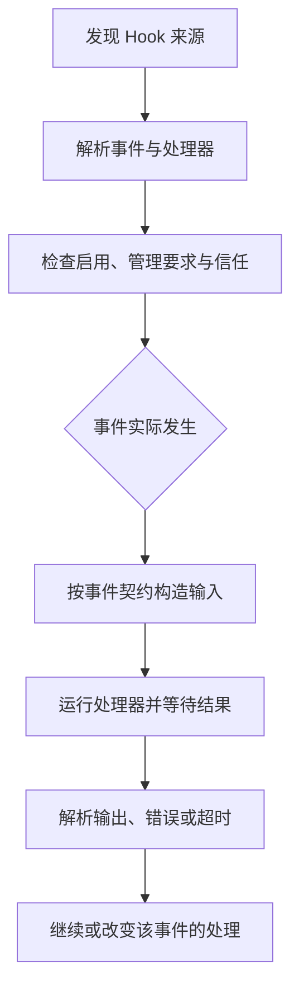

# 第 12 章：Skills、Hooks 与插件如何配合

<!-- block: codex-ch12.b-opening -->
技能提供任务方法，Hook 在特定事件运行，插件把多类资源打包；安装、发现、信任与实际执行是四个不同阶段。

“加个插件”经常包含几种完全不同的需求。你想让代理知道怎样做发布，可能需要技能；想在命令前检查条件，可能需要 Hook；想连接外部系统，可能需要 MCP；想把这些能力分发给团队，才涉及插件包装。先选对扩展层，比照抄另一套代理的回调接口更重要。

## 12.1 Codex 插件不等于 OpenCode 的 Hooks 对象

钉版 `PluginManifestPaths` 列出的资源包括 skills、onboarding skill、MCP server 声明、apps 和 hooks。它是资源清单，宿主根据资源类型分别加载。不要把第 8 章 OpenCode 的 `Plugin(input) => Hooks` 搬过来，期待 Codex 自动调用同名 TypeScript 函数。

| 需求 | 合适入口 | 需要另外确认 |
| --- | --- | --- |
| 告诉代理怎样完成项目任务 | Skill | 是否被发现、何时读取正文 |
| 在某个生命周期点运行程序 | Hook | 事件字段、信任状态、超时与输出契约 |
| 提供外部工具或数据 | MCP | 连接、认证、权限和错误处理 |
| 分发一组扩展资源 | Plugin | 清单、版本、来源、安装与启用状态 |

本版 CLI 确实有 `plugin add/list/marketplace/remove` 子命令，本机帮助已核对。帮助证明入口存在，不能证明你指定的 marketplace 可访问，或其中某个插件适合当前版本。自动化安装前应固定来源与版本，阅读实际资源。

## 12.2 写一个只解决一件事的 Skill

下面是原创技能的核心写法，完整文件在 [review-change/SKILL.md](https://github.com/zhuguang-ZFG/claude-code-book/blob/main/codex/examples/review-change/SKILL.md)。它指导代理检查已有差异，不替用户自动发布。

```markdown
---
name: review-change
description: 检查当前 Git 差异与项目测试，给出可定位的修改意见。
---

先读项目指令和 git status，区分本次变化与原有修改。
对每个发现写清触发条件、文件位置和可观察影响。
优先运行与改动有关的检查；不要将没有运行的命令写成通过。
没有发现问题时，说明检查范围与仍存在的验证空缺。
```

技能描述是触发线索，正文是工作方法。把所有细节都塞进描述，会增加常驻信息而不一定提高使用效果；把描述写得过于泛化，则容易在不相关任务里被触发。这里围绕“已有差异审查”限定范围，避免把安装、修复、提交和发布混成一个无边界流程。

技能可以引用脚本或参考资料，但这些文件仍需要通过实际工具读取和执行。Markdown 写着“运行测试”，并不会自动变成一个测试进程；脚本可执行也不代表用户已经授权它产生外部副作用。

## 12.3 发现与注入是两个时刻

宿主可以先列出技能名称与简述，只有相关任务发生时才读取详细内容。钉版 core 的 skills 入口区分被提及与已注入的技能，并处理相关记录。由此可见，目录里存在 `SKILL.md`、候选列表出现名称、正文进入当前上下文，分别需要不同证据。

排查技能没生效时，先确认目录是否在当前宿主的发现范围，再检查名称和描述是否有效，最后确认该次任务是否真的加载正文。不要在正文末尾不断追加更强硬的口号；若宿主根本没读它，修改语气不会解决发现问题。

本书提供的技能文件只作为原创资源与格式例子，未在本轮启动真实模型会话验证触发率。它不应被包装成“已证明代理一定遵循全部步骤”。

## 12.4 Hook 的生命周期更具体

固定版本公开十四个事件名称，涵盖模型请求前后、工具前后、权限请求、压缩前后、会话开始结束、用户输入、子代理开始结束、停止与中断。并不是每个事件都使用 matcher：钉版常量单独列出有意义的 matcher 事件，说明不能随便给所有事件加正则后期待同样过滤。



图 12-1：Hook 从配置到执行的路径。不同事件的输出含义不同，不能统一理解成返回一段文字即可。

比如 `PreToolUse` 面向工具执行前，`PostToolUse` 面向之后，`PermissionRequest` 面向审批相关流程。把日志写在后置 Hook，不能用它阻止已经完成的工具副作用；把前置检查写成耗时网络请求，则可能拖慢每次工具调用。这是选择事件时的真实取舍。

## 12.5 JSON 与 TOML 会一起加载

钉版 discovery 从有效配置层查找 `hooks.json` 与 inline TOML Hook。若同层两种表示都含事件，会发出警告并加载两者；它不是“后写的那份自动替换前一份”。配置重复时，处理器可能执行多次。

```json
{
  "hooks": {
    "PostToolUse": [
      {
        "matcher": "Bash",
        "hooks": [
          {
            "type": "command",
            "command": "python scripts/observe_tool.py",
            "timeout": 10
          }
        ]
      }
    ]
  }
}
```

这是配置形状示意，需要结合你真正使用的工具名称与钉版输入输出 schema 编写处理器。不能因为一个程序在终端可运行，就认为它已经遵守 Hook 返回契约。也不要把示例直接写进个人配置来测试，以免影响所有项目。

本书建议给每个 Hook 保存来源、事件、目的与失败处理。重复加载时先查配置层，不要立刻在脚本里加一个全局“只运行一次”标记；后者可能把合法的第二次调用也吞掉。

## 12.6 信任绑定的是具体定义

官方当前 Hook 文档说明，非管理 Hook 运行前需要审查和信任，变化后的定义会重新需要审查。钉版插件信任实现进一步比较声明哈希，并在适用时比较插件内容哈希。仅记住“我曾经信任过这个插件名字”，不足以解释后来修改的文件是否还能运行。

这对开发很实际：你改了脚本，发现 Hook 没执行，原因可能是信任基线改变，而不是事件没有触发。先看 Hook 列表与警告，区分“未发现”“未启用”“未信任”“事件未发生”和“已运行但返回错误”。五种情况对应五种修复。

管理来源和普通项目来源也不同。管理要求可以限制只允许管理 Hook，或者要求某些 Hook 必须可加载。普通用户配置不能简单覆盖这类约束。教程中不应把危险的跳过信任旗标当作默认安装步骤；这个旗标的存在不意味着每个开发环境都应该使用它。

## 12.7 状态和清理由扩展作者负责设计

Hook 可能是一个短命进程，MCP 服务可能长期运行，技能只是文件，插件清单又只是资源组织。它们没有一套共同的 `dispose` 回调可以解决所有状态。写扩展之前先确定资源属于哪一层：单次调用、会话、服务进程，还是磁盘文件。

只记录摘要的观察器可以把每次调用当成独立事件；需要关联前后状态的处理器则应使用明确 ID，考虑并发与缺失事件。不要用工具名字当唯一键，同一种工具可能同时运行多次。

卸载插件也不应被理解为撤销历史副作用。已经写入的项目文件、发出的外部消息、创建的数据库记录，除非扩展另有明确撤销机制，否则不会因为清单消失而自动恢复。分发插件时应写清数据位置、备份方式与清理步骤。

## 12.8 为一个插件准备发布材料

一份可维护的插件至少应有固定版本、许可说明、资源清单、安装与卸载方法、适用 CLI 版本和最小验证命令。例子应包含失败，不只展示正常截图。Hook 需要注明输入输出契约，MCP 需要说明认证位置，技能需要说明触发范围。

升级时逐项核对资源：新技能是否改变工作方法，Hook 内容是否改变信任哈希，MCP 是否增加能力，默认启用状态是否变化。把所有内容压成“修复若干问题”会让用户无法判断应该重新审查什么。

## 来源

[插件资源清单类型](https://github.com/openai/codex/blob/086ccc833bc9cf01024ad2dd6af7dbd421b6bf9a/codex-rs/plugin/src/manifest.rs)、[Hook 事件集合](https://github.com/openai/codex/blob/086ccc833bc9cf01024ad2dd6af7dbd421b6bf9a/codex-rs/hooks/src/lib.rs)、[Hook 发现](https://github.com/openai/codex/blob/086ccc833bc9cf01024ad2dd6af7dbd421b6bf9a/codex-rs/hooks/src/engine/discovery.rs)、[插件 Hook 信任](https://github.com/openai/codex/blob/086ccc833bc9cf01024ad2dd6af7dbd421b6bf9a/codex-rs/hooks/src/engine/plugin_trust.rs)、[技能注入入口](https://github.com/openai/codex/blob/086ccc833bc9cf01024ad2dd6af7dbd421b6bf9a/codex-rs/core/src/skills.rs)。滚动用法补充见[官方 Hooks](https://learn.chatgpt.com/docs/hooks)。
