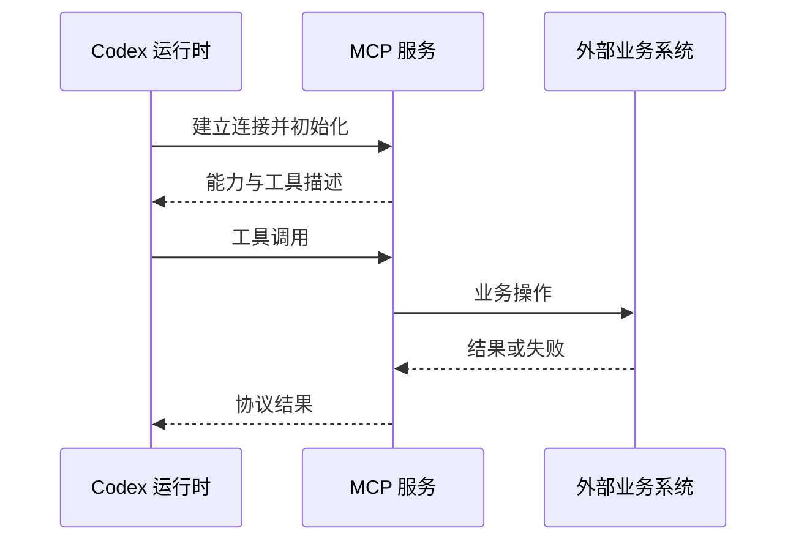

# 第 13 章：MCP 把工具接进来，也把另一套边界接进来

<!-- block: codex-ch13.b-opening -->
MCP 提供外部工具和资源接口，服务连接、认证、调用权限与业务副作用仍需要分别管理。

<!-- block: codex-ch13.b-term-mcp -->
连接一个 MCP 服务后，代理多了一组可以选择的工具。但“工具在列表里出现”距离“它能正确完成当前任务”还有几步：服务是否在线，凭据是否适用，输入是否符合 schema，操作是否被允许，结果能否被客户端解释。接入过程应沿这些步骤验证。

## 13.1 MCP 与本地插件的分工

插件可以打包 MCP 声明，MCP 服务则提供运行中的协议端点。两者不是互相替代的名词。一个插件可以只包含技能，也可以同时带 Hook 和 MCP 配置；一个 MCP 服务也可以独立配置，不依附某个插件包。

本地 stdio 服务通常由宿主启动进程，通过标准输入输出通信；HTTP 服务则有独立的监听端点和生命周期。前者要处理程序路径、环境和退出，后者要处理连接、认证和网络策略。选择传输方式时，先考虑部署方式，不必为了“统一”把所有服务都包装成远端 HTTP。

## 13.2 先核对当前 CLI 的管理入口

```powershell
codex.cmd mcp --help
codex.cmd mcp add --help
codex.cmd mcp list --help
```

本书没有运行会写个人配置的 add 命令，也没有连接外部业务服务。真实使用时先阅读同版本参数，并把最小测试服务放进隔离环境。不要把安装失败后的残留配置留在日常账号中，再以为后续所有项目都没有受影响。

配置文件中的凭据应通过明确的受控方式注入，不写进公开仓库。公开问题报告只提供端点类型、参数结构和必要错误，不复制完整 Authorization 头、个人路径或环境变量。

## 13.3 一次调用的观察顺序



图 13-1：MCP 服务后面可能还有另一层系统。协议成功不自动证明业务正确。

例如服务正常返回一个“任务已提交”的 ID，真正工作仍可能在后台排队；或服务把业务失败放在结果正文里，而传输本身成功。客户端与代理都要理解工具契约，不能只看 HTTP 状态码或有没有 JSON。

测试时至少分别制造连接失败、参数失败和业务失败。连接失败说明协议链路不可用；参数失败说明调用与定义不一致；业务失败可能需要用户修正输入、补权限或等待资源。三者重试策略通常不同。

## 13.4 外部服务的权限不会被本地目录自动收窄

一个数据库工具即使从只读本地工作区启动，仍可能持有远端写入凭据。一个浏览器或消息工具也可能在服务自己的账号中行动。CLI 沙箱能约束本地执行环境，却不能凭本地路径限制另一个服务器上的资源。

接入时尽量使用职责清楚、权限适当的账号。工具说明应区分读取与修改，输入参数也应避免把自由文本直接变成任意数据库语句或命令。确实需要强大能力时，把审批与结果审查放在操作之前，而不是完成之后才查看日志。

钉版配置代码对插件提供的 MCP 服务还会应用管理要求过滤。某服务在插件里存在，却未进入有效列表，可能是管理约束，不应直接认定插件解析器坏了。排查要看有效配置和来源，而不只看 manifest。

## 13.5 断线后最危险的是重复副作用

客户端没有收到返回，不代表服务没有执行。网络在业务完成后断开时，盲目重试可能重复创建记录、发送消息或发起付款。工具应尽可能提供可查询任务 ID 或幂等键，客户端也应先查询状态再决定重试。

只读查询通常容易重试，但也应考虑资源成本与限流。持续重连若没有退避和上限，会把一个短暂故障放大。不要让模型在每次失败后换一个几乎相同参数无限循环，应把重试次数和失败类别放进工具或工作流约束。

## 13.6 为读者准备一个可控实验

后续完整 MCP 实验可以使用本地服务，只暴露读取固定文本和故意返回错误两个工具。输入不接受任意文件路径，结果包含固定标记；服务记录请求 ID，测试驱动检查同一调用是否被重复处理。这样能观察协议行为而不涉及真实业务账号。

本书当前没有把这项设计写成已完成宿主实验。已经验证的 app-server schema 与 MCP 运行不是同一件事，前者只帮助客户端理解 Codex 的协议表面。附录 C 保留这个明确区别。

## 13.7 用运费项目判断是否真的需要外部工具

当前修复只读写本地 Python 文件，没有必要为了“使用 MCP”而接入一个服务。把纯函数任务保持在本地，可以先看清工具、审批和日志；等需求变成查询真实计费规则或工单，再引入外部能力。

例如一个计费规则服务可以暴露查询某个版本的价目表。调用输入应明确版本和区域，输出应含规则身份与数据，不只是“最新价格”。否则代理修复时读到变化中的远端规则，测试仍用旧表，任务就失去固定依据。是否使用 MCP 并不改变这个数据版本问题。

设计工具时还应把查询与修改分开。查询规则的凭据只需读权限；发布新规则需要另一种动作与授权。一个名字叫 `get_rate` 的工具若内部仍用可写生产凭据，名字本身不能限制它。CLI 选择调用与服务账号能做什么，是两层约束。

## 13.8 参数校验与错误返回分别负责什么

JSON Schema 可以要求区域代码为字符串、重量为整数、版本字段存在，但不一定表达所有业务约束。服务仍需检查版本是否存在、重量范围是否合理、调用方是否能访问对应租户。工具返回成功结构后，客户端还要判断数据是否满足当前任务。

错误应保留可区分的原因：参数无效、找不到规则、认证失效、权限不足、服务超时。把所有错误都变成空列表，会让模型以为“没有计费规则”，转而在本地编造一份。空结果与失败状态应在接口契约中分开。

超时之后也不要立刻重试写操作。查询通常容易重复，发布规则可能已经成功但响应丢失。服务若提供幂等键或结果查询，应按契约使用；否则先查询目标状态，再决定下一步。这个原则与第 17 章恢复本地任务相同，但远端副作用不能通过 Git diff 看见。

## 13.9 插件包装不改变服务自身的部署边界

Codex 插件清单可以包含或引用 MCP server 声明。它方便组织资源，却不会把服务自动变成与 CLI 同一个进程，也不会把远端权限收缩成当前工作区范围。清单解析、服务启动、认证、工具发现与工具调用要分别观察。

开发时先做最小服务，提供确定输入和确定输出，再加入失败 fixture。确认客户端能区分断线和工具业务错误以后，再接入真实数据。若插件升级增加新的写工具，应把能力变化写清，不能因为插件名字没变就继续沿用旧的使用假设。

本册没有启动 MCP 宿主实验，所以这里给出的是接口与排错方法。读者补测时，把服务版本、配置来源、工具清单与脱敏调用结果放在一起；仅有一次连接成功日志，还不足以说明真实工具调用与断线恢复都经过验证。

## 来源

[CLI 的 MCP 管理入口](https://github.com/openai/codex/blob/086ccc833bc9cf01024ad2dd6af7dbd421b6bf9a/codex-rs/cli/src/main.rs)、[插件 MCP 资源类型](https://github.com/openai/codex/blob/086ccc833bc9cf01024ad2dd6af7dbd421b6bf9a/codex-rs/plugin/src/manifest.rs)、[配置与管理过滤](https://github.com/openai/codex/blob/086ccc833bc9cf01024ad2dd6af7dbd421b6bf9a/codex-rs/core/src/config/mod.rs)。
