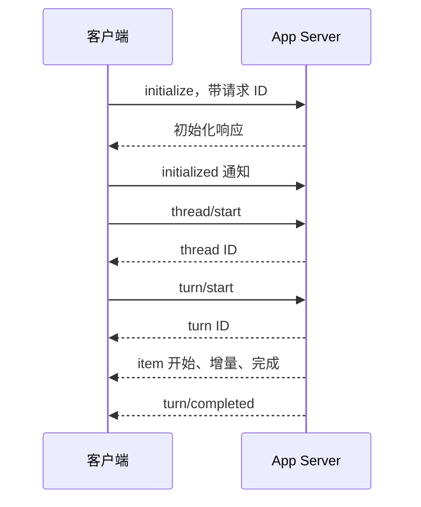

# 第 15 章：App Server 客户端要理解状态

<!-- block: codex-ch15.b-opening -->
app-server 把会话能力暴露为请求与事件；客户端必须完成握手、关联标识、处理审批并等待回合终态。

如果你要把 Codex 接进编辑器、内部页面或自动化服务，解析终端文字不是可靠接口。app-server 提供结构化协议，但它也把一部分责任交给客户端：连接初始化、请求关联、事件更新、审批显示、断线重连。只发一条 `turn/start` 并等待第一段文字，不能构成完整客户端。

## 15.1 先生成当前二进制的协议文件

```powershell
codex.cmd app-server generate-json-schema --out .scratch/codex-schema
```

本机固定 0.167.0 实际生成了 322 份 JSON 文件。实验检查了 `initialize`、`thread/start`、`turn/start` 与 `turn/interrupt` 在生成结构中存在。这里没有启动模型会话，也没有向远端发送请求。

静态生成的价值是避免客户端凭记忆拼字段。协议会演进，实验方法也会有能力开关；从同版本生成 schema，再核对服务端实际行为，比从一篇几个月前的博客复制 JSON 稳妥。

文件数量只是此次产物统计，不是 API 稳定性承诺。下一版增加几个文件，不必然意味着全部方法都改变；相反，只改一个枚举，也可能让旧客户端无法解析终态。

本次生成结果里还有一个容易误读的细节：`v2/ThreadStartParams.json` 的 `AskForApproval` 类型仍能表达 `untrusted`、`on-request`、`never` 和 `granular` 对象。但同版本 CLI 帮助只列出 `on-request` 与 `never`，配置加载代码还明确拒绝用户显式设置 `approval_policy = "untrusted"`。schema 描述可表达的协议数据，具体入口另有约束；不能据此把 `untrusted` 抄回 CLI 配置。实现客户端时，应同时检查字段类型、入口校验和服务端响应。

## 15.2 握手在业务请求之前

官方当前 app-server 文档要求每个连接先发送 `initialize`，再发 `initialized` 通知。客户端元数据说明是谁连接，能力字段决定能否使用部分实验功能。不要把第一次业务请求同时当作初始化。

```json
{"id":1,"method":"initialize","params":{"clientInfo":{"name":"book_client","title":"Book Client","version":"0.1.0"}}}
```

```json
{"method":"initialized","params":{}}
```

这些是协议说明片段，实际传输格式按对应接口和生成类型核对。stdio 模式下应逐行收发结构化消息，诊断输出不能混进协议流。WebSocket 模式还要另外处理监听、认证和连接范围，不能为了开发方便默认暴露到所有网卡。

## 15.3 请求响应与通知不是同一件事

请求带 ID，响应回传对应 ID；通知描述状态变化，不一定对应你刚发出的某条请求。`turn/start` 的响应说明回合已经建立或接受，不代表所有工具执行完成。客户端必须继续消费 item 与 turn 事件。



图 15-1：客户端应保存的最小状态链。真实流程还可能穿插审批、错误和取消。

把请求 ID 当作线程 ID 是一种常见实现错误。请求 ID 只关联一次通信，thread ID 关联历史，turn ID 关联回合，item ID 关联具体活动。明确的数据模型能减少重连后把状态更新到错误 UI 卡片的问题。

## 15.4 审批请求要求客户端回话

服务端可能反向请求命令或文件变更审批。客户端需要把实际内容展示给有权决定的人，并用原请求的关联信息回应。不能因为客户端没有实现某类请求，就默认批准或静默丢弃。

钉版文档中的 managed human checkpoint 尤其说明了能力协商的重要性：需要公布 `experimentalApi` 和 `requiredHumanApproval` 能力的客户端才参与对应流程；没有可用的合格连接时命令被拒绝。界面支持不完整时，应明确报告不支持，而不是假装代理卡住。

用户取消审批与工具执行失败也要分别呈现。前者可能是有意中止，后者需要排错；若 UI 全部显示红色“未知错误”，用户会反复重试本来不该继续的动作。

## 15.5 取消的响应并不总等于资源已释放

协议中的中断请求用于推动活动回合停止。客户端应随后等到终态或重新读取状态，再更新按钮和任务记录。收到一个确认响应，只能证明请求被处理到某个阶段，不能自动证明所有子进程和外部操作已经回滚。

钉版 app-server README 对部分取消 API 也特别区分信号确认与原请求独立完成。虽然那些接口各有细节，这个原则适用于客户端设计：把“取消已请求”和“已停止”作为两个状态，避免用户以为系统已经完全静止。

## 15.6 重连需要补状态，不只重开套接字

连接断开期间可能发生工具完成、审批等待或回合结束。重连后只继续接收新事件，可能遗漏过去那段变化。客户端应保存 thread 身份，并根据协议读取当前状态与必要历史，然后再恢复展示。

分页历史同样需要正确处理游标。钉版文档说明，某些列表请求会在存储不可用时返回错误，而成功响应中 `nextCursor: null` 才表示耗尽。不能把错误响应当作空列表，否则 UI 会把暂时故障显示成“历史被删除”。

需要并发更新的字段也不应随意覆盖。比如阅读状态使用不透明 revision 做相等检查，冲突时应刷新再让用户决定；不要把 revision 当时间戳比较大小。客户端一旦自己发明了未在协议中定义的排序规则，就可能造成难以复现的数据覆盖。

## 15.7 一个最小客户端应先达到什么程度

先只实现本地 stdio、握手、开始线程、开始回合、显示文字与工具状态、拒绝不支持的服务器请求、取消和明确终态。确认这些行为之后，再加多标签页、历史搜索、自动重连或远端服务。

每加一个功能都找一个失败例子。多标签页要检查事件路由，重连要检查遗漏事件，审批要检查迟到回应，历史分页要检查存储错误。协议结构能帮你写类型，真正的客户端可靠性仍来自这些状态转换。

## 来源

[固定 app-server 说明](https://github.com/openai/codex/blob/086ccc833bc9cf01024ad2dd6af7dbd421b6bf9a/codex-rs/app-server/README.md)、[协议类型目录](https://github.com/openai/codex/tree/086ccc833bc9cf01024ad2dd6af7dbd421b6bf9a/codex-rs/app-server-protocol)、[官方当前握手说明](https://learn.chatgpt.com/docs/app-server)、[静态生成实测](https://github.com/zhuguang-ZFG/claude-code-book/blob/main/codex/facts/local-cli-20261110.json)。
