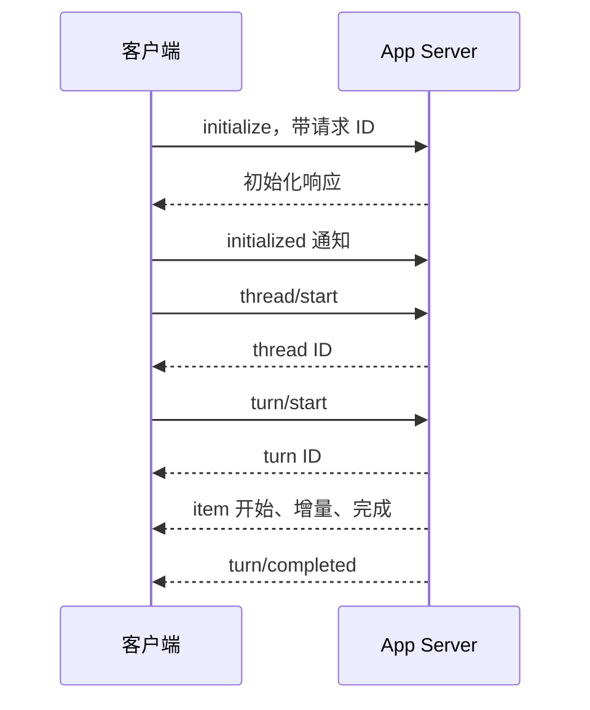
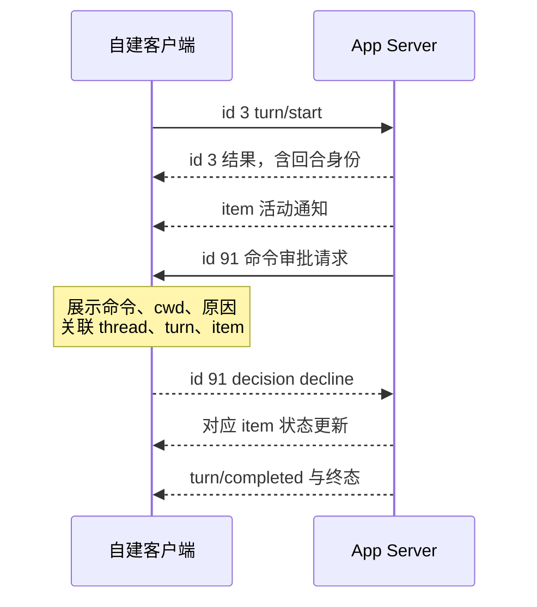

# 第 15 章：App Server 客户端要理解状态

<!-- block: codex-ch15.b-opening -->
app-server 把会话能力暴露为请求与事件；客户端必须完成握手、关联标识、处理审批并等待回合终态。

如果你要把 Codex 接进编辑器、内部页面或自动化服务，解析终端文字不是可靠接口。app-server 提供结构化协议，但它也把一部分责任交给客户端：连接初始化、请求关联、事件更新、审批显示、断线重连。只发一条 `turn/start` 并等待第一段文字，不能构成完整客户端。

## 15.1 先生成当前二进制的协议文件

```powershell
codex.cmd app-server generate-json-schema --out .scratch/codex-schema
```

本机固定 0.167.0 实际生成了 322 份 JSON 文件。实验检查了 `initialize`、`thread/start`、`turn/start` 与 `turn/interrupt` 在生成结构中存在。这里没有启动模型会话，也没有向远端发送请求。

<!-- block: codex-ch15.b-term-schema -->
静态生成的价值是避免客户端凭记忆拼字段。协议会演进，实验方法也会有能力开关；从同版本生成 schema，再核对服务端实际行为，比从一篇几个月前的博客复制 JSON 稳妥。

文件数量只是此次产物统计，不是 API 稳定性承诺。下一版增加几个文件，不必然意味着全部方法都改变；相反，只改一个枚举，也可能让旧客户端无法解析终态。

本次生成结果里还有一个容易误读的细节：`v2/ThreadStartParams.json` 的 `AskForApproval` 类型仍能表达 `untrusted`、`on-request`、`never` 和 `granular` 对象。但同版本 CLI 帮助只列出 `on-request` 与 `never`，配置加载代码还明确拒绝用户显式设置 `approval_policy = "untrusted"`。schema 描述可表达的协议数据，具体入口另有约束；不能据此把 `untrusted` 抄回 CLI 配置。实现客户端时，应同时检查字段类型、入口校验和服务端响应。

## 15.2 握手在业务请求之前

官方当前 app-server 文档要求每个连接先发送 `initialize`，再发 `initialized` 通知。客户端元数据说明是谁连接，能力字段决定能否使用部分实验功能。不要把第一次业务请求同时当作初始化。

```json
{"id":1,"method":"initialize","params":{"clientInfo":{"name":"book_client","title":"Book Client","version":"0.1.0"}}}
```

```json
{"method":"initialized","params":{}}
```

这些是协议说明片段，实际传输格式按对应接口和生成类型核对。stdio 模式下应逐行收发结构化消息，诊断输出不能混进协议流。WebSocket 模式还要另外处理监听、认证和连接范围，不能为了开发方便默认暴露到所有网卡。

## 15.3 请求响应与通知不是同一件事

请求带 ID，响应回传对应 ID；通知描述状态变化，不一定对应你刚发出的某条请求。`turn/start` 的响应说明回合已经建立或接受，不代表所有工具执行完成。客户端必须继续消费 item 与 turn 事件。



图 15-1：客户端应保存的最小状态链。真实流程还可能穿插审批、错误和取消。

把请求 ID 当作线程 ID 是一种常见实现错误。请求 ID 只关联一次通信，thread ID 关联历史，turn ID 关联回合，item ID 关联具体活动。明确的数据模型能减少重连后把状态更新到错误 UI 卡片的问题。

## 15.4 审批请求要求客户端回话

服务端可能反向请求命令或文件变更审批。客户端需要把实际内容展示给有权决定的人，并用原请求的关联信息回应。不能因为客户端没有实现某类请求，就默认批准或静默丢弃。

钉版文档中的 managed human checkpoint 尤其说明了能力协商的重要性：需要公布 `experimentalApi` 和 `requiredHumanApproval` 能力的客户端才参与对应流程；没有可用的合格连接时命令被拒绝。界面支持不完整时，应明确报告不支持，而不是假装代理卡住。

用户取消审批与工具执行失败也要分别呈现。前者可能是有意中止，后者需要排错；若 UI 全部显示红色“未知错误”，用户会反复重试本来不该继续的动作。

## 15.5 取消的响应并不总等于资源已释放

协议中的中断请求用于推动活动回合停止。客户端应随后等到终态或重新读取状态，再更新按钮和任务记录。收到一个确认响应，只能证明请求被处理到某个阶段，不能自动证明所有子进程和外部操作已经回滚。

钉版 app-server README 对部分取消 API 也特别区分信号确认与原请求独立完成。虽然那些接口各有细节，这个原则适用于客户端设计：把“取消已请求”和“已停止”作为两个状态，避免用户以为系统已经完全静止。

## 15.6 重连需要补状态，不只重开套接字

连接断开期间可能发生工具完成、审批等待或回合结束。重连后只继续接收新事件，可能遗漏过去那段变化。客户端应保存 thread 身份，并根据协议读取当前状态与必要历史，然后再恢复展示。

分页历史同样需要正确处理游标。钉版文档说明，某些列表请求会在存储不可用时返回错误，而成功响应中 `nextCursor: null` 才表示耗尽。不能把错误响应当作空列表，否则 UI 会把暂时故障显示成“历史被删除”。

需要并发更新的字段也不应随意覆盖。比如阅读状态使用不透明 revision 做相等检查，冲突时应刷新再让用户决定；不要把 revision 当时间戳比较大小。客户端一旦自己发明了未在协议中定义的排序规则，就可能造成难以复现的数据覆盖。

## 15.7 一个最小客户端应先达到什么程度

先只实现本地 stdio、握手、开始线程、开始回合、显示文字与工具状态、拒绝不支持的服务器请求、取消和明确终态。确认这些行为之后，再加多标签页、历史搜索、自动重连或远端服务。

每加一个功能都找一个失败例子。多标签页要检查事件路由，重连要检查遗漏事件，审批要检查迟到回应，历史分页要检查存储错误。协议结构能帮你写类型，真正的客户端可靠性仍来自这些状态转换。

## 15.8 从七份消息建立最小协议练习

`fixtures/app-server-requests.json` 保存了七个教学消息，分别对应初始化、创建 thread、开始 turn、中断、恢复、服务端命令审批和客户端拒绝答复。它们的参数或结果已经对固定 CLI 生成的 schema 校验，但没有发送到真实 app-server。外层 id 与 method 用于说明协议封装，校验脚本验证的是相应 params/result 的数据形状。

先发初始化请求，再发 initialized 通知，之后才进入业务请求。下面两条是完整教学消息：

```json
{"id":1,"method":"initialize","params":{"clientInfo":{"name":"parcel_book","version":"0.1.0","title":"Parcel workshop"}}}
```

```json
{"method":"initialized","params":{}}
```

clientInfo 的 name 标识调用方，version 标识客户端自己的版本。不要把它填成模型版本，也不要把某次任务 ID 当成客户端名字。能力协商应来自你实际实现的功能；如果界面没有审批请求处理器，就不应该宣称自己支持相应人工审批能力。

创建 thread 的请求可以使用只读模式，先分析运费失败：

```json
{"id":2,"method":"thread/start","params":{"cwd":"C:/work/parcel","approvalPolicy":"on-request","sandbox":"read-only"}}
```

服务端响应后，要从真实结果取 thread 身份，不能使用教材里的 `fixture-thread`。业务请求接着带这一身份：

```json
{"id":3,"method":"turn/start","params":{"threadId":"fixture-thread","input":[{"type":"text","text":"Explain the 1001 g failure.","text_elements":[]}]}}
```

这里的 `text_elements` 是生成类型中的字段，空数组表示本条文本没有额外元素描述。threadId 使用 camelCase，而 Hook stdin 的 turn_id 使用下划线。这不是格式喜好问题，是两个接口的实际字段名。静态练习故意把 threadId 改成 thread_id，校验器会指出缺少必需字段。

## 15.9 服务端也会成为请求方

很多初次实现只写“发请求，等响应”的循环，一收到没有自己生成 ID 的消息就丢掉。这会漏掉审批。app-server 能向客户端发起请求，客户端此时承担响应方职责；它必须让有权决定的人看到具体动作，再回传相同请求 ID。



图 15-2：同一连接上的双向请求。id 91 由服务端发起，不能拿客户端的待响应表把它当成异常响应丢弃。

实现分发时先区分有 method 的请求/通知与只有 result/error 的响应，再按是否有 id 判断是否需要回话。对自己不支持的服务器请求，应按协议返回明确错误或拒绝路径；静默丢弃会让远端等待，用户只看到“代理卡住”。

审批对象还可能在用户决定前失效。当前 turn 被中断、线程切换、连接断开后，界面应更新待审批状态。不能把旧卡片的“接受”按钮继续留着，再把结果发给新的请求。最少保存连接身份、请求 ID 和业务身份三者的关联。

## 15.10 静态 schema 检查器可以证明到哪一步

先用固定二进制生成协议，再从同一固定源码取得 Hook schema：

```powershell
codex.cmd app-server generate-json-schema --out .scratch/codex-schema
python -B codex/examples/check_protocol.py `
  --schema .scratch/codex-schema `
  --hooks-schema PATH_TO_PINNED_SOURCE/codex-rs/hooks/schema/generated
```

脚本使用 Python 的 jsonschema 库，按文件内 Draft 7 声明验证。本次实跑使用 jsonschema 4.26.0；它是本练习的额外依赖，安装命令为 `python -m pip install -r codex/examples/requirements.txt`。`--hooks-schema` 是明确的本地目录，检查脚本不会联网下载，也不会读取用户认证信息。

程序先对 schema 自身做结构检查，再校验七份消息参数/结果；随后检查错误字段名、两份 Hook 输入与处理器输出，以及缺少 turn_id 的坏 Hook 输入。成功输出 `passed: true`，并给出各 schema 的 SHA-256。哈希使读者可以确认检查所依据的文件版本，而不仅是一个口头“最新版”。

它不能证明 service 会接受某个 cwd、能找到 thread、允许某种模型、完成握手或执行工具。JSON Schema 表达类型和局部结构，服务端还有上下文约束。例如生成类型含有某个枚举值，具体配置入口仍可能拒绝它；第 12 章的 PreToolUse allow 就给出了类似例子。

## 15.11 从事件更新一个小状态表

客户端不必一开始做复杂界面。可以先维护以下状态：

```text
connection: 初始化中 / 可用 / 断开
pending_requests[id]: 等待本端请求的响应
pending_approvals[id]: 等待用户决定的服务端请求
threads[thread_id].turns[turn_id]: 当前回合状态
items[item_id]: 工具、消息等活动的最新状态
```

这张表是客户端自己的设计，不是要求照抄服务端内部结构。它的作用是让每种消息都有归宿：初始化响应改变连接阶段，turn/start 响应确认业务身份，item 通知更新活动，审批请求进入单独集合，中断请求进入 pending_requests，终态通知改变回合状态。

收到新的正文片段时，更新对应消息项；不要用“界面最近一次有文字”当作回合结束条件。收到终态时，先确认 threadId 和 turnId，再关闭对应忙碌状态。并发标签页会让“当前屏幕上的 thread”与“刚收到事件的 thread”不同，硬编码一个全局 current_turn 很容易把一个任务的完成通知应用到另一个任务。

对重复或迟到通知，应选择明确策略。只做展示时，保存服务端最新完整对象通常比盲目追加稳妥；涉及增量时，还需要按协议说明处理顺序。没有序号或幂等契约的地方，不要凭客户端时间戳自行宣布某条消息必然较新。

## 15.12 中断与恢复也需要真实身份

```json
{"id":4,"method":"turn/interrupt","params":{"threadId":"fixture-thread","turnId":"fixture-turn"}}
```

中断请求同时指明 thread 和 turn，防止把某个线程后面新开始的回合误停。请求响应之后仍要等状态确认。若连接在此刻断开，重新连接并恢复/读取 thread，才知道实际到了什么阶段；不能把本地“已经点击取消”保存成服务端完成状态。

恢复消息可保留只读配置：

```json
{"id":5,"method":"thread/resume","params":{"threadId":"fixture-thread","cwd":"C:/work/parcel","approvalPolicy":"on-request","sandbox":"read-only"}}
```

本章没有伪造完整服务端响应，因为 thread 对象、turn 内容与具体运行相关。读者连接自己的服务时，应保存实际响应并对同版 schema 验证，再观察它如何映射到上面的客户端状态表。教材的静态请求用于减少字段错误，真实连接记录用于验证状态变化，两份证据可以并存，不能相互冒充。

## 来源

[固定 app-server 说明](https://github.com/openai/codex/blob/086ccc833bc9cf01024ad2dd6af7dbd421b6bf9a/codex-rs/app-server/README.md)、[协议类型目录](https://github.com/openai/codex/tree/086ccc833bc9cf01024ad2dd6af7dbd421b6bf9a/codex-rs/app-server-protocol)、[官方当前握手说明](https://learn.chatgpt.com/docs/app-server)、[静态生成实测](https://github.com/zhuguang-ZFG/claude-code-book/blob/main/codex/facts/local-cli-20261110.json)。

[固定协议生成文件目录](https://github.com/openai/codex/tree/086ccc833bc9cf01024ad2dd6af7dbd421b6bf9a/codex-rs/app-server-protocol/schema/json)。
