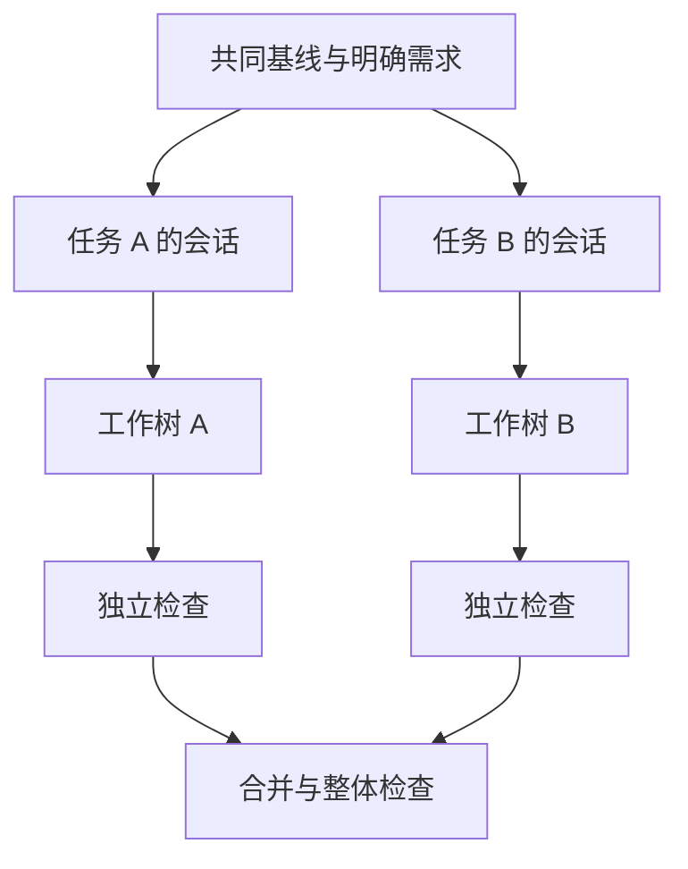

# 第 16 章：并行任务先隔离工作树

<!-- block: codex-ch16.b-opening -->
多个会话可以并行思考，但代码修改应有明确文件责任和独立工作状态；会话分支不能代替 Git 工作树隔离。

让两个代理同时修一个项目，看起来速度翻倍，实际可能互相覆盖。一个修改接口，另一个根据旧接口写测试；一个格式化全仓，另一个正在审阅差异。并行的难点不是能开多少进程，而是怎样让每个结果有清楚边界。

## 16.1 先按责任拆任务

适合并行的任务有相对独立的输入输出。例如一个负责文档与示例，另一个负责数据库适配，第三个负责 UI；但共享类型、公共配置和依赖锁需要指定一个负责人。不要只分成“实现”“优化”“完善”，这几个词很可能同时触碰所有文件。

每个任务说明至少包含目标、允许修改的目录、共同接口、验证命令与禁止覆盖的已有修改。代理还应知道其他人也在工作，遇到新变化先理解与协调，不能用还原命令清理掉不属于自己的差异。

## 16.2 工作树隔离文件状态

```powershell
git worktree add ../task-parser -b task/parser
git worktree add ../task-docs -b task/docs
```

每个工作树有自己的已检出文件和分支，适合两项独立修改。它们仍共享 Git 仓库的部分内部数据，也可能共享系统工具、全局缓存、外部数据库和账号。因此工作树隔离不是进程沙箱，更不是所有资源的独占环境。

固定 CLI 也提供 `--worktree` 托管工作树入口。使用自动创建前仍应理解它选择的基线、目录和分支，以及完成后如何取回结果。不要因为工具替你创建目录，就省略结果合并与清理检查。

## 16.3 会话 fork 解决的是上下文分支

你可以把同一问题交给两条 fork 会话，比较两种算法；但若它们指向同一工作目录，仍会编辑同一文件。相反，两个 Git 工作树如果沿用同一段过时任务描述，也可能各自做出一致却错误的修改。



图 16-1：会话与文件状态同时划清范围，合并后仍需整体检查。

## 16.4 交付接口要能被另一项任务使用

并行前先确定数据结构、文件位置和公共约定。比如文档 agent 需要知道命令最终叫什么，测试 agent 需要知道错误返回形状。接口未定时，可以先做只读研究或准备独立用例，等待接口明确后再改依赖部分。

沟通内容也应具体。说“接口改了”不够，应该说明文件、字段、旧值与新值，以及谁需要跟进。让每个代理独立搜索整个仓库重新猜一遍，会浪费并行收益。

对于共享文件，可以让一方给出补丁建议，由负责人统一应用。这样比约定“大家尽量别冲突”更可操作。锁文件和构建注册表尤其适合集中维护，否则每个任务都可能生成不同顺序或删除别人的条目。

## 16.5 合并冲突揭示的是未解决的设计问题

文本冲突可以机械选择一边，但语义冲突不一定出现冲突标记。例如两个分支各自通过测试，合并后一个更改错误类型，另一个仍捕获旧类型。整体检查应覆盖交界处，而不只是把两个分支的绿色结果加在一起。

合并时先读两边意图，再形成最终实现；不要简单保留行数更多的一边。测试失败则回到共同契约，判断是实现回归还是测试假设已经过时。解决后更新文档与示例，让仓库只保留一套当前行为。

## 16.6 取消子任务与清理目录

子任务取消后，已经产生的文件和提交仍可能有价值。先记录状态，再决定保留、合并或丢弃。清理工作树前检查其中有没有未提交修改，确认它确实属于已结束任务。

自动化清理应验证绝对路径落在指定任务根目录，避免字符串拼错后删除用户工作。对于 Windows，保持一种 shell 完成路径检查与删除，不要在 PowerShell 中枚举再把未转义路径传给另一层 shell。

并行开发的成果是更短的总交付时间，而不是更多并发数字。任务太小却花大量时间协调，反而不如顺序完成；任务太大又没有边界，则容易返工。用接口清楚、能独立验证的模块做分界，才更容易获得稳定收益。

## 来源

[exec 工作树入口](https://github.com/openai/codex/blob/086ccc833bc9cf01024ad2dd6af7dbd421b6bf9a/codex-rs/exec/src/worktree.rs)、[CLI 工作树参数](https://github.com/openai/codex/blob/086ccc833bc9cf01024ad2dd6af7dbd421b6bf9a/codex-rs/cli/src/main.rs)。本章协作规范是工程方法，不声称 Codex 会自动安排所有文件所有权。
