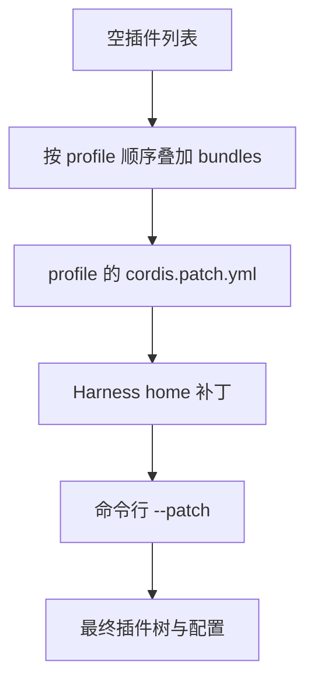

# 第 1 章：项目入口与第一次运行

<!-- block: deepseek-ch01.b-opening -->
第一次启动 dsh，最容易弄混的不是模型名称，而是三个目录：你从哪里启动、配置从哪里读取、运行程序本身装在哪里。把它们当成同一件事，后面安装插件、切换项目和恢复会话都会显得不可预测。

## 1.1 先辨认安装、工作区与 Harness home

CLI 安装目录放程序与安装级依赖；启动时的工作目录默认成为工作区；Harness home 保存 profile、用户补丁和应用数据。源码快照把应用启动统一到 `dsh`，Web、headless、SDK、ACP 通过 profile 选择。不要看到仓库里某个可执行测试文件，就把它当成另一个稳定的应用入口。

建议第一次使用时，在一个专门的临时项目中启动。先创建一份只含几行文本的 fixture，再记录 Node 与 dsh 版本；不要直接选一个有大量未提交修改的日常仓库。这个做法的作用是让第一次工具结果可解释：读到什么、写了什么、停止后剩下什么，都能与已知初态比较。

```powershell
node --version
dsh --version
$env:DSH_HOME = Join-Path $PWD '.dsh-book-home'
dsh --profile web --dump-config
```

这里的 DSH_HOME 只修改当前终端的子进程环境，退出终端后不会成为系统默认值。dump-config 用来查看将要组合的插件树，不需要发送模型任务。若调用的是源码安装，请先按照该提交的 package.json 准备依赖并构建；不能把未构建的仓库目录等同于已安装 CLI。

## 1.2 一份 profile 是怎样拼出来的

profile 是有名字的组合，bundle 是分发配置行和插件代码的容器。本快照内置 web、headless、sdk、sdk-minimal、acp 模板。通常先装共享 base，再加对应应用；sdk-minimal 是例外，它自己的 bundle 声明完整树，不依赖 base。



图 1-1：补丁层的先后关系。某一层命中配置行时，需要确认它替换的是完整 config，不能默认所有字段都会深度合并。

这解释了一个常见现象：修改 bundle 内文件没有效果，却修改 profile 补丁就有效。后层可能已经覆盖了同一个 row。排错时保留 dump-config，搜索该 row 的 id，再与声明层比较。只看“我改过哪个文件”无法说明运行时最后用了哪个值。

## 1.3 选择启动方式

| 入口 | 适用任务 | 需要另外确认的结果 |
| --- | --- | --- |
| `dsh web --no-open` | 本机浏览器交互 | 服务地址、认证和浏览器连接 |
| `dsh --profile headless "任务"` | 一次性自动任务 | 退出码、最终答案、持久会话 |
| `dsh --profile sdk` | 程序控制代理 | JSON-RPC 协议和关闭流程 |
| `dsh --profile sdk-minimal` | 较小 SDK 组合 | 缺少哪些 base 能力 |
| `dsh --profile acp` | 自动化客户端 | stdio 连接和断开语义 |

启动器只解析自己的参数，后面的应用参数交给选定的 profile。例如 `dsh --help` 与 `dsh --profile web --help` 问的是不同层。把一个 mode 的参数放到另一个 mode 上，不应期待它被悄悄兼容。

本书不使用浮动的 `npx @deepseek-ai/dsh` 证明固定快照行为。日常尝鲜可以采用官网命令，复现实验则应保留实际解析版本和 lockfile。仓库根 Node 要求是 `>=24.9.0`；本机组件实验使用 Node 24.14.0。运行时满足最低版本，仍不表示全部原生依赖已就绪。

## 1.4 第一项任务只要求读懂文件

准备一个 fixture.txt，写入唯一标记，例如 BOOK_REVIEW_ALPHA。任务写成“读取 fixture.txt，报告首行和行数，不修改任何文件”。第一次检查的是工具链是否连接，不是模型能否完成复杂推理。查看任务的会话标识、模型路由、工具调用与结果，并比较前后文件内容。

如果模型回答了标记，却没有对应工具结果，不能据此断言读文件已发生：标记可能来自提示词、历史或者测试替身。更可靠的证据是工具执行记录包含目标路径，并且返回正文进入后续请求。第 7 章会解释怎样从日志区分用户输入与工具回喂。

有些读者会先加几十个插件，再跑第一项任务。这样失败时可能同时涉及配置覆盖、服务依赖、模型选择和 UI 连接。先把最小路径跑通，再一次加一个能力，才能知道是哪一层改变了行为。完整 Web 首次启动在本册没有实跑，附录 C 保留这一项；后面马上可以运行的，是不需要账号的真实 Cordis 组件实验。

<!-- deepened: 01 -->

## 1.5 本书实验目录怎样准备

为了先学插件机制，不必第一天就把完整 Web 应用和模型账号配置好。书仓把实验工具放在 deepseek/examples，把下载的框架与 npm 依赖放在 .scratch/deepseek-runtime。前者是可审阅教材，后者是可重新准备的运行环境。两种文件分开，Git 差异里就不会突然出现整份上游仓库。

```text
deepseek/
  examples/review-lab.mjs          业务服务与插件
  examples/check-review-lab.mjs   连续实例断言
  examples/check-cordis.mjs       七个基础场景
  facts/                         版本、摘要与结果
.scratch/deepseek-runtime/
  pinned-cordis/src/              固定提交源码
  node_modules/                  tsx 与运行依赖
```

prepare-cordis.ps1 从完整提交地址取得九个源码文件，先恢复 API 提供的原始字节，再校验摘要。直接把终端里的源码文字复制到文件，可能受控制台编码影响；本轮核对时就发现 logger.ts 的非 ASCII 内容曾被错误解码。取得源文件后对照 Git blob，才确认运行的是同一份逻辑内容。

机器策略若禁止运行 PowerShell 脚本，错误发生在准备工具入口，不能写成 Cordis 初始化失败。保持系统策略，使用已准备且通过摘要检查的目录，或者在允许脚本的开发环境完成准备。不要通过删掉 hash 验证、换用机器上另一份同名包来“修复”，那会失去固定实验的前提。

## 1.6 从命令输出判断停在哪一层

`node --version` 检查运行时可执行文件；tsx loader 负责把 TypeScript 源码交给 Node；--source 决定加载哪个 index.ts；Context 构造之后才进入插件实验。报错堆栈里如果还没有 Context、Fiber 或业务插件，通常仍在模块解析与环境准备层。

相反，脚本已经打印前几项 PASS，后面 assert.equal 失败，说明框架能加载，某个行为与断言不符。应该保留失败场景名与实际值，核对固定源码和示例是否被改过。把这种错误当成安装故障而重新装全局包，既浪费时间，又可能引入新版本。

完整 dsh 的启动又多了一层 profile 组合。dump-config 回答准备装什么，readiness 回答需要的能力是否活跃，第一项任务回答模型与工具能否合作。它们的成功条件各不相同。读者先在组件实验里看到实际状态，再进入完整宿主时，就能把同类故障定位到更小范围。

## 1.7 给第一次运行留下有用的记录

不必截取整个终端。保存源码提交、Node 版本、准确命令、退出码与最终 JSON 就足够重跑；发生错误时再附对应堆栈。绝对用户名路径、临时端口和凭据不应成为公开教材必需部分。facts 采用这种形式，所以别人可以换目录运行，同样比较语义结果。

这份目录组织还有一个实际好处：你可以复制一个业务插件副本来尝试错误写法，保留原示例与摘要不变。原基线用于确认环境，副本用于学习修改的后果。等你确实要把改动纳入教材，再更新来源、断言和记录，不把练习中间态混进成功证据。

## 固定版本来源

- [apps/cli/README.md](https://github.com/deepseek-ai/deepseek-harness/blob/fcc0ad462172522aaf5c93a7b2e01f6b9f0b0159/apps/cli/README.md)
- [packages/boot/app-boot/README.md](https://github.com/deepseek-ai/deepseek-harness/blob/fcc0ad462172522aaf5c93a7b2e01f6b9f0b0159/packages/boot/app-boot/README.md)
- [docs/architecture.md](https://github.com/deepseek-ai/deepseek-harness/blob/fcc0ad462172522aaf5c93a7b2e01f6b9f0b0159/docs/architecture.md)
