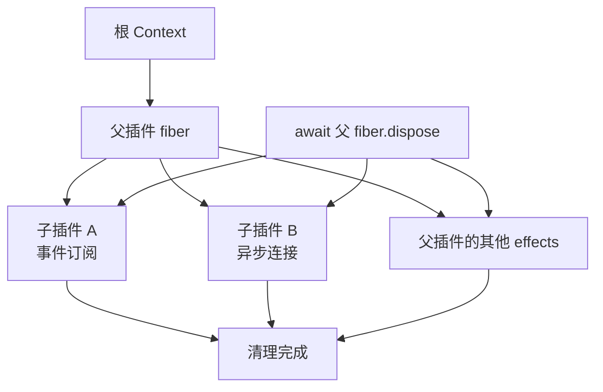

# 第 3 章：插件注册、卸载与资源清理

<!-- block: deepseek-ch03.b-opening -->
插件最难写的往往不是加载，而是第二次加载。第一次创建的监听器还活着，第二次又注册一个，同一条事件就执行两遍；第一次开出的连接没人关闭，重载几次后程序开始卡住。Cordis 的 effect 机制把这些资源交给拥有它们的 fiber 管理。

## 3.1 谁创建资源，谁声明撤销动作

ctx.on 注册的监听器已经是受管资源。对框架不知道的连接、定时器或文件观察器，需要使用 ctx.effect。effect 主体返回撤销函数，fiber 清理时执行它。

```javascript
ctx.effect(() => {
  record('resource:open');
  return async () => {
    await Promise.resolve();
    record('resource:closed');
  };
});
```

这是本书实验中的资源替身，用来验证真实 Cordis 的异步清理协议。没有真的连接数据库，因此结果证明的是“宿主等待异步 disposer”，不是某个数据库驱动的关闭保证。把它换成 socket 时，还需要确认 close 事件、待发数据和超时是否按驱动契约完成。

若资源在创建到一半就失败，还没来得及返回撤销函数，框架不可能凭空知道句柄在哪。插件应把局部 try/finally 放在资源取得过程附近，或者先注册一个能处理部分初始化状态的清理动作。effect 管理已有的撤销约定，不会猜测外部库的副作用。

## 3.2 挂载句柄指向这一次实例

ctx.plugin 返回 fiber。保留它，才能明确卸载的是哪一次挂载。以插件函数名字去全局搜索再删除，容易在快速重载时删错新实例。

```javascript
const fiber = root.plugin(reviewObserver(record));
await fiber.await();
root.emit('book/review', 'a.ts');
await fiber.dispose();
root.emit('book/review', 'b.ts');
```

组件实跑先记录 `review:1:a.ts`，dispose 完成后出现 `resource:closed`，再发 b.ts 没有新增审查事件。它同时验证监听器消失与自定义资源关闭，避免只盯着 dispose 是否被调用。

不要把“disposer 被调用”直接写成“操作撤销了”。已发出的邮件、已提交的数据库事务、已落盘的文件都需要自己的补偿设计。我们的失败实验把一条记录写入外部数组，插件启动失败后那条记录仍存在；受管监听和 effect 被回收，却没有回滚数组内容。

## 3.3 父插件消失时，子插件怎么办

组合插件常会挂载多个子插件。父 fiber 拥有这些挂载，清理沿所有权向下传播。



图 3-1：所有权决定清理范围。图不承诺兄弟资源严格按绘图顺序关闭。

本书的子插件返回异步清理函数，父 dispose 返回后断言 child:closed 已出现。再次 dispose 不重复关闭。这个小测试比启动两次看控制台干净更直接，因为它检查了等待边界。

如果 A 的 disposer 需要继续使用 B，不能从“都属于同一个父插件”推导出 B 一定最后关闭。应让 A 的资源所有权包含依赖，或使用框架支持的组合 effect 来明确顺序。把清理顺序寄托在代码书写位置上，是热重载中很难重现的故障来源。

## 3.4 重载不是一种动作

需要分清更新配置、重新执行插件主体、重新导入模块和重启应用。fiber.restart 描述重新加载当前插件，配置 update 还会经过更新事件；源代码 HMR 则涉及加载器、模块依赖和应用协调。进程重启又会清空另一层模块状态。

因此本章只把实际观察到的重新激活写进结果：移除 Counter 后依赖它的观察器停止，提供新 Counter 后重新工作。它没有证明浏览器插件热更新、TypeScript 文件保存监听或所有传输连接都无缝恢复。第 4 章继续讨论配置失败，第 16 章再把这些边界带到插件包升级。

开发阶段最实用的习惯是给资源分配可关联标识，记录 open 与 close，并在卸载后主动再触发一次事件。如果计数器还在增长、回调还会写文件，说明你留下了未受管资源。与其只做一次正常启动，不如先确认第二次、第三次挂载仍只产生一份效果。

## 3.5 把清理失败做成可定位的问题

真实资源比实验中的 Promise 更麻烦。假设插件启动一个文件观察器，回调把变更追加到队列，再由定时器批量处理。它至少拥有观察器、定时器和正在执行的批处理三种资源。只清掉定时器不够：观察器仍可能继续入队；只关闭观察器也不够：已经排队的批处理可能稍后写文件。

可以先画出关闭协议：停止接收新事件，停止产生新批次，给当前批次发取消信号，等待它结束，最后释放底层句柄。这个顺序属于插件的业务契约，应该在一个受管 disposer 中表达，而不是指望框架猜测三个独立 effect 的依赖。若外部库提供整体 close 方法，先查清它究竟等待哪些动作，再决定是否还需要自己的收敛步骤。

异步清理也会挂起。例如一个连接的 close 等待服务器回应，而网络已经断了。给关闭动作设定有限等待，并保留超时记录，能避免重载永远停在 UNLOADING。超时以后是否强制销毁句柄，由驱动能力决定；不能只让等待函数返回，就宣称底层连接已经关闭。

检查这类问题时，把卸载完成后的观察窗口也纳入实验：继续发送原来的事件，确认没有新写入；检查子任务集合是否为空；再次挂载后确认只有新实例的标识出现。测试日志应保留旧实例标识，这样偶发的晚到回调会直接暴露，而不会被新一轮正常输出掩盖。

## 固定版本来源

- [vendor/cordis/src/fiber.ts](https://github.com/deepseek-ai/deepseek-harness/blob/fcc0ad462172522aaf5c93a7b2e01f6b9f0b0159/vendor/cordis/src/fiber.ts)
- [vendor/cordis/src/events.ts](https://github.com/deepseek-ai/deepseek-harness/blob/fcc0ad462172522aaf5c93a7b2e01f6b9f0b0159/vendor/cordis/src/events.ts)
- [docs/cordis-tutorial/06-composition-and-hmr.md](https://github.com/deepseek-ai/deepseek-harness/blob/fcc0ad462172522aaf5c93a7b2e01f6b9f0b0159/docs/cordis-tutorial/06-composition-and-hmr.md)
