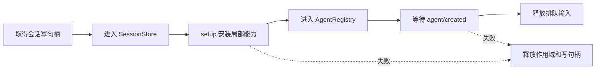

# 第 5 章：Agent 契约与具体循环

<!-- block: deepseek-ch05.b-opening -->
应用按钮写着“新建 Agent”，并不意味着按钮知道循环怎样工作。DeepSeek Harness 把 Agent 的公共行为放在 agent 包，把默认的模型—工具循环放在 agent-loop 包。这个分离决定了替换循环时到底要承担哪些责任。

## 5.1 消费者依赖公共入口

ctx.agents 管理活跃 Agent，并暴露创建与恢复入口。默认 agent-loop 注册工厂，消费者调用 ctx.agents.create 或 resume，拿到 AgentHandle；handle.dispose 是这次创建的清理责任。调用者不应直接实例化默认驱动的内部类，再把它塞进注册表。

```typescript
// 固定版本文档中的 API 形状；需要已经装配的运行时。
const handle = await ctx.agents.create({
  sessionId: 'book-review-session',
  agentOptions: { provider: 'deepseek', model: 'deepseek-chat' },
  setup: (agentCtx, agent) => {
    // 在发布 Agent 之前安装这次实例需要的局部能力。
  },
});
// 所有者结束使用时：await handle.dispose()
```

sessionId 是身份，不是随意的显示名称。复用一个已经被写持有者占用的会话，应由持久化契约阻止，而不是让两个进程同时追加。create、resume 的路由选择也不同：程序化恢复保留历史选择，初始 agentOptions 不能被当成覆盖所有保存状态的开关。

## 5.2 创建成功之前就有事务边界

固定版本的默认循环把初始化做成可回收过程：获得 Session，进入存储，完成 session/created，执行可选 setup，进入 AgentRegistry，等待 serial 的 agent/created，然后释放排队输入。这个顺序让 setup 有机会安装作用域内工具，避免第一轮已经发出请求，插件还没有准备好。

如果 setup 失败，资源要撤回，但已经持久写出的事实不会假装从未发生。观察者收到过创建公告，后面还需要匹配的清理通知。由此可以理解“原子”一词为什么必须说清对象：内存注册能被撤销，不意味着外部观察和磁盘日志也被删除。



图 5-1：默认 Agent 发布之前的准备阶段。图中的回收不包含用户代码任意副作用的回滚。

## 5.3 什么时候真的需要替换循环

只想改提示词，优先注册提示词片段；想在工具前审批，使用工具管线；想在模型错误时修复连接，使用 request-error 扩展点。因为这些工作不改变“接输入、请求模型、执行工具、继续”的基本驱动。

当任务本身是固定状态机、需要多模型投票、严格的预算调度，或者模型只在其中一个阶段参与时，替换驱动才有价值。新的驱动需要保持公共 Agent 契约：输入如何接受、取消如何传递、什么时候算结束、哪些事件持久化、每个工具请求是否配上结果、谁关闭资源。只实现一个 while 循环不够。

设计替代驱动时可以先画出它的确定性部分。例如审查流程先读取变更列表，再并发运行静态检查，最后才让模型解释结果。静态检查的运行身份和结果仍应成为可恢复事实；模型故障不能让静态检查默默重复写外部系统。

## 5.4 一个可审阅的替代驱动设计

先规定状态 `idle → collecting → checking → explaining → settled`，取消从每个活动状态进入 stopping，待执行任务收敛后才进入 settled。每一步都列出进入条件、可见输出和副作用。需要恢复时，从持久事件决定哪些阶段已经完成，不从 UI 最后一行文本猜测。

测试应刻意让 checking 的一个子任务失败，验证其他任务是否被取消、错误是否保留、解释步骤是否继续。另一个测试让取消发生在解释请求发出之前，确认没有幽灵请求。再测试重复 dispose：旧 handle 不得删除同 id 的新实例。

本册没有把这一设计冒充已跑通的自定义 Agent 工厂。实际实验只覆盖 Cordis 层的注册与清理；要交付替代驱动，需要在完整组合里沿上面的公共行为做集成测试。读者已经有足够源码地图去判断改造成本，而不是把“可替换”误解为“换一个函数就完事”。

## 5.5 工厂接口怎样保护消费者

一个 Web 路由和一个 ACP 桥接器可能同时使用 Agent 服务。它们关心的是把输入交给一个活跃 Agent、订阅输出、结束自己拥有的实例。若两者都 import 默认循环内部类，驱动升级会同时破坏两个消费者。把创建交给公共工厂后，消费者仍使用同一个接口，而替代驱动承担满足契约的责任。

这里容易漏掉的是所有权。ctx.agents.get(id) 得到可使用的 Agent，并不因此取得创建者手里的 dispose 能力。创建者持有 AgentHandle，工厂提供者也通过自身生命周期承担结构性清理责任。做一个“查看当前任务”的插件时，不能因为查到了对象，就随意关闭别的消费者创建的任务。

setup 还有一个精细边界：它可以返回同步 commit。异步准备完成后，某项可变条件可能已经改变，例如分配给任务的配置版本被另一条操作更新。commit 可以在正式发布前最后检查一次条件，并使过期准备失败。这不是让 setup 提前驱动 Agent；输入应在 create 返回之后交给实例，避免初始化尚未发布就启动模型请求。

替代驱动的设计评审可以用三个消费者检验：一个只创建和清理，一个恢复既有会话，一个只观察注册表。若某个消费者必须知道内部状态机的私有名称才能工作，说明公共契约还没被真正保留。再把创建失败放到 setup 和 agent/created 监听器两个位置，检查谁曾经收到公告、谁应收到配对的释放通知。这样的接口测试比比较两段 while 循环长得是否相似更有价值。

## 固定版本来源

- [packages/core/agent/src/index.ts](https://github.com/deepseek-ai/deepseek-harness/blob/fcc0ad462172522aaf5c93a7b2e01f6b9f0b0159/packages/core/agent/src/index.ts)
- [packages/core/agent-loop/README.md](https://github.com/deepseek-ai/deepseek-harness/blob/fcc0ad462172522aaf5c93a7b2e01f6b9f0b0159/packages/core/agent-loop/README.md)
- [docs/architecture.md](https://github.com/deepseek-ai/deepseek-harness/blob/fcc0ad462172522aaf5c93a7b2e01f6b9f0b0159/docs/architecture.md)
