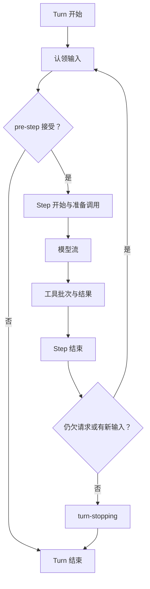

# 第 6 章：Turn、Step 与输入队列

<!-- block: deepseek-ch06.b-opening -->
用户发出一条消息，模型先要求读两个文件，随后又运行测试，最后给出解释。这是一轮用户任务，却不是一次模型请求。用 Turn 和 Step 分开记录，才能回答取消停在哪、追加输入何时生效、失败后还欠哪些工具结果。

## 6.1 两种边界解决不同问题

Step 是一次模型请求及它触发的工具工作。Turn 包含零个或多个 Step：在认领输入前开始，直到没有尚需履行的工作时结束。零个 Step 很有意义，输入可能在 pre-step 被拒绝，或者第一份输入被改写为空；日志仍能表达“尝试开启过一轮，但没有发送请求”。

不要把回车次数当成 Step 数，也不要把工具数量当成 Turn 数。一次请求可以给出多个工具调用；工具结果往往要求下一次请求解释结果。只听到模型流结束就宣布整个任务完成，会漏掉后面的工具和继续请求。

图 6-1：默认驱动的循环轮廓。真实日志还包含请求头、上下文快照与失败尝试。

## 6.2 输入不是直接塞进正在飞行的请求

默认驱动有一个 inbox。修改队列会留下规范化的 agent/inbox/spliced 事件，投影据此重建待处理输入；领取与取消是不同结果。已经在发送的模型请求被冻结，后来补充的要求应进入后续认领，而不是从旁边改写同一请求对象。

例如任务正在运行测试，你追加“只关注 Windows 的失败”。如果系统把这句立即拼进现有网络请求，那请求与日志就难以一致。通过 inbox 排队，下个被接受的 Step 才获得这条信息；UI 应呈现它仍在等待，避免用户误以为当前调用已经看见新要求。

注入上下文也不必然唤醒代理。固定版本的架构说明区分上下文材料与唤醒消息：有些材料等待下一条真正要工作的输入。用事件记录“已经插入”和“已经认领”，就能解释为什么插件提供了材料，模型暂时没有反应。

## 6.3 pre-step 与 request 各改什么

pre-step 能接受、重写或拒绝被认领消息，决策发生在 Step 准备前。step 的模型选择已经从 Session 取快照，包括 provider、model 和显式 reasoning effort。老的 agent/request 扩展点仍存在，但不能偷偷换掉这份路由选择；当前快照会拒绝这样的改变。

这使路由变化可追踪：用户选择另一个模型，应记录成会话状态，并由下一 Step 获取，而不是某个中间件临时改一个字段。重试也保留该 Step 的模型选择，避免一次失败之后无声换模型却仍被当成同一次请求。

实现观察插件时，把 request 的进入与实际 stream 开始分开计时。配置解析、适配器绑定和上下文准备也会消耗时间。只用“首 token 减用户点击”无法判断是网络慢还是本地准备慢。

## 6.4 停止不等于抹掉已经发生的事

默认 agent.cancel 使用协作式取消信号，并根据 keepInbox 选择是否保留待处理工作。流里已经交给用户的文本可能被保留为中断结果；已经执行的工具也不会倒带。取消的正确目标是停止继续产生不需要的工作，并让状态可解释。

当模型给出多个工具调用时，部分已经启动、部分还没启动。日志需要分别表达“未开始”与“结果未知”；把它们都写成失败会诱发不必要的重试。文件写入若已完成但回执丢失，再执行一次可能覆盖更新的数据。

练习时准备一个只读工具和一个延时工具，任务启动后在不同位置取消。记录取消信号时间、工具进入时间、结束事件与队列剩余项。不要只断言进程退出码；真正要核对的是每个已接受调用都有可解释的结局，以及下一轮恢复不会把尚未确认的副作用直接重做。

本章的完整循环流程来自固定版本源码与文档，未把真实模型请求纳入本册实跑。Cordis 的环绕调用实验只能帮助理解调用顺序，不能替代 inbox、持久化与取消链路的集成验证。

## 固定版本来源

- [packages/core/agent-loop/README.md](https://github.com/deepseek-ai/deepseek-harness/blob/fcc0ad462172522aaf5c93a7b2e01f6b9f0b0159/packages/core/agent-loop/README.md)
- [docs/agent-lifecycle.md](https://github.com/deepseek-ai/deepseek-harness/blob/fcc0ad462172522aaf5c93a7b2e01f6b9f0b0159/docs/agent-lifecycle.md)
- [docs/architecture.md](https://github.com/deepseek-ai/deepseek-harness/blob/fcc0ad462172522aaf5c93a7b2e01f6b9f0b0159/docs/architecture.md)
