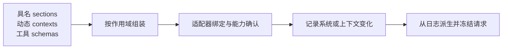

# 第 8 章：System Prompt 组装

<!-- block: deepseek-ch08.b-opening -->
给代理加一段审查要求很容易，真正需要决定的是它属于稳定系统指令，还是每次请求都会变化的运行上下文。把当前目录、临时端口和任务状态都塞进固定提示词，会让缓存与解释都变得困难。

## 8.1 片段有名字，也有顺序

system-prompt 服务接受具名 section。每段有 name、order、text；text 可以是字符串，也可以是在组装时求值的提供函数。片段按 order 升序排列，相同 order 再按名字的 code-unit 顺序决定，避免不同机器的语言排序产生差异。

```typescript
// 运行于已提供 systemPrompt 服务的插件上下文。
ctx.systemPrompt.section({
  name: 'book:review-policy',
  order: 450,
  text: '先检查正确性，再解释证据。缺少依据时明确说明。',
});
```

这是原创片段的 API 示例，完整 dsh 组装未在本册运行。名称不能随手复用；同一有效层里重复注册应暴露冲突，而不是悄悄把旧策略覆盖。需要对某个 Agent 改写时，应使用作用域规则，而不是全局删除其他插件的内容。

## 8.2 动态材料有自己的位置

PromptContext 表达组装与接纳阶段刷新的动态材料，可作为持久的 user-role 快照进入模型上下文。工作目录、运行地址和策略状态这类内容，不必与稳定身份片段混在一起。

假设代理被从 project-a 切换到 project-b。若模型每轮看到的工作目录来自一段固定字符串，工具已经切到新目录，模型却还在解释旧路径。动态提供函数能在合适时刻取新值，但取值必须有明确来源和时序，不能在渲染函数里随意读不可重放的外部状态。

工具 schema 也随组装进入请求。仅修改自然语言说明，不会让一个未注册工具出现；从提示词里删除工具名字，也不会自动撤销执行权限。这三件事要分别检查：能力注册、模型可见声明、执行策略。

## 8.3 完整替换的成本

某个 section 可以声明 complete，表示完整系统提示词。组装仍会运行协作的 waterfall 来解析工具、变量与上下文，然后恢复这份完整 section 为唯一系统片段；有效范围里多个 complete 会冲突。

使用 complete 时，作者要负责此前其他片段承担的工作：文件引用格式、工具使用约束、结构化输出要求等是否还存在。不能因为“模型回答更简短了”，就认为替换正确。先比较最终组装文本和工具列表，再运行故意缺参数、产生工具错误的任务，看新提示词能否解释结果。

模板变量默认允许插值，字面文本需要保留双花括号时应检查 interpolate。来自仓库的内容可能包含类似变量语法，不应让不可信文本意外变成模板指令。动态数据和模板语法要在注册时区分，而不是等组装后字符串看起来不对再补转义。

## 8.4 变更怎样进入下一次请求

默认循环依据 prepareCall 得到的实际能力接纳系统提示词。有的路由支持历史内系统提示词更新，有的需要把有效文本收敛到首个系统节点。空提示词还要清空已有有效版本，不能仅追加一个空字符串，让旧指令继续可见。



图 8-1：组装和真正进入请求之间还有接纳步骤。某个提供函数已经执行，不等于它的文本已发给模型。

因此调试要保存三层证据：注册了哪些提供者、组装得到什么、实际请求含什么。仅打印 section.text 不足以说明最后一层。重试也不应任意再组装一份新提示词，让同一 Step 的请求在没有相应记录的情况下改变。

## 8.5 缓存问题从前缀变化查起

重复请求是否命中缓存最终由模型提供者决定，Harness 能控制的是哪些字节稳定、哪些必须变化。给每轮系统提示词插一个当前时间，通常会破坏从该位置开始的前缀稳定性；把必要运行状态放在适当的动态上下文位置，更容易解释变化范围。

不过“放在后面”并不自动保证缓存命中。provider、model、工具声明顺序、消息替换和供应商的缓存策略都会影响结果。实验应记录实际请求摘要、token 使用与提供者返回指标，不能用本地组装速度推断远端计费节省。本册不调用真实模型，所以没有给出缓存命中率或费用数字。

<!-- deepened: 08 -->

## 8.6 一次组装前后的实际对象

SystemPrompt 的注册输入与组装结果不同。PromptSection 还可以带函数，AssembledSection 的 text 已经求值成字符串；PromptPresentation 包含 sections、contexts 与 variables，提供给 system-prompt/assemble waterfall。工具声明由工具提供者持有，不能因为 presentation 对象可变就假定监听器可以随意伪造注册能力。

可以用下面的教学数据理解排序。假设有 policy，order=100；format，order=200；还有同为 200 的 references。组装顺序先 policy，再按 code-unit 名称把 format 放在 references 前。若想改变业务顺序，应调整 order，不要依赖注册时刻或机器语言排序。

```text
注册输入：policy(100), references(200), format(200)
有效层合并：保留各自名字与最近作用域的值
排序结果：policy → format → references
求值结果：每项 text 成为本次组装的字符串
渲染结果：应用允许的变量插值，再生成提示词
```

complete 的特殊处理发生在协作组装之后：它允许其他参与者先完成上下文和变量工作，再把完整 section 恢复为唯一系统片段。因此 complete 作者无法靠“仍运行 waterfall”推断其他系统段会被拼回来。两个有效 complete 同时存在会使组装失败，让冲突显式暴露。

## 8.7 插值为什么要在注册时说清楚

审查一份模板文件时，原文可能包含 `{{ customer }}`。若这段作为提示词注册且默认启用 interpolate，渲染器可能把它当成变量引用。结果已经偏离待审查文本，模型看到的就不再是文件原样内容。字面材料应在适当的动态上下文入口保留原文，并明确 interpolate:false。

变量提供的是名称到字符串或 undefined 的映射，不应该成为任意代码求值入口。业务插件若想把“当前规则版本”交给模型，可以提供一个受控值；不要把整份配置对象直接字符串化，其中可能混有内部路径和认证。提示词组装是数据出界位置，字段选择也应在这里完成。

动态 PromptContext 的 required 表示在可选运行上下文被禁用时仍保留这项操作资料。它不把文本提升成工具权限，也不改变系统级执行边界。字段名很容易诱导误读，阅读类型注释时要同时看消费位置：它控制的是上下文保留，不是授权。

## 8.8 从一次修改定位缓存变化

把 review-policy 的一句话改掉，先比较有效 section 与最终渲染文本，再比较派生请求里哪个 system 节点变化。支持 in-history 更新的持续请求系列可能追加新版本；不能历史内更新的路由则需要把有效文本收敛到头部。空文本又要清空旧有效节点，避免旧指令意外复活。

如果真正变化的是工具 schema，不能只看 system 字符串是否相同。模型请求中的工具声明也是前缀的一部分。把标题、描述或参数枚举改了，远端缓存是否能复用要从具体请求字节和提供者策略判断。源码能帮助确定变化发生在哪里，实际费用与命中率仍由真实供应商指标回答。

## 固定版本来源

- [packages/core/system-prompt/src/index.ts](https://github.com/deepseek-ai/deepseek-harness/blob/fcc0ad462172522aaf5c93a7b2e01f6b9f0b0159/packages/core/system-prompt/src/index.ts)
- [docs/subsystems/system-prompt.md](https://github.com/deepseek-ai/deepseek-harness/blob/fcc0ad462172522aaf5c93a7b2e01f6b9f0b0159/docs/subsystems/system-prompt.md)
- [packages/core/agent-loop/README.md](https://github.com/deepseek-ai/deepseek-harness/blob/fcc0ad462172522aaf5c93a7b2e01f6b9f0b0159/packages/core/agent-loop/README.md)
