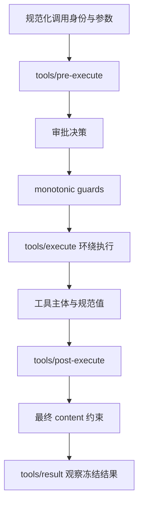

# 第 10 章：工具注册与执行管线

<!-- block: deepseek-ch10.b-opening -->
模型提出“读这个文件”，到磁盘真的被读取，中间至少要完成参数校验、权限判断、执行和结果规范化。DeepSeek Harness 把这些工作拆成可组合的管线，工具作者不必为每个工具重写一套部署策略。

## 10.1 工具定义有三个出口

一个工具首先有输入 schema，然后有 execute 返回的规范 JSON 值，最后才是给模型看的 content。UI 卡片又是另一个呈现出口。不要为了让界面好看，把原本应该是结构化对象的结果变成带标题的长字符串。

下面是一个只做字符串统计的原创教学定义。它没有文件访问，也不需要凭据，适合先理解输入与返回值约定。

```typescript
import { defineTool } from '@deepseek-ai/dsh-tools';
export const name = 'book-text-stats';
export const inject = ['tools'];
export function apply(ctx) {
  ctx.tools.register(defineTool({
    name: 'book_text_stats',
    description: '统计给定文本的行数和字符数。',
    parameters: { text: { type: 'string', required: true } },
    output: {
      schema: {
        type: 'object', additionalProperties: false,
        properties: {
          lines: { type: 'number', required: true },
          characters: { type: 'number', required: true },
        },
      },
      render: (_args, value) => [{
        type: 'text',
        text: `${value.lines} 行，${value.characters} 个字符`,
      }],
    },
    async execute({ text }, exec) {
      exec.signal.throwIfAborted();
      return { lines: text === '' ? 0 : text.split('\n').length,
               characters: [...text].length };
    },
  }));
}
```

这个片段按固定版本的统一 schema 形状说明设计，未作为完整 dsh 工具集成实跑。字符数采用 Unicode code point 计数，不是字形簇计数；组合音标和 emoji 仍可能由多个 code point 组成。即使是很小的工具，也要把业务语义写清楚。

## 10.2 定义校验保护什么

defineTool 编译参数与输出 schema，包装 execute 以验证模型参数，并把输出契约交给共用执行管线。管线再验证规范值、冻结结果并调用 renderer。类型不对、缺字段、不能无损转成 JSON 或 renderer 抛错，都需要被规范成错误结果。直接调用定义里的 execute 并不等于走完这条管线。原生 JSON Schema 直接注册的路径则由工具承担自己的输入验证。

schema 能表达 string、number、required，并不能替你判断“路径必须在项目内”“限制必须为正数”“两个参数不能同时出现”。工具作者仍要处理 DSL 无法表示的业务约束。反过来，不要在 execute 内重新解析同一份 JSON 字符串，制造与注册时 schema 不一致的第二套入口。

## 10.3 策略的次序关系



图 10-1：共用调用管线的责任顺序。拒绝和抛错会走错误归一化分支，不必进入工具主体。

pre-execute 用于可扩展策略；需要后续监听器无法撤销的最终拒绝，使用 guard。around-dispatch 适合计时和期限；post-execute 可以改变结果或附加上下文；tools/result 是观察最终结果的出口。日志插件若只想计数，应放在观察点，而不是随手截断一个决策 waterfall。

## 10.4 隐藏文本未必隐藏数据

Native 模式下模型看 content；程序化工具调用还可能取得 canonical value。若保密策略只把 content 换成“结果已隐藏”，value 仍可能保留原文。正确做法是依据威胁模型阻断整个结果，或者同时替换规范值与呈现，不能把显示处理当成数据权限。

同样，工具的 presentationMeta 和 UI presenter 不能执行 I/O。重放会反复运行展示逻辑，如果 presenter 每次都读当前文件，旧会话显示的就不再是当时结果。应该把需要重放的有限事实写进持久结果 metadata，再纯粹地渲染。

## 10.5 取消与批次不是可选细节

execute 收到的 signal 应传给底层操作。文件读取、网络请求和子进程各有不同的取消接口，不能仅在函数开头检查一次就算支持取消。批次并发与 exclusive barrier 由选定执行器负责；工具作者应该正确声明自己的并发能力，不要为了快把共享写操作标成可并行。

同一批次的结果保持模型顺序，不表示所有工具串行执行。调试性能时要分别记录开始和完成时间，再与最终结果顺序比较。遇到未知结果也不能自动重跑副作用；第 13 章会把这件事放到恢复路径里。

## 10.6 用一组输入辨认边界

对本章字符串统计工具，先输入空字符串，期望行数和字符数都是零；再输入两个汉字，期望一个逻辑行、两个 code point；最后输入末尾带换行的文本，确认是否把末尾空行计入。这个定义使用 split，所以结尾换行会产生一个空段。若产品要统计“非空行”，应修改工具描述与实现，而不能只在测试里换一个看起来更合理的期望。

再让模型参数缺少 text，或把它写成数字。期望执行主体没有运行，并且调用方取得可解释的参数错误。还要试一个额外字段：固定版本的 parameters 根是隐式开放对象，不能因为示例输出声明 additionalProperties: false，就推断输入也会拒绝额外字段。输入根和嵌套输出对象采用不同的 schema 形状，阅读时要分开。

输出错误可以通过有意返回字符串行数来触发。它应被输出契约拦住，不能先把无效数据交给 presenter。随后让 renderer 抛错，检查最终结果是否记录展示失败，同时保留可诊断的调用身份。这些检查必须走真实工具执行入口；直接调用用户写的 execute 只能观察统计函数，触不到输出校验与结果规范化。

如果后来把统计工具改成读文件，新增的已不只是一个路径参数。还需要路径解析、访问策略、文件大小上限、编码约定和取消传播。原先字符串工具的全部测试仍有价值，但不能因此宣称文件访问也安全。工具能力每跨出一个进程边界，都应把新承担的事实写进自己的契约。

## 固定版本来源

- [docs/cookbook/adding-a-tool.md](https://github.com/deepseek-ai/deepseek-harness/blob/fcc0ad462172522aaf5c93a7b2e01f6b9f0b0159/docs/cookbook/adding-a-tool.md)
- [docs/tool-execution-pipeline.md](https://github.com/deepseek-ai/deepseek-harness/blob/fcc0ad462172522aaf5c93a7b2e01f6b9f0b0159/docs/tool-execution-pipeline.md)
- [packages/core/tools/src/pipeline.ts](https://github.com/deepseek-ai/deepseek-harness/blob/fcc0ad462172522aaf5c93a7b2e01f6b9f0b0159/packages/core/tools/src/pipeline.ts)
- [packages/core/tools/src/schema.ts](https://github.com/deepseek-ai/deepseek-harness/blob/fcc0ad462172522aaf5c93a7b2e01f6b9f0b0159/packages/core/tools/src/schema.ts)
