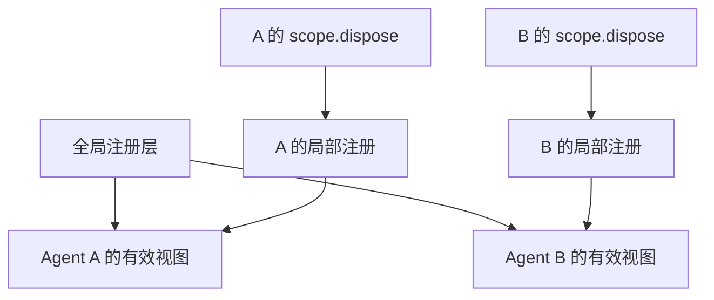

# 第 12 章：作用域与并发

<!-- block: deepseek-ch12.b-opening -->
一个审查 Agent 只读文件，另一个修复 Agent 可以修改文件。它们在同一宿主里工作，不能因为都看得见 ctx.tools，就默认拥有同一组能力。DeepSeek Harness 用作用域区分注册可见性，同时让注册的寿命跟着拥有者结束。

## 12.1 两种隔离不要混用

Cordis 的 isolate 针对服务名称建立独立解析域；Harness 的 ScopeKey 则表达某个 Agent 的不透明身份，用来选择局部注册和过滤事件。前者适合替换服务实现，后者适合让某一条工具或提示词只对一个 Agent 生效。

ScopeKey 按对象身份比较，不是把 sessionId 拼进字符串。默认循环使用活跃 Agent 对象作为键。这样旧实例与后来同 id 的新实例仍可区分，不会因为显示名称相同就共享局部注册。

## 12.2 注册上下文同时承担两件事

一个作用域上下文既决定“谁看得见”，也决定“谁结束时撤掉”。在 agent.ctx 上注册工具、提示词和监听器，比在全局注册后再写一堆 if(sessionId) 更可靠。后者容易漏掉一种事件，或者在会话重用时把旧状态带进来。

图 12-1：局部层影响可见内容，也提供清理所有权。全局能力仍可能被两个 Agent 共享。

## 12.3 局部同名项与全局项

ScopedLayers 维护全局层和按精确 scope 建立的层。读取不会凭空创建空局部层；合并时保留全局命名项顺序，再让局部同名项形成遮蔽。局部项撤销后，全局项可以重新显现，这与删除全局注册不是同一操作。

例如全局审查提示词要求通用输出，A 的局部层用同一名称换成面向安全审查的版本。A 结束只清理自己的层，B 仍读到全局版本。若作者为了“覆盖”直接改全局对象，所有并发任务都会受到影响。

同一层重复名字通常是错误信号，应该保留诊断。不要每次注册都加随机后缀来逃避冲突，那会让逻辑上应互斥的两份策略同时进入请求。需要多份匿名贡献时，使用支持该语义的注册入口。

## 12.4 服务隔离实验说明什么

本册已运行两个 bookCounter realm：左边调用两次得到 1、2，右边第一次仍为 1。这证明服务查找域分开。它没有证明两个 Agent 的工具集隔离，因为实验没有创建 Harness Agent，也没有调用 scope 的工具注册层。

完整作用域练习可用两个并发 Agent，各自注册一个返回 A 或 B 的同名工具，再检查各自请求 schema 与工具结果。随后清理 A，继续调用 B，确认 B 没受影响；再创建新的 A，确认不会复用旧 A 的 closure。测试应把模型协议替换为固定调用序列，避免模型恰好没选择工具而产生假通过。

## 12.5 清理要等到工作安静下来

Scope.dispose 是共享的收敛边界：直接调用和竞态调用都应等待同一次完成。默认循环还要先停止、排空驱动，再撤局部注册、关闭写句柄和移除对象。只从注册表删除 Agent，不足以说明它的网络请求和子进程已经停了。

并发 bugs 常表现为旧 disposer 晚到，把新对象移除。因此源码强调按实际进入的对象解绑，而不只按名字查找。插件作者也应保存自己取得的 exact handle，不要在清理时重新查询“当前那个连接”然后关闭它。

作用域不是安全沙箱。全局可变单例、模块顶层数组、Node 文件访问仍然可能跨任务共享。设计上应把业务状态放进明确的实例或存储，限制不可信插件的执行环境，而不是看到 Scope 一词就认为内存和权限都已完全隔离。

## 12.6 两个并发任务的反例

假设插件在模块顶层保存 currentSession，每次任务开始时把它改成自己的会话 id。A 的工具启动后等待文件读取，B 随后开始并改写 currentSession，A 的读取完成时就可能把结果记到 B 名下。即使工具本身注册在正确作用域，这个全局变量仍能把两个任务串起来。

修复时应让身份随调用传递，或放在每个任务的独立实例中。不能简单给文件读取加锁，因为锁只是让时序暂时不重叠，模块级身份仍缺少正确的所有者。测试也不要只用同步返回值；刻意让 A 停在一个受控 Promise 上，启动 B 后再释放 A，才能稳定暴露串线。

另一个反例是旧清理函数按 id 删除注册。A1 结束前，A2 已经在同一个业务名称下启动；A1 的异步 disposer 随后完成，把当前名字对应的 A2 删了。按具体对象或挂载句柄解绑，就能区分“释放我拥有的那份”和“删除现在占用这个名字的任意对象”。名字适合查找，句柄适合所有权，不应互相替代。

这两类故障都可能在单任务演示中隐藏很久。因此作用域评审至少要问两件事：跨 await 的状态究竟存在哪，晚到的清理究竟指向谁。答案若都是“当前全局那个”，就值得在接真实模型之前先做一次确定性交错测试。

## 固定版本来源

- [packages/core/scope/src/index.ts](https://github.com/deepseek-ai/deepseek-harness/blob/fcc0ad462172522aaf5c93a7b2e01f6b9f0b0159/packages/core/scope/src/index.ts)
- [packages/core/scope/src/store.ts](https://github.com/deepseek-ai/deepseek-harness/blob/fcc0ad462172522aaf5c93a7b2e01f6b9f0b0159/packages/core/scope/src/store.ts)
- [docs/subsystems/scope.md](https://github.com/deepseek-ai/deepseek-harness/blob/fcc0ad462172522aaf5c93a7b2e01f6b9f0b0159/docs/subsystems/scope.md)
- [packages/core/agent-loop/README.md](https://github.com/deepseek-ai/deepseek-harness/blob/fcc0ad462172522aaf5c93a7b2e01f6b9f0b0159/packages/core/agent-loop/README.md)
