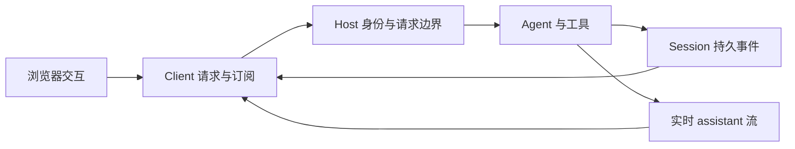

# 第 14 章：Web 界面和远程消费者

<!-- block: deepseek-ch14.b-opening -->
网页显示一条正在生成的回答，数据不一定已经持久保存。浏览器断线后重新连接，还要避免把刚收到的增量重复显示。把实时流与耐久历史分开，是理解 Web 客户端的第一步。

## 14.1 Host 与 Client 分工

Host 持有 Agent、工具与会话写入；Client 发送用户意图并渲染可公开的状态。插件系统在两边都存在，并不意味着浏览器可以导入任意 Host 工具模块。浏览器没有宿主文件系统能力，后端也不应该依赖 React 组件才能生成工具结果。

图 14-1：持久事件提供重建依据，实时流提供及时反馈。两路在界面消费层汇合。

## 14.2 增量通知与最终结算

agent/assistant-stream 是进程内实时事件，携带 start、chunk、end；会话日志保存结算后的 compact stream 与完整消息或尝试。Host 侧的传输层把实时事件交给客户端，浏览器重连则需要从已提交历史恢复。

因此 UI 收到 end 时还要理解它的结算状态，不应把所有结束都画成绿色成功。网络断开也不等于 Host 任务取消；任务可能仍在继续，重连后应查询现状，再决定是否重新发送用户消息。

最容易产生重复任务的交互是：用户按发送，客户端没等到回执，自动重发同一句话。真正需要的是请求身份与服务端接纳状态，而不是比较文本是否相同。两个相同文本可能本来就是用户有意发出的两次请求，粗暴去重也会丢任务。

## 14.3 工具卡片从结果事实生成

工具 canonical value、模型 content、持久 metadata 和 Web 卡片是不同层。固定版本的 Web Client 根据传输过来的 tool/call、tool/result 等原始事件及 metadata 生成卡片，不会因为 Host 工具实现了某个 presenter 方法就自动获得专用网页组件。

比如读取文件时，界面想显示路径、行号和语法高亮，应依赖结果中保留的有界结构，而不是让浏览器再次请求“当前文件”。旧会话如果重新读取最新文件，就会把当时没有的内容显示成过去已经读到过的证据。

组件渲染应能容忍旧数据或错误形状，退回通用显示。展示层失败不能让整个会话无法打开。与此同时，不要为了包容旧数据就删掉 Host 写入时的校验；入口严格与读取兼容承担不同责任。

## 14.4 连接成功并不代表有权执行

Web 启动默认地址是本机 loopback。远程暴露需要另外处理认证、来源、转发与代理设置。浏览器能加载静态资源，不代表它能调用 Host 工具；请求被认证，也不代表每项工具动作都已批准。

做本地练习时，可以让浏览器连接一个不含外部消息发送能力的测试 profile，先断开网络再恢复。记录 Host 是否继续、客户端是否补齐历史、同一 tool/result 是否出现两份。再换一个无效认证请求，确认失败发生在执行前。不要把认证值放进截图或可共享的 URL。

## 14.5 与其他界面接法比较

SDK 与 ACP 通过各自协议消费 Host，Web 只是其中一种客户端。统一 Agent/Session 契约使你可以保留工具和循环，改用 CI 控制端或编辑器界面。代价是每种客户端都需要正确实现请求身份、取消、错误和流结算。

本册没有声称本机浏览器断线重连已通过。这里的图来自固定版本架构，实际 Web 验证仍列在附录 C。读者不必先做完整 UI 才能研究插件：先运行 Cordis 生命周期，再接具体传输，能把错误范围缩小很多。

<!-- deepened: 14 -->

## 14.6 用一段断线时间线读客户端职责

假设浏览器发出消息 M，Host 已接受并开始工具调用，回执在网络中丢失。浏览器此时只知道自己没有收到确认，不知道 M 是否被接纳。若立刻生成新请求重发，Host 可能把它当成第二个合法任务；若永久不处理，用户又会认为输入丢了。

可靠客户端需要保存本次请求身份与会话身份，重连后查询服务端状态，再恢复订阅。具体幂等字段由所用传输协议决定，不能把本书教学名字 M 当成官方 API 参数。我们关注的判断是：哪条证据说明已经接纳，哪条说明任务结束，哪条说明历史已经持久。

接着假设工具完成，浏览器先从实时流看见结果，重连查询又读到持久结果。界面应按事件或工具身份合并，而不是把相同文本直接追加两次。文本去重会误删两次真实相同输出；身份去重则能保留“同一事件的重复投递”与“两次不同调用”的区别。

## 14.7 数据卡片为何要携带结果当时的事实

review_text 的卡片可以显示 lines=2、characters=7、todo=true。浏览器无需再知道原文本的当前位置，也无需重新调用工具；这些字段已经是结果事实。若卡片为了高亮 TODO 再请求当前文件，就必须明确这是“查看当前文件”，不能把新内容混进历史结果。

同样，展示资源有界很重要。工具返回了巨大正文，不应让每次重开会话都把全部内容无条件插进 DOM。可以保存有限摘要和可定位附件，由用户按需展开；摘要的生成版本与附件身份也应能追溯。性能与证据一致性在这里相关：更少且稳定的资料更容易准确重放。

Host 的 presenter 与 Client 的组件系统属于不同进程和类型环境。把一个 Node 函数名放进 metadata，不会让浏览器自动拥有这个函数。远程协议只能传约定数据，客户端再按已安装的呈现代码解释。升级时旧 metadata 应能退回通用卡片，而不是让整页崩溃。

## 14.8 连接生命周期与任务生命周期分开关闭

浏览器标签关闭，可能只意味着一个消费者离开；Agent 由谁持有 handle，决定任务是否继续。若每个订阅断开都直接 dispose 共享 Agent，另一个正在使用它的客户端也会被中断。相反，明确的一次性 SDK 调用在调用者退出后留下孤儿任务，也可能违反该入口的所有权约定。

设计客户端时把订阅 disposer、连接 close 与 AgentHandle.dispose 分开命名。它们可能在某个产品入口里一起执行，但不能因此合并语义。调试“关闭界面后任务怎么还在跑”时，先找到真正拥有 handle 的对象，再决定应由哪条关闭路径结束它。

## 固定版本来源

- [docs/architecture.md](https://github.com/deepseek-ai/deepseek-harness/blob/fcc0ad462172522aaf5c93a7b2e01f6b9f0b0159/docs/architecture.md)
- [docs/cookbook/adding-a-tool.md](https://github.com/deepseek-ai/deepseek-harness/blob/fcc0ad462172522aaf5c93a7b2e01f6b9f0b0159/docs/cookbook/adding-a-tool.md)
- [apps/cli/README.md](https://github.com/deepseek-ai/deepseek-harness/blob/fcc0ad462172522aaf5c93a7b2e01f6b9f0b0159/apps/cli/README.md)
- [README.md](https://github.com/deepseek-ai/deepseek-harness/blob/fcc0ad462172522aaf5c93a7b2e01f6b9f0b0159/README.md)
