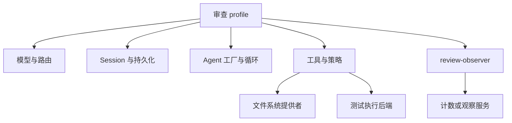

# 第 17 章：组装自己的 Harness

<!-- block: deepseek-ch17.b-opening -->
现在把零件放回一个具体项目：做一个本地代码审查助手，读取变更、运行有限的检查、解释问题，并且保留足够证据让人复核。目标不是一次加齐所有功能，而是让每项能力都能说出来源、状态和停止方式。

## 17.1 从任务反推能力

审查助手至少需要模型适配器、会话日志、默认循环、提示词组装与工具注册；文件读取和测试执行再依赖各自提供者。若只做静态审查，可以先不启用写文件工具。需要浏览器交互时再加 Web 应用，CI 则可以选 headless 或 SDK。

图 17-1：一次审查所需的能力组合。实际 row 名称应以固定版本 dump-config 为准。

先把每项需求映射到服务，而不是先挑一长串插件包。比如“所有审查结果都有依据”需要保留工具结果和引用；仅在提示词里写“请给依据”并没有建立记录机制。“不能修改文件”需要执行能力与策略约束，不能只删除一个自然语言动词。

## 17.2 第一个可交付版本

第一版任务只读一个已知 fixture，输出检查结论和引用位置。确认会话创建、工具声明、调用结果和最终答复都存在；然后再把输入换成一个小仓库的 diff。工具返回文件位置时保留原始路径身份，展示时才做相对路径转换。

观察器应记录调用 id、工具名、耗时与结局，不记录完整机密正文。把日志失败设计为可解释的降级：审查能否继续、是否提示观察数据不完整、是否有界缓存。不要无限堆积一份迟迟发不出去的日志队列。

这一版仍不需要自动发布 PR 评论。对外发送改变了授权与重试的边界，应独立加上发送前检查、目标身份和幂等键。把发送隐藏在日志插件里，会让原本看似只读的审查具有意外副作用。

## 17.3 用失败场景驱动第二版

准备四种输入：文件不存在、测试超时、模型流断开、插件初始化失败。每种情况先定义期望：是否产生工具结果、Turn 如何结束、是否还能接受下一条消息、哪些资源应释放。

模型断线与工具失败不应混成一条“出错了”。前者影响请求尝试，后者可能已经完成外部操作。初始化失败又发生在任务开始之前。把它们放在同一错误码下，后续恢复只能整套重启，无法知道究竟该重做哪一步。

在本地模型替身里返回固定工具调用，可以把模型选择的不确定性暂时拿掉。仍然需要真实 Harness 工具管线与持久化参与，才能验证这一版本的集成行为。仅直接调用 execute 函数会绕过 schema、策略和日志，适合单元排错，不足以证明完整组合。

## 17.4 再加入有限写入

当只读路径稳定后，可以在新的临时工作树测试一个明确的代码修复。任务包括失败测试、允许修改的文件、成功命令和停止条件。先看 diff，再运行测试，再由人决定是否提交。会话恢复不负责 Git 回退，工作树本身才承担版本隔离。

同一个修复任务重复两次时，应先检查现有状态，避免第二次重复追加配置。工具层可以通过内容版本或预期旧文本拒绝过期修改；模型答复“已经改过”不能替代这种校验。审查助手若只需要解释，就不必获得这项能力。

## 17.5 保留一份可维护的运行说明

运行说明写清固定版本、profile 来源、补丁层、环境变量名称、持久目录、启动与停止方式，以及哪些实验实际通过。不要把真实凭据值放进去。给每个原创插件标出拥有的资源和 disposer，就能在升级时有针对性地复测。

本册已把最底层插件生命周期做成可重复实验，完整审查 Harness 的模型与持久化路径仍需按本章逐项实跑。读者最终交付的不是“框架很灵活”这句话，而是一组别人能启动、能停止、能看懂错误的配置和程序。

## 固定版本来源

- [docs/architecture.md](https://github.com/deepseek-ai/deepseek-harness/blob/fcc0ad462172522aaf5c93a7b2e01f6b9f0b0159/docs/architecture.md)
- [docs/cookbook/adding-a-tool.md](https://github.com/deepseek-ai/deepseek-harness/blob/fcc0ad462172522aaf5c93a7b2e01f6b9f0b0159/docs/cookbook/adding-a-tool.md)
- [packages/core/agent-loop/README.md](https://github.com/deepseek-ai/deepseek-harness/blob/fcc0ad462172522aaf5c93a7b2e01f6b9f0b0159/packages/core/agent-loop/README.md)
- [packages/boot/app-boot/README.md](https://github.com/deepseek-ai/deepseek-harness/blob/fcc0ad462172522aaf5c93a7b2e01f6b9f0b0159/packages/boot/app-boot/README.md)
