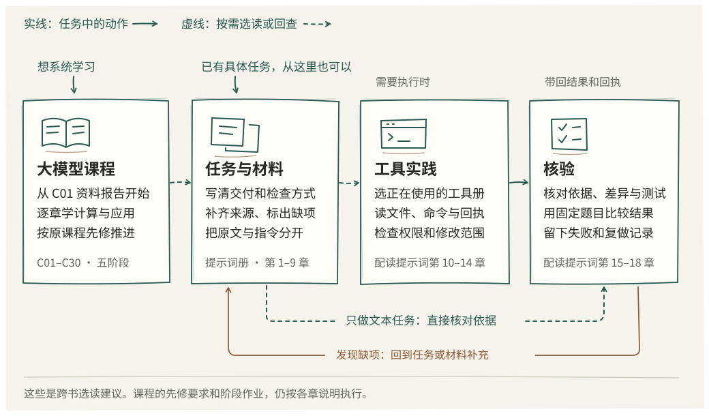

# 怎么读这个系列

想把任务交代清楚，可以从提示词册开始；想系统理解模型并实现应用，沿大模型课程的五阶段读。用到某个 Agent 时，再查它的工具分册。跨书可以穿插选读，课程先修要求与阶段作业仍按原课程执行。

图中箭头说明几本书在一次任务中怎样配合。比如整理资料报告时，先写交付要求和来源，再核对回答依据；只有需要读写文件或执行命令时，才进入工具实践。核验发现缺项，就回去补任务说明或材料。读过某本工具册不等于完成课程的阶段验收。

| 现在的目标 | 起点 | 先完成什么 |
| --- | --- | --- |
| 把任务交代清楚、检查回答依据 | [提示词第 1 章](../agent-books/prompt/ch01.md)，接着读 [第 2 章](../agent-books/prompt/ch02.md)与[第 3 章](../agent-books/prompt/ch03.md) | 任务要求、缺失问题和可检查的输出；这些章节不要求编程 |
| 从零走完模型与应用主线 | [C01 先做一份资料报告](../model-course/book/llm/lessons/c01.md) | 按 C01–C30 的先修顺序完成章节与阶段作业 |
| 已会写程序，想检查 Agent 的行动 | [提示词第 10 章](../agent-books/prompt/ch10.md)与[第 11 章](../agent-books/prompt/ch11.md)，再选下表中的工具分册 | 能读懂文件、命令退出码和测试回执；材料组织不熟时先补第 5–9 章 |

大模型课程的正式顺序来自 [course.json](../model-course/book/llm/course.json)。当前 C02–C30 各自要求前一章；有经验的读者可以查阅后面的章节，进入阶段验收时仍须满足先修要求。

| 阶段 | 实际章节入口 | 可穿插的提示词章节 |
| --- | --- | --- |
| S1 会使用 | [C01 资料报告](../model-course/book/llm/lessons/c01.md) · [C02 任务约定](../model-course/book/llm/lessons/c02.md) · [C03 依据与错误](../model-course/book/llm/lessons/c03.md) · [C04 首次交付](../model-course/book/llm/lessons/c04.md) | [1 明确交付](../agent-books/prompt/ch01.md) · [2 必要追问](../agent-books/prompt/ch02.md) · [3 输出与检查](../agent-books/prompt/ch03.md) · [4 示例选择](../agent-books/prompt/ch04.md) |
| S2 懂原理 | [C05 逐步生成](../model-course/book/llm/lessons/c05.md) · [C06 向量](../model-course/book/llm/lessons/c06.md) · [C07 注意力](../model-course/book/llm/lessons/c07.md) · [C08 Transformer](../model-course/book/llm/lessons/c08.md) · [C09 训练](../model-course/book/llm/lessons/c09.md) · [C10 对齐](../model-course/book/llm/lessons/c10.md) | [5 指令与原文](../agent-books/prompt/ch05.md) · [6 连续修改](../agent-books/prompt/ch06.md)；它们讨论任务组织，模型计算仍由课程展开 |
| S3 能实现 | [C11 第一段程序](../model-course/book/llm/lessons/c11.md) · [C12 请求与响应](../model-course/book/llm/lessons/c12.md) · [C13 真实模型](../model-course/book/llm/lessons/c13.md) · [C14 可追溯片段](../model-course/book/llm/lessons/c14.md) · [C15 检索](../model-course/book/llm/lessons/c15.md) · [C16 工具执行](../model-course/book/llm/lessons/c16.md) · [C17 资料助手](../model-course/book/llm/lessons/c17.md) | [7 选择材料](../agent-books/prompt/ch07.md) · [8 会话交接](../agent-books/prompt/ch08.md) · [9 中间结果](../agent-books/prompt/ch09.md) · [10 工具回执](../agent-books/prompt/ch10.md) · [11 审查与修复](../agent-books/prompt/ch11.md) |
| S4 会改进 | [C18 冻结评测](../model-course/book/llm/lessons/c18.md) · [C19 失败定位](../model-course/book/llm/lessons/c19.md) · [C20 上下文与记忆](../model-course/book/llm/lessons/c20.md) · [C21 Agent](../model-course/book/llm/lessons/c21.md) · [C22 质量与开销](../model-course/book/llm/lessons/c22.md) · [C23 自动微分](../model-course/book/llm/lessons/c23.md) · [C24 小 decoder](../model-course/book/llm/lessons/c24.md) · [C25 参数适配](../model-course/book/llm/lessons/c25.md) · [C26 蒸馏](../model-course/book/llm/lessons/c26.md) | [12 规则与 Skill](../agent-books/prompt/ch12.md) · [13 多 Agent 分工](../agent-books/prompt/ch13.md) · [14 提示注入](../agent-books/prompt/ch14.md) · [15 冻结评测](../agent-books/prompt/ch15.md) · [16 配对比较](../agent-books/prompt/ch16.md) |
| S5 独立交付 | [C27 OCR 与多模态边界](../model-course/book/llm/lessons/c27.md) · [C28 系统选择](../model-course/book/llm/lessons/c28.md) · [C29 发布与回退](../model-course/book/llm/lessons/c29.md) · [C30 陌生题材毕业项目](../model-course/book/llm/lessons/c30.md) | [17 环境迁移](../agent-books/prompt/ch17.md) · [18 独立交付](../agent-books/prompt/ch18.md) |

C23–C26 是课程 S4 的组成部分。只想改善提示或了解工具时，可以把它们留待深入；要参加课程 K4、进入 C27–C30 的完整交付路线，就须完成相应的评测与小模型实验。C30 还要求陌生题材和独立复做，作者自测不能记作 K5 通过。题包和当前缺项见[课程实际进度](../model-course/specs/STATUS.md)。

选工具时，从它自己的第一章和验证记录开始：

| 关心的问题 | 阅读入口 |
| --- | --- |
| 对话循环、工具、权限和 Harness 结构 | [御舆第 1 章](../agent-books/第一部分-基础篇/01-智能体编程的新范式.md) · [总目录](../agent-books/README.md) |
| Omp 的使用与工程机制 | [Omp 目录](../agent-books/omp/README.md) |
| Pi 的扩展与运行过程 | [Pi 第 1 章](../agent-books/pi/ch01.md) · [验证记录](../agent-books/pi/VERIFY.md) |
| OpenCode 插件与权限 | [OpenCode 第 1 章](../agent-books/opencode/ch01.md) · [验证记录](../agent-books/opencode/VERIFY.md) |
| DeepSeek Harness 的插件与生命周期 | [DeepSeek 第 1 章](../agent-books/deepseek/ch01.md) · [验证记录](../agent-books/deepseek/VERIFY.md) |
| Hermes 的记忆、技能与持续任务 | [Hermes 第 1 章](../agent-books/hermes/ch01.md) · [验证记录](../agent-books/hermes/VERIFY.md) |
| Codex CLI 的执行边界 | [Codex 第 1 章](../agent-books/codex/ch01.md) · [验证记录](../agent-books/codex/VERIFY.md) |
| Kimi Code 的插件、Hook 与审查 | [Kimi 第 1 章](../agent-books/kimi/ch01.md) · [验证记录](../agent-books/kimi/VERIFY.md) |

提示词册的离线练习可先在本地完成，再决定是否做模型对照。[练习说明](../agent-books/prompt/examples/README.md)区分程序检查与模型实验；已有脚本结果不能替代实际模型输出或独立读者的结果。
