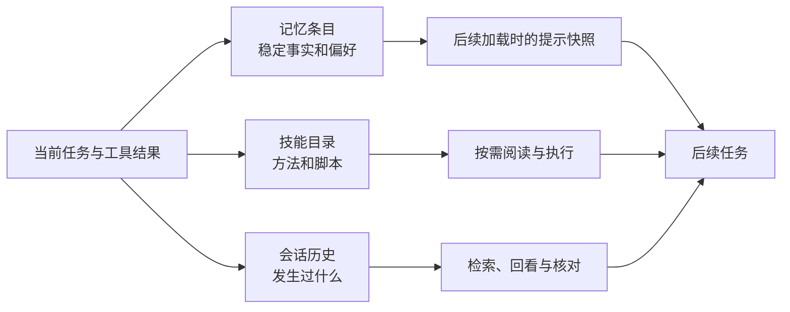

# 前言

<!-- block: hermes-front.b-opening -->
昨天已经说过项目用 unittest，今天又推荐 pytest；上周修过的发布步骤，这周还要重新解释。我们希望一个长期使用的 Agent 记得这些事。但“记得”至少有三种意思：把一句事实放进下一次提示词，把操作方法写成技能，或者从旧会话中找到当时的证据。Hermes 把这几条路放进同一个工作环境，这也是本书选择它的原因。

## 读完以后要能做什么

本书围绕一个小项目展开：维护名为 Aurora 的资料仓库。你会把稳定偏好写入用户档案，把项目事实写入记忆，把检查资料的方法整理成技能，再逐步接入工具、历史检索和定时任务。这个项目不需要贵重设备；重要的是能看见文件、请求和状态发生了什么变化。

前八章处理“下一次会话怎样得到正确知识”。第九至十四章处理扩展、外部服务和长期运行。最后四章把这些部件接成可维护的工作流：可以备份、排错、修正，也能判断所谓自我改进到底改变了什么。插件专题会从目录发现一直讲到注册句柄、卸载、数据归属和失败路径，不把安装命令当作扩展机制的全部。

你不需要先读完整个 Python 项目。每章都给出足够小的源码落点，让你能从一个问题追到具体实现。涉及外部平台或模型效果的实验，会和本地组件验证分开写。读者可以先运行第 4 章的记忆实验，再回头读循环和初始化；也可以先读第 9 章，给自己的资料库增加一个只读工具。

## 这本书固定了哪一版

全书写作基线为 Hermes Agent v0.23.0，实际提交是 `2bd378ed1b8d6bf2192cb26e0a55ff3091e6bd19`。上游许可证为 MIT，本书是独立编写的中文分析与教程。正文引用固定提交，不用滚动官网上的新能力证明旧版本已经存在。

本版已经实际运行上游 MemoryStore、威胁模式扫描器、原子文件写入器和技能元数据函数，覆盖冻结快照、重复添加、局部修订、预算拒绝、歧义删除、批处理失败、重新加载以及损坏编码。它们在 Windows 的隔离目录中运行，没有调用外部模型。驱动对导入环境做了窄适配，避免启动 CLI 和工具注册系统；详细范围在附录 C，不能把这组组件结果称为整套 Hermes 的端到端验收。

## 先画出三条知识路径

三种材料可以相互补充，却不能互相替代。把十页错误日志塞进 MEMORY.md，会耗尽常驻上下文；把一个人的隐私写进可共享技能，会扩大传播范围；只靠历史检索，又可能反复重建早已明确的操作步骤。合理的分工往往比更大的存储额度有用。

## 关于命令和安全范围

书中的实验默认使用单独的 Hermes home、临时项目与虚构数据。这里隔离的是应用的数据目录，并不是操作系统沙箱。工具和插件拥有的实际能力，还取决于运行账号、终端后端、挂载、网络与凭据。我们会直接说明这些区别，不用“安全模式”一词包住所有机制。

涉及安装的命令由读者在自己的机器执行；本书的组件实验不会启动 gateway，不会创建会发送到真实聊天平台的 cron 任务，也不会读取个人模型凭据。你可以在没有 API key 的情况下先理解并验证知识存储。等接入真实模型时，再分别检查效果、费用与外部服务，而不是把一次文件写入成功解释成“Agent 已经学会”。
