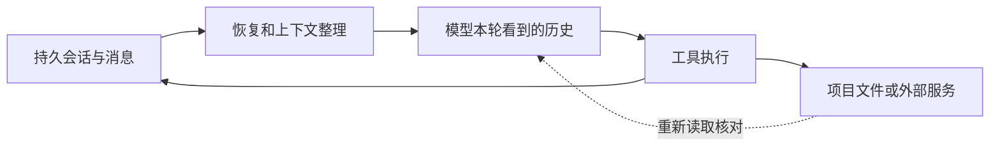

# 第 3 章：会话状态与恢复

<!-- block: hermes-ch03.b-opening -->
恢复昨天的会话后，Agent 记得修改计划，文件却已经被你手动改过。此时旧消息是真实历史，磁盘也是当前事实；问题在于两者不再描述同一个状态。会话恢复负责延续对话，不会自动把工作目录恢复到历史时刻。

## 3.1 历史不是一个聊天字符串

Hermes 的 SessionDB 使用 SQLite 保存会话与消息，并把标题、使用量、搜索、压缩、网关关系等能力拆在多个模块中。`hermes_state.py` 是进入这套存储的入口。会话还可能有父子关系、来源和结束原因，这些信息决定哪些记录被检索、恢复或当成新的开始。

可以把状态分成四层：原始持久记录，供模型使用的当前历史表示，本轮工具的运行状态，以及项目文件。前三者有联系，但没有任何一层天然成为第四层的事务日志。一个工具已经写入文件后，消息保存失败，也不意味着那次写入消失。



虚线提醒我们：恢复后常需要重新读取项目文件。不能只凭旧消息里的“检查通过”，继续执行一次可能已经失去前提的发布操作。

## 3.2 Session ID、来源与路由键

session_id 标识一次持久会话；gateway 的路由键回答某条外部消息应进入哪个会话。后者可能结合平台、聊天位置、参与者、线程或 profile。相同用户名不一定对应同一个身份，不同平台的同名群也不应共享一份上下文。

钉版 gateway/session.py 提供 SessionSource、SessionContext、SessionEntry 和 build_session_key 等结构。它对外部标识做规范化，并在构造上下文文字时处理不可信值。这说明“显示出来的聊天名称”和“存储使用的路由身份”有不同职责。用聊天标题当数据库主键，会在改名、同名和多平台接入时留下隐患。

故障排查时记录 session_id、profile 和来源即可满足很多需求；公开报告不必附上真实用户或聊天平台 ID。想观察路由，可以用虚构 ID 做单元输入，没必要为了测试而给别人发送真实消息。

## 3.3 压缩改变的是哪些历史

长对话无法把全部内容永远放进有限的模型窗口。压缩模块会整理上下文，保留后续所需材料。压缩摘要是另一份表示，不能当成原始对话的逐字副本：它可能省略失败尝试、细小约束和工具输出的尾部。

钉版会话存储和压缩代码有恢复上限、压缩状态与消息内容表示等专门处理。其存在提醒我们，不要用“数据库还有记录”推断“下一次请求会全部带上”，也不要用“模型没提到”推断“数据库已经删除”。要回答某项事实去哪了，分别检查存储、恢复过程和最终请求。

当重要约束只存在于一次长工具输出中，可以把它提炼成带出处的项目记忆，或者写入项目文档。这样的持久化应由明确的规则驱动；不能把压缩过程中随手生成的推测直接升级为长期事实。

## 3.4 中断后先查副作用

想象一个任务顺序执行：生成文件、跑测试、上传报告。程序在第二步被中断。恢复会话时，第一步的文件可能已经存在，测试进程可能仍在运行，第三步可能根本未开始。重试整个任务容易重复生成或重复投递。

更稳妥的恢复输入是：列出当前存在的产物，检查相关进程和日志，再从最后一个可证明的状态继续。给工具动作设计可重复的标识，也比依赖模型记忆可靠。例如生成报告使用确定文件名和内容校验，投递前保存发送标识；这些是业务工作流设计，Hermes 的会话 ID 不会替你自动完成。

对于只读任务，恢复成本小得多。重复读取临时文件不会产生同类业务副作用，因此本书先用只读例子建立观察方法，再讨论持续任务。别因为只读演示平稳，就认为发邮件、部署或付款也能照样无脑重试。

## 3.5 一个可以核对的恢复记录

```text
任务：检查 Aurora 资料清单
最后确认：inventory.json 已写入，SHA-256 已记录
未确认：链接检查是否结束
当前文件：源文档在中断后有两处人工修改
恢复动作：先重新生成清单，再决定是否复用旧检查结果
```

这样的记录比“继续上次任务”更能约束下一步。它没有假装精确知道所有中间状态，而是把已确认与待核对分开。恢复后的模型应重新读相关文件，不应为了保持对话连贯而忽略新事实。

本书的 MemoryStore 实验会创建新的存储对象证明记忆文件能重新加载；那不是 SessionDB 恢复实验。完整会话恢复、崩溃恢复和数据库迁移仍需要独立环境验证。附录 C 保留这种边界，避免把同一个“恢复”词覆盖所有层。

源码定位：[SessionDB](https://github.com/NousResearch/hermes-agent/blob/2bd378ed1b8d6bf2192cb26e0a55ff3091e6bd19/hermes_state.py)、[会话压缩](https://github.com/NousResearch/hermes-agent/blob/2bd378ed1b8d6bf2192cb26e0a55ff3091e6bd19/agent/conversation_compression.py)、[网关会话身份](https://github.com/NousResearch/hermes-agent/blob/2bd378ed1b8d6bf2192cb26e0a55ff3091e6bd19/gateway/session.py)。
