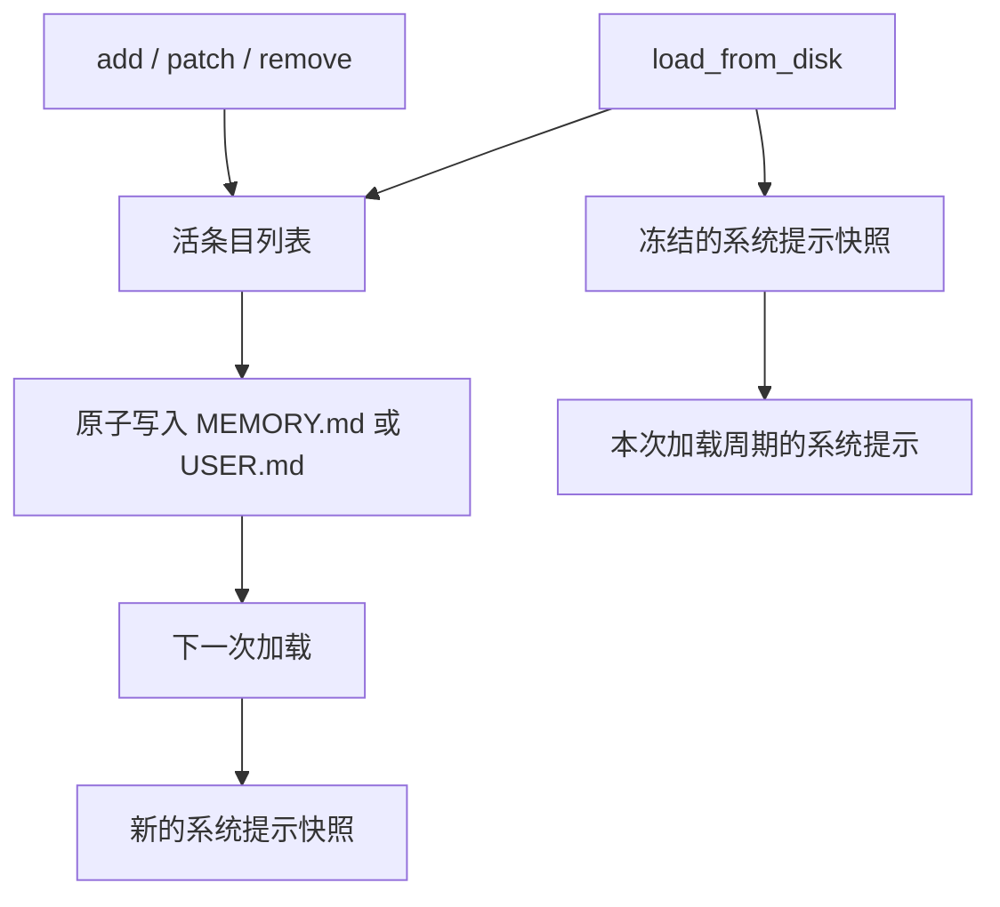

# 第 4 章：Memory 的存储、预算与冻结快照

<!-- block: hermes-ch04.b-opening -->
你让 Hermes 记住“Aurora 使用 unittest”，工具说保存成功，磁盘里也出现了这句话；同一会话的系统提示词却还是旧内容。这不是必然丢失记忆。钉版 MemoryStore 刻意把加载时的提示快照和正在变化的磁盘状态分开，本章用真实上游组件把这个差别跑出来。

## 4.1 两个目标，两个字符预算

内置记忆有两个主要目标：`memory` 对应 MEMORY.md，保存 Agent 的持久笔记；`user` 对应 USER.md，保存用户档案。它们位于当前 Hermes home 的 memories 目录。构造函数的默认预算分别为 2200 和 1375 个字符，可由配置覆盖；这里的单位是字符，不是 token。

```yaml
memory:
  memory_enabled: true
  user_profile_enabled: true
  memory_char_limit: 2200
  user_char_limit: 1375
```

同样的字符数在不同语言、不同模型的 tokenizer 下会产生不同 token 数。预算还包含条目之间的分隔符；不能只把所有可见句子的长度加起来就假定正好能存下。钉版用换行、`§`、换行连接条目，这个格式也影响匹配和手工编辑。

“Aurora 的测试命令是 python -m unittest”适合放项目笔记；“用户希望回复简短中文”适合放用户档案。一次性调试日志、临时口令和未经确认的猜测都不适合常驻。容量有限迫使我们决定哪些事实值得每次带上，而不是鼓励不断提高上限。

## 4.2 保存成功为什么没有改系统提示

`load_from_disk()` 读取文件、去重，并产生 `_system_prompt_snapshot`。后续 add、patch、remove 改的是活的条目列表和磁盘文件；`format_for_system_prompt()` 返回加载时保存的快照。这样会话中的前缀保持稳定，有利于缓存复用。



因此，“工具写入成功”“当前模型通过工具结果知道这件事”“系统提示快照包含这件事”是三种证据。模型仍可能从本轮工具返回或对话内容获知新事实，但这不代表被冻结的系统提示已就地刷新。不要为了演示这一点偷偷调用 load，再说是中途写入自动生效。

## 4.3 八组实际运行的检查

从书仓根目录执行组件驱动：

```powershell
python hermes/examples/check_memory_components.py --upstream hermes-source --without-yaml
```

其中 hermes-source 必须是钉版源码目录，准备方式见附录 C。驱动使用真实 MemoryStore、威胁模式扫描器、原子写入函数与 home 解析器；只适配了 memory_tool 的路径和操作系统文件锁入口，避免启动整套工具注册系统。`--without-yaml` 表示不加载本轮用不到的 YAML 依赖，技能头部只检查真实解析器的降级路径。

| 输入或动作 | 本机观察 |
| --- | --- |
| 空 store 加入一条事实 | 文件立即出现，当前提示快照仍为空 |
| 新 store 重新加载 | 提示快照出现已保存事实 |
| 重复添加完全相同条目 | 返回成功，条目数仍为一 |
| 把 pytest 局部改为 unittest | 条目其余内容保留，旧提示快照不变 |
| 向 100 字符实验预算加入 101 字符 | 拒绝，文件字节不变 |
| 两条记忆都含 unittest，以该词删除 | 因匹配歧义拒绝，文件不变 |
| 批处理中先添加，再修改不存在文本 | 整批失败，前面的添加也没有提交 |
| 写入损坏 UTF-8 后尝试添加 | 拒绝覆盖，没有把坏文件当成空文件抹掉 |

100 和 70 是本书实验使用的小预算，方便触发边界，不是上游默认值。全部八项通过的脱敏记录在 facts 中。这里没有调用外部模型，不能据此评价模型是否会选择正确的记忆内容。

## 4.4 patch 与 replace 不是同一种修改

钉版存储层仍有 replace 方法，用 old_text 找到条目后替换整条内容；patch 则只替换匹配到的文本片段，保留其余部分。当前 memory 工具主要暴露 add、patch、remove 或 operations 批处理；不要因为存储类里还存在 replace，就把它写成当前工具 schema 中必然可用的动作。

假设条目是“Aurora 使用 pytest，文档位于 docs”。把 pytest patch 成 unittest，会保留文档位置。若用整条 replace，只给出“使用 unittest”，就可能丢掉另一项事实。修订前先读完整条目，再选择操作，不能只看一个关键词。

匹配规则也值得认真对待。完整条目相等优先于子串匹配；子串命中多个不同条目时拒绝。实现还会处理引号、破折号和空白的常见差异，但这种宽容不意味着可以随意改写 old_text。最稳妥的做法仍是从当前条目复制一个唯一片段。

## 4.5 锁和原子替换各保护什么

修改路径先获取单独锁文件，重新读取磁盘，再运行变更并保存。重新读取能减少两个 store 先后写入时覆盖对方新增条目的风险；临时文件加原子替换则避免读者看到只写了一半的内容。Windows 路径使用 msvcrt，Unix 路径使用 fcntl，具体锁行为仍依赖操作系统和文件系统。

这两个机制不能保证所有写入者都合作。你用编辑器或外部脚本直接改 MEMORY.md，可能没有使用同一把锁。钉版对超长、无法正常往返的外部内容有漂移检测和备份保护，目的是避免一次整理悄悄丢掉原文。看到这种拒绝，应先检查备份和文件结构，而不是持续要求模型重试。

## 4.6 满了以后先整理，别把错误写成成功

超预算时应合并重复事实、删除失效事实，或者把长方法搬到技能与项目文档。删除之前保留来源，尤其是可能影响真实业务的偏好或约束。自动整理失败也有成本：钉版对每轮连续整理失败设了上限，超过后返回终止性结果，避免模型为了“记住”一件事把整轮回复耗尽。

一条更好的最终回复是“这次没能写入，原因是预算不足；当前回答仍按你的新要求执行”。把保存失败坦白出来，比无依据地说“已经记住”更有用。下次会话是否真正带上这条要求，可以通过新建 store 或新启动会话检查，而不是凭当前对话里恰好出现过它判断。

源码定位：[真实存储实现](https://github.com/NousResearch/hermes-agent/blob/2bd378ed1b8d6bf2192cb26e0a55ff3091e6bd19/tools/memory_tool_store.py)、[工具动作与写入门控](https://github.com/NousResearch/hermes-agent/blob/2bd378ed1b8d6bf2192cb26e0a55ff3091e6bd19/tools/memory_tool.py)、[原子文件写入](https://github.com/NousResearch/hermes-agent/blob/2bd378ed1b8d6bf2192cb26e0a55ff3091e6bd19/utils.py)。
