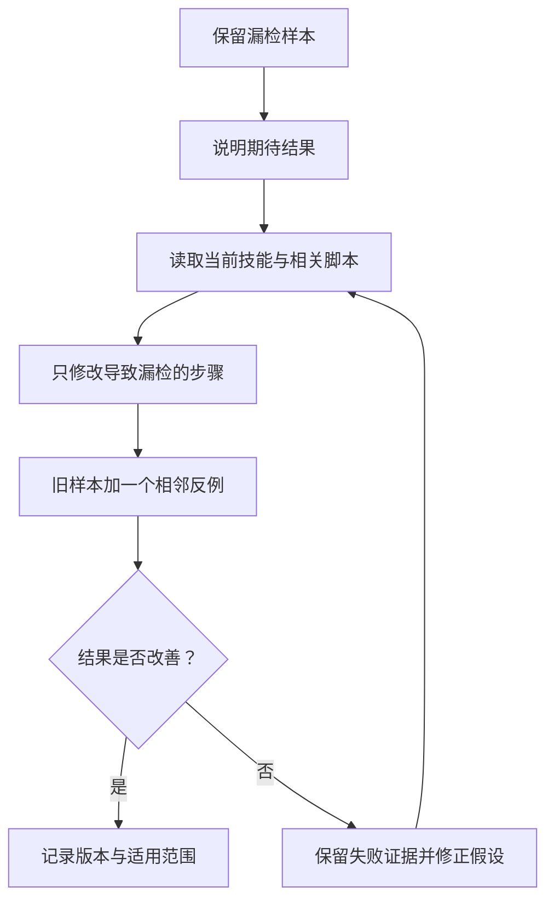

# 第 6 章：从任务经验到技能修订

<!-- block: hermes-ch06.b-opening -->
资料检查连续两次漏掉代码块里的链接，你已经知道旧技能不够好。最直接的修订是增加“扫描代码块”这一步。但若没有保留漏检样本，下一次又可能为了减少误报把它删掉。技能改进需要一条能重放的失败证据，不能只靠“这个步骤感觉更全面”。

## 6.1 把一次失败整理成小样本

先保留最小输入。例如一个三行 Markdown 文件，其中一条链接在正文，一条在代码块。记录旧流程检查了什么、漏了什么，以及用户真正需要哪种结果。随后再决定代码块链接应被检查还是明确排除；这取决于任务目标，不是链接出现在哪里就一定处理。

```markdown
资料引用：https://example.invalid/reference

示例命令里也有一个 URL，但它可能只是说明用的占位值。
```

对于出版资料，读者可能会照抄示例 URL，因此应标记占位地址；对于源码说明，代码中的地址未必要求在线可访问。技能要写清这层区别。把所有 URL 都当成失效链接，会产生大量噪声，最后让使用者忽略真正的问题。

## 6.2 改的是方法，还是某次任务的例外

“本次忽略 archived 目录”可能只是临时范围；“默认检查前先确认归档目录是否在范围内”才是可以复用的方法。把临时例外直接写成永久规则，会让下一个项目继承并不适合它的假设。

可以把修订拆成三部分：触发条件、操作步骤、可观察结果。比如“输入含归档目录时，先读取项目范围说明；输出中注明是否扫描了该目录”。这比“注意特殊情况”具体，也不会强迫所有项目采用同一处理方式。

稳定的项目事实留在项目文档或 memory；普遍适用的检查步骤留在 skill；这次为什么做出决定留在会话证据。三者相互链接，但不要为了省事把全部内容复制到每个位置。

## 6.3 skill_manage 提供写入能力，不替你判断好坏

钉版 skill_manager_tool.py 支持创建和编辑技能文件，维护路径检查、保护规则以及相应批处理能力。它能把一项修订落到磁盘，并不意味着该修订提升了效果。一次写入成功只是技术动作成功，方法质量还需要样本对照。

现有技能可能来自内置、用户目录或其他安装来源。代码会处理实际修改位置，不能假设“编辑某技能”一定是在个人目录中新建副本。如果你希望保留上游版本，应先明确副本策略，避免下一次同步时覆盖自己的改动，或者无意改坏其他项目共用的技能。

修改前读取当前正文尤其重要。一个长期运行进程看到的材料可能落后于磁盘；另一个会话也可能刚写过同一文件。相对于“重写整个 SKILL.md”，基于当前文本的局部修订更容易审阅。它仍不自动解决语义冲突，所以重要变化应保留 diff。

## 6.4 一次可重复的修订流程



相邻反例指看起来相似、实际上不应触发同样规则的情况。例如正文中的真实引用和代码块里的示例地址。只验证原来的漏检样本，容易得到“见到 URL 就报错”这种过度修复；增加反例才有机会看出规则是否过宽。

输出中还应保存执行命令、样本版本和错误解释。如果模型使用了新版依赖，旧结论可能不再有效。把“今天改过技能”写成日志，远远不如指出哪个输入从失败变为正确、哪个边界仍然没处理。

## 6.5 自动维护也要有触发和停止条件

Hermes 的 Agent 入口包含后台 review 相关逻辑，并区分用户明确发起与自动触发的情形。后台维护可以减少重复劳动，但它也会增加并发和状态变化：用户还在当前任务中，技能文件却可能在另一条路径上被更新。

操作上应先从小范围开始。只让后台维护整理一个明确的技能目录，保留差异和原版本；不要把所有失败都理解为“需要修改技能”。错误可能来自网络、权限、模型不遵从或工具实现，而这些问题并不总能靠多写一条提示修好。

当没有足够证据时，记录候选改进而不立刻覆盖正文也是合理结果。技能维护的目标是减少未来任务的重复错误，不是每次任务结束都必须制造一次文件变化。第 18 章会进一步讨论怎样用对照实验评价这种变化。

源码定位：[技能编辑与保护入口](https://github.com/NousResearch/hermes-agent/blob/2bd378ed1b8d6bf2192cb26e0a55ff3091e6bd19/tools/skill_manager_tool.py)、[技能定位与读取](https://github.com/NousResearch/hermes-agent/blob/2bd378ed1b8d6bf2192cb26e0a55ff3091e6bd19/tools/skills_tool.py)、[后台 review 入口](https://github.com/NousResearch/hermes-agent/blob/2bd378ed1b8d6bf2192cb26e0a55ff3091e6bd19/run_agent.py)。
