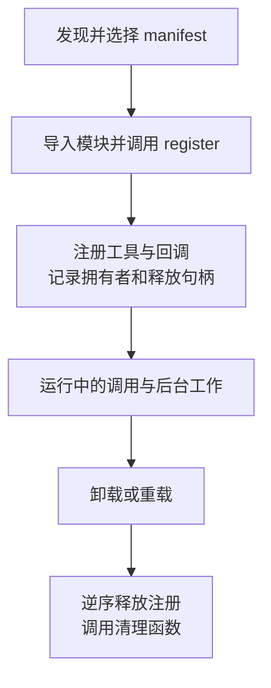

# 第 9 章：工具与插件扩展

<!-- block: hermes-ch09.b-opening -->
技能能教 Agent 怎样检查资料，但它不能凭空提供读取目录的程序能力。要增加一个确定的动作，需要工具；要让工具随 Hermes 启动、受配置管理并在卸载时释放注册，需要插件。本章用一个资料清单插件把这些步骤接起来。

## 9.1 工具、技能和插件各做什么

工具包括模型可见的 schema 和实际执行的 handler。技能是可阅读的方法说明及配套材料。插件则是装入宿主的程序单元，可以注册工具、Hook、命令或其他能力。一个插件可以带工具，一个技能可以调用工具；二者不是同义词。

钉版通用目录插件使用 plugin.yaml 与暴露 `register(ctx)` 的 Python 模块。发现还可能涉及内置目录、用户目录、项目目录和 Python entry point。配置是否允许加载、依赖是否满足、同名来源如何选择，都发生在工具调用之前。项目插件尤其需要核对启用条件，不能以“文件在仓库里”推断它会自动执行。

```text
plugins/
  book-inventory/
    plugin.yaml
    __init__.py
```

```yaml
name: book-inventory
version: 0.1.0
description: 列出指定资料目录中的 Markdown 文件
provides_tools:
  - book_inventory
```

完整原创代码在 examples/book-inventory。正文只展示关键连接；它不要求模型凭据，也不发送外部请求。

## 9.2 register 不是一次工具调用

插件加载时，register 接收 PluginContext。下面是注册核心：

```python
def register(ctx):
    root = ctx.get_config("root", "")
    handler = make_inventory_handler(root)
    ctx.register_tool(
        name="book_inventory",
        toolset="book_inventory",
        schema=SCHEMA,
        handler=handler,
    )
```

这里先读取配置并构造闭包，之后模型调用 book_inventory 才进入 handler。读取配置成功不证明目录存在，工具注册成功也不证明它已经加入本次模型请求。调试时要分别记录发现、register 和调用，不能只在导入顶部 print 一行就认为全链路完成。

本例工具不接收任意路径，只列举操作者配置的根目录。handler 拒绝缺失目录与链接目录，限制返回条目数量，并输出相对路径。这样可以减少误读其他目录的机会；它仍在宿主进程中运行，不构成对恶意插件代码的沙箱。

## 9.3 注册句柄与卸载账本

钉版 PluginContext 会追踪许多注册，保存归属和释放动作。`on_unload(callback)` 注册清理函数，按获取的逆序与注册拆除交错执行；清理异常被记录。`spawn_task(coro)` 创建受监督的异步任务，卸载或强制重载会请求取消，但协程仍应正确处理自己的 finally。



没有通过宿主跟踪的线程、文件句柄或远程连接，不会因为注册表清空就自动消失。插件自行开了资源，应尽早登记对应清理动作；初始化失败之前已经写入的文件也不会自动回滚。给资源定义明确拥有者，比到处堆全局变量更容易收尾。

本书核对了这些源码路径，尚未用完整 PluginManager 实跑卸载。原创插件的离线处理器检查能验证输入与结果，但不能代替宿主发现、作用域或卸载时序的实验。

## 9.4 同名覆盖必须是有意行为

一个插件把自己的工具命名为 write_file，可能遮住原来的实现。钉版注册逻辑对跨工具集覆盖有拒绝路径；通用插件显式 override 还需要操作者配置允许。不能把“我只是换个实现”当作无害细节，因为它会改变模型以为自己在调用的能力。

最好给原创工具使用可辨识的名称，并让描述准确说明范围。确实要替换时，把版本、输入兼容性、返回形状和卸载后的恢复行为一起测试。只验证新工具能返回文本，不足以证明旧调用方仍正确工作。

## 9.5 Hook 不应默认当作拦截器

Hook 的含义取决于具体触发点和返回值消费方式。观察型回调适合记录阶段、计时或统计；能否改参数、能否拒绝动作，要看该 Hook 的契约。不要因为一个回调叫 pre_tool_call，就假定抛异常一定能阻止工具执行。

通用插件源码区分普通 Hook、异步调用与中间件等表面。阅读时从注册函数追到 invoke 的调用方，检查错误如何处理、返回值是否被使用、回调是否按当前 profile 路由。相比插件数量，这些细节更能决定扩展是否可靠。

## 9.6 把示例放进一个独立 profile
先运行附录 C 的离线检查，确认处理器在当前 Python 上能列出临时资料、拒绝错误输入，再准备完整宿主。目录放在当前 Hermes home 的 plugins/book-inventory 下，配置使用下面的形状：

```yaml
plugins:
  enabled:
    - book-inventory
  entries:
    book-inventory:
      settings:
        root: D:/agent-labs/aurora
```

get_config("root", "") 读取的是这个插件 settings 中的 root，不是配置文件顶层的 root。有效插件键还取决于目录分类：把相同 manifest 放进多层目录后，配置命名空间可能随之变化。初次实验保持示例的扁平布局，等加载与调用都看清楚后再移动。

enabled 是允许名单，disabled 是优先的拒绝名单；两边都有同一个名字时，应先修正这份矛盾配置。项目内 .hermes/plugins 还要检查 HERMES_ENABLE_PROJECT_PLUGINS。钉版来源选择中，后扫描的项目或用户副本可能遮住同键的内置副本，所以遇到“改了代码却没变化”，先查实际加载路径，别急着加重试。

示例在 register 时校验目录，不接受空路径，也不自动退回当前目录。处理器只收空对象，模型不能通过参数请求扫描任意磁盘位置。它最多返回 100 条 Markdown 相对路径；超过时保留前面的结果并设置 truncated。扫描目录项也有独立上限，避免一个文件很少却带着大量无关目录的树消耗过久。这个上限属于原创示例，不是 Hermes 的全局默认值。

符号链接和 Windows junction 都会被排除。这样的检查适合操作者控制的静态资料库，不能保证抵御其他进程在检查与遍历之间恶意替换目录。需要更强边界时，应将目录权限和进程隔离交给操作系统，不能把几次路径判断当成完整沙箱。

## 9.7 从一次错误走到可重复的排查
假设工具一直没出现。第一步看宿主是否发现了 manifest；没有发现就查目录与项目门控。发现但没启用时查允许名单、拒绝名单与有效键。启用了却注册失败时，检查错误根目录、Python 导入和 manifest 依赖。注册成功后仍未进入当前模型请求，再查本次工具集与会话装配。把这几步合成一个“插件坏了”的结论，会掩盖真正需要修改的位置。

发现工具后故意将测试目录改名。示例的 handler 会返回明确错误，而不会返回空清单冒充成功。恢复目录后再试，确认错误没有让插件持有永久失效的状态。本次离线检查实际覆盖了这个情况，也覆盖了清单上限、非法参数和链接路径，总计 7 项通过。FakeContext 只检查注册参数，宿主生命周期仍未实跑。

升级插件时，先保存旧代码、配置和一个稳定样本，然后观察同样的输入是否得到相同路径与错误形状。若新增后台观察线程，应加入卸载后线程停止的证据；若新增远程连接，应验证连接关闭与失败恢复。当前示例没有后台资源，因此也没有为展示 API 而添加空的清理回调。卸载的目的在于结束真实资源的生命周期，不在于让代码看起来具备更多钩子。

源码定位：[PluginContext、注册与清理](https://github.com/NousResearch/hermes-agent/blob/2bd378ed1b8d6bf2192cb26e0a55ff3091e6bd19/hermes_cli/plugins.py)、[manifest 与依赖次序](https://github.com/NousResearch/hermes-agent/blob/2bd378ed1b8d6bf2192cb26e0a55ff3091e6bd19/hermes_cli/plugins_manifest.py)、[发现与启用门控](https://github.com/NousResearch/hermes-agent/blob/2bd378ed1b8d6bf2192cb26e0a55ff3091e6bd19/hermes_cli/plugins_discovery.py)、[工具注册表](https://github.com/NousResearch/hermes-agent/blob/2bd378ed1b8d6bf2192cb26e0a55ff3091e6bd19/tools/registry.py)。
