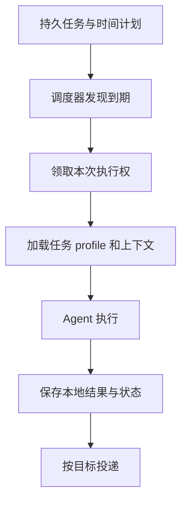

# 第 11 章：Cron 与持续任务

<!-- block: hermes-ch11.b-opening -->
“每天检查资料并给我结果”至少包含四件事：保存任务、计算到期时间、执行 Agent、投递报告。只看到任务存在，不能证明它会按时执行；只看到本地产出，也不能证明消息已经到达。持续任务需要分别观察这些阶段。

## 11.1 调度记录保存在哪里

钉版 cron/jobs.py 以当前 profile 的 cron 目录保存 jobs.json，并为运行输出使用单独目录。源码特别处理 profile 路由，避免多个配置共用一份任务文件。任务不仅有一句提示词，还需要计划、状态、执行范围和其他控制信息。

直接手改 jobs.json 可能破坏字段一致性，或与正在运行的调度器竞争。日常使用应通过当前版本支持的工具或管理入口创建、更新、暂停任务。研究时可以读取它理解结构，但不要把某次导出的内部 JSON 当成长期稳定的公共 API。

## 11.2 到点、领取和完成不是同一个时刻

调度器必须面对两个进程同时检查到期、任务运行超过下个周期、时区变化和机器停机。钉版实现包含锁、执行 claim、运行中记录与迟到分类等机制。这些机制减少重复执行和状态混乱，但不等于任何故障下都恰好执行一次。

尤其要区分执行一次与外部副作用一次。报告文件可以覆盖同一路径，聊天通知却可能重复发送。为每次运行保存可识别的结果标记，能帮助用户判断重复报告究竟来自重试、多个调度器还是两个不同任务。

## 11.3 时间表达应当可核对

自然语言“明早”依赖时区和当前时间；cron 表达式还涉及日历边界。创建后应读取系统解释出的下一次执行时间，而不是只看原输入。跨夏令时地区尤其要明确是固定本地钟点，还是固定间隔。

机器离线期间错过的任务如何处理，也需要看具体版本与任务类型。一次性任务和重复任务的恢复策略可能不同。不要用“cron 每天运行”承诺所有漏跑都会补齐，也不要认为服务重启后会从头重放所有计划。

## 11.4 首次实验先不投递

为教学任务使用单独 profile，只让任务读取虚构资料并写本地报告，不配置真实聊天目标。观察任务创建、到期、执行和本地产出后，再研究投递。这样能避免为了排查调度而不断打扰真实群组。

可以设计三个失败：目录不存在、工具返回错误、执行耗时超过预期。检查本地输出、任务状态和下一次计划如何变化。然后在任务执行前暂停它，确认暂停作用于哪一阶段。已经开始运行的任务与尚未领取的任务不一定受到同样影响。

本书未运行真实 cron 调度或投递，不能把这组设计写成通过。之所以保留这些具体步骤，是让读者知道下一步要观察什么，而不是只得到“支持定时任务”的功能列表。

## 11.5 沉默结果仍然需要本地证据

钉版 scheduler.py 对静默响应有特殊处理，例如符合约定的 SILENT 标记可以抑制投递，但本地输出仍有用途。静默适合没有新变化的巡检，不能拿来掩盖失败。一个任务没有发消息，可能是没有变化、被抑制、尚未执行、失败或投递异常，需要通过状态区分。

长期维护时应关注连续失败与长期无产出，而不只是收到的消息。减少通知噪声有价值，前提是故障仍可发现。把执行结果、投递结果和用户确认拆开保存，会比一个笼统 success 更容易排错。

源码定位：[任务存储、时间与锁](https://github.com/NousResearch/hermes-agent/blob/2bd378ed1b8d6bf2192cb26e0a55ff3091e6bd19/cron/jobs.py)、[调度、执行与投递编排](https://github.com/NousResearch/hermes-agent/blob/2bd378ed1b8d6bf2192cb26e0a55ff3091e6bd19/cron/scheduler.py)。
