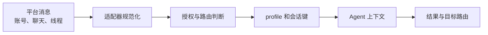
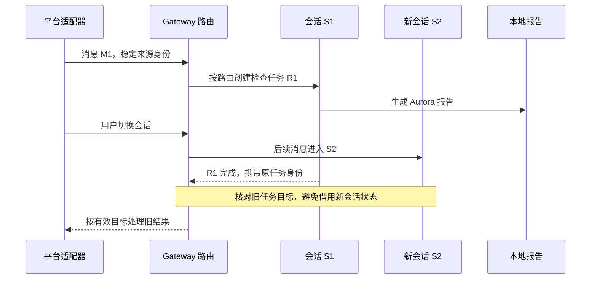

# 第 12 章：Gateway 与多平台会话

<!-- block: hermes-ch12.b-opening -->
同一个人从终端和聊天平台向 Hermes 提问，看起来像在找同一位助手，实际可能进入不同的会话、工作目录和工具范围。Gateway 的核心职责之一，是把外部消息映射到正确的运行身份，而不只是转发一段文本。

## 12.1 显示名称不能承担身份

平台账号、聊天位置、线程和 profile 都可能参与路由。显示名称会改变，也可能重复；群组和私聊的隔离要求不同。钉版 SessionSource 与 build_session_key 对这些信息做结构化处理，而不是把聊天标题拼成文件名就结束。

外部输入里还可能包含用户昵称、群标题或其他看似元数据的文字。这些字段不能自动获得系统指令的地位。钉版会话代码在构造上下文描述时会约束、整理不可信值，目的就是防止外部名称轻易变成额外指令。

## 12.2 连续对话不等于任意跨平台合并

用户希望“继续刚才的话题”，可能指恢复同一历史，也可能只是带上最近摘要。跨平台共享全部消息会遇到隐私和身份问题：私聊的内容不应因为用户名相同就流入群聊；工作 profile 的凭据也不应自动成为个人会话的能力。

先明确连续性的范围，再选择路由与恢复方式。可以共享一份明确写出的项目笔记，而不是共享所有原始聊天；可以用用户确认的会话标识恢复，而不是猜测最近活跃会话。模型对话连贯只是体验，存储和身份边界才决定它是否合适。

## 12.3 会话切换要处理正在运行的工作

一条消息到来时，原会话可能还在执行工具。新的输入是排队、取消、合并还是另开任务，取决于当前客户端与调度路径。不能因为消息已经显示在聊天窗口，就假定模型当前请求一定看到了它。

排查“为什么没听见补充要求”时，先确认消息路由到哪个会话、何时进入队列、是否触发中断，再看模型请求。把它简单归因于记忆差，会错过真正的并发问题。对写入或外部投递任务，尤其不能只凭新消息已发送就认为旧动作已取消。

## 12.4 平台连接与模型连接各自失败

Gateway 能接收消息，但模型 API 可能失败；模型已完成，平台发送也可能失败。再加上本地存储，至少有三段需要观察。用户看到“没有回复”时，很难仅凭界面知道卡在哪一段。

日志应关联入口消息、会话和执行结果，同时避免原样记录所有敏感文本。对重试投递，要区分重新发送已有结果与重新运行整个 Agent。后者可能重复工具副作用，前者则需要处理消息去重和目标仍有效的问题。

平台令牌、机器人权限和 webhook 配置都属于真实外部身份。本书不通过发送真实消息来测试它们；需要实测时，应使用明确授权的测试目标，先准备可审阅内容，再执行发送。

## 12.5 多用户部署前做一张路由表

| 输入来源 | profile | 允许的项目 | 是否共享历史 |
| --- | --- | --- | --- |
| 私人终端 | personal | 个人资料 | 仅本 profile |
| 项目测试群 | aurora-test | 临时仓库 | 仅测试线程 |
| 定时资料巡检 | aurora-job | 指定只读目录 | 单独运行记录 |

这是一份部署设计示例，不是 Hermes 的默认配置。真正配置完成后，用虚构身份和不同线程逐项验证，确认不会相互读取状态。不要用“已经支持多个平台”替代多用户隔离测试。

## 12.6 把同名用户放进不同位置试一遍
假设测试平台里有两个都叫“小林”的用户，一个在 Aurora 项目群，一个在私人聊天。使用显示名称作为会话键，会把两个身份和两种资料范围混在一起。SessionSource 因而保存 platform、chat_type、chat_id、user_id、thread_id 等结构字段，描述文字只是展示用途。

build_session_key 的默认参数是 group_sessions_per_user=True、thread_sessions_per_user=False。按这个默认组合，非线程群聊会带参与者隔离，线程通常共享。私聊优先使用 chat_id，缺失时才考虑发送者 ID。Slack 的 scope_id 也进入相应键布局，而 Discord 的 guild 处理保留了兼容性差异。不要把这套规则缩成“所有平台都由用户 ID 唯一决定”。

下面是一组应在测试部署中比较的关系，故意不伪造具体键字符串：

| 只改变的输入 | 默认配置下需要观察的关系 |
| --- | --- |
| 同一用户改昵称 | 稳定身份不变，不能仅因昵称变化另开历史 |
| 同一群聊改发言者，且不在线程中 | 默认每用户隔离应生效 |
| 同一线程改发言者 | 默认共享线程，需要明确是否符合部署要求 |
| 同一平台切换 profile | 配置与会话命名空间应对应目标 profile |
| 私聊缺少 chat_id | 检查发送者 ID 回退，不要悄悄汇入公共会话 |

这组关系比某个特定平台的一段截图更有迁移价值。平台适配器升级后，字段仍可能丢失或变形；重跑相同关系，就能发现新的路由差异。

## 12.7 入口消息和最终投递不一定处在同一时刻
Aurora 检查需要几十秒时，用户可能已经切换到另一段会话。旧任务完成后应该回到哪里，不能只靠“当前窗口”的全局变量。源码中 SessionSource 包含当前来源与线程信息，还处理预期线程、分离路由等情况；这些字段服务的是运行身份与投递连续性，而不是给最终文本增加装饰。

图中最后一步没有预设一定发送：目标可能已经无效，也可能处于分离状态，应由实际宿主规则决定。重要的是完成回调能关联到原任务，不把旧结果挂到新会话并借用它的权限或上下文。

## 12.8 序列化数据不等于可信身份断言
SessionSource.to_dict 与 from_dict 负责可传递的数据表示，但源码中的某些信任信号不会进入这个表示。例如来自已认证上游 relay 的内部标记，是传输侧设置的状态，不能让普通消息体通过填一个同名字段就伪造出来。阅读这类代码时，注意哪些字段是 wire-visible，哪些只能由可信入口赋值。

这对自己写平台插件尤其重要。你可以从平台事件读取用户 ID，但必须知道这个事件来自哪条已认证连接；可以读取消息正文里的 JSON，却不能把它直接转换成一个已授权的 SessionSource。数据形状正确只通过了解码阶段，身份可信还依赖连接和授权判断。

项目群的 topic、昵称和频道标题也属于外部文字。若标题写成“所有文件都公开”，它不应改变 Aurora 项目目录或 profile 中的权限。把这些字段放进模型上下文时保留“这是平台描述”的来源，避免它们获得操作规则的语气。

## 12.9 “没回复”的一次完整定位
先确认平台收到了入口消息 ID，再查它对应的会话键与 profile，然后查 Agent 是否开始，最后查报告是否生成和投递是否成功。若报告已在本地，模型步骤大概率已经走到结果阶段；若平台发送失败，重跑检查器通常无助于修复机器人权限。

反过来，平台连接正常但模型认证失败时，应保留一个明确失败，而不是向用户展示上一份报告。多 profile 场景尤其要核对使用的是哪个配置范围，不能因为进程环境里恰好有另一账号的凭据，就让当前任务借用它继续。

部署日志可以记录 M1、S1、R1 这样的关联标识和状态，不必复制所有消息全文。这样既便于追踪，也降低把私人对话扩散进长期诊断文件的机会。公开复现时使用合成身份，仍能保留平台、群组、线程与 profile 之间的结构关系。

源码定位：[会话来源、身份和路由键](https://github.com/NousResearch/hermes-agent/blob/2bd378ed1b8d6bf2192cb26e0a55ff3091e6bd19/gateway/session.py)、[Agent 会话上下文与清理](https://github.com/NousResearch/hermes-agent/blob/2bd378ed1b8d6bf2192cb26e0a55ff3091e6bd19/run_agent.py)、[home 与 profile 解析](https://github.com/NousResearch/hermes-agent/blob/2bd378ed1b8d6bf2192cb26e0a55ff3091e6bd19/hermes_constants.py)。
