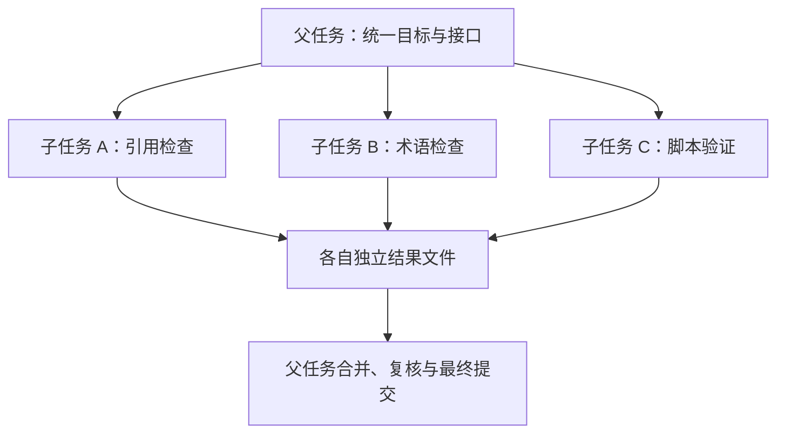

# 第 14 章：任务委派与并行

<!-- block: hermes-ch14.b-opening -->
三个人同时检查同一批文档，可能更快，也可能同时覆盖同一份报告。子 Agent 增加的是执行路径，不会自动消除共享状态。委派前先明确每个任务负责什么、读什么、能写什么，往往比增加并发数量更有效。

## 14.1 父任务应该交出去什么

合适的委派说明包含目标、范围、输入材料、产物位置和完成判断。例如“只检查第 1–3 章的引用，输出问题列表，不直接改正文”，比“帮我完善这本书”容易整合。子任务应知道自己不是唯一写作者，避免还原其他任务的变更。

Hermes 的 delegate_tool.py 连接委派入口、子任务配置、状态和结果相关模块。实际继承哪些模型、工具集和上下文，要看这条配置链，不能假设父任务的所有记忆和限制都逐字复制。名字叫 subagent，也不代表它一定运行在独立操作系统账号或容器中。

## 14.2 上下文分离和文件分离不同

子任务有独立会话历史，可以减少相互干扰；如果它们都写同一个工作目录，文件冲突仍然存在。独立 worktree 能分开 Git 文件状态，却不能自动分开共用数据库、端口、外部服务或 Hermes home。

图中把最终合并放回父任务，是为了给共享决定一个明确负责人。若子任务都直接修改 manifest、目录和发布配置，就会把协调成本推到最后。

## 14.3 共享预算要防止任务越拆越多

AIAgent 的接口包含迭代与运行时间预算，以及 parent_session_id 等关系字段。预算存在于调用链里，并不意味着任何插件或外部进程都会严格响应同一个限制。把耗时工作委派出去以后，父任务仍需观察是否超时、卡住或产生重复请求。

很小的任务不值得分拆。读取同一个十行文件让三个 Agent 各写一次摘要，可能只增加费用和整合成本。适合并行的是依赖较少、产物能独立检查的部分，例如不同章节研究，或者源码检查与本地构建。

## 14.4 取消父任务时检查子任务

父任务停止回复后，子任务是否已经结束，需要实际状态确认。钉版 AIAgent 有活动子任务的关闭入口，但某个工具已经启动的外部工作仍可能有自己的生命周期。不要把“父会话取消”直接写成“所有副作用撤销”。

设计一个无外部发送的取消实验：子任务周期性写入临时日志，父任务请求停止后，检查日志是否继续增长、进程是否退出、结果是否被标为中断。这类实验比看一条取消提示更有说服力。本书未运行完整委派链，所以只把它列为待复现方案。

## 14.5 结果要交回证据，不只是判断

子任务报告“没有问题”时，父任务应能看到检查范围、使用的版本和关键证据。研究任务交回固定源码路径与结论；实现任务交回改动文件与验证命令；失败任务说明卡在哪个环节。让父任务重新做全部工作会抵消并行收益，完全不复核又会放大错误。

对书稿项目，最有用的整合单位是章节、来源和可运行例子。先约定标题格式、文件名、引用方式和未验证标记，再并行写作，能减少最后的机械返工。共享构建器交给一个负责人，其他任务只提交各自产品的配置。

源码定位：[委派工具入口](https://github.com/NousResearch/hermes-agent/blob/2bd378ed1b8d6bf2192cb26e0a55ff3091e6bd19/tools/delegate_tool.py)、[父子会话、预算和清理接口](https://github.com/NousResearch/hermes-agent/blob/2bd378ed1b8d6bf2192cb26e0a55ff3091e6bd19/run_agent.py)。
