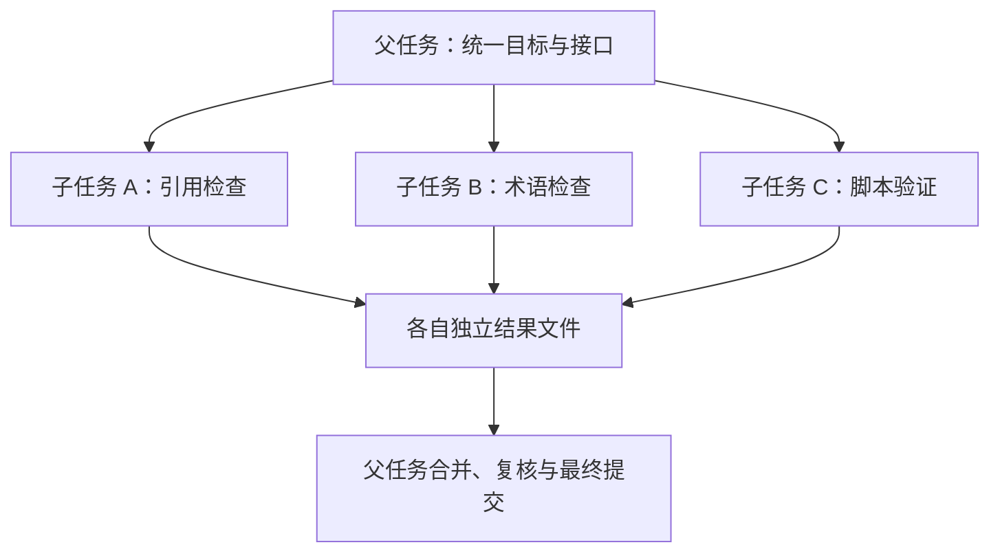

# 第 14 章：任务委派与并行

<!-- block: hermes-ch14.b-opening -->
三个人同时检查同一批文档，可能更快，也可能同时覆盖同一份报告。子 Agent 增加的是执行路径，不会自动消除共享状态。委派前先明确每个任务负责什么、读什么、能写什么，往往比增加并发数量更有效。

## 14.1 父任务应该交出去什么

合适的委派说明包含目标、范围、输入材料、产物位置和完成判断。例如“只检查第 1–3 章的引用，输出问题列表，不直接改正文”，比“帮我完善这本书”容易整合。子任务应知道自己不是唯一写作者，避免还原其他任务的变更。

Hermes 的 delegate_tool.py 连接委派入口、子任务配置、状态和结果相关模块。实际继承哪些模型、工具集和上下文，要看这条配置链，不能假设父任务的所有记忆和限制都逐字复制。名字叫 subagent，也不代表它一定运行在独立操作系统账号或容器中。

## 14.2 上下文分离和文件分离不同

子任务有独立会话历史，可以减少相互干扰；如果它们都写同一个工作目录，文件冲突仍然存在。独立 worktree 能分开 Git 文件状态，却不能自动分开共用数据库、端口、外部服务或 Hermes home。



图中把最终合并放回父任务，是为了给共享决定一个明确负责人。若子任务都直接修改 manifest、目录和发布配置，就会把协调成本推到最后。

## 14.3 共享预算要防止任务越拆越多

AIAgent 的接口包含迭代与运行时间预算，以及 parent_session_id 等关系字段。预算存在于调用链里，并不意味着任何插件或外部进程都会严格响应同一个限制。把耗时工作委派出去以后，父任务仍需观察是否超时、卡住或产生重复请求。

很小的任务不值得分拆。读取同一个十行文件让三个 Agent 各写一次摘要，可能只增加费用和整合成本。适合并行的是依赖较少、产物能独立检查的部分，例如不同章节研究，或者源码检查与本地构建。

## 14.4 取消父任务时检查子任务

父任务停止回复后，子任务是否已经结束，需要实际状态确认。钉版 AIAgent 有活动子任务的关闭入口，但某个工具已经启动的外部工作仍可能有自己的生命周期。不要把“父会话取消”直接写成“所有副作用撤销”。

设计一个无外部发送的取消实验：子任务周期性写入临时日志，父任务请求停止后，检查日志是否继续增长、进程是否退出、结果是否被标为中断。这类实验比看一条取消提示更有说服力。本书未运行完整委派链，所以只把它列为待复现方案。

## 14.5 结果要交回证据，不只是判断

子任务报告“没有问题”时，父任务应能看到检查范围、使用的版本和关键证据。研究任务交回固定源码路径与结论；实现任务交回改动文件与验证命令；失败任务说明卡在哪个环节。让父任务重新做全部工作会抵消并行收益，完全不复核又会放大错误。

对书稿项目，最有用的整合单位是章节、来源和可运行例子。先约定标题格式、文件名、引用方式和未验证标记，再并行写作，能减少最后的机械返工。共享构建器交给一个负责人，其他任务只提交各自产品的配置。

## 14.6 把 Aurora 分成两份独立工作
一个子任务检查 docs 中的本地链接，另一个审阅文中术语。两者可以读取同一批文件，但暂不直接修改正文。子任务 A 返回路径、行号、目标和输入摘要；子任务 B 返回引用片段、术语理由和相同输入摘要。父任务合并结果后再决定修改，避免两个任务都顺手重写 index.md。

若用本书的 aurora_lab.py，各任务不要同时对同一目录运行 check，因为它们都会写 reports/latest.json。可以让确定性检查只由一个任务执行，另一个只读其 snapshot；或者为每个任务建立独立资料副本。为了展示并行而让两个相同检查同时覆盖一个文件，既没有加速，也降低了证据可读性。

一份有效委派可以写成下面这样：

```text
只检查 docs/index.md 与 docs/install.md 的术语和描述一致性。
先记录这两份输入的 SHA256；不要修改文件。
输出每个问题的文件、原文片段、理由与建议。
如果文件在检查期间变化，说明受影响结论并停止基于旧文本提出修改。
你与其他任务共享工作区，不要还原他人的文件。
```

这份说明没有要求子任务猜父任务全部历史。它把需要的上下文和产物约定直接交过去，结果也能被另一个人复查。

## 14.7 从源码看“完成”怎样被分类
delegate_tool.py 在子 Agent 创建后设置父子关系与委派身份，连接进度回调，并把子任务附着到父任务以传播中断。真正执行的 _run_single_child 不只拿一段 summary 就宣布成功；它会结合结构化完成字段判断状态、退出原因和是否因为迭代预算截断。

源码对 completed、interrupted、failed，以及 completed、max_iterations、interrupted、error 等退出原因有明确区分。模型写出一段像最终答复的文本，但结构化错误字段非空时，仍不应归类为正常完成。这对父任务很有用：一段部分报告可以提供线索，却不代表所有分配范围都已检查。

执行路径还启动 heartbeat，预留或更新子会话记录，并在结果构造后附上相关工作区信息。阅读时顺着创建、await_child、结果验证和清理走，比单看委派工具的参数表更容易理解“任务已发出”“子任务开始”“子任务结束”之间的时间差。

## 14.8 迟来的结果怎样与新输入相处
假设子任务 A 在摘要 H1 上开始，父任务期间修复了 setup.md 的链接并得到 H2，随后 A 返回“setup.md 不存在”。这个发现可能在 H1 上完全正确，只是已经过期。父任务不应为了保持结果一致而撤销刚完成的修复，也不该指责子任务检查错误；应核对文件摘要，标记该问题已被后续修改解决。

如果 B 的术语意见指向一个未变化文件，则不必因为整个项目摘要变化就全部丢弃。保留文件级哈希的好处是可以细分失效范围。项目摘要负责判断整次输入是否相同，文件摘要负责判断某个结论是否仍有依据。两层记录结合起来，能减少无谓重做。

并行写入则要更谨慎。独立 worktree 可以把 Git 改动分开，但两个任务若仍使用同一个 Hermes home 或同一个外部服务账号，状态仍会共享。给文件责任分界时，也要列出共同的数据库、端口和报告目录。否则表面上修改不同章节，后台却在竞争同一份缓存或索引。

## 14.9 取消实验要等到可观察的停止
完整宿主中的取消可用一个合成任务检查：子任务每隔一段时间向自己的临时文件追加一行，父任务请求停止后记录最后修改时间，确认文件不再增长，再检查子进程状态。这不需要访问私人文件或真实平台。

若工具启动了独立后台进程，子 Agent 结束未必足以结束它。源码里的关闭与所有权转移细节，就是为了避免父对象过早释放子任务仍使用的连接或数据库句柄。观察到一个“已取消”状态后，仍要按你实际使用的后端检查外部进程，这属于运行结果的一部分。

本书实跑的是两个 store 的确定性交错和 Aurora 的文件恢复，不是这条完整委派取消链。读者接着验证时可以复用同一批合成输入，把父任务 ID、子任务 ID、文件摘要和停止时刻放在一份记录里，结果会比只有终端截图更容易解释。

## 14.10 合并子任务结果时先比较输入
父任务拿到两份报告后，可以先按路径比较摘要。若同一个文件在两份报告中的 SHA256 相同，就具备了合并针对这份输入的发现的基础；若不同，应保留两份结果并说明它们来自不同状态。不要先把自然语言结论拼成一篇，再到最后才发现讨论的根本不是同一版文件。

去重也应基于具体问题。例如“index.md 第 3 行指向不存在的 setup.md”和“安装链接无效”可能是同一发现，父任务可以合并并保留更完整的证据。“示例地址是占位值”则不是另一个需要修复的断链，不能因为两条都含 URL 就一起归入失败清单。

最终提交前，再对当前工作树执行确定性检查。子任务的报告证明它当时观察到了什么，最终检查证明合并后的文件处于什么状态。两者缺一项都可能出现问题：只信子任务会漏掉整合冲突，只跑最终程序又可能丢掉它们发现但程序无法判断的语义问题。

源码定位：[委派工具入口](https://github.com/NousResearch/hermes-agent/blob/2bd378ed1b8d6bf2192cb26e0a55ff3091e6bd19/tools/delegate_tool.py)、[父子会话、预算和清理接口](https://github.com/NousResearch/hermes-agent/blob/2bd378ed1b8d6bf2192cb26e0a55ff3091e6bd19/run_agent.py)。
