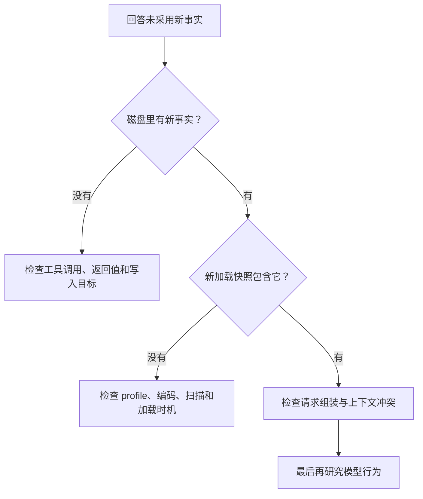

# 第 16 章：观察与调试

<!-- block: hermes-ch16.b-opening -->
“Agent 没记住”不是足够精确的故障描述。可能没有调用 memory，也可能写入失败、写到另一份 profile、当前快照未刷新，或者事实进入请求后被模型忽略。把这些情况分开，才能避免用反复提示掩盖程序问题。

## 16.1 从可见结果往回追

先写下期待和实际：希望新会话采用 unittest，实际回答仍推荐 pytest。接着逐层检查：当前 home 是哪一个，文件中是否有正确条目，新加载时快照是否包含它，最终请求是否带上，以及模型回答为什么偏离。

这个顺序不要求每次都抓取完整请求。很多错误在文件和工具返回阶段就能解释。只有前面证据一致，才值得继续检查更昂贵或更敏感的请求内容。

## 16.2 日志需要关联，而不需要复制全部文本

记录 session_id、工具名、阶段、错误类别和时间，常能帮助还原链路。把完整提示词、文件正文和密钥全部写进日志，会扩大泄露面，也让噪声淹没关键事件。日志应服务具体问题，而不是默认“越多越好”。

对于记忆操作，记录 target、动作、成功状态和用量变化即可描述许多问题。需要检查具体匹配时，在本地查看相关条目，公开报告使用虚构样本。本书的驱动打印每项 PASS，并把源文件摘要和场景结果放入 JSON，不提交用户内容。

## 16.3 常见症状的排查顺序

| 症状 | 先检查 | 不要立即下的结论 |
| --- | --- | --- |
| 保存成功但当前提示没变 | 加载快照与活条目的区别 | 记忆没有持久化 |
| patch 找不到文本 | 当前完整条目、唯一匹配、编码 | 文件权限不足 |
| 技能改了却没生效 | 实际来源、同名项、读取内容 | 模型拒绝遵从 |
| 工具没有出现 | 注册、依赖检查、工具集和本次定义 | 插件代码一定错误 |
| 定时任务没发消息 | 是否执行、本地输出、静默与投递状态 | 调度器完全失效 |

每一行都指出了一条可验证的下一步。避免一次把十个配置都改掉，否则即使问题消失，也不知道哪项变化起作用。

## 16.4 错误注入应当小而明确

本书组件实验故意写入损坏 UTF-8，验证新增操作不会把原文件当成空文件覆盖。这是一个可控的失败输入，发生在临时目录，检查也直接比较字节。它比“随机关机看看会不会丢数据”更容易解释，也不伤害真实状态。

其他可控输入包括超预算条目、两个相同关键词、批处理中一个不存在的匹配、缺少技能根目录，以及工具输出超过上限。每次只改变一个因素，保存前后状态。实验结束后确认所有文件都仍在临时范围内。

针对外部服务，可以模拟超时和断线，但不能据此宣称真实服务的所有错误都已覆盖。错误类别、重试策略和服务端副作用仍需要单独研究。

## 16.5 避免修复一次、下次又忘

修复应留下触发条件、原因、改动和复现命令。若问题来自错误记忆，修正条目并说明旧结论何时失效；若来自技能，保留失败样本；若来自工具实现，增加能拦住同类错误的检查。把所有问题都写进用户档案，会让知识库越来越混乱。

版本升级后先重跑那些曾经暴露真实问题的实验。来源锁与脚本摘要帮助确认跑的是哪份代码，避免拿旧结果为新版本背书。发生新的失败时保留原记录，追加新的结果，而不是把历史里的 passed 改成 failed 并丢掉时间线。

源码定位：[组件驱动](examples/check_memory_components.py)、[内置存储错误处理](https://github.com/NousResearch/hermes-agent/blob/2bd378ed1b8d6bf2192cb26e0a55ff3091e6bd19/tools/memory_tool_store.py)、[记忆协调与后台调用](https://github.com/NousResearch/hermes-agent/blob/2bd378ed1b8d6bf2192cb26e0a55ff3091e6bd19/agent/memory_manager.py)。
