# C02 把任务交代清楚

“帮我整理成一张表。”

这句请求在办公室里一天要出现好几次，可它离一个能验收的任务还差着一截。整理哪一份材料，要哪几列，材料里没有的东西怎么办，表交给谁、拿去做什么，什么情况下算做完了——这些都没有说。没有说，不等于对方会来问。更常见的情况是，它自己补上一个看起来合理的答案，然后把表交回来；你翻两行觉得挺像，就收下了。

本章只做一件事：把这句口头请求改写成一张能被检查的**任务约定**，再用同一份通知做对照，看看约定变了以后，结果里究竟哪几个格子跟着变。改写的重点不在措辞漂亮，而在于每一条都留下一个可以回查的落点。

## 先修桥：把约定写成五段

先回看 C01 的那张表。一行是一条记录，一格是一个字段；“原文证据”与“状态”是两列，不是装饰。读表的时候，眼睛先落在表头，再逐行往下扫，看每个值是不是都能在原句里找到落点。这个习惯要带到本章来，因为接下来写的每一条约定，最后都要落回这样一张表上接受检查。

有了这个基础，可以把任务约定固定成五段：

1. **目标**：这次要产出什么，交给谁，用来做什么。
2. **材料**：哪些文件或原文可用，版本或日期是什么，哪些不能用。
3. **约束**：只依据材料吗？缺失怎么标？冲突怎么处理？允不允许推测？
4. **输出**：字段、格式、语言、长度，要不要逐项引用。
5. **核对**：完成后逐项检查什么，什么状态算“可交付”，什么状态必须停下来。

五段不必写成长文，一段一两行就够。要紧的是每一段都能被结果检验。你说“只用材料”，报告里就不能出现材料没有的地点；你说“每项附原句”，表里就得有一列原句，而且那一列要真的能对上。

这里有个容易忽略的细节：五段对应的是**五个出错的位置**。目标写含糊，产出就会偏到别的事情上；材料没划界，模型只能按常见常识补；约束缺一条，遇到缺失和冲突时它就没有规则可依；输出没定义，格式每次都不一样；核对没写，谁也不知道什么时候该停。反过来说，结果出了问题，你也能顺着这五段找回是哪一段没交代清楚，而不是笼统一句“它不靠谱”。

## 一次完整的改写

原话：“帮我整理成一张表，要完整。”

改写：

> 目标：把通知 A 整理成活动安排表，交给没读过原文的同事，用来决定出门时间。
> 材料：只使用 `notice-a.txt` 与 `notice-b.txt` 的原文；文件里没有的不要补。
> 约束：缺失写“材料未提供”；两份材料冲突时并列写出，不合并；不把星期补成具体日期。
> 输出：四列表格——事项、值、原文证据、状态；表后附三条待确认事项。
> 核对：每一格能回到原句；没有原句的格子不能标“有依据”；冲突项必须同时出现。

改写之后，任务没有变复杂，反而更好做了。原来的“要完整”是句愿望，谁都可以自称做到了；现在的“每一格能回到原句”是一条动作，做不到就是做不到，一眼能看出来。

同一份通知，两种交代会得到两种“完成”：

- 只说“整理成表”，表格填满就算完成，地点被顺手补上也没人发现。
- 按五段交代，“地点未知”是合格结果，“补出地点”反而是失败。

这就是约定真正的作用：它把“看起来完成”与“可以交付”分开了。约定也不是礼貌用语。“请认真一点”“尽量准确”听着周到，其实什么也没约束——它们没有给出任何可检查的动作，写与不写，结果一样难以核对。

## 示例不是参数训练

任务里放一两个示例，常能帮助对齐格式。例如：

> 示例：事项＝报名；值＝需提前报名；原文证据＝“参与者需提前报名”；状态＝有依据。

示例好用的原因很朴素：模型是在“接着往下写”的，前面给过一行合格的样板，后面就更容易照着同样的形状排下去。但这里要拆开一个常见的误解：**提示里的示例不会更新模型参数**。示例只是这次输入的一部分，模型看到它，按当前参数继续往下算；对话结束，参数并没有因为这段示例被训练过。真正拿示范数据去改参数的，是监督微调（SFT），那是另一条路径，旧课 [L06 会续写为什么还要学听指令](assistant.md) 与 [深入页](../deepening/assistant.md) 已经把这两件事分开讲过。

所以对示例的期待要放准：

- 示例能改变**这一次**的输出倾向；
- 示例不能保证模型“学会了”这类任务；
- 示例写错了，模型可能照着错；
- 换一个会话、去掉示例，行为可能退回。

把它当“临时示范”就好，别当“已经训练过”。这个区分还能解释一种奇怪的体验：同一段提示今天管用、明天不管用。多半不是它退步了，而是本次输入里少了那两行示例，或者多了一段会带偏的材料。

*图：材料可以存在外部，但只有被选进本次输入的部分才参与计算；还要给输出留空间。图中的 4096/3584/512 是人工示例，不是某个产品的规格。*

## 材料多时，先决定放什么进来

C01 只处理一条通知，桌子够大，全部摊开也不挤。材料一多，就要选了：哪些原句与本次问题有关，哪些是旧版本，哪些只是背景。外部的文件不会自动进入本次输入；检索、历史摘要、工具返回值都可能改变模型看到的材料。

图里把过程分成“外部保存—按条件选择—本次输入—输出预留”四段。先建立一个直觉：**上下文有容量，输出也要占位置**。把材料一股脑塞进去，可能挤掉回答的空间；只放摘要，又可能丢掉关键日期。两种情况都会让同一份材料得出不同结论，而你在读结果的时候，往往分辨不出是哪一种。

这也是为什么约定里要写“材料版本”。旧通知和新通知同时躺在文件夹里，先取到哪一份，取决于检索和顺序，不取决于它更新。至于具体容量与计费，要查实际产品的说明；图里的数字是人工示例，不能当规格用。

## 改一个条件：删掉“核对”，看结果哪里变

把上面的约定删到只剩“目标＋材料＋输出”，再拿同一份通知做一遍。表格可能依然很整齐，但两种问题会回来：

- 地点缺失时，没有规则要求标未知，回答可能补一个常见场所；
- 两份时间冲突时，没有规则要求并列，回答可能只留一个。

这不是说模型一定会犯错，而是说**约定里没有检查点时，你失去了发现错误的入口**。反过来，加上“每项附原句”之后，报告多出一列，核对的人可以逐格打开原文。代价是输出更长、输入更多；收益是错误可定位。这笔账要自己算：一次交付里有几格需要核对，值不值得为它多花那点篇幅。

在本页固定材料与预置回答里，选通知 A 时地点一项没有原句；加上通知 B 后地点才有依据；再加通知 C，时间变成冲突。你可以打开 [X06 上下文与核对](../../../exports/llm/context.html) 依次切换，观察“本次输入里到底有什么”怎样改变答案，而不是观察“模型是否更聪明”。这两件事经常被混在一起，其实一个查的是材料，一个查的是能力，查错了地方就会得出很冤的结论。

## 失败对照：四种写不清楚的约定

1. **“要完整”**：完整没有定义。缺三项的表也可能自称完整。
2. **“合理推测”**：如果材料没有就推测，等于允许无依据内容进入报告。推测可以另开一列，不能混进“值”。
3. **“参考所有资料”**：没有说版本与优先级，旧通知可能压过新通知。
4. **“输出专业一点”**：没有字段、没有核对方式，改十遍也无法判断哪一版更对。

这四种写法的共同点，是把判断留给了执行的一方。写约定的人省了力气，核对的人却要替它猜标准。

还有一种更隐蔽的问题：约定要求“附引用”，但没说引用要**支持该结论**。结果可能每格都贴了一句真实原文，其中几句答非所问——句子是真的，用在这里是错的。核对时如果只看“有没有引用”，这种错误会全部过关。C03 会专门检查这一点。

## 独立作业

1. 把下面三句含糊要求各改写成五段约定，每段不超过两行：
   - “把这份会议纪要总结一下。”
   - “看看这个活动能不能报名。”
   - “帮我判断这份材料靠不靠谱。”
2. 找出下面这份约定里的至少三个问题，并说明会导致什么可观察后果：

   > 目标：整理通知。材料：所有找到的资料。约束：尽量完整，缺的可以合理推测。输出：一张表。核对：你自己再检查一遍。

3. 用 C01 的停水通知，按你的五段约定做一次报告；只改“约束”一段（例如先允许推测，再禁止推测），比较两次结果里“咨询电话”和“年份”两格的变化。把两次输出都留下，不要只留好看的那次——被删掉的那一版，往往才是发现约定漏洞的证据。

参考答案在 [C02 核对](../deepening/c02-answer.md)，题目不附答案。

## 项目增量：任务约定 v1

在 S1 项目里新增 `contract-v1.md`，包含：

- 五段约定（目标、材料、约束、输出、核对）；
- 一段“本次不做什么”（例如不做报名、不联系发布方、不判断活动质量）；
- 证据列的定义：引用原文、位置（行号或段落）、是否支持该字段。

“本次不做什么”这一段常常被跳过，但它省下的麻烦最多。范围一旦没有边界，模型会把“顺便”做的事也当作任务的一部分：替你联系发布方、替你判断活动值不值得去。写完五段再加这一段，等于给任务画上外围的框。

然后把 C01 的 `report-v0.md` 按新约定重做一版 `report-v1.md`。两版都留着。到 C04 的独立交付时，要能说清楚：是哪一条约定让哪一格从“猜”变成“未知”。说不出这一句，说明对比还没做到位。

## 来源与边界

本章沿用旧课 [L07](context.md) 的材料与核对流程、旧课 [L06](assistant.md) 对“示例、模板、微调”的区分，以及图 G08/G14 的原始出处说明。所有通知与预置回答均为课程虚构或人工编写；本章**没有对 DeepSeek、Kimi 或其他模型做提示词效果实测**，因此不给出“加了这句话准确率提高多少”的数字。示例对本次输出的影响依产品与参数而异，需要你自己在固定材料上对照记录。
