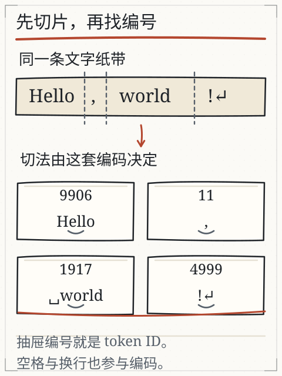
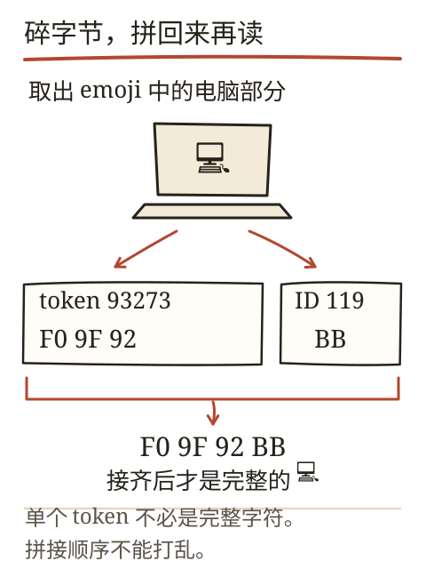
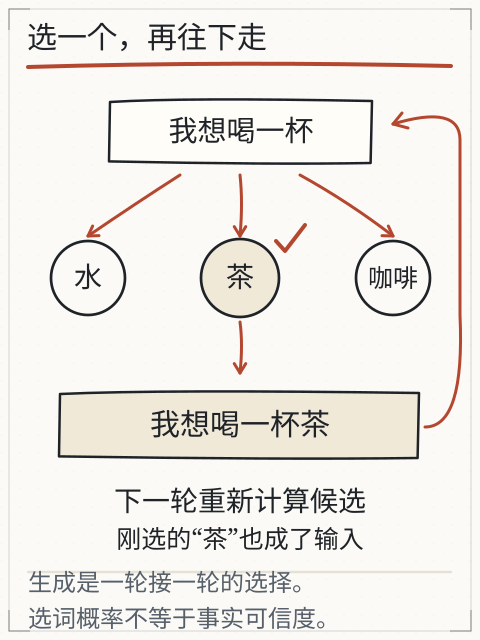
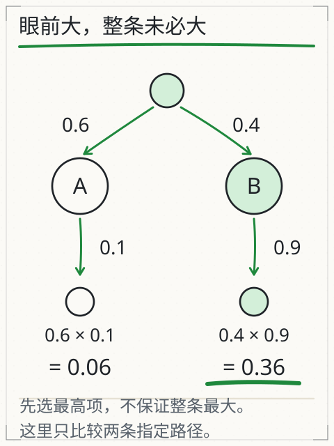

# C05 一句话怎样逐步生成

把一句话停在“他端起杯子，喝了一口……”。你接“水”，同事接“茶”，另一个人想到“咖啡”。三个人都把句子接顺了，可谁看见杯子里装的是什么？这一章拆开“接下去”这个动作：模型不是一次写完整段，而是一次算一个片段，选中、追加、再算下一步。

这一卷有一条贯穿的主线：`周六 下午 两点 在 图书馆 报名`。C05 先管最后一步——给定几个候选分数，怎样选中一个；分数本身从哪来，留给 C06 到 C08 一层层算。C09 再回来改这些分数。

读下去之前先做一个小准备：分数、比例、概率和为一，这三件事要能算。下面会从“一分成几份”开始，不要求先会矩阵。

## 先修桥：分数、比例与概率

一个袋子里有 3 个红球、1 个蓝球。红球占 `3/(3+1)=0.75`，蓝球占 `1/4=0.25`，两者相加为 1。概率就是这种“份额”，只是分母由模型算出来，不由你数球。

模型对下一步的每个候选给出一个分数（logit），分数可正可负，也不相加为 1。要把它们变成份额，常用 softmax：

`p_i = exp(s_i) / Σ_j exp(s_j)`

`exp(x)` 是 e 的 x 次方，e≈2.718。先把每个分数变成正数，再各自除以总和。分数大的候选份额大，但份额不会超过 1，全部候选相加等于 1。若分数里有很大的数，直接算 `exp` 可能溢出，程序通常先减去最大分数再算，比值不变。

## 从文字到编号：先切片，再查表

模型不直接读汉字。文本先被分词器切成片段（token），每个片段换成词表里的编号（ID），编号再用来查一行数字。片段可以是完整单词、半个单词、标点、空格，甚至一个汉字的部分字节。

以 `Hello, world!` 为例，旧实验的快照把它切成 `Hello`、`,`、` world`、`!` 四片；注意 `world` 前面的空格跟着它一起走。换成中文或生僻字符，切口可能落在字的中间。UTF-8 里 `A` 是一个字节 `41`，`中` 是三个字节 `E4 B8 AD`；如果分词器从中间切开，单独显示半截字节就会看到替代字符。把所有片段的字节按原顺序接回去，原文可以无损还原。

*图：原文被切成片段，再查成编号。片段数不等于字数，编号只是存储地址。*

*图：半截字节显示不成字，不代表原文坏了；按字节顺序拼接即可还原。*

主线句子在本课程的人工词表里切成六片：`周六`、`下午`、`两点`、`在`、`图书馆`、`报名`，对应的编号分别是 4102、2871、5530、2701、6984、3650。整句十二个汉字、六片，平均两字一片——这个比例只属于这张人工词表；真实分词器对同一句话可能给七片，也可能给九片。这五个编号是课程 fixture，用来让每一步算术都能复算；换成真实分词器，切法可能不同，编号也完全不同。编号大小说明不了任何语义：2701（在）比 4102（周六）小，与“谁更常用、谁更要紧”没有关系。

这里要记住两个“不相等”：

- **字数 ≠ token 数**：一个汉字可能一片，也可能多片；英文单词也可能被拆开。
- **ID 接近 ≠ 意思接近**：42 和 43 只是相邻的存储位置，语义关系要靠训练后的向量体现，而不是编号大小。

旧实验（[X01 分词](../../../exports/llm/tokens.html)）可以切换编码、展开每片的字节并还原原文。它只有固定快照，不能替任意新句子现场编码；真实接口还可能额外加入系统提示、聊天格式和工具定义，计量要按实际产品。

## 完整算例：三个候选，一个分数表

输入是 `周六 下午 两点 在 图书馆`，要预测下一片。假设模型只考虑三个候选，分数是：

| 候选 | 分数（logit） |
| --- | --- |
| 报名 | 1.9336 |
| 签到 | −0.0126 |
| 两点 | 0.3268 |

这三个数怎么算出来，是 C06 到 C08 的事：编号查表得向量，注意力在前文里汇总信息，输出头再把向量变成三个分数。眼下只练一件事——把分数变成概率。

`T=1` 时直接算：

- `exp(1.9336)=6.91436`，`exp(−0.0126)=0.98748`，`exp(0.3268)=1.38652`
- 总和 `9.28836`
- 概率约 `[0.7444, 0.1063, 0.1493]`

温度会先除分数，再算 softmax：

- `T=2`：分数变 `[0.9668, −0.0063, 0.1634]`，概率约 `[0.5477, 0.2070, 0.2453]`。分布变平，冷门候选机会变大。
- `T=0.5`：分数变 `[3.8672, −0.0252, 0.6536]`，概率约 `[0.9429, 0.0192, 0.0379]`。分布变尖，高分候选更集中。
- `T→0`：程序通常直接取分数最高的候选，不把这个极限硬塞进除法。

上表分数只有个位数，直接算 `exp` 不会出事。真实 logits 可能有几十上百的量级：`exp(1000)` 在 float32 里直接溢出成无穷大，归一化就得到 0/0。程序的标准做法是先减最大值再算——`exp(1.9336−1.9336)=1`、`exp(−0.0126−1.9336)=0.1428`、`exp(0.3268−1.9336)=0.2005`，总和 1.3433，概率仍是 `[0.7444, 0.1063, 0.1493]`。减掉的常数在分子分母里同时出现，比值不变，溢出风险消失。

温度改变的是“怎样从分数里抽”，不是“分数从哪里来”。它不能补上材料里缺失的地点，也不能把错误事实变正确。把 `T` 从 1 调到 0.5，“报名”的份额从 0.7444 升到 0.9429，但“图书馆里能不能报名”这件事，一点证据都没多出来。

再往下调一档，能看清温度到底在改什么。`T=0.2` 时分数变成 `[9.668, −0.0635, 1.634]`，概率是 `[0.999617, 0.000059, 0.000324]`；到 `T=0.1`，另外两个候选的概率已经小到打印出来是 0.000000。这时“抽样”名存实亡：只要分数差一点点，结果就锁死在高分候选上。温度不是“保守程度”旋钮，它只放大或压缩分数的差距；分数本身错得离谱时，低温只是把错误锁得更死。

## 三个候选之外：真实词表有多大

上面的算例只列了三个候选，真实模型的候选是整张词表——几万到十几万片。softmax 要对每一个候选算 `exp` 再归一化，所以“下一步”这一步本身就是一次覆盖全词表的计算：词表越大，这一步越贵。

这解释了三个常被忽略的现象：

- **概率被切得很碎**：词表有几万片时，即使 `T=1`，单个候选的概率也常常只有百分之几；“最高概率 0.08”并不表示模型瞎猜，只是候选太多。
- **看似无关的候选仍占份额**：它们加起来可能不小，采样的随机性就来自这里；把温度调到 0.2，等于把这几万片的空间压缩成一条窄缝。
- **步数与费用成正比**：一段几百字的回答要跑几百次“算分数、选一个、追加”，每次都是一次完整前向计算。屏幕上的打字速度、接口的计费口径，都绕不开这个循环。

把这三条与前面的算例对齐：分数表只有三个候选，是为了手算；真实系统里同一套流程在几万片候选上跑几百遍。流程不变，规模变了。

## 选中之后：追加与停止

抽样选中一个片段后，把它接到输入末尾，形成新输入，再算下一轮。这个循环叫自回归生成。下一步的候选依赖刚才写下的内容：第一步选中“报名”，下一步要接的可能是标点或“方式”；选中“签到”，候选又会变。

*图：当前输入产生候选；选中一片后接回末尾，更新输入再算。概率条只示意结构，准确数值由实验计算。*

选中“报名”之后，输入变成六片 `周六 下午 两点 在 图书馆 报名`，模型重新算出下一片的分数表。这里出现两个容易混淆的“都一样”：

- **流程一样，分数不一样**：每一步都做“查表—汇总—出分数”，但输入多了一片，分数表随之改变。
- **温度一样，结果也可能不一样**：同一温度下按概率抽样，两次运行可以抽到不同候选；只有把种子和实现都固定，才谈得上复现。

生成会在几种情况下停：

- 选中停止标记（它通常不写进正文）；
- 达到步数或长度上限；
- 服务端规则要求停止。

看到文字不再增加时，要检查停止原因。若最后一句断在半路，不能把它当完整回答。旧实验（[X02 生成](../../../exports/llm/generation.html)）会直接显示停止原因，还能固定种子重放同一次抽样；真实服务的并行计算、版本和解码实现不同，零温度也不保证逐字复现。

## 每步最大，整段一定最好吗

不一定。假定第一步 A 的概率 0.6、B 的概率 0.4；走 A 后目标片段概率 0.1，走 B 后是 0.9。两条完整路径的概率是：

- A 路：`0.6 × 0.1 = 0.06`
- B 路：`0.4 × 0.9 = 0.36`

第一步 A 更大，整条路却更小。贪心解码每步取最大，采样按概率抽，top-k 先留若干高分候选，top-p 先留累计概率达到阈值的一组再归一化。用上面的分数表在 `T=1` 时做 top-p=0.9：先取“报名”0.7444，累计 0.7444；再取“两点”0.1493，累计 0.8937；还不够 0.9，于是把“签到”也纳入，三个候选全留。阈值卡在中间时，一个候选的去留会改变归一化后的分布，这一点比“top-p 更聪明”更值得记住。

*图：只比较图中两条指定路径，不是完整搜索树；它说明“每步最大”不等于“整段最大”。*

## 分数错了，错在哪一层

`报名` 拿到 1.9336，`两点` 只有 0.3268。这个差距可以来自三个不同的地方，修法完全不同：

1. **前文没看见关键信息**：如果输入里没有“图书馆”，模型不可能给“报名”高分。这时要改的是材料，不是温度；把温度调低只会更稳定地选错。
2. **看见了但没汇总到**：前文有“图书馆”，注意力却没把它的信息带到当前位置，分数就仍然低。这时要改的是 C07 的注意力权重与 C08 的拼接方式。
3. **汇总了但输出头偏**：向量里已经有“地点+动作”的信息，输出头给“报名”的分数仍然偏低。这时要改的是输出头这一层，训练（C09）就是改它的手段之一。

判断落在哪一层，靠的是同一套动作：改一个条件、看分数怎么动。只改温度不在此列——它不动分数，只动抽样。

这条分层的用处是：以后遇到“模型答得不对”，先问“它是没看见、没汇总，还是输出头偏”，而不是笼统地说“模型不行”。三者的证据不同，修法也不同。

## 失败对照

1. **概率高就当真**：最高概率只表示“这段前文后更容易接出它”，不表示事实为真。材料没写杯里是什么，抽到“水”也没有增加证据。
2. **调低温度就不编**：温度让分布变尖，错误照样可能被更稳定地选中；把“报名”的份额推到 0.9429，也只是更稳定地选它。
3. **把显示速度当计算速度**：屏幕上的打字动画受网络和前端影响，不能反推模型内部步数。
4. **忽略截断**：达到长度上限时最后一句可能不完整，报告不能照抄。
5. **拿另一套词表的 ID 喂模型**：编号只在对应词表里有意义，换编码器要重新编码。

## 独立作业（数值容差 ±0.001）

1. 分数 `[0, 1, 1]`，分别算 `T=1` 与 `T=0.5` 时三个候选的概率（先写 exp 值，再写归一化结果）。
2. 用上面的两路口例子，算“先 A 再目标”和“先 B 再目标”的整条概率，并说明第一步贪心会选哪条。
3. 字符串 `A中` 的 UTF-8 字节是什么？如果分词器把它切成 `41`、`E4`、`B8 AD` 三片，直接逐片显示会看到什么？怎样验证还原正确？
4. 某次生成在“因此，我们建议”处停止，原因是达到最大长度。这份输出能否直接作为结论？写出你要检查的两件事。
5. 同一提示两次回答不同，列出至少三个可能原因，并说明哪一个能靠固定种子在本地实验中排除。

核对值与判分要点在 [C05 答案](../deepening/c05-answer.md)。

## 项目增量：生成记录 v1

S2 的项目从“资料报告”转向“机制记录”。新建 `generation-log.md`，每次观察记一行：

`输入原文 | 分词/字节快照 | 温度与采样设置 | 实际输出（截断处标出） | 停止原因 | 是否核验事实`

至少做两类记录：一类用本地教学实验（可重放），一类用你能访问的聊天产品（记下版本、模式、可见设置；看不到的就写“未知”）。不要编造模型输出；没有实际运行就留空，并注明原因。

## 来源与边界

本章沿用旧课 [L01 文字怎样变成模型的输入](tokens.md) 与 [L02 为什么同一句话能接出不同结果](generation.md) 的字节、分词、生成循环与停止说明，复用图 G25/G26/G27/G28 的原始出处。主线句子的五个编号、三个候选分数（1.9336、−0.0127、0.3268）以及 `[0,1,1]` 练习、两路口概率都是课程人工数值，**不是从 DeepSeek、Kimi 或任何模型内部读出的 logits**；它们只用于练 softmax、温度、top-p 与路径概率。真实产品的 token 计数、可选温度和停止字段以其文档与界面为准。
