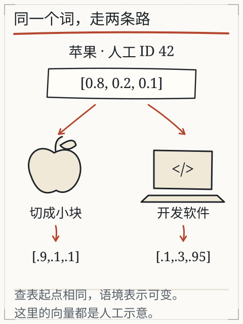
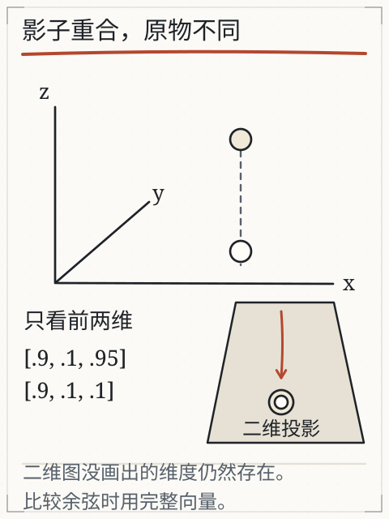

# C06 一串数字怎样表示文字

“他把苹果切成小块。”和“她在苹果公司开发软件。”同样是“苹果”，你的理解会跟着后半句转弯。模型拿到的却是一串数字。它会给“苹果”换一个编号，还是保留编号、改变后面的表示？

本章要搭一座小桥：从坐标、点积、长度到余弦相似度，全部用可手算的数字。桥搭好后，才能判断“两个向量很像”到底在说什么，以及为什么屏幕上的二维图可能骗人。

## 先修桥：坐标、点积、长度

把三个数排成一行 `[1, 2, 3]`，可以看成三维空间里的一个点，也可以看成从原点指向该点的一支箭头。两个向量 `a=[1,2,3]`、`b=[4,5,6]` 的点积是：

`a·b = 1×4 + 2×5 + 3×6 = 4+10+18 = 32`

点积把“对应位置相乘再相加”。向量的长度（范数）是各分量平方和开根号：

- `‖a‖ = √(1+4+9) = √14 ≈ 3.7417`
- `‖b‖ = √(16+25+36) = √77 ≈ 8.7750`

余弦相似度把长度除掉，只比较方向：

`cos(a,b) = (a·b) / (‖a‖×‖b‖)`

代入得 `32 / (3.7417×8.7750) ≈ 32/32.8329 ≈ 0.9746`。值接近 1，表示两支箭头方向接近；它不表示两个数组相同，也不表示两句话意思相同。

若两个向量同向但长度不同，例如 `[1,0]` 与 `[2,0]`，余弦为 1，可它们不是同一个数组。零向量 `[0,0,0]` 没有方向，余弦没有定义；程序应显示“未定义”，不能当成相似度 0。

## 编号查表，向量参与计算

token ID 像书架编号：它告诉程序“到第几行取数据”。取出的那一行数字叫嵌入向量，参与后续计算。42 号挨着 43 号，只说明存放位置相邻，不能说明语义相近。

课程用人工数据把“苹果”暂当作一个 token，编号设为 42，初始向量为 `[0.8, 0.2, 0.1]`。这是示意，不是实际分词器或模型读数；真实 tokenizer 可能把这两个字切成多个片段，真实向量也不会正好是这三个数。

*图：同一个编号从同一初始向量出发，在两种语境中得到不同示意表示。数字是人工 fixture，不是运行网络算出的真实表示。*

在“切成小块”的语境里，课程把上下文表示写作 `[0.9, 0.1, 0.1]`；在“公司开发软件”里写作 `[0.1, 0.3, 0.95]`。两行都从同一行起点出发，结果不同，说明网络可以让当前位置的表示受到可见上下文影响。至于网络内部怎样逐层算出这两个结果，要等 C07 的注意力与 C08 的组装；现在先认清“起点相同、处理结果可以不同”。

## 手算两次相似度

用同一初始向量分别和两种上下文表示比较：

与“水果”表示：

- 点积 `0.8×0.9 + 0.2×0.1 + 0.1×0.1 = 0.72+0.02+0.01 = 0.75`
- `‖a‖=√(0.64+0.04+0.01)=√0.69≈0.8307`
- `‖b‖=√(0.81+0.01+0.01)=√0.83≈0.9110`
- 余弦 `0.75/(0.8307×0.9110) ≈ 0.991`

与“公司”表示：

- 点积 `0.08+0.06+0.095 = 0.235`
- `‖c‖=√(0.01+0.09+0.9025)=√1.0025≈1.0012`
- 余弦 `0.235/(0.8307×1.0012) ≈ 0.283`

所以“初始苹果”与水果语境更接近，与公司语境较远。这个结论只适用于这三组人工数字，不能推广成“模型一定这样理解苹果”。

## 投影边界：影子重合，原物不同

二维图只能画前两维。取 `[1,1,0]` 与 `[1,1,2]`：它们在纸上的影子完全重合，第三维却差了 2。用全部三维算：

- 点积 `1+1+0 = 2`
- 长度 `√2≈1.4142` 与 `√6≈2.4495`
- 余弦 `2/(1.4142×2.4495) ≈ 0.5774`

影子一样，真实相似度并不是 1。图上的轴也只是数字维度，没有哪一根被保证是“甜度”或“公司程度”；训练可以形成有用的方向，但那是事后观察，不是事先贴好的标签。

*图：只画前两维时两点重合；第三维仍参与计算，所以余弦不同。*

## 相似度能做什么，不能做什么

语义搜索可以把问题和文档片段变成向量，按相似度找候选。例如“怎么退货”可能取回写着“申请退款与退回商品”的段落，而不必字面相同。但取回只是缩小范围：

- 旧版政策的文字可能同样相似，日期与适用范围决定它是否现行；
- 相似度高不等于事实正确，也不等于回答有用；
- 换嵌入模型或维数后，旧索引与新分数不能直接混用，要重建或记录版本。

旧实验（[X03 向量](../../../exports/llm/vectors.html)）可以在两句话之间切换，观察初始向量不变、上下文表示改变，并展开第三维。它只有人工表，不能当作真实模型的内部读数。

## 失败对照

1. **把 ID 当语义**：42 与 43 相邻，就说“苹果”和“香蕉”意思近。
2. **只看二维图**：影子近就判为同一向量，忽略未画出的维度。
3. **把余弦当概率**：0.99 不是“99% 正确”，它只描述方向接近。
4. **同向当相同**：`[1,0]` 与 `[2,0]` 余弦为 1，但不是同一数组。
5. **零向量算相似**：长度为零，分母为零，结果应标未定义。

## 独立作业（容差 ±0.001）

1. 算 `a=[1,2,2]` 与 `b=[2,1,0]` 的点积、各自长度与余弦。
2. 算 `[1,1,0]` 与 `[1,1,2]` 的余弦，并解释为什么二维影子相同而余弦小于 1。
3. 判断并说明：`[0,3,0]` 与 `[0,5,0]` 的余弦是多少？它们是不是同一个向量？
4. 向量 `[0,0,0]` 与任意向量的余弦应怎样报告？为什么不能写 0？
5. 用一句话解释：为什么“token ID 接近”不能推出“语义接近”，而“上下文表示接近”也只能作为线索？

核对过程在 [C06 答案](../deepening/c06-answer.md)。

## 项目增量：向量核对表 v1

在 S2 项目里新增 `vector-check.md`，列：

`词/片段 | ID（若可见） | 初始向量 | 上下文 A 表示 | 上下文 B 表示 | 余弦 A/B | 数据来源（人工/实测）`

要求：

- 人工数字必须标“课程示意”，不能写成模型实测；
- 每次换向量或语境，记录维度与版本；
- 对至少一组“影子重合”的向量写出第三维差异；
- 结论只写“本次比较中谁更接近”，不写“模型理解了”。

## 来源与边界

本章沿用旧课 [L03 一串数字怎么表示语言](vectors.md) 的编号/向量区分与人工向量表，以及深入页 [vectors.md](../deepening/vectors.md) 的余弦、零向量与投影说明，复用图 G29/G30/G03/G19 的出处。`[0.8,0.2,0.1]` 等数字均为课程人工 fixture，没有运行嵌入模型；真实向量维度、归一化方式与相似度实现因模型而异，接入时要按对应模型卡与代码核对。
