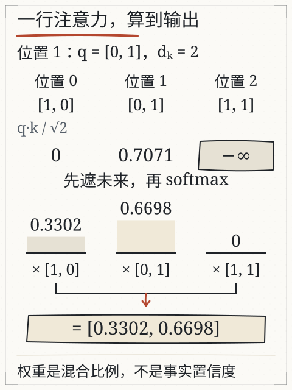
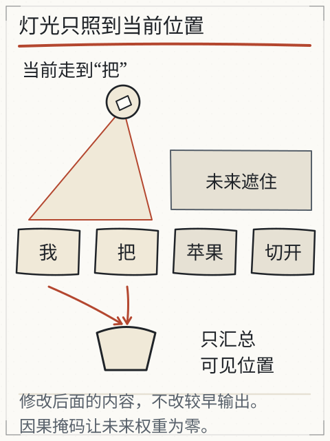
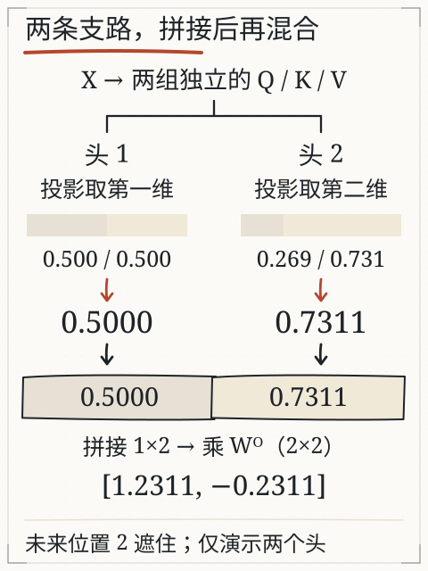

# C07 注意力到底计算了什么

用手遮住“我把苹果切开”的后半句，只露出“我把”。站在“把”这个位置，你能看到“苹果”吗？训练时整句都在材料里，模型会不会提前偷看后面的答案？本章把一次注意力拆成四步：投影出 Q/K/V、算匹配分数、遮住未来、按权重汇总。每一步都能手算。

## 先修桥：矩阵形状与加权平均

先复习两个动作。

**矩阵乘法**：一个 `m×n` 矩阵乘一个 `n×p` 矩阵，得到 `m×p` 矩阵。结果第 i 行第 j 列，是左矩阵第 i 行与右矩阵第 j 列对应相乘再相加。例如：

```
[1 0]   [1 0]   [1 0]
[0 1] × [0 1] = [0 1]
[1 1]           [1 1]
```

这是 3×2 乘 2×2，得到 3×2；单位矩阵不改变输入。

**加权平均**：两个数 10 和 20，权重 0.25 与 0.75，结果是 `0.25×10 + 0.75×20 = 17.5`。权重相加为 1，结果落在两个数之间。注意力最后一步就是这种加权，只是每个“数”换成一行向量。

## Q、K、V 各做什么

同一行输入表示，经过三组不同的学到的参数，得到三种用途：

- **Q（查询）**：当前位置想找什么。
- **K（键）**：每个位置能提供什么“匹配条件”。
- **V（值）**：每个位置实际要汇入的内容。

这不是三个会主动思考的角色，而是三组投影结果。用一个 3 个位置、每位置 2 维的例子：

```
X = [1 0]     WQ = WK = WV = [1 0]
    [0 1]                     [0 1]
    [1 1]
```

取单位矩阵是为了让手算看得见：`Q=K=V=X`。真实模型的三组参数不同，形状也可能不同；本章只练计算关系。

## 站在第二个位置，算一行

位置编号从 0 开始。现在站在位置 1（输入 `[0,1]`），它只能看见位置 0 和 1，位置 2 是未来。

**第一步，算分数**：当前位置的 Q 与各可见位置的 K 求点积，再除以 `√d_k`。这里 `d_k=2`，`√2≈1.4142`。

- 与位置 0：`q·k0 = 0×1 + 1×0 = 0`
- 与位置 1：`q·k1 = 0×0 + 1×1 = 1`
- 除以 `√2`：`[0, 0.7071]`

**第二步，遮住未来**：位置 2 的分数设为负无穷（计算中常写成很大的负数）。`exp(-∞)=0`，它在 softmax 里权重为 0。这样可见位置的权重和为 1，未来位置不贡献。

**第三步，softmax**：对 `[0, 0.7071]`：

- `exp(0)=1`
- `exp(0.7071)≈2.0281`
- 总和 `3.0281`
- 权重 `[0.3302, 0.6698]`

**第四步，加权汇总 V**：可见 V 是 `[1,0]` 与 `[0,1]`：

`输出 = 0.3302×[1,0] + 0.6698×[0,1] = [0.3302, 0.6698]`

第一个分量只来自位置 0 的 V 第一维，第二个分量只来自位置 1 的 V 第二维。权重说明“这次混合各取多少”，不是“模型有多相信某句话”。



*图：沿同一行从上往下读。位置 2 的分数先被遮成 −∞，因此权重为 0；另两项的条高按实际权重绘制，再分别乘对应的 V。这里与上面的单位投影例子使用同一组数。*

本例输出恰好等于两项权重，是因为 V 恰好为 `[1,0]` 与 `[0,1]`。如果只把 V 改成 `[2,0]` 与 `[0,4]`，保持 Q、K 不变，权重仍是 `[0.3302,0.6698]`，输出却变成约 `[0.6605,2.6790]`。权重决定取多少，V 决定取回什么；不要把“输出向量”与“注意力权重”混为一谈。

## 主线算例：五个位置的 Q/K/V

最小例子只有三个位置、单位投影。主线句子更长，投影也不再是单位阵。输入是五片 `周六 下午 两点 在 图书馆`，每片一行四维向量（C06 的表）。先给三组投影参数：

```
WQ = [ 2 -2 -1 -1 ]      WK = [ -2 -1  0 -2 ]      WV = [ 1 0 0 0 ]
     [ 0  2  2  2 ]           [  2  2  2  2 ]           [ 0 0 1 0 ]
```

四维进、二维出，所以每个位置的 Q、K、V 都是两个数。这些参数是为了让手算有结果而设定的，不是任何模型的权重；真实模型的 `WQ` 是几千乘几千的矩阵，没人手算。算完五片，得到：

| 位置 | 片段 | Q | K | V |
| --- | --- | --- | --- | --- |
| 0 | 周六 | `[1.2, 0.4]` | `[−1.4, 1.6]` | `[0.6, 0.2]` |
| 1 | 下午 | `[−0.4, 0.8]` | `[−1.2, 1.2]` | `[0.2, −0.2]` |
| 2 | 两点 | `[−0.2, 0.8]` | `[−0.2, 1.2]` | `[0.2, 0.4]` |
| 3 | 在 | `[0.0, 1.2]` | `[−1.4, 2.0]` | `[0.4, 0.2]` |
| 4 | 图书馆 | `[−2.0, 2.0]` | `[−0.6, 1.6]` | `[−0.2, 0.2]` |

验算一格：位置 4 的 Q 是 `[2,−2,−1,−1]` 乘 `[−0.2, 0.6, 0.2, 0.2]`，得到 `−0.4−1.2−0.2−0.2 = −2.0`；第二行 `[0,2,2,2]` 乘同一向量得 `1.2+0.4+0.4 = 2.0`。

## 站在最后一个位置，算一行

位置 4（图书馆）能看见全部五个位置，所以这一行没有未来要遮。先算原始分数，即 Q 与各 K 的点积：

| 对 | 原始点积 | 除以 √2 |
| --- | --- | --- |
| 图书馆 · 周六 | 6.0 | 4.2426 |
| 图书馆 · 下午 | 4.8 | 3.3941 |
| 图书馆 · 两点 | 2.8 | 1.9799 |
| 图书馆 · 在 | 6.8 | 4.8083 |
| 图书馆 · 图书馆 | 4.4 | 3.1113 |

`√d_k=√2≈1.4142`。缩放后差异被压缩，但仍然保持排序。softmax 之后：

| 被看位置 | 权重 |
| --- | --- |
| 周六 | 0.2766 |
| 下午 | 0.1184 |
| 两点 | 0.0288 |
| 在 | 0.4870 |
| 图书馆 | 0.0892 |

五行相加 `0.2766+0.1184+0.0288+0.4870+0.0892 = 1.0000`。这组权重值得逐条读：

- **“在”最高 0.4870**：位置 4 是地点，“在”是引出地点的介词，这两个位置的 Q/K 对齐得最好。
- **“自己”只有 0.0892**：和最小例子（自己占 0.6698）完全相反。权重分布由参数决定，不是“模型总会多看自己”这类规则。
- **“两点”最低 0.0288**：它在这里提供的信息最少。

最后一句话很关键：这三个数字只说明这组人工参数下谁被取回多少，不能读成“模型认为‘在’更重要”。

## 汇总：从权重到向量

权重乘各自 V 再相加，得到位置 4 的输出：

- `0.2766×[0.6,0.2] + 0.1184×[0.2,−0.2] + 0.0288×[0.2,0.4] + 0.4870×[0.4,0.2] + 0.0892×[−0.2,0.2]`
- 第一维：`0.1659+0.0237+0.0058+0.1948−0.0178 = 0.3724`（权重取四位小数会让末位差 0.0001）
- 第二维：`0.0553−0.0237+0.0115+0.0974+0.0178 = 0.1583`

得到 `o = [0.3723, 0.1584]`（按未舍入权重算）。二维的 `o` 还不能直接接回四维的输入，所以再乘一次输出投影 `WO`：

```
WO = [ 1 0 ]
     [ 0 1 ]
     [ 1 0 ]
     [ 0 1 ]
```

`WO·o = [0.3723, 0.1584, 0.3723, 0.1584]`。这一步把二维的“取回结果”铺回四维，才能与原来的嵌入相加。残差连接就是这次相加：

`h = e(图书馆) + WO·o = [−0.2, 0.6, 0.2, 0.2] + [0.3723, 0.1584, 0.3723, 0.1584] = [0.1723, 0.7584, 0.5723, 0.3584]`

这四行算式就是“一层注意力”的全部产出。C08 接着把它送进归一化、前馈层和输出头，最终得到 C05 用的三个分数。

## 为什么要除以 √d_k

上表如果省掉缩放，直接把原始点积送进 softmax，会得到：

| 被看位置 | 未缩放权重 | 缩放后权重 |
| --- | --- | --- |
| 周六 | 0.2653 | 0.2766 |
| 下午 | 0.0799 | 0.1184 |
| 两点 | 0.0108 | 0.0288 |
| 在 | 0.5904 | 0.4870 |
| 图书馆 | 0.0536 | 0.0892 |

未缩放时“在”的权重从 0.4870 涨到 0.5904，“两点”从 0.0288 掉到 0.0108——分布更尖。这不是数值误差，而是 softmax 的输入整体放大了 `√2≈1.4142` 倍，差距随之放大。

维度越大，这个放大越严重：`d_k=64` 时 `√d_k=8`，`d_k=128` 时约 11.3，点积本来就会随维度累积变大。不缩放的话，softmax 会越来越接近“只留一个”，梯度也随之变小，训练更难推进。除以 `sqrt(d_k)` 就是把量级拉回来，让不同维度的模型有可比的行为。

这条也能反过来用：看到别人的注意力权重异常尖（某项 0.99），先问有没有缩放、缩放因子是多少；看到异常平（各项 0.2 附近），先问是不是被过度缩放或温度开得太大。

## 五行的权重表放在一起看

把五个位置各算一行（每行只填可见位置，其余为掩码）：

| 查询位置 | 周六 | 下午 | 两点 | 在 | 图书馆 |
| --- | --- | --- | --- | --- | --- |
| 周六 | 1.0000 | — | — | — | — |
| 下午 | 0.5702 | 0.4298 | — | — | — |
| 两点 | 0.4085 | 0.3167 | 0.2749 | — | — |
| 在 | 0.2612 | 0.1860 | 0.1860 | 0.3668 | — |
| 图书馆 | 0.2766 | 0.1184 | 0.0288 | 0.4870 | 0.0892 |

三个可复算的性质：

1. **每行和为 1**：掩码位置不参与归一化，所以可见部分的权重和为 1，不是“五行加起来等于 1”。
2. **第一行只能是 1**：位置 0 只看自己，没有别的选择——这不是“模型很有把握”，是掩码决定的。
3. **越往后越分散**：位置 1 只有两个选择，位置 4 有五个；可选位置越多，单个权重通常越小。看到“最高权重只有 0.28”时，先看这一行有几个可见位置。

## 整张矩阵在算什么

把三个位置一起算，形状是这样：

- `X` 是 3×2，`WQ` 是 2×2，`Q` 是 3×2；K、V 同理。
- `QKᵀ` 是 (3×2)·(2×3)=3×3，第 i 行第 j 列是位置 i 的 Q 与位置 j 的 K 的点积。
- 除以 `√d_k`，再对每一行做 softmax；上三角（未来）已被遮住。
- 权重矩阵 3×3 乘 V（3×2），得到输出 3×2。

`Kᵀ` 只是把 K 的行列交换，好让 Q 的每一行与 K 的每一行逐一相乘。mask 在 softmax 之前生效；softmax 是按行做的，所以每一行的权重各自相加为 1。



*图：因果掩码让每个位置只能看见自己和之前的位置；红色表示可见范围，不是权重大小。*

## 一个头不够：多头的用处

上面这一整套只用了三组参数 `WQ`、`WK`、`WV`，得到一个 `2` 维的输出。这叫一个头。真实模型会并行算几组到几十组，每组一套自己的 `WQ`、`WK`、`WV`，各自算出一行权重、汇总出一个小向量，最后拼接起来。

为什么这样做有效，用主线句子能看出一半：

- 一组参数可能把“在”和“图书馆”对齐得最好（上面这张表的 0.4870）；
- 另一组参数可能更关注时间线，让“两点”与“下午”互相加分；
- 还有一组可能只关心相邻位置，把“周六”和“下午”连起来。

同一条输入、同一套掩码，换一组投影就换一个“关注角度”。拼接之后，位置 4 的表示里同时有地点线索与时间线索，输出头才有材料去选“报名”。代价是参数量与计算量随之增加——每个头都要算一遍分数矩阵。



*图：两个头各自投影、各自汇总，拼接后乘输出投影。图中数字是另一组人工矩阵（C08 展开），与本章主线算例不是同一组参数。*

## 注意力的成本：一张 n×n 的表

序列有 `n` 个位置，就要算 `n×n` 个分数（掩掉一半仍然是这个数量级）。这个二次关系决定了三件事：

- `n=10` 时 100 个分数，手算可行；
- `n=10 000` 时一亿个分数，只有 GPU 能算，且显存吃紧；
- `n=100 000` 时一百亿个分数，这就是“长上下文很贵”的来源。

有些实现靠稀疏化、分块或近似把这张表压小，代价是“每个位置都能看到所有前文”不再严格成立。读架构说明时看到“线性注意力”“滑动窗口”，说的就是这类交换。C20 讲长上下文时会回到这张表。

## 改一个条件：动未来，输出会变吗

站在位置 1，把位置 2 的 V 从 `[1,1]` 改成 `[100,-100]`。先猜输出会不会变，再算：位置 2 的权重是 0，`0×[100,-100]=[0,0]`，所以输出仍是 `[0.3302, 0.6698]`。

再把位置 2 的 K 改得很大，分数仍然被 mask 成负无穷，权重仍是 0，输出不变。这两个测试检查的是**因果边界**：未来内容不能通过这一层影响当前位置。

如果站在位置 2（最后一个位置），未来为空，所有位置都可见；这时改位置 1 的 V 就会改变输出。边界不是“永远只能看两个位置”，而是“不能看自己后面”。

旧实验（[X04 注意力](../../../exports/llm/attention.html)）可以选位置、修改未来 V、对照修改前后的数值，并把一次计算分成“可见—分数—权重—汇总”几步。它使用人工小矩阵，省去投影计算，不是模型内部读数。

## 注意力的边界

一次注意力只是一层、一个头的局部汇总。真实模型还要：

- 用多组 Q/K/V 投影做多头，再拼接（C08）；
- 经过前馈层、残差连接与归一化；
- 加入位置信息，否则同一组词的不同顺序难以区分；
- 堆叠多层，并经过输出头得到词表分数。

注意力权重也不是完整的“思考记录”。权重高只说明这个头这次多取了一些 V，不能直接读成“模型认为这句话重要”或“这句话为真”。

## 失败对照

1. **忘记缩放**：分数随维度变大，softmax 过尖；`√d_k` 是常用的缩放。
2. **先 softmax 再 mask**：未来位置已经分到权重，再置零会破坏“每行和为 1”，必须先遮再归一化。
3. **mask 用 0 分**：0 分不是“看不见”，它仍可能得到非零权重；要用负无穷或等价的加性掩码。
4. **把权重当事实置信度**：权重是混合系数，不是正确概率。
5. **忽略形状**：`QKᵀ` 的行是查询位置、列是被看位置；转置弄反，mask 方向也会反。

## 独立作业（容差 ±0.002）

1. 取 `q=[1,1]`，可见 `k1=[1,0]`、`k2=[0,3]`，`d_k=2`。算两个缩放后分数、softmax 权重。
2. 对应 `V1=[1,2]`、`V2=[3,0]`，算加权汇总输出。
3. 若把未来的 `k3` 设为 `[9,9]`、`V3` 设为 `[5,5]`，输出会不会变？说明理由。
4. `X` 为 4×3，`WQ`、`WK`、`WV` 均为 3×2：写出 Q、`QKᵀ`、权重矩阵、输出各自的形状。若只把 `WV` 换成 3×5，哪一步的形状会变？
5. 用自己的话说明：为什么“先 mask 再 softmax”与“先 softmax 再 mask”不等价。

核对过程在 [C07 答案](../deepening/c07-answer.md)。

## 项目增量：注意力轨迹 v1

在 S2 项目里新增 `attention-trace.md`，选一个位置，记录：

`位置 | 可见位置 | 原始分数 | 缩放后分数 | softmax 权重 | 各 V | 输出向量 | 未来改动是否影响`

至少做一次“修改未来 V”的对照，并保留修改前后的数值。数据可以来自旧实验或手算；标明是人工矩阵，不写成模型内部读数。

## 来源与边界

本章沿用旧课 [L04 模型怎样利用前文](attention.md) 的 Q/K/V、因果掩码与加权汇总，以及旧实验 X04 的计算方法。G31 保留可见范围示意；G52 专为本章单位投影例子计算，不混用旧实验矩阵。单位投影与 `[0,0.7071]`、主线五行的 Q/K/V 与 `[0.2766, 0.1184, 0.0288, 0.4870, 0.0892]` 都是课程为手算设计的，**不是 DeepSeek、Kimi 或任何模型的内部 Q/K/V**；真实模型的头数、维度、缩放方式和掩码实现要按架构与代码核对。
