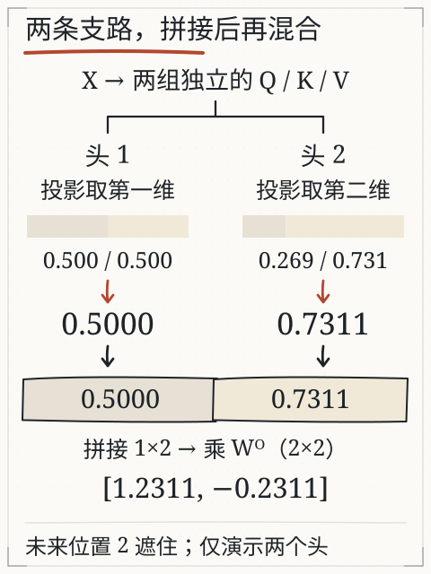
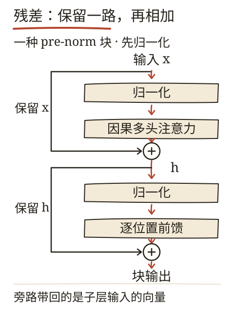

# C08 怎样拼成一个 Transformer

C07 停在最后一行注意力：位置“图书馆”汇总出 `o = [0.3723, 0.1584]`，加上残差得到 `h = [0.1723, 0.7584, 0.5723, 0.3584]`。C05 则从 `[1.9336, −0.0126, 0.3268]` 这三个分数出发讲了采样。中间那一大段——归一化、前馈层、再加一次残差、最后乘输出头——正是这一章要补的接线。

补完之后，同一个位置会走完整条链：`h → 归一化 → 前馈 → 残差 → y → 输出头 → 三个分数`。C05 里被当成“给定值”的 `1.9336`，在这一章会变成一个能逐格复算的结果。

本章保留课程自带的双头 fixture 作为第二个例子。它不是多余的：主线例子里每个位置只有四个数、一个头，看不出“多头”到底怎么并存；fixture 用一个能跑的小矩阵把拼接和输出投影摊开。

## 先修桥：层、维度与沿路径追踪

三个词先落到具体数字上：

- **维度**：一个位置用几个数表示。主线例子每个位置 4 维，注意力内部投影到 2 维。
- **层**：一组按顺序执行的计算。输入经过注意力、前馈、归一化等，可以堆叠多层。
- **沿路径追踪**：选定一个位置，跟着它的向量从输入走到输出，每步记下形状与数值，不跳步。

主线例子的形状在每一步都固定：

| 步骤 | 形状 | 主线取值（位置“图书馆”） |
| --- | --- | --- |
| 词嵌入 E | 4 | `[−0.2, 0.6, 0.2, 0.2]` |
| 注意力输出 o | 2 | `[0.3723, 0.1584]` |
| 残差 h | 4 | `[0.1723, 0.7584, 0.5723, 0.3584]` |
| 归一化 LN(h) | 4 | `[−1.3285, 1.3285, 0.4850, −0.4850]` |
| 前馈输出 a2 | 4 | `[0, 1.8134, 0, 0]` |
| 块输出 y | 4 | `[−1.3285, 3.1419, 0.4850, −0.4850]` |
| 三个候选分数 | 3 | `[1.9336, −0.0126, 0.3268]` |

表里唯一的“跨越”是注意力：4 维进去，2 维出来；输出投影 `W_O` 再把它变回 4 维，才能和残差相加。这个形状约定贯穿全书，后面每一层都必须遵守。

## 双头例子：输入与参数

课程的人工 fixture（`book/llm/fixtures/multihead.json`）给出：

```
X = [1 0]       位置 0
    [0 1]       位置 1
    [1 1]       位置 2

头1：WQ=[[1],[0]]，WK=[[1],[0]]，WV=[[1],[0]]
头2：WQ=[[0],[1]]，WK=[[0],[1]]，WV=[[0],[1]]
输出矩阵 WO = [[1, 1],
               [1, -1]]
当前位置 position = 1
```

每个头把 2 维投影成 1 维，所以单头输出是 1 个数；两个头拼接成 2 维，再乘 2×2 的 WO。这个例子能实际运行（`node book/llm/examples/multihead.mjs`）。下文保留中间计算，显示时按需舍入，最后列出程序的完整输出。

## 头 1：只取第一维

投影：

- `Q = X·WQ`，每一行取第一维：`[1, 0, 1]`
- K、V 相同：`[1, 0, 1]`

站在位置 1，q=0，只能看见位置 0 和 1：

- 与 k0=1 的点积：`0×1=0`
- 与 k1=0 的点积：`0×0=0`
- `d_k=1`，缩放后仍是 `[0, 0]`
- softmax：`[0.5, 0.5]`
- 汇总 V：`0.5×1 + 0.5×0 = 0.5`

头 1 输出 `[0.5]`。

## 头 2：只取第二维

投影：

- `Q = [0, 1, 1]`
- K、V 相同：`[0, 1, 1]`

站在位置 1，q=1，可见 k 为 0 和 1：

- 点积：`[0, 1]`
- `d_k=1`，缩放后仍 `[0, 1]`
- softmax：`exp(0)=1`，`exp(1)=2.71828`，总和 `3.71828`
- 权重：`[0.2689414, 0.7310586]`
- 汇总 V：`0.2689414×0 + 0.7310586×1 = 0.7310586`

头 2 输出 `[0.7310586]`。

## 拼接与输出投影

两个头的结果拼成 `[0.5, 0.7310586]`。乘 WO：

- 第一维：`0.5×1 + 0.7310586×1 = 1.2310586`
- 第二维：`0.5×1 + 0.7310586×(-1) = -0.2310586`

实际程序输出为 `[1.2310585786300048, -0.2310585786300049]`。显示时的末位差异来自浮点表示，不是两种算法。



*图：左右支路分别算出 0.5000 与 0.7311；并排放入拼接向量，再一起乘 WO。两段比例条对应可见位置 0 和 1 的权重，未来位置 2 已遮住。图中数值由同一 D14 程序计算；未包含位置、残差、归一化、前馈层或训练。*

## 为什么拼接后还要乘 WO

每个头输出的维度、含义由各自的投影决定。直接拼起来只是把两段数放在一起；WO 让模型学习怎样混合这些头的信息，并把拼接维度映射回需要的宽度。它不是“投票”，也没有固定的“头 1 管语法、头 2 管语义”的分工。头的作用要通过对具体输入和权重的分析来判断，不能凭编号分配。

我也可以把两个头的结果相加而不是拼接，但那是另一种设计；本例按“拼接再投影”实现。改 WO 会改变最终向量，改某个头的 V 只会通过该头的输出影响结果。

## 主线接续：先把 h 归一到同一把尺子上

回到主线。`h = [0.1723, 0.7584, 0.5723, 0.3584]` 这一组数的四个分量差别不大：最大 0.7584，最小 0.1723，相差不到五倍。问题在于它们的大小取决于上游所有参数，一层层堆下去，尺度会漂。LayerNorm 做的事是把每个位置自己的四个数平移、缩放，使均值变 0、方差变 1：

`mean = (0.1723 + 0.7584 + 0.5723 + 0.3584) / 4 = 0.4654`

`h − mean = [−0.2930, 0.2930, 0.1070, −0.1070]`

方差取各分量平方的平均：

`var = (0.2930² + 0.2930² + 0.1070² + 0.1070²) / 4 = 0.0487`

`sd = √0.0487 = 0.2206`

于是逐项相除：

`LN(h) = (h − mean) / sd = [−1.3285, 1.3285, 0.4850, −0.4850]`

四个数的和正好是 0，这是定义保证的。第一维和第二维互为相反数、第三维和第四维互为相反数，也不是巧合：原向量里 `h₁−h₂ = −0.5861`、`h₃−h₄ = 0.2139`，比值 `0.5861/0.2139 ≈ 2.74`；归一化后 `1.3285/0.4850 ≈ 2.74`，两个比值相同（两边都是四位舍入，末位会差一点）。LayerNorm 只改尺度，不改方向。

这里必须强调作用域：归一化是逐个位置做的，四个数是同一个位置的分量。若改成“跨位置求均值”，那会把不同词的信息互相掺进去，与注意力的职责重叠，也和 LayerNorm 的定义不符。

## 前馈层：一进一出，绝不跨位置

归一化后的四个数进入前馈层。主线用的 `W1` 是 4×4：

```
W1 = [[1, 0, -1, 0],
      [0, 1, 0, -1],
      [1, 1,  0, 0],
      [0, 0,  1, 1]]
```

代入 `ln = [−1.3285, 1.3285, 0.4850, −0.4850]`：

- 第一行 `ln₀ − ln₂ = −1.3285 − 0.4850 = −1.8134`
- 第二行 `ln₁ − ln₃ = 1.3285 + 0.4850 = 1.8134`
- 第三行 `ln₀ + ln₁ = −1.3285 + 1.3285 = 0`
- 第四行 `ln₂ + ln₃ = 0.4850 − 0.4850 = 0`

得到 `a1 = [−1.8134, 1.8134, 0, 0]`。第三、四维为 0 不是巧合：归一化之后分量和为零，`ln₀+ln₁` 与 `ln₂+ln₃` 恰好各自抵消。

再过 ReLU（负值截成 0，正值保留）：

`ReLU(a1) = [0, 1.8134, 0, 0]`

这一步把“第一维为负”这件事变成“第一维没有信号”。没有 ReLU，前馈层就只是两个矩阵相乘，整体仍是一个线性变换，堆多少层都和一层等价。ReLU 这类非线性是深度可用的前提。

`W2` 在本例取单位矩阵，所以 `a2 = [0, 1.8134, 0, 0]`。真实模型的 `W2` 不会这么省事，它是把扩宽后的表示压回原宽度；本例压回后只有一个分量非零，是为了让手算能走完。

前馈层的关键性质是逐位置独立：位置“图书馆”的四个数只和它自己的四个数运算，与“周六”“在”无关。跨位置的信息传递在上一章的注意力里已经完成，前馈层负责在单个位置上做变换，两者的分工不能混。

## 残差与块输出

第二次残差把 `h` 的直接输入加回来——注意加的是 `LN(h)`，不是 `h` 本身：

`y = LN(h) + a2`

`y = [−1.3285, 1.3285, 0.4850, −0.4850] + [0, 1.8134, 0, 0] = [−1.3285, 3.1419, 0.4850, −0.4850]`

只有第二维被前馈层改写：`1.3285 + 1.8134 = 3.1419`。其余三维原样穿过。这种“只改动一部分维度”的现象在小模型里很常见；真实模型里前馈层会改动大部分维度，但残差的结构不变。



*图：从输入 x 出发，左侧保留原向量，右侧经过归一化和注意力，在加号处合成 h。第二条旁路保留的是 h，再与前馈结果相加。这里只画一种 pre-norm 块，位置机制在架构中如何接入未展开。*

沿图可写出两行式子：`h = x + Attention(Norm(x))`；`y = h + FFN(Norm(h))`。同一个加号两侧必须同形状。主线例子输入是 5×4，注意力子层经输出投影后也是 5×4，才能逐项相加；前馈层可以先扩宽，最终要回到 4 维。两个 Norm 分别作用于 x 和 h，通常各有自己的参数。

这也解释了为什么第二次不能再加最初的 x：该子层接收的是已经含有注意力结果的 h，残差保留的是它的直接输入。堆叠下一块时，y 再成为新块的输入。

## 输出头：把四个数变成三个分数

块输出 `y` 还是表示，不是词。输出头 `W_U` 是一个 3×4 矩阵，三行分别对应三个候选：

```
报名: [0.2, 0.7, 0.1, 0.1]
签到: [0.1, 0.1, 0.2, 0.6]
两点: [0.5, 0.3, 0.2, 0.1]
```

逐行与 `y` 做点积：

- 报名：`0.2×(−1.3285) + 0.7×3.1419 + 0.1×0.4850 + 0.1×(−0.4850) = −0.2657 + 2.1993 + 0.0485 − 0.0485 = 1.9336`
- 签到：`0.1×(−1.3285) + 0.1×3.1419 + 0.2×0.4850 + 0.6×(−0.4850) = −0.1329 + 0.3142 + 0.0970 − 0.2910 = −0.0126`
- 两点：`0.5×(−1.3285) + 0.3×3.1419 + 0.2×0.4850 + 0.1×(−0.4850) = −0.6643 + 0.9426 + 0.0970 − 0.0485 = 0.3268`

三个分数 `[1.9336, −0.0126, 0.3268]` 与 C05 开头那张表逐位相同。C05 从分数讲采样，C08 把分数的来源补齐——同一个位置，同一条链，中间没有跳跃。

真实模型的 `W_U` 不是 3 行，而是词表大小那么多行；三行是为了手算。C05 里说的“几万个候选同时算分”，在这里体现为矩阵乘法的一行一行，和多头注意力里“所有位置对所有位置”是同一回事：一次矩阵乘法就是一次批量点积。

签到这一行的 −0.0126 值得留意：它对第二维的权重是 0.1，而第二维被前馈层抬到了 3.1419，本该推高分数。但第四维的权重是 0.6，乘上 −0.4850 拉回 −0.2910，两相抵消后总分接近 0。输出头决定的是“表示里哪几维算数”，而不是“哪一维大就用哪一维”。

## 三条能自检的性质

手算完总要能对账。这个例子里有三条可以独立验证的关系：

1. **归一化后均值为 0，方差为 1**：`[−1.3285, 1.3285, 0.4850, −0.4850]` 求和为 0；平方和除以 4 等于 `(1.7650+1.7650+0.2352+0.2352)/4 = 1.0001`，末位误差来自四位舍入。
2. **前馈输出只有第二维非零**：因为 `W2` 是单位矩阵，`a2` 与 ReLU 后的 `a1` 相同；`a1` 的第三、四行是“和为 0 的两个分量相加”，必然为 0。
3. **块输出等于 LN 加前馈**：只有 `y₂ = 1.3285 + 1.8134 = 3.1419` 被改动，其余三维与 `LN(h)` 相同。

任何一条对不上，都说明某一步的行列取错了。手算时最容易错的是把残差加成了 `h + a2`（漏掉归一化）或把 `W1` 的行列顺序读反。

## 改一个条件：分数会怎么动

分数是链条末端的结果。改动链条上任何一处，都能在分数上看到反应。以下四组对照都从同一个 `h` 出发：

| 改动 | 块输出 y | 三个分数 | 概率（报名/签到/两点） |
| --- | --- | --- | --- |
| 原样 | `[−1.3285, 3.1419, 0.4850, −0.4850]` | `1.9336 / −0.0126 / 0.3268` | `0.7444 / 0.1063 / 0.1493` |
| 去掉 ReLU | `[−3.1419, 3.1419, 0.4850, −0.4850]` | `1.5709 / −0.1940 / −0.5799` | `0.7766 / 0.1330 / 0.0904` |
| 前馈输出乘 2 | `[−1.3285, 4.9553, 0.4850, −0.4850]` | `3.2030 / 0.1687 / 0.8709` | `0.8732 / 0.0420 / 0.0848` |
| 整块跳过，直接用 E | `[−0.2, 0.6, 0.2, 0.2]` | `0.4200 / 0.2000 / 0.1400` | `0.3909 / 0.3137 / 0.2954` |
| 去掉 LayerNorm | `[0.1723, 1.1584, 1.5031, 1.2891]` | `1.1246 / 1.2072 / 0.8632` | `0.3501 / 0.3803 / 0.2696` |

第一组对照：去掉 ReLU 后，第一维保持 `−1.8134`，残差后变成 `−3.1419`。`报名` 的概率反而升到 0.7766——但 `两点` 的分数塌成负数。这说明“概率最高项变高”不等于模型更好：它是把其余候选一起压扁换来的。训练要动的是正确词与错误词之间的分数差（下一章），把最高项抬得更高并不能减小损失。

第二组对照：前馈输出乘 2，第二维变成 `4.9553`，`报名` 涨到 3.2030，`签到` 也从负转正。前馈层的缩放会整体推高分数的绝对值；softmax 只在乎差值，所以概率的变化取决于各候选被推高的幅度是否一致。

第三组对照：完全跳过注意力、归一化与前馈，直接把词嵌入 `[−0.2, 0.6, 0.2, 0.2]` 送进输出头。三个分数是 `0.42 / 0.20 / 0.14`，概率 `0.3909 / 0.3137 / 0.2954`——几乎打平。整块计算做的事情，从数值上看就是把这个“差不多”的分布变成 `0.7444 / 0.1063 / 0.1493` 的鲜明分布。这也解释了为什么小模型的输出常常“摇摆”：矩阵乘法没有算错，是中间的层还没把差距拉开。

第四组对照：去掉 LayerNorm，把 `h` 直接送进前馈层。`W1·h` 得 `[−0.4, 0.4, 0.9307, 0.9307]`——第一、二维是差值，第三、四维是两两之和；ReLU 之后四维里有三路都带着信号，残差后 `y = [0.1723, 1.1584, 1.5031, 1.2891]`。三个分数变成 `1.1246 / 1.2072 / 0.8632`，排序翻了过来：`签到` 以 0.3803 超过 `报名` 的 0.3501，损失从 0.2952 跳到 1.0495。

原因在尺度。没有归一化时，前馈层吃的就是 `h` 的绝对大小：`h₃+h₄ = 0.93` 比 `h₁−h₂ = −0.4` 大一倍多，于是两路“求和”维度的信号压过了两路“求差”维度，输出头第二维被喂得比原设计更满。LayerNorm 做的事是把每个位置的向量先摆到同一把尺子上，让前馈层比较的是方向而不是量级——这也是为什么它放在子层入口，而不是出口。

## 位置、前馈、残差、归一化、输出头

把这一层放回完整块，还需要交代三件事：

- **位置信息**：不带位置机制或掩码的自注意力，输入行重排后，输出也只是相应重排。因果掩码已经提供“能看前面、不能看后面”的关系；位置编码或 RoPE 等机制进一步提供位置或相对距离，不能把掩码与位置机制视为同一件事。
- **归一化的位置**：归一化放在子层前还是子层后，是不同架构的选择。本章画的 `h = x + Attention(Norm(x))` 是 pre-norm；post-norm 把 Norm 放在加号之后。两种流程不能叠成一张图，混着讲会让残差路径看起来有两条。
- **输出头独立于块**：同一个块堆叠多层之后只接一个输出头；输出头不参与块内计算，权重形状是“候选数 × 宽度”。权值共享（如输入嵌入与输出头共享）是可选设计，不是必然。

## 改一个条件：换位置，或动未来

**换位置**：把双头 fixture 的 position 改成 0，只能看见位置 0。头 1 的输出变成 1（唯一的 V 是 1），头 2 的输出变成 0（唯一的 V 是 0），拼接 `[1,0]`，乘 WO 得 `[1,1]`。可见集合变了，权重与输出都变。

**动未来**：在 position=1 时把位置 2 的 V 改成 `[99]`（两个头都改）。位置 2 的权重为 0，输出不变。这验证了因果掩码仍在起作用，不是双头就绕过了未来。

## 这个玩具例子省略了什么

fixture 的 `limitations` 写得很清楚：两个一维头、人工给定投影；没有位置编码、残差、归一化、前馈层或训练；不是完整 Transformer，也不是商用模型内部读数。它验证的是“双头投影—各自汇总—拼接—输出投影”这条数据流，不能用来声称模型能力或某头功能。

主线例子补上了残差、归一化、前馈与输出头，但仍然省略了位置编码、多层堆叠、真实宽度和训练。两组例子合起来覆盖“一个块内部怎么走”，没有覆盖“几十个块怎么叠”。

## 失败对照

1. **把双头当完整模型**：缺 FFN、残差、归一化、位置、训练和输出头，不能据此解释真实模型行为。
2. **拼接当相加**：拼接保留两个头的信息，相加会混合；本例没有做相加。
3. **忘记 mask**：位置 1 看见位置 2，训练时等于偷看目标。
4. **给头贴固定分工**：没有检查具体权重与输入，不能断言“头 1 一定管某类关系”。
5. **忽略浮点显示**：末位差异不等于程序算错，比较时用容差。
6. **把 LayerNorm 当成跨位置归一化**：它每个位置独立计算，把不同词的分量混在一起求均值，是对定义的理解错误。
7. **把“概率变高”当成“模型变好”**：上表第一组对照里去掉 ReLU 也让 `报名` 的概率升高，代价是其他候选塌陷。

## 独立作业（容差 ±0.001）

1. 用同一 fixture，把 position 改成 0，算两个头的输出、拼接向量与最终输出。
2. position=1 时，把位置 2 的 V 改成 `[99]`，最终输出是否变化？写出理由与计算。
3. 写出 `X`、单头 Q、`QKᵀ`、拼接向量、WO 输出的形状（本例数字）。
4. 列出这个玩具例子缺少的至少四个部件，并各用一句话说明它们的作用。
5. 如果把两个头的结果相加而不是拼接，输出维度会怎样变？WO 还能直接用吗？

核对过程在 [C08 答案](../deepening/c08-answer.md)。

## 项目增量：双头轨迹 v1

在 S2 项目里新增 `multihead-trace.md`，记录：

`位置 | 头 | Q/K/V | 可见位置 | 分数 | 权重 | 单头输出`

再记 `拼接向量 | WO | 最终输出 | 与程序输出是否在容差内`。至少做一次换位置和一次“动未来”的对照；标明人工矩阵，不写成模型内部读数。

追加一段 `块内轨迹`：`h | mean | var | LN(h) | a1 | ReLU | a2 | y | 三个分数`，与本章主线表格对齐。

## 来源与边界

本章使用课程 fixture D14 与 `examples/multihead.mjs` 的实际计算，沿用旧课 [L04](attention.md) 的注意力与因果掩码、旧深入页 [attention.md](../deepening/attention.md) 的拼接和输出投影说明，复用图 G15/G05 的原始出处。主线例子的矩阵与数值记录在 `specs/llm-running-example.md`，由同一份脚本生成，四个对照组的数字可复算。

矩阵是人工给定，**不是 DeepSeek、Kimi 或任何模型的内部 Q/K/V**；fixture 明确省略位置、残差、归一化、前馈与训练。真实模型的架构细节要按对应论文、配置和代码核对。
