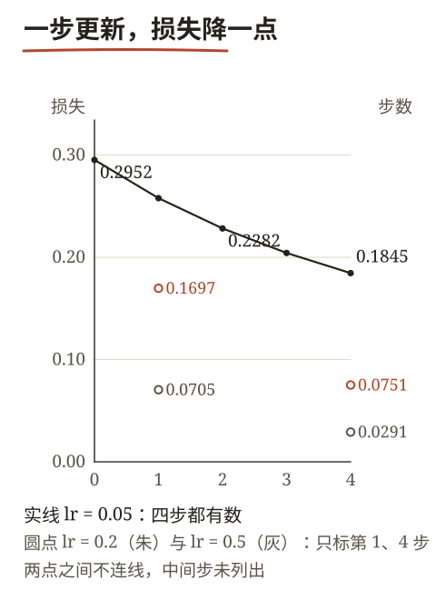
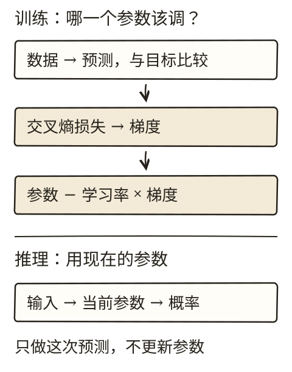
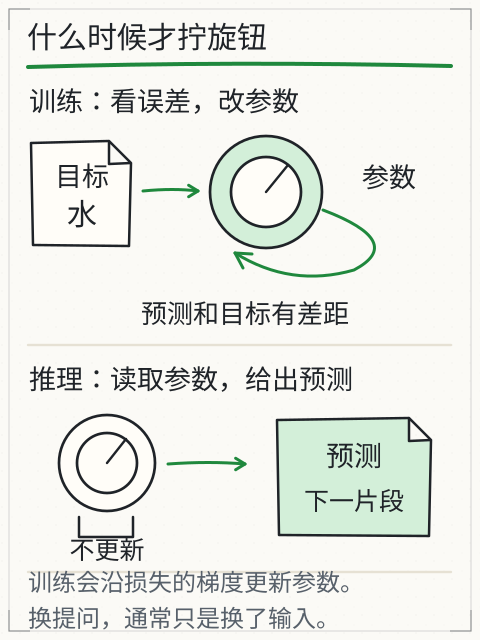

# C09 训练为什么能改变预测

你在聊天里说“答错了，再想想”，下一次回答可能变好。可这是模型学会了，还是它这次看到了你的纠正？判断这件事，得找到参数有没有变化。

C08 结束在三个分数 `[1.9336, −0.0126, 0.3268]`，给正确词 `报名` 的概率是 0.7444，损失 `−ln(0.7444)=0.2952`。本章从这 0.2952 出发，把“预测—比较—算梯度—更新”走完：先在两候选的小例子里把机制讲清楚，再回到主线算一遍真实链条，最后区分训练与推理。

## 先修桥：负对数、斜率、学习率

**负对数**：若模型给正确答案的概率是 0.5，损失 `−ln(0.5)≈0.693`；概率升到 0.8，损失 `−ln(0.8)≈0.223`。给目标的概率越高，罚分越小；概率接近 0，罚分趋于很大。

**斜率（梯度）**：函数在某点的斜率告诉你“参数往哪边动，损失会升还是降”。更新时朝斜率相反方向走一小步：

`新参数 = 旧参数 − 学习率 × 梯度`

学习率是步长。步子太大可能跨过低损失区域，甚至发散；太小则更新慢。

**训练/验证分割**：训练材料用来改参数；验证材料不参与这次更新，用来观察“换一批材料还灵不灵”。分割要按来源或组来分，不能把同一篇文档的相邻句子随机拆到两边，否则两边太像，测不出泛化。

## 目标错位：用前一个片段预测下一个

拿序列“我 喝 水 。”。自回归训练让每个位置预测下一个 token：

| 位置 | 输入到该位置 | 目标 |
|---|---|---|
| 0 | 我 | 喝 |
| 1 | 我 喝 | 水 |
| 2 | 我 喝 水 | 。 |
| 3 | 我 喝 水 。 | 无下一个（或 EOS） |

主线序列同理。`周六 下午 两点 在 图书馆` 这五个位置的训练目标分别是 `下午`、`两点`、`在`、`图书馆`、`报名`：

| 位置 | 输入 | 目标 | 训练时该位置的输出头比较对象 |
|---|---|---|---|
| 0 | 周六 | 下午 | 词表里全部候选 |
| 1 | 周六 下午 | 两点 | 同上 |
| 2 | 周六 下午 两点 | 在 | 同上 |
| 3 | 周六 下午 两点 在 | 图书馆 | 同上 |
| 4 | 周六 下午 两点 在 图书馆 | 报名 | 同上 |

C08 算的正是第 4 行。也就是说，主线那三个分数不是凭空给出的：它们是位置 4 在训练时必须“压中”`报名` 的一次预测。这是一个“目标错位”的例子——输入与目标不是同一个 token，而是错开一位。训练时可以把整段一起送入、并行算多个位置，但因果掩码必须保证位置 t 只看见 ≤t 的内容；否则位置 t 会看到自己要去预测的答案（C07 的 mask 就是为此）。

## 完整一步：两个候选的更新

先只看“喝”后面该接什么，候选是“水”和“茶”。初始分数都设为 0：

- `softmax([0,0]) = [0.5, 0.5]`
- 目标是“水”，损失 `−ln(0.5)≈0.693`

softmax 交叉熵对分数的梯度有一个简单形式：`预测概率 − 目标指示值`。目标“水”指示值为 1，“茶”为 0：

- 水的梯度：`0.5 − 1 = −0.5`
- 茶的梯度：`0.5 − 0 = 0.5`

取学习率 0.4：

- 新分数：`0 − 0.4×(−0.5) = 0.2`；`0 − 0.4×0.5 = −0.2`
- 新概率：`exp(0.2)=1.2214`，`exp(−0.2)=0.8187`，总和 `2.0401`
- `p(水)≈0.5987`，`p(茶)≈0.4013`
- 新损失 `−ln(0.5987)≈0.513`

水上升、茶下降，损失从 0.693 降到 0.513。这是一次更新、一个训练对的结果；真实训练会对很多对求平均，再更新。

这里特意把两个分数本身当成可训练参数，所以可以直接减去梯度。Transformer 的分数由前面许多参数计算出来，下面两节沿链式法则把分数上的梯度传回实际参数。

*图：上下两条总宽相同，浅色的“水”从 50.0% 扩到 59.9%，其余是“茶”。中间先算概率减目标，再减去 0.4 倍梯度；水的梯度是负数，减去它会抬高水的分数。数值来自人工两候选例子的实际计算。*

## 主线一步：从 0.2952 出发

回到三个候选。概率 `[0.7444, 0.1063, 0.1493]`，目标 `报名` 的指示值是 1，另两个是 0：

- `报名`：`0.7444 − 1 = −0.2556`
- `签到`：`0.1063 − 0 = 0.1063`
- `两点`：`0.1493 − 0 = 0.1493`

三个梯度都是对分数的偏导。要让某个实际参数动起来，还得乘上“分数对这个参数的变化率”。输出头的一行就是一个参数：第 k 行的分数是 `W_U[k]·y`，所以它对该行的偏导就是 `y` 本身：

`∂z(报名)/∂W_U(报名) = y = [−1.3285, 3.1419, 0.4850, −0.4850]`

链起来，`报名` 那一行的梯度是：

`dL/dW_U(报名) = (−0.2556) × [−1.3285, 3.1419, 0.4850, −0.4850] = [0.3396, −0.8029, −0.1240, 0.1240]`

第 2 维的梯度最负（−0.8029），因为它同时被“y 的该维最大（3.1419）”和“要抬高的分数”推动。取学习率 0.05，更新这一行：

`新行 = [0.2, 0.7, 0.1, 0.1] − 0.05 × [0.3395, −0.8030, −0.1240, 0.1240] = [0.1830, 0.7402, 0.1062, 0.0938]`

重算三个分数：`报名` 涨到 `2.0883`，另两个不变（它们对应的行没动）。概率变成 `[0.7727, 0.0945, 0.1327]`，损失 `−ln(0.7727)=0.2578`。以上都按全精度计算再取四位；拿表里的四位小数重算，末位会差 0.0002 左右。

只改一行、只走一步，损失从 0.2952 降到 0.2578。继续走同一步：

| 步数 | 报名分数 | p(报名) | 损失 |
| --- | --- | --- | --- |
| 0 | 1.9336 | 0.7444 | 0.2952 |
| 1 | 2.0883 | 0.7727 | 0.2578 |
| 2 | 2.2259 | 0.7960 | 0.2282 |
| 3 | 2.3494 | 0.8153 | 0.2042 |
| 4 | 2.4612 | 0.8315 | 0.1845 |

四步之后损失降到 0.1845。收敛不是“学会了”：这只是同一个训练对上的拟合。真实训练还有另外四个位置、其他句子和验证集。

同一件事也可以只改一个标量偏置：`报名` 行的分数加上 `b`，梯度只有 `−0.2556`，取学习率 1.0 时 `b` 变为 `0.2556`，分数 `1.9336+0.2556=2.1892`，概率 `[0.7900, 0.0874, 0.1227]`，损失 0.2358。一步就把损失的降幅做到了改整行两步才有的水平——因为偏置只平移这一行，不牵动与其他候选的几何关系，同样的步长下更直接。

步长的影响体现在速度上。把学习率换成 0.5，同样改一行：

| 学习率 | 1 步后损失 | 4 步后损失 | 4 步后 p(报名) |
| --- | --- | --- | --- |
| 0.05 | 0.2578 | 0.1845 | 0.8315 |
| 0.2 | 0.1697 | 0.0751 | 0.9277 |
| 0.5 | 0.0705 | 0.0291 | 0.9713 |

学习率越大，损失掉得越快，概率越快逼近 1。本例只有一行参数在动，概率上界就是 1，所以它不会“越过”最优再回来；真实模型里成千上万个参数互相牵连，步长过大会让损失震荡甚至上升。这就是为什么学习率要试、要退火，而不能照抄。

*图：同一个起点 0.2952，学习率 0.05 的四步损失连成实线；0.2 与 0.5 只有第 1、4 步的数字，画成孤立的点，不连线。图不证明哪档学习率更好，真实模型要试。*

## 反向传播：梯度怎么穿回块内

上一节只更新了输出头。真正要改的是块内的 `W1`、`W2`、`W_O`，以及上游注意力的投影。做法是从损失出发，沿前向计算的依赖关系逐层求导。

先把“损失对块输出 y 的梯度”算出来。`y` 有四维，每一维都通过三个候选的分数影响损失：

`dL/dy = Σ_k (dL/dz_k) × W_U[k]`

代入 `dL/dz = [−0.2556, 0.1063, 0.1493]` 与三行权重：

- 第 1 维：`0.2×(−0.2556) + 0.1×0.1063 + 0.5×0.1493 = 0.0342`
- 第 2 维：`0.7×(−0.2556) + 0.1×0.1063 + 0.3×0.1493 = −0.1235`
- 第 3 维：`0.1×(−0.2556) + 0.2×0.1063 + 0.2×0.1493 = 0.0256`
- 第 4 维：`0.1×(−0.2556) + 0.6×0.1063 + 0.1×0.1493 = 0.0532`

注意这些数比分数上的梯度小得多：三个候选的梯度正负相抵，`报名` 那行的负梯度被另外两行的正梯度中和掉大半。这是 softmax 的常态——它只关心差，不关心绝对水平。想让表示动起来，靠的是这种“抵消后剩下的一点点”，再由学习率和步数累积。

往下走一步：`y = LN(h) + a2`，加号让梯度原样分成两条路，一条回到 LN，一条回到前馈。前馈这条路上要穿过 `W2`、ReLU 和 `W1`：

- 穿过 `W2`（本例是单位矩阵，梯度不变）：`[0.0342, −0.1235, 0.0256, 0.0532]`
- 穿过 ReLU：`a1 = [−1.8134, 1.8134, 0, 0]`，只有第二维是正的，所以只有第二维的梯度能通过，其余三维被截成 0，得到 `[0, −0.1235, 0, 0]`
- 穿过 `W1`（乘 `W1ᵀ`）：`[0, −0.1235, 0, 0.1235]`

第三条最值得盯住。`W1` 的第二行是 `[0, 1, 0, −1]`，它把 `ln₁ − ln₃` 送进隐藏层；梯度沿同一行回来时，`ln₁` 得到 `−0.1235`，`ln₃` 得到 `+0.1235`。一正一负、绝对值相等，正是这一行“只关心差值”的体现。

两条路合并，`dL/dLN(h) = [0.0342, −0.2470, 0.0256, 0.1766]`。再穿过 LayerNorm，得到对 `h` 的梯度 `[−0.5058, −0.4350, 0.3735, 0.5673]`。这个结果不靠背公式也能验：把 `h` 的某一维加一个极小量，重算归一化后的输出，用链式关系累加，数值结果与上面四位小数一致。

LayerNorm 的反向传播比前向复杂，因为它让每一维都依赖全体的均值和方差。直觉是：梯度要先减去自身的均值（平移不改变方向），再减去“沿归一化方向的分量”，最后除以标准差还原尺度。少了任何一项，梯度方向都会偏。

最后一步回到注意力：`h = E + W_O·o`，所以 `dL/do = W_Oᵀ·dL/dh = [0.0597, −0.0703]`。这两个数分别对应“谁的 V 该多取一点、谁的 K 该更被关注”，继续往下就进入 C07 的 softmax 与 `W_Q/W_K/W_V`。整条链一个不多、一个不少。

## 训练与推理：两条路径

- **推理**：读取当前参数，算出概率，选一个 token；参数不变。
- **训练**：算出概率，与目标比较，算损失和梯度，更新参数。

旧课 [L05](training.md) 的 bigram 实验把这两条路径做成了两个按钮：“只预测一次”只读参数，“更新一步”会改参数。bigram 是一张 7×7 的分数表，没有注意力，也不理解长句；它的价值是让你看见哪一格变了，不能代表大模型能力。

*图：训练会改参数，推理不会。bigram 教学流程不代表完整训练工程。*

## 改一个条件：损失下降，任务仍可能错

训练损失下降，说明模型在这批材料上的下一个 token 预测更好了。它不自动说明：

- 换一批材料仍然好（要看验证/留出集）；
- 任务完成得对（例如通知里的地点是否被正确提取）；
- 事实正确（训练目标本身可能错）；
- 没有学到虚假线索（材料里的偶然共现）。

如果训练集成绩越来越好、留出集越来越差，要查过拟合、数据差异和评测泄漏。若两条曲线都降，也只说明这组指标改善；真实任务还要按字段、引用和执行结果另测。

主线这个例子里还能看到更细的一层：损失从 0.2952 降到 0.1845 的过程中，`签到` 与 `两点` 的分数一动没动。原因是只更新了 `报名` 那一行，另两行没被碰。真实训练会同时更新所有行，`签到` 的分数会被压低——这正是“正确答案被抬高”和“错误答案被压低”的两种力量，在 softmax 里它们其实是同一件事。

*图：参数是训练拧的旋钮；改提示、补材料、调温度不是同一种动作。*

## 失败对照

1. **把“回答变好”当参数更新**：聊天里补一句纠正，通常只改变本次输入；权重没有因此更新。
2. **只看训练损失**：训练集降、留出集升，是过拟合的常见信号。
3. **学习率过大**：损失可能不降反升；过小则几乎不动。
4. **目标错位写错**：用当前位置预测当前位置，等于抄答案；因果掩码也会失去意义。
5. **随机拆句当留出集**：同一文档的相邻句高度相似，分数虚高。
6. **只更新输出头就叫“训练完了”**：本章第一步只动了 `W_U` 的一行，块内的 `W1`、`W2`、注意力的参数都还停在旧值；真实训练是整条链一起更新。
7. **把梯度当成“改哪一维就抬哪一维”**：`dL/dy` 是三个候选梯度加权求和的结果，符号和大小都会被抵消改写，不能按单个候选的直觉读。

## 独立作业（容差 ±0.002）

1. 两候选初始分数 `[1, 0]`，目标是第一个，学习率 0.5。算更新前的概率、两个梯度、更新后的分数。
2. 算更新后的概率与损失，说明损失是否下降。
3. 用链式法则：`w=1.5`、`h=2`、`∂L/∂s=-0.4`、学习率 0.1，求 `∂L/∂w` 与更新后的 `w`。
4. 序列“A B C”用于自回归训练，写出每个位置的目标；最后一个位置没有下一个 token 时怎么处理？
5. 用三句话解释：为什么训练损失下降，仍可能在没见过的通知上提取错地点？

核对过程在 [C09 答案](../deepening/c09-answer.md)。

## 项目增量：训练记录 v1

在 S2 项目里新增 `training-log.md`，记录：

`数据来源 | 训练/验证如何分割 | 初始损失 | 更新一步后的参数与损失 | 留出集结果 | 任务层检查`

数据可以用旧 bigram 实验或你按本章手算的小例子；标明是教学数据。不要把训练损失写成任务准确率，也不要把一次更新写成“模型学会了”。

主线追加一张表：`步数 | 报名分数 | p(报名) | 损失 | 改了哪一组参数`，并把学习率 0.05 / 0.2 / 0.5 的对照各记一行。

## 来源与边界

本章沿用旧课 [L05 模型是怎样学会的](training.md) 的 bigram、交叉熵、梯度与训练/推理区分，复用深入页 [training.md](../deepening/training.md) 的两候选算例与链式法则，图 G33/G06/G20 的出处与旧实验 [X05](../../../exports/llm/training.html)。

主线数值（0.2952、`dL/dz=−0.2556`、四步损失表、`dL/dy`、`dL/do`）记录在 `specs/llm-running-example.md`，由同一份脚本生成；LayerNorm 的反向结果另用有限差分核对过。

所有数值为课程人工小例子；**没有训练 DeepSeek、Kimi 或任何真实模型**，不能把 0.1845 之类的损失读成模型性能。真实训练的优化器、批次、正则化和数据配比会影响结果，需要按实际实现核对。
