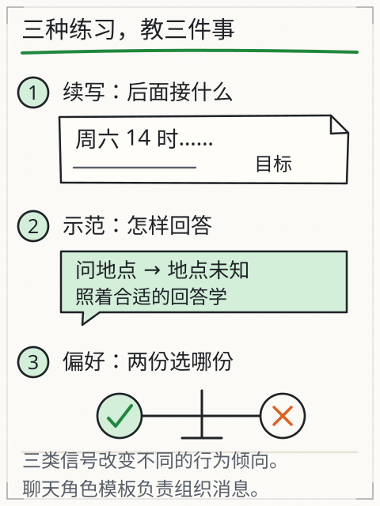
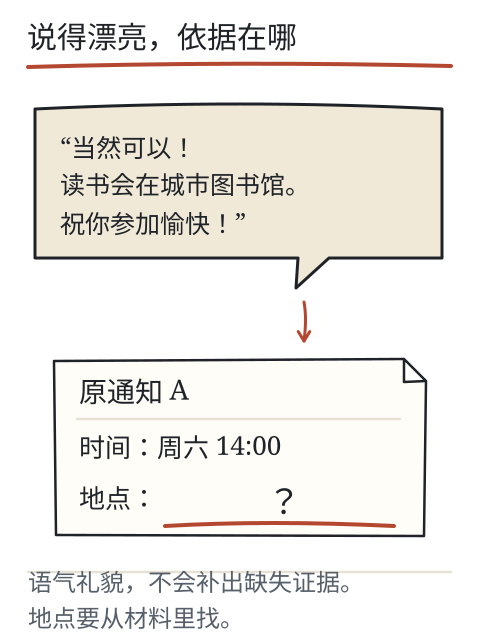

# C10 从续写到助手

你把一份通知交出去，说“把时间提取出来”，对方却顺着通知往下续写。句子很通顺，事情没办成。会续写，为什么还不一定会按要求做事？

主线例子把这件事夹在两个分数之间。输入 `周六 下午 两点 在 图书馆`，模型给出的最高候选是 `报名`（0.7444），而任务要求的答案是 `两点`（0.1493）。两者都在这三个候选里，概率却差五倍。本章把“预训练—指令微调—偏好优化—聊天模板”分开，说明它们各自能把哪一段差距补上，最后用 K2 阶段任务检查你是否真的能复算生成、注意力和一步更新。

## 先修桥：监督信号与偏好信号

C09 的训练信号是“下一个 token 是什么”：每个位置有一个明确目标，损失比较预测分布与目标。这叫**监督信号**。

偏好信号不同：它不直接说“这个 token 对”，而是把两个回答放在一起，说“A 比 B 更符合某套标准”。标准可能是遵守要求、有帮助、依据充分，也可能是语气友好。偏好数据要先有比较，再转成训练信号；它不保证被选中的回答事实正确。

先记住这两种信号的差别，再看三种训练材料。

## 预训练：从大量序列学预测

第一份材料可以只是普通文本。常见自回归模型从大量序列中学习下一个 token 的分布；为了把预测做好，参数可能学到语言结构、知识联系和其他规律。材料的范围、质量、时间都有限，远不是“全部人类资料”。

它也可能记住部分内容。但你问一句、它答一句时，不等于正在逐条查询一个核验过的原文库。预训练后的模型更像“很会接下去”，还不一定“按你的任务交付”。

主线这个模型就是预训练状态的缩影：给定“周六 下午 两点 在 图书馆”，它按语料里的搭配习惯接上 `报名`——在“在图书馆”后面接动作，是很常见的续写。这个输出用“接得顺”的标准衡量是对的，用“把时间提取出来”的标准衡量是错的。同一个参数，被两把不同的尺子量，结论相反。模型本身没有坏，是任务换了。

## 指令微调：用示范教任务

第二份材料把要求写清楚：任务是提取时间，给定通知，示范回答只写“周六14:00”。监督式指令微调（SFT）用这样的任务、上下文与示范继续训练，更新参数，让模型学习在这类要求下作答。

它对主线例子的作用可以直接算出来。假设示范数据里每个“提取时间”请求的目标是 `两点`，那么训练时把 `两点` 的指示值设为 1，`报名` 与 `签到` 设为 0，梯度就会把 `两点` 那一行往上推。取学习率 0.05、只更新 `两点` 这一行：

| 步数 | 报名 | 签到 | 两点 | p(报名) | p(两点) |
| --- | --- | --- | --- | --- | --- |
| 0 | 1.9336 | −0.0126 | 0.3268 | 0.7444 | 0.1493 |
| 1 | 1.9336 | −0.0126 | 0.8418 | 0.6764 | 0.2270 |
| 2 | 1.9336 | −0.0126 | 1.3097 | 0.5957 | 0.3192 |
| 3 | 1.9336 | −0.0126 | 1.7218 | 0.5123 | 0.4145 |
| 4 | 1.9336 | −0.0126 | 2.0762 | 0.4355 | 0.5023 |

四步之后，`两点` 的分数超过 `报名`，概率也翻了过来。这就是“用示范教任务”在参数层面的样子：让目标词在示范数据里反复当正例，梯度一步步把它顶上去；整个过程没有写任何规则。

反过来也成立：如果目标是 `报名`（续写任务），同一步梯度会把 `两点` 压下去。同一组参数、同一批向量，目标一换，梯度方向就反。这是 C09 那条 `预测概率 − 目标指示` 的直接后果，也是“训练数据决定模型行为”的最短证明。

这里要区分两个动作：

- **聊天模板**：把 system、user、assistant 等角色组织成输入标记，标出边界。它改变的是**这次输入**。
- **SFT**：用示范数据更新**参数**。

只改角色标签，不会现场完成一次训练；套了模板，也不等于模型一定遵守角色权限。模板是格式，权限仍要由应用校验和控制。

## 偏好优化：让回答符合选定标准

第三份材料把两个回答放在一起，让标注者比较：哪个更遵守要求、更有帮助、依据更充分？偏好优化利用这样的比较、奖励等信号调整行为。

常见路线有差别：

- 一些 RLHF 配方先训练奖励模型，再用强化学习调整策略；
- DPO 从偏好对直接构造相对于参考策略的目标，通常不用先单独训练奖励模型。

两条路线各有假设、数据和实现，不能当成同一个算法。实际模型还可能采用其他方法；不要根据一次回答反推某家公司的训练配方。

偏好训练也不能保证事实正确。如果评分只看语气是否友好、文字是否饱满，一个补了地点、说得更漂亮的回答可能得分更高。标准选得怎样，直接决定模型被鼓励什么。

主线例子能说明“偏好”与“监督”的差别：监督信号会说“第 4 个位置上，答案必须等于 `两点`”；偏好信号只会说“回答 A（`两点`）比回答 B（`报名，附一段寒暄`）更符合要求”。前者给的是位置级的目标，后者给的是一对回答的相对排序。前者更容易直接转成梯度，后者要先定一套把排序转成目标的方法——这就是 RLHF 与 DPO 分歧的地方。

*图：文本、示范与偏好对分别提供目标；角色模板另行组织消息。比较信号来源，不表示所有模型都遵循同一阶段配方。*

## 聊天模板：同一条消息，不同组织

把“提取时间”放进 system，还是放进 user？历史消息保留多少？工具结果放在哪？这些都属于输入组织。模板让模型知道“谁说了什么”，但：

- 它不改变参数；
- 它不能替代权限检查；
- 它不保证模型忽略材料里的恶意指令；
- 不同模型见过的模板可能不同，换格式要重新验证。

主线例子里，模板能做的和不能做的都很清楚：把“只回答时间”写进 system，等于给模型多了一段前文，输出会受这段前文影响；但它不会让 `两点` 那一行的权重变大。若模型从未在这种格式上训练过，模板甚至可能让输出更差。

旧课 [L06](assistant.md) 把“预训练、SFT、偏好、模板”做成可切换的对照材料；它是课程编写的人工示例，没有实际训练三个检查点。

## 四种手段的对照：同一条主线，四种改法

“让它输出 `两点`”这件事，至少有四条路。它们的成本和副作用完全不同：

| 手段 | 具体动作 | 主线例子里动的是什么 | 是否持久 |
| --- | --- | --- | --- |
| 改输入 | 在提示里写“只回答时间”，或给一个示范 | 本次上下文 | 只影响本次请求 |
| 改参数 | 用示范数据做 SFT（上表四步） | `两点` 那一行权重 | 保存到检查点后持续 |
| 改解码 | 调温度、top-p、最大长度 | 采样方式，不改任何分数 | 只影响生成配置 |
| 外部状态 | 应用保存偏好、检索原文、调工具 | 下次请求的输入或动作 | 依赖应用实现 |

解码这一行值得单独算一遍，因为很多人以为“调低温度就能让它更听话”。主线分数在 T=1 时是 `[0.7444, 0.1063, 0.1493]`，T=0.5 时是 `[0.9429, 0.0192, 0.0379]`：概率差距被拉大了，但排序没变，`报名` 仍然第一。温度只改变分布的陡峭程度，不改变谁是最高项。想让 `两点` 排第一，必须动参数（或者动输入里的证据），解码设置做不到。

这条对照也是排查问题的顺序：先看输入里有没有模型需要的信息，再看参数是不是被对应任务训练过，再看解码设置是否合适，最后看应用层是否把状态弄错了。顺序反了，就会在调温度上反复试而毫无进展。

## 推理：两种常见含义

中文里“推理”常指两件事：

1. **模型推理（inference）**：前向计算，读参数、出结果，不更新参数；
2. **推理行为（reasoning）**：模型先写出中间步骤、再给结论，或产品展示“思考过程”。

两者不要混。产品显示一段思考摘要，不等于你看到了完整内部计算，也不等于这段摘要一定忠实反映模型实际依据。训练是否包含推理步骤、怎样筛选，属于具体配方；没有公开材料时，只能写“未知”，不能编。

## 输入变化、参数变化、解码设置、外部状态

把一次“行为变化”拆开，常见有四类，与上表一一对应：

| 变化 | 例子 | 改了什么 | 是否持久 |
|---|---|---|---|
| 输入变化 | 加 system 提示、补原文、加示例 | 本次上下文 | 通常只影响本次请求 |
| 参数变化 | SFT、偏好优化、继续预训练 | 权重 | 保存到检查点后持续 |
| 解码设置 | 温度、top-p、最大长度 | 采样方式 | 只影响生成配置 |
| 外部状态 | 应用保存的记忆、检索库、工具回执 | 下次请求的输入或动作 | 依赖应用实现 |

聊天里纠正一句，通常属于第一类；把纠正整理成一批示范再训练，才进入第二类；调温度是第三类；应用记住你的偏好是第四类。它们可能同时出现，但检查时要分开说。

## 失败对照

1. **把模板当训练**：加一个 assistant 标签，就以为模型“学会了”新任务。
2. **把偏好当事实**：被选中的回答更礼貌，不等于更准确。
3. **把思考摘要当内部记录**：摘要可能省略、重构，不能当完整因果链。
4. **反推配方**：从两次回答猜“它一定用了某种强化学习”，没有证据。
5. **把输入变化说成参数更新**：用户纠正一次，权重通常没变。
6. **指望调温度改变排序**：主线数字里 T=1 与 T=0.5 的最高项都是 `报名`；温度改的是分布形状，不是偏好顺序。

## K2 阶段任务：复算与分类

这是 S2 的阶段门。请先独立完成，再打开 [C10 答案](../deepening/c10-answer.md)。所有数值容差 ±0.002；每一问都要写出公式或中间值，只写结果不通过。

### A. 生成：softmax 与温度

分数 `[2, 1, 0]`。分别算 `T=1` 与 `T=0.5` 时三个候选的概率（先写 exp 值、总和，再写归一化结果）。

### B. 注意力：一行、带掩码

当前位置的 `q=[0,1]`，可见 `k1=[2,0]`、`k2=[0,2]`，未来位置被遮住；`d_k=2`。对应 `V1=[1,1]`、`V2=[2,0]`。算缩放后分数、softmax 权重与加权输出。

### C. 训练：一步更新

两个候选初始分数 `[0,0]`，目标是第一个，学习率 0.8。算更新前概率、两个梯度、更新后分数、更新后概率与损失。

### D. 分类：四种变化

对下面四种变化，分别判断它属于“输入变化 / 参数变化 / 解码设置 / 外部状态”，并说明“改了什么、是否持久”：

1. 在请求最前面加入一段 system 提示，规定输出字段。
2. 用 200 条示范回答做一次监督微调。
3. 把温度从 0.2 调到 0.9。
4. 用户在应用里编辑了一条保存的偏好备注，下一次请求会被带上。

### 通过条件（全部满足，不取平均）

1. A 两组概率全部落在容差内，且写出 exp 与总和。
2. B 的分数、权重、输出全部落在容差内，并明确说明未来被遮住。
3. C 的梯度、更新后分数、概率、损失全部落在容差内，并说明损失方向。
4. D 四项分类全部正确，每项都说明“改了什么/是否持久”。
5. 没有把模板说成训练、把偏好说成事实保证、或编造某模型的训练配方。

任一项数值超出容差或分类错误，K2 不通过；不能用其他项的高分抵消。课程没有真人复核记录，K2 的数值部分可按答案自检，解释部分仍需一位评审者确认；在复核前保持未验证。

*图：偏好训练可能奖励“礼貌完整”，但材料没写的地点仍是未知；流畅不增加证据。*

## 项目增量：S2 证据包

S2 结束时，把以下文件装进一个文件夹：

- `generation-log.md`（C05）
- `vector-check.md`（C06）
- `attention-trace.md`（C07）
- `multihead-trace.md`（C08）
- `training-log.md`（C09）
- `k2-answers.md`（本章四问的作答与自检）

每份都标明“人工/实测”和数据来源。S2 认的证据是能复算、能指出边界、能分类变化；“我看懂了”不算证据。

证据包里再放一页 `task-gap.md`：写清主线例子里“续写输出 `报名`、任务要求 `两点`”这个差距，以及本章四种手段各自能补多少、需要多持久。这一页是把前五章的算例连起来的地方。

## 来源与边界

本章沿用旧课 [L06 会续写为什么还要学听指令](assistant.md) 的预训练/SFT/偏好/模板区分与 InstructGPT、DPO 的路线说明，复用深入页 [assistant.md](../deepening/assistant.md) 的“三种材料分别改变什么”，图 G35/G21/G36/G07 的出处与旧实验 [D06](../../../exports/llm/assistant.html)。

主线数值（`0.7444` 与 `0.1493` 的差距、四步翻转表、温度对照）记录在 `specs/llm-running-example.md`，与 C05–C09 同源。课程**没有训练或评测 DeepSeek、Kimi 或任何真实模型**，不推测其内部配方；K2 的数值为课程人工设计，答案与容差另放。
