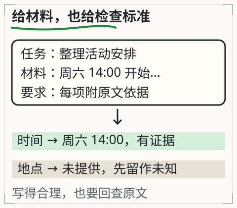

# C13 接上真实模型

上一章的本地服务会回显 JSON，但它没有“生成”任何东西。现在把问题换成：给助手一份设备手册，问“闭馆前要检查什么”，让它基于材料给出带出处的回答。你要么在本机加载一个合法取得的模型，要么使用明确授权的兼容 API。二者都必须是真调用：输入变了，输出和记录要跟着变；模型不可用就报告不可用，不能退回一段手工写好的“成功答案”。

本章使用贯穿项目的真实助手 `book/llm/examples/assistant/assistant.py`。接口已经固定到命令和报告字段；不同机器上的模型路径、输出内容和耗时当然不同，但状态、引用、错误和未知的结构必须一致。

## 先修检查：请求、权限与报告

C12 已经讲过：请求要区分成功、坏输入、未认证、无权限、服务失败和未知；凭据不能写进仓库。本章再加三条：

1. 你能读懂一个 JSON 报告里的 `status`、`claims`、`citations` 和 `diagnostics` 字段，而不是只看最后一段自然语言。
2. 你知道“模型目录存在”不等于“模型可用”：还需要配置、权重、分词器/处理器文件，以及与当前 `transformers`/`torch` 版本兼容。
3. 你愿意在模型不可达时留下资源阻碍记录，而不是把示例输出改个名字当成真实调用。

如果第 2 条不熟，先在本机设置并列出模型目录：

```bash
# 替换为你已合法取得、已下载到本机的模型目录绝对路径
MODEL_DIR="/absolute/path/to/local-model"
ls "$MODEL_DIR"
```

至少应看到 `config.json`、权重文件（`.safetensors` 或 `.bin`）和 tokenizer/processor 相关文件。具体文件名由模型类型决定，不能靠猜；加载失败时报告里的错误类型比“跑不通”更有用。

## 两条合法路径，不要求付费账号

### 路径 A：本地 Transformers 模型目录

`--model` 指向一个已经在磁盘上的模型目录。助手以 `local_files_only=True` 加载，不会自动联网下载。模型和权重的许可、来源、允许用途由你或提供方确认；本书不把一个模型名称当成授权。

```bash
python book/llm/examples/assistant/assistant.py run \
  --docs book/llm/examples/assistant/documents.json \
  --reader student \
  --question "闭馆前需要检查哪些项目？请逐条给出材料出处。" \
  --model "$MODEL_DIR" \
  --json out/c13-local.json \
  --markdown out/c13-local.md
```

`$MODEL_DIR` 沿用上一节设置的本地目录。这次运行是否得到 `answered` 取决于模型、材料和逐字引用校验；任何失败状态都是可保存的证据，不要用示例回答替代。

### 路径 B：显式授权的 OpenAI 兼容接口

只有当你明确选择 `--provider api`，并配置了 `ASSISTANT_API_BASE`、`ASSISTANT_API_MODEL`、`ASSISTANT_API_KEY` 时，助手才会走网络。三个变量放在本机受控环境里：

Windows PowerShell：

```powershell
$env:ASSISTANT_API_BASE = "https://your-authorized-endpoint.example/v1"
$env:ASSISTANT_API_MODEL = "provider-model-id"
$env:ASSISTANT_API_KEY = "..."   # 不要粘贴到聊天、课文或提交记录
```

macOS / Linux：

```bash
export ASSISTANT_API_BASE="https://your-authorized-endpoint.example/v1"
export ASSISTANT_API_MODEL="provider-model-id"
export ASSISTANT_API_KEY="..."
```

```bash
python book/llm/examples/assistant/assistant.py run \
  --docs book/llm/examples/assistant/documents.json \
  --reader student \
  --question "闭馆前需要检查哪些项目？请逐条给出材料出处。" \
  --provider api \
  --json out/c13-api.json \
  --markdown out/c13-api.md
```

不要在示例里填入真实密钥；不要用别人的密钥“试一下”；不要把密钥写进 `documents.json`、脚本或报告。API 的费用、限流、可用模型名和字段支持由服务方当前文档定义，本章不替你猜价格或能力。

## 先看材料权限，再看问题

助手的 `--reader` 是必需的，不是装饰。以 `--reader student` 读取 `documents.json` 时，只有 `readers` 包含 `student` 的文档会被列出/检索；`review-budget` 这类教师材料对学生会显示为无权限或不可见。换一个没有权限的读者再问同一问题，预期不是“回答得更少”，而是 `unauthorized`/无权限，或只基于该读者可见的材料回答并明确范围。

先读文档清单：

```bash
python book/llm/examples/assistant/assistant.py inspect read \
  --docs book/llm/examples/assistant/documents.json \
  --reader student --doc station-log
```

这条命令读取学生有权查看的 `station-log`。输出包含 `doc.doc_id`、`version`、`path`、`sha256`、`readers` 和正文 `text`；`--doc` 是必填的文档 ID，并非列出全部文档的命令。不要把教师材料的存在当成学生可读；权限检查必须发生在读入内容之前，而不是回答完之后再遮盖。

## 报告里必须有的证据

一次 `run` 会写出 JSON 和 Markdown。JSON 至少包含：

- `status`：`answered`、`insufficient-evidence`、`conflict`、`unauthorized`、`missing-source`、`invalid-response`、`citation-failed`、`model-unavailable` 等；
- `question`、`reader`、模型/提供方标识和版本（能记录的部分）；
- `claims`：拆开的主张；每条有 `text` 和 `citations` 数组。来源引用写作 `{"chunk_id":"...","quote":"..."}`，报告会补 `doc_id`、`version`、`sha256`、`start`、`end`；工具引用写作 `{"tool_receipt_id":"tool-1"}`。`claim.text` 必须是其 `quote` 的逐字连续子串；`answer` 只能由已核验 claim 的原文组成，不能额外加入未列主张。改写句会被判 `citation-failed`（paraphrase requires human verification），只能进入人工复核，不能当作自动验证通过。
- `diagnostics`：至少保留 `first_raw_response` 和 `first_failure`，用于区分“模型没回”“回了但格式不对”“引用对不上”；
- `usage`：调用次数、token、延迟；费用字段在未配置价格时为 `null`，不能编一个金额。

`status: answered` 不是“每个字都正确”，而是“报告声称的每条主张都有可回查的来源或工具回执，且 claim 原文、quote、answer 三者的逐字关系通过校验”。引用存在也不自动等于引用支持结论；C15/C18 会逐条核对。

如果模型输出了无法解析的结构，助手应记录 `invalid-response` 或 `citation-failed`，并保留首次原始响应；它不能悄悄改写成一段人工答案。如果模型目录不存在、配置缺失或加载失败，应得到 `model-unavailable`，而不是 `answered`。

## 可选抽取模式：让模型选证据

前面的命令使用默认 `--claim-mode copy`：模型同时输出主张和引用，程序检查它们的逐字关系。若只需要原文摘录，可以在 `run` 后加上 `--mode fixed --claim-mode extract`。模型只返回 `status`、`claims[{chunk_id,quote}]` 和可选 `reason`，程序从已验证的 quote 生成主张与 answer；它不调用另一个模型代写答案。

quote 按程序的空白规范化后必须为 2–300 个字符，并连续出现在命中片段中。报告仍用 `claims[].text` 和 `citations[]`；`start/end` 指向整个 chunk，抽取模式另外给出 `quote_start/quote_end`，对应引文在文档中的精确字符范围 `[起点, 终点)`。程序先按 UTF-8 去 BOM 并把 CRLF/CR 统一成 LF，再计 Unicode 字符；这不是字节位置，也不是浏览器 JavaScript 的 UTF-16 下标。

同一 chunk 内出现多个相同引文时，取空白规范化后第一次匹配的位置。空白折叠只用于匹配，位置仍映射回折叠前的文档；例如原文 `风速\t4.2` 可以匹配模型的 `风速 4.2`，范围包含原来的制表符。`sha256` 仍计算原文件字节，回查前要先核对文件版本。展示主张时去掉开头的 Markdown 标题标记，引用 quote 与定位范围仍保留标题。

这项附加合同在 `config.claim_contract` 标记为 `source-extract/2`，JSON 与 Markdown 都能查看位置。旧报告和默认 copy 不含这两个精确字段，不能把旧 `start/end` 当作新字段使用。

这是一种证据摘录模式，不能据此判定选中的句子完整回答了问题。当前真实模型在风速题和冲突题上仍会失败，详见 [冻结基线](../examples/assistant/BASELINE.md)。`extract` 只支持 fixed；与 agent 组合会返回 `invalid-request`。不要切换模式后仍把结果与另一种协议的历史报告混为一谈。

## 完整操作：从空输出到一条可核对主张

在仓库根目录：

```bash
mkdir -p out
python book/llm/examples/assistant/assistant.py run \
  --docs book/llm/examples/assistant/documents.json \
  --reader student \
  --question "设备手册里，闭馆前要检查哪些项目？" \
  --model "$MODEL_DIR" \
  --json out/c13-first.json \
  --markdown out/c13-first.md \
  --repair-attempts 1
```

`$MODEL_DIR` 沿用前文的本地模型目录。`--repair-attempts 1` 允许在结构不合格时做一次格式修复请求，但修复请求也必须走同一个真实模型，不能由程序拼接模板冒充模型输出。若第二次仍不合格，报告保持失败并保留两次诊断。

打开 `out/c13-first.json`，按顺序检查：

1. `status` 是否与问题、材料和模型能力相符；
2. 每条 `claim.text` 是否是其 `quote` 的逐字连续子串，且 `quote` 能在对应 `chunk_id` 指向的文档版本中找到；
3. `diagnostics.first_raw_response` 是否存在，是否与解析后的结果一致；
4. `usage` 是否记录了实际调用，而不是固定值；
5. 若失败，`first_failure` 是否指出是网络、模型、解析还是引用问题。

这一步的证据价值来自“首次输出”而非事后润色。不要在报告生成后手工修改 `claims` 来让它看起来有依据；如果你改了，必须标记为人工修改并保留原始文件。

## 改一个条件：问题超出材料

把问题换成“今天食堂几点开门？”——文档清单里没有食堂安排。预期 `status` 是 `insufficient-evidence`，或者报告明确说明材料未覆盖，而不是让模型凭常识补一个时间。若模型仍然回答，`claims` 里应没有伪造的文档 `quote`；引用校验应失败或报告无依据。

再改一个条件：把 `--reader` 换成没有权限的身份。预期是权限错误或可见范围缩小，不能因为“问题一样”就绕过权限。权限失败要通过授权或改用有权材料解决，不能把 `readers` 字段删掉求通过。

## 图与实验

下图把本次请求拆成“任务、材料、当前输入、输出预算”。模型只看到被选中的材料和问题；它看不到未检索到的文件，也不会因为文件在磁盘上就自动知道。



*图：模型只看见被选进本次输入的任务、材料和问题；未检索到的文件不会因为“在磁盘上”就自动可见。每项结论仍要回查原文，写得合理不等于有依据。*

旧的 [L10 工具执行](../../../exports/llm/tools.html) 实验展示了“模型说调用了”与“程序真的执行”之间的差别。C13 先不把工具接进来，只要求真实推理和引用；C16 再加入计算器与只读查找。

## 失败反例：三种假成功

1. **固定回答**：无论问题是什么都输出同一段“闭馆前检查门窗、电源”。它的 `diagnostics.first_raw_response` 与问题无关，`usage` 固定为 0，换问题也不变。这是模板，不是模型调用。
2. **模型没加载，却返回示例答案**：`--model` 路径错误时仍打印 `answered`。正确行为是 `model-unavailable`，并给出路径/加载错误。
3. **引用装饰**：每条主张都挂同一个 `chunk_id`，但 `quote` 在原文中不存在或只支持半句。引用校验应发现 `citation-failed`；人工核对时要把 `quote` 放回原文上下文，而不是只看 ID。

遇到这些情况，先检查 `status` 和 `diagnostics`，再检查模型/凭据/材料。不要通过改报告字段或换一个“更听话”的模型来掩盖失败。

## 项目增量

在你的项目目录保存：

```text
out/c13-first.json
out/c13-first.md
notes/c13-resource.md
```

`notes/c13-resource.md` 记录：使用的模型/提供方、来源与许可（若已知）、加载方式（本地目录/API）、版本、设备（CPU/GPU）、耗时、费用条件、首次失败与修复尝试。没有付费账号不是失败；把“没有真实调用”写成“已验证”才是失败。

## 独立作业

1. 用本地模型或授权 API 跑一次真实 `run`，保存 JSON 与 Markdown；在报告中指出至少一条 `claim` 的 `quote` 在原文中的位置。
2. 提一个材料没有覆盖的问题，记录 `status` 和诊断；解释系统为什么不能补常识。
3. 把 `--reader` 换成无权限身份，记录结果；不要修改 manifest 的 `readers` 来“通过”。
4. 故意把 `--model` 指向一个不存在的目录，记录 `status`、错误类型和退出码；再恢复正确路径重跑，比较两次 `usage`。
5. 解释 `diagnostics.first_raw_response` 与 `claims` 的关系：为什么保留原始输出比只保留整理后的答案更重要？

答案与核对依据见 [C13 答案](../deepening/c13-answer.md)。

## 来源与限制

助手命令与字段来自本课程 `book/llm/examples/assistant/README.md` 的实际接口；模型输出、耗时、费用和可用性必须在你的机器上实测，本书不预填成功结果。模型权重/服务许可由使用者确认；没有合法模型或授权时，只能记录资源阻碍，不能回退为手工答案。真实模型的内部实现、训练数据和能力边界不由本课推断。
