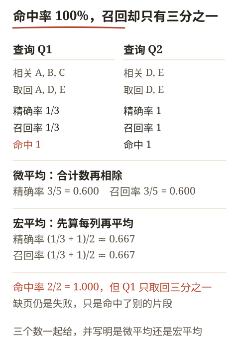

# C18 先定怎样评，再动手优化

假设你已经把 C17 的助手跑通了。现在有人提议：“把检索条数从 3 调到 5，回答应该会更好。”你换了参数，随手问了两个问题，其中一个答对了；于是准备宣布改进成功。停一下：另一个问题是不是本来就会答对？你看到的“更好”，是参数带来的，还是问题变简单了？如果没有在改动前留下同一套题和同一套判据，这两个问题都无法回答。

这一章不教某个“神奇指标”，而是建立一条底线：**先冻结材料、题目、判据和预算，再运行第一次调用；之后每次只改一个因素，用同一把尺子比较。** 这也是 S4 所有诊断和取舍的起点。

## 先修检查：你手里已经有什么

C17 留下了 `run` 的 JSON 报告：`status`、`claims`、`citations`、`retrieval.hits`、`tool_receipts`、`usage`、`diagnostics.first_raw_response` 和 `first_failure`。C18 不要求新的模型能力，只要求你把这些字段组织成可重复的评测。

先确认三件事：

1. 你能对同一个问题重新运行，并得到一份新的、带时间戳和用量的报告；
2. 你知道当前文档清单的版本和文件哈希，而不只是“我记得用的是那篇”；
3. 你愿意把“答对”拆成可以逐例检查的条件，而不是一句总体印象。

如果第 1 条做不到，先回到 C13/C17 修真实调用；如果第 2 条做不到，先补 C14 的来源和版本；如果第 3 条做不到，本章会给你拆法。

## 开发、验证、留出：三份题，各干一件事

评测集不是一个越攒越大的“题库”，而是三种用途分开的材料：

| 集合 | 用途 | 可以看几次 | 典型动作 |
| --- | --- | --- | --- |
| 开发集 dev | 找错误、改提示、改切块、调检索 | 反复看 | 定位失败、形成假设 |
| 验证集 val | 在少数候选方案之间做选择 | 少看，按预先规则看 | 比较 A/B，决定采用或拒绝 |
| 留出集 heldout | 最终报告，不再据此调参 | 最后一次 | 冻结后只跑一次，报告结果 |

三个词描述的是使用方式，不是文件大小。你可以把同一批文档切成不同问题：开发题用来改，验证题用来选，留出题在调参期间不打开。若留出题被看过后又拿来改参数，它就已经变成验证集，不能再冒充“没见过的题”。

还要区分两种“留出”：

- **问题留出**：文档相同，问题没在开发阶段出现；
- **来源留出**：连文档或来源组都换成开发阶段没看过的，用来观察换材料后的泛化。

问题留出更容易做，但结论只覆盖“新问题、旧材料”。来源留出更强，但需要额外授权材料。报告里要写清楚是哪一种，不能把问题留出说成“陌生领域”。

### 数据泄漏的常见来源

- 用留出题的结果来决定 `top_k`、切块大小或提示措辞；
- 开发集和留出集有近似重复的问题，答案几乎一样；
- 文档在冻结后更新，但清单版本没变；
- 模型、API 版本、聊天模板或系统提示在两次运行之间变了；
- 为了“让基线好看”，先跑一次再改判据；
- 把留出题写进提示示例或说明文档，之后又声称它没被看过。

冻结的对象不只是题目文件，还包括：题目和期望状态、文档清单及每个文件哈希、预算（`top_k`、`max_new_tokens`、`max_prompt_tokens` 等）、模型/提供方标识、运行代码版本，以及人工复核规则。助手会自动记录清单哈希，但不会替你记录文档和模型；这些要另建一张冻结表。

## 在第一次调用前冻结

`book/llm/examples/assistant/eval-manifest.json` 是教学样例，覆盖正常引用、零命中、冲突、越权、缺失源、缺失模型、未配置 API 和 Agent 计算器八种情况。它是**需要评审的样例，不是 CI 基线**：没有经过人类确认它适合作为本课程验收标准，也不保证 0.5B 级模型能通过。你可以用它检查流程，但真正的基线要自己复制、改版本、复核标签后再冻结。

先做一个最小冻结记录。以下命令从仓库根目录运行，在任何 `run` / `evaluate` 之前执行：

```bash
mkdir -p out/c18
python - <<'PY'
import hashlib
import json
import pathlib
from datetime import datetime, timezone

root = pathlib.Path("book/llm/examples/assistant")
files = [root / "eval-manifest.json", *sorted((root / "docs").glob("*.md"))]
record = {
    "created_at": datetime.now(timezone.utc).isoformat(),
    "note": "before any model call",
    "files": {
        str(path): {
            "sha256": hashlib.sha256(path.read_bytes()).hexdigest(),
            "bytes": path.stat().st_size,
        }
        for path in files
    },
}
out = pathlib.Path("out/c18/freeze-sample.json")
out.parent.mkdir(parents=True, exist_ok=True)
out.write_text(json.dumps(record, ensure_ascii=False, indent=2) + "\n", encoding="utf-8")
print(out)
PY
```

这份记录至少回答了“我评的是哪一版”。如果你要评自己的 12 道题，把 `eval-manifest.json` 换成你的 `eval-dev.json`、`eval-val.json`、`eval-heldout.json`，并分别冻结。不要只冻结一个总文件后在运行中改它。

`evaluate` 自己也会冻结清单：它在调用任何模型前读取清单字节，记录 `manifest.sha256`、大小、修改时间和 `frozen_at`；所有用例跑完后再读一次，结果写成 `manifest_unchanged`。如果这个值是 `false`，这次结果不能作为对照，必须丢弃并重跑。

### 一个可用的划分示例

下面只是结构示例，不是你的留出集；真正的留出题在调参期间不要打开。样例文档已经提供了足够的事实：

| 集合 | 用例 | 期望状态 | 关键检查 |
| --- | --- | --- | --- |
| dev | 2026-10-03 风速 | `answered` | 引用 `station-log` |
| dev | 咖啡机保修期 | `insufficient-evidence` | 不调用模型或明确无证据 |
| dev | 冬季闭站时间冲突 | `conflict` | 引用 `visitor-policy` 与 `closing-notice` |
| dev | 访客读内部预算 | `unauthorized` | 正文不进入上下文 |
| dev | 缺失的外场手册 | `missing-source` | 在模型调用前失败 |
| dev | 4.2×86400 总行程 | `answered` | 成功 `calculator` 回执 |
| val | BT-24 常规续航 | `answered` | 引用 `equipment-guide` |
| val | 风速传感器校准周期 | `answered` | 引用 `equipment-guide` |
| val | 学生问教师预算 | `unauthorized` | 同上，换身份复核 |
| heldout | 2026-10-03 阵风 | `answered` | 引用 `station-log`，数值必须逐字可回查 |
| heldout | 12 月 10 日参观通道闭站时间 | `answered` | 引用 `closing-notice` 的临时日期范围 |
| heldout | 教师问总预算 | `answered` | 引用 `review-budget` |

每个用例至少要写：`id`、`reader`、`question`、`expectStatus`、`expectCitationDocs`（可选 `expectTool`），以及一条给人类看的 `note`。`note` 不是模型输入，不应把答案提示塞进实际 prompt。

## 逐例判据：不要把“通过”压成一个数

`evaluate` 的 `checks` 只比较三件事：

- `status` 是否在 `expectStatus` 中；
- `expectCitationDocs` 中的每个文档是否至少被一条 source citation 引用；
- 若指定 `expectTool`，是否存在成功的对应工具回执。

它不判断引用是否真的支持主张，也不判断回答是否回答了问题。因此 `cases[].passed` 只是“这三个机械检查通过”，不是质量通过。逐例判据要再加人工复核：

1. 状态是否符合预期；
2. 每条 source claim 的 `quote` 是否在对应版本中逐字存在；
3. 该 quote 是否真的支持 claim（条件、否定、日期、范围有没有被漏掉）；
4. `answer` 是否只包含已核验的主张，没有额外推断；
5. 工具回执是否成功，结果是否出现在 claim 中；
6. 失败时是否停在正确阶段，而不是用旧答案或手工答案补齐。

### 一个必须说清的提取式契约

本课程助手当前采用提取式校验，不是语义事实判断：

- `quote` 必须是实际使用的 chunk 中的逐字连续片段（空白规范化后比较）；
- source claim 的文本必须是对该 `quote` 的逐字提取，不能是改写或概括；
- `answered` / `conflict` 的 `answer` 只能由这些已核验 claim 组成，额外解释文字会被拒绝；
- `insufficient` 不同：它保留解释性 `answer`（例如说明材料未覆盖），但 `claims` 必须为空。不能为了“看起来有证据”而塞一条无依据 claim。

这解决的是一个具体缺陷：样例材料写“地点尚未确定”，旧实现可能让 claim“地点已确定为图书馆”配着这段 quote 返回 `answered`。修复后的最小复现是：

| 输入 | 结果 | 原因 |
| --- | --- | --- |
| claim “地点已确定为图书馆”，quote “地点尚未确定” | `citation-failed` | claim 不是 quote 的逐字提取 |
| claim “地点尚未确定”，quote “地点尚未确定” | 通过机械校验 | 两段文本一致；但仍需人判断它是否回答了问题 |
| answer “地点尚未确定。因此地点是图书馆”，claim 只有第一句 | `citation-failed` | answer 含已核验 claim 之外的文字 |

第三行尤其重要：**逐字 quote 只证明文本来自材料，不自动证明改写、推断或“因此”成立。** 本课程不使用“有引用就等于事实正确”这种普遍结论；提取式契约只是把可机械核对的部分收紧，语义支持仍由人复核。

## 证据支持率与检索命中：分母写清楚

先定义分子分母，再谈百分比。否则“支持率 80%”可能只是把失败用例悄悄排除后的结果。

### 主张级证据支持率

```text
主张支持率 = 经人工核对、quote 确实支持的主张数 ÷ 报告中提出的主张总数
```

- 分母是“提出的主张”，不是“通过的用例”；
- 没有提出任何主张时，分母为 0，应写 `n/a`，不能写成 100%；
- 一个用例有 2 条主张、其中 1 条不支持，主张级是 1/2，但该用例在严格口径下失败。

### 严格用例通过率

```text
严格通过率 = 状态正确且全部主张有支持且无额外文字的用例数 ÷ 用例总数
```

这个口径更接近“能不能交付”，因为它不允许用一条正确主张掩盖另一条编造。报告时两个数都给：主张级看局部质量，用例级看整体可用性。

### 检索命中率、精确率与召回率

对每个查询，先人工标出“相关片段”集合。片段是 chunk，不是整篇文档；一篇文档相关，不代表切出来的那一块包含答案。

```text
precision@k = 取回片段中相关的数量 ÷ 实际取回的数量
```

```text
recall@k = 取回片段中相关的数量 ÷ 该查询全部相关片段的数量
```

```text
hit@k = 至少取回一个相关片段的查询数 ÷ 查询总数
```

注意 precision 的分母是“实际取回数量”，不是固定的 `k`。如果阈值只让 2 条命中，`top_k=3` 时分母仍是 2，不能把没取回的第三条算成不相关而人为压低 precision。

一个小集合算术例（教学标注，不是模型运行结果）：

| 项目 | 查询 Q1 | 查询 Q2 |
| --- | --- | --- |
| 相关片段 | A, B, C | D, E |
| 取回片段 | A, D, E | D, E |
| TP | 1 | 2 |
| FP | 2 | 0 |
| FN | 2 | 0 |
| P | 1/3 | 1 |
| R | 1/3 | 1 |
| hit | 1 | 1 |

- 微平均：先合计数，再相除。`P = 3/5 = 0.6`，`R = 3/5 = 0.6`。
- 宏平均：先算每个查询，再平均。`P = (1/3 + 1)/2 = 2/3 ≈ 0.667`，`R` 同样是 `2/3`。
- 命中率：两个查询都至少命中一个相关片段，`hit = 2/2 = 1.0`。

这组数说明：`hit@k=1.0` 并不代表检索足够好。Q1 只取回了三分之一的相关内容，答案仍可能因为缺页而失败。报告里要同时给 hit、precision 和 recall，并写明是微平均还是宏平均。



*图：两个查询都是“命中”，但 Q1 的精确率与召回率都只有 1/3；微平均先合计再相除，宏平均先算每列再平均，两个口径给出不同小数。图只做算术，不是检索实测。*

## 跑第一次基线

冻结之后才运行。以下命令跑样例中的单个正常用例，先确认报告形状；换成你自己的清单和模型再跑全套：

```bash
python book/llm/examples/assistant/assistant.py evaluate \
  --manifest book/llm/examples/assistant/eval-manifest.json \
  --model path/to/local-model \
  --case normal-wind \
  --json out/c18/baseline-normal.json \
  --markdown out/c18/baseline-normal.md
```

再跑全套：

```bash
python book/llm/examples/assistant/assistant.py evaluate \
  --manifest book/llm/examples/assistant/eval-manifest.json \
  --model path/to/local-model \
  --json out/c18/baseline-sample.json \
  --markdown out/c18/baseline-sample.md
```

查看结果时，至少记录：

```text
manifest.sha256 / manifest_unchanged
summary.total / passed / failed / status_counts
每个 case 的 expected_status、actual_status、checks、passed
每个 case 的 report.usage.calls、prompt_tokens、completion_tokens、latency_ms
每个 case 的 report.diagnostics.first_failure
```

`evaluate` 完成即返回 0，即使通过率很低；退出码不是质量分数。清单不可读、用例字段非法等操作错误才返回 1。不要把“命令成功结束”误读成“助手答对了”。

样例清单里的 `model-missing`、`api-unconfigured` 是故意制造的失败路径。若实际返回各自预期的 `model-unavailable`、`api-config-missing`，且其他检查成立，就计入 `summary.passed`；“系统按预期拒绝”是边界用例通过，不是答题能力通过。报告应分状态、分失败阶段，并说明哪些用例本来就应该失败，不能用边界用例的通过率冒充正常问答质量。

同样，`no-hit-coffee` 的名字和 note 不保证真的零命中。问题含有“观测站”等共有词，可能取回不包含保修期的片段并调用模型；必须看实际 `retrieval.hits` 与 `usage.calls`。原冻结题仍按证据不足评分，不在看到结果后改题。另测真正零命中时，单独冻结查询和判据，不用旧题的名称代替测量。

## 改一个条件，才知道是谁起作用

假设你怀疑“检索条数太少”。只改 `top_k`：同一批问题、同一文档版本、同一模型、同一提示、同一阈值、其余预算相同，只把 `top_k` 从 3 改成 5。不要同时改切块大小和提示措辞，否则即使变好也不知道原因。先准备两个清单；迁移清单目录时同步调整用例路径，保持指向相同资源（缺失资源仍指向原来缺失的位置）：

```python
import json
import os
from pathlib import Path

src = Path("book/llm/examples/assistant/eval-manifest.json").resolve()
data = json.loads(src.read_text(encoding="utf-8"))
target = Path("out/c18").resolve()
target.mkdir(parents=True, exist_ok=True)
for case in data["cases"]:
    for key in ("documents", "model", "embedding"):
        if key in case:
            case[key] = Path(os.path.relpath((src.parent / case[key]).resolve(), target)).as_posix()
for name, top_k in (("eval-val-topk3.json", 3), ("eval-val-topk5.json", 5)):
    item = json.loads(json.dumps(data))
    item["budgets"]["top_k"] = top_k
    (target / name).write_text(json.dumps(item, ensure_ascii=False, indent=2) + "\n", encoding="utf-8")
```

```bash
python book/llm/examples/assistant/assistant.py evaluate \
  --manifest out/c18/eval-val-topk3.json \
  --model path/to/local-model \
  --json out/c18/val-topk3.json \
  --markdown out/c18/val-topk3.md

python book/llm/examples/assistant/assistant.py evaluate \
  --manifest out/c18/eval-val-topk5.json \
  --model path/to/local-model \
  --json out/c18/val-topk5.json \
  --markdown out/c18/val-topk5.md
```

两个清单只有 `budgets.top_k` 不同；各自有不同哈希，因此要分别冻结，不能声称“同一个清单只改了一个参数”。比较时先看质量底线，再看延迟和费用。若质量下降，即使更快也不能采用；若质量相同但更慢，也不值得采用。结论可以是“不采用”，这同样是有效结果。

## 失败反例：四种让评测失去意义的做法

1. **先跑再冻结**：看到结果后才补判据，等于用答案改题。冻结记录的时间戳必须早于第一次模型调用。
2. **只报一个平均数**：把越权、缺失源、模型缺失和正常回答混在一起算“准确率”，既看不出能力，也掩盖安全问题。
3. **改题让指标变好**：删掉失败用例或放宽 `expectStatus`，不是改进系统。任何判据变更都要升版本、重跑基线，并单独报告。
4. **把 `manifest_unchanged:false` 当正常**：运行中清单被改过，结果不可比；应丢弃重跑，而不是挑一个好看的数。

还有一个容易忽略的失败：`evaluate` 的 `passed` 为真，但人工复核发现 quote 答非所问。这不是评测工具坏了，而是机械检查的边界。逐例复核不能省。

## 图与已有实验

下图把开发、验证、留出和最终报告分开：改动只在开发集发生，验证集用于选择，留出集在最后才打开。



*图：改动只在开发集发生，验证集用于选择，留出集最后才打开；反复看测试题再改参数，评估就失效。图中是流程，不是真人试读成绩。*

旧实验 [L12 项目交付](../../../exports/llm/project.html) 用网页预置材料演示“留一封没拆过的题”。它可以帮助理解划分，但不是本章真实助手的基线，也不包含你的模型运行结果。

## 独立作业

1. **建三份题**：用你自己的文档建 dev/val/heldout，比例可以是 6/3/3。每例写 `reader`、`question`、`expectStatus`、`expectCitationDocs` 和人工复核说明。先不运行模型，先冻结文件哈希。
2. **算一次检索账**：选 5 个查询，人工标出相关 chunk；用 `top_k=3` 跑 `inspect retrieve`，计算每个查询的 P/R、hit，以及微平均和宏平均。必须写出分母。
3. **算一次证据账**：从基线报告取 10 个用例，逐条核对 claim。报告主张支持率和严格用例通过率；说明没有主张的用例如何处理。
4. **制造一次清单变更**：在清单副本上跑完基线后添加一个换行，再跑 `evaluate`。比较两份报告的 `manifest.sha256`：应当不同；只要各次运行期间没有改动，两个 `manifest_unchanged` 都仍可为 `true`。恢复副本，并说明为什么单次运行的“不变”不能代替两次之间的版本核对。
5. **解释提取式契约**：用“地点尚未确定”的例子说明三种结果：改写 claim、逐字提取、额外推断。指出哪一种只是机械通过，哪一种仍需人判断语义支持。

答案与核对依据见 [C18 答案](../deepening/c18-answer.md)。

## 项目增量：评测目录

```text
eval/
  freeze-dev.json
  freeze-val.json
  freeze-heldout.json
  eval-dev.json
  eval-val.json
  eval-heldout.json
  labels/
    retrieval-relevance.csv
  out/
    baseline-dev.json
    baseline-val.json
    baseline-heldout.json
  review/
    claim-review.csv
    decisions.md
```

`claim-review.csv` 至少包含 `case_id, claim_index, quote, supported(true/false/unknown), reviewer, note`。`decisions.md` 记录每次单因素改动、质量底线、采用或拒绝的理由；没有提升也要写“不采用”。

## 来源与限制

本章使用 `book/llm/examples/assistant/README.md` 与 `assistant.py` 中的 `evaluate`、`manifest`、`checks`、`usage` 字段；样例文档与清单来自同目录。`eval-manifest.json` 是待评审样例，不是 CI 基线，也不代表真实模型的表现。检索精确率/召回率例子是教师手写的小集合，不是模型测量；“地点尚未确定”的最小复现来自本轮引用校验缺陷的修复记录，修复前行为只作为历史反例，不能复现为当前输出。本章不声称任何模型、API 或评测已经在本机成功运行；实际状态、耗时和费用必须由读者自己的报告提供。
