# C22 质量、延迟和费用怎么取舍

假设你把 `top_k` 从 3 改成 1，验证集上的平均耗时下降，回答也“看起来没变差”。这时最容易犯的错，是直接宣布“更快更便宜，改进成功”。但平均耗时下降可能只是因为更多用例在检索阶段就失败、根本没调用模型；质量没变差也可能只是验证集太小，没覆盖需要多段证据的问题。

C18 冻结了题和判据，C19 定位失败边界，C20 处理输入选择，C21 约束 Agent。C22 把三件事放在同一张表上：质量、延迟、费用。目标不是找到一个通用最优设置，而是对同一验证集、同一条件、只改一个因素的对照，给出有样本数、有分位数、有失败解释的采用或拒绝结论。

## 先修检查：没有质量底线，不要比价格

先写下三条底线，再看任何延迟或费用数字：

1. **质量底线**：哪些用例必须通过？严格通过率最低是多少？越权/引用失败是否一票否决？
2. **延迟底线**：在什么硬件、冷启动还是热启动、哪个分位数下比较？用户能接受的上限是多少？
3. **费用底线**：本地费用是否计价？API 价格单位是什么？是否包含重试、工具调用、人工复核？

如果质量底线没定，便宜的系统可以通过“更早失败”获得更低的平均延迟，看起来很有吸引力。这不是优化，而是把失败藏进了统计。

## 三个指标，各自量什么

### 质量

至少报告四层：

```text
summary.passed / summary.total          机械检查通过率
strict pass / total                     人工逐例严格通过率
supported claims / all claims           主张级证据支持率
status_counts + first_failure.stage     失败分布，不是被平均掉
```

`evaluate` 的 `passed` 只检查状态、引用文档和工具回执，不等于语义正确；C18 已经说明。严格通过还要人工核对 quote 是否支持 claim、answer 是否只含已核验文本。这里的“通过”是 C18 的提取式契约加人工语义复核：**逐字 quote 不自动证明改写、推断或“因此”成立**，也不能把机械校验通过当成事实正确。

### 延迟

报告里有两个不同的时间：

- `usage.latency_ms`：模型调用的累计耗时；本地模型第一次调用还包含加载时间；
- `elapsed_ms`：整条流水线从开始到结束的墙钟时间，包含检索、提示组装、模型、解析和校验。

本地 `usage.model_load_ms` 是加载权重的耗时，已经包含在第一次 `latency_ms` 里；后续调用通常为 0。API 的 `load_ms` 为 0，但 `latency_ms` 包含网络请求时间。不要拿本地的冷启动和 API 的热请求直接比较，也不要把 `usage.latency_ms` 当成用户感知的全部时间。

### 费用

本地报告固定：

```json
{"cost": null, "cost_basis": "local-compute-not-priced"}
```

这不是“免费”，而是“本工具没有把电费、硬件折旧、运维和人工时间计价”。不要自己编一个单价填进去。

API 只有同时提供输入/输出价格时才计算：

```text
cost = prompt_tokens / 1000 × price_input_per_1k
     + completion_tokens / 1000 × price_output_per_1k
```

例如 1000 个输入 token、200 个输出 token，输入价 0.5、输出价 1.5（单位以你的价格表为准）：`1000/1000 × 0.5 + 200/1000 × 1.5 = 0.5 + 0.3 = 0.8`。这是算术示例，不是任何供应商的真实价格。

`evaluate` 的聚合 `usage.cost` 被固定为 `null`，`cost_basis` 为 `per-case reports`；若要总费用，需要从每个 `cases[].report.usage.cost` 汇总，并且只汇总非 `null` 的 API 用例。本地用例的 `null` 不能被当成 0 后再求平均，否则会制造“本地免费”的假象。

## 同一验证集，只改一个设置

下面用样例清单演示流程。样例是**待评审的教学样例，不是 CI 基线**；换成你自己的 `eval-val.json` 才有意义。

先复制出两个只差 `top_k` 的清单：

```bash
mkdir -p out/c22

python - <<'PY'
import json
import os
import pathlib

src = pathlib.Path("book/llm/examples/assistant/eval-manifest.json").resolve()
data = json.loads(src.read_text(encoding="utf-8"))
target = pathlib.Path("out/c22").resolve()
target.mkdir(parents=True, exist_ok=True)
for case in data["cases"]:
    for key in ("documents", "model", "embedding"):
        if key in case:
            case[key] = pathlib.Path(os.path.relpath((src.parent / case[key]).resolve(), target)).as_posix()
for name, top_k in (("eval-val-topk3.json", 3), ("eval-val-topk1.json", 1)):
    item = json.loads(json.dumps(data))
    item["budgets"]["top_k"] = top_k
    out = target / name
    out.write_text(json.dumps(item, ensure_ascii=False, indent=2) + "\n", encoding="utf-8")
    print(out)
PY
```

两个文件之间只有 `budgets.top_k` 不同；用例路径已随清单目录迁移，仍指向原来的同一份文档、模型或故意缺失的路径。它们各自的 SHA-256 不同，因此是两个条件，不是“同一个冻结清单”。若只复制 JSON 而不改相对路径，`missing-source` 用例可能提前报 `invalid-manifest`，比较条件就变了。运行：

```bash
python book/llm/examples/assistant/assistant.py evaluate \
  --manifest out/c22/eval-val-topk3.json \
  --model path/to/local-model \
  --json out/c22/val-topk3.json \
  --markdown out/c22/val-topk3.md

python book/llm/examples/assistant/assistant.py evaluate \
  --manifest out/c22/eval-val-topk1.json \
  --model path/to/local-model \
  --json out/c22/val-topk1.json \
  --markdown out/c22/val-topk1.md
```

比较顺序：

1. 质量底线是否仍满足（严格通过、引用支持、越权为零）；
2. 若质量下降，直接拒绝，不看延迟/费用；
3. 若质量不降，比较样本数、中位数、p95 和调用次数；
4. 检查失败分布是否变化（例如更多零命中导致“更快”）；
5. 给出采用/不采用结论，并写清适用条件。

只改 `top_k` 是一个例子。也可以只改 `max_new_tokens`、只改检索器、只换模型；但每次只改一个，且保持题、文档、读者、阈值、提示模板不变。不要同时改 `top_k` 和 `max_new_tokens`，否则无法归因。

## 分位数：小样本不要把 p95 当神

先定义算法。常用 nearest-rank：

```text
p95 = 排序后第 ceil(0.95 × n) 个值（1 开始计数）
```

中位数（p50）：

- 奇数个：正中间那个；
- 偶数个：中间两个的平均。

例：8 次端到端耗时（毫秒）：

```text
1200, 1300, 1400, 1500, 1600, 1700, 1800, 9000
```

- 中位数：`(1500 + 1600)/2 = 1550` ms；
- nearest-rank p95：`ceil(0.95 × 8) = ceil(7.6) = 8`，第 8 个是 **9000 ms**；
- 平均值：`(1200 + 1300 + 1400 + 1500 + 1600 + 1700 + 1800 + 9000)/8 = 2437.5` ms。

这组数说明：

- 一个离群点会把平均值拉高，中位数仍接近常见值；
- `n = 8` 时 p95 就是最大值，不能据此估计“95% 用户”的体验；
- 必须报告 `n` 和所有点（或至少 min/median/max），不能只写“p95=9000”而不说样本只有 8 个；
- 若用线性插值，p95 会得到不同数值；必须写明算法，不能和别人的 p95 直接比。

`n = 20` 时，nearest-rank p95 是第 `ceil(19) = 19` 个值；`n = 100` 时是第 95 个。样本越少，分位数越不稳定。不要编造置信区间；可以说“样本不足，暂不下结论”。

## 用脚本读报告

以下脚本从 `evaluate` JSON 中取每例的实际状态、模型调用耗时和端到端耗时，输出 `n`、中位数、nearest-rank p95。它不判断质量，只做算术：

```bash
python - <<'PY'
import json
import math
import pathlib
import statistics

path = pathlib.Path("out/c22/val-topk3.json")
data = json.loads(path.read_text(encoding="utf-8"))
rows = []
for case in data["cases"]:
    usage = case["report"].get("usage", {})
    rows.append({
        "id": case["id"],
        "status": case["actual_status"],
        "calls": usage.get("calls", 0),
        "model_ms": usage.get("latency_ms", 0.0),
        "load_ms": usage.get("model_load_ms", 0.0),
        "elapsed_ms": case["report"].get("elapsed_ms", 0.0),
    })

def nearest_rank(values, p):
    if not values:
        return None
    ordered = sorted(values)
    index = max(1, math.ceil(p / 100.0 * len(ordered)))
    return ordered[index - 1]

model_called = [row for row in rows if row["calls"] > 0]
print("n_total", len(rows))
print("n_model_called", len(model_called))
for label, subset in (("all", rows), ("model_called", model_called)):
    elapsed = [row["elapsed_ms"] for row in subset]
    model = [row["model_ms"] for row in subset]
    print(label, {
        "n": len(subset),
        "elapsed_p50": statistics.median(elapsed) if elapsed else None,
        "elapsed_p95": nearest_rank(elapsed, 95),
        "model_p50": statistics.median(model) if model else None,
        "model_p95": nearest_rank(model, 95),
    })
for row in rows:
    print(row)
PY
```

解释：

- `all` 包含在检索/权限阶段就失败的用例，它们的 `elapsed_ms` 可能很小；如果失败变多，`all` 的平均/中位数会“变快”。这正是要先看质量的原因。
- `model_called` 只包含真正调用过模型的用例，更适合比较模型工作量；但它仍可能因失败模式不同而产生选择偏差，必须同时看状态分布。
- `elapsed_ms` 和 `model_ms` 不要混用；`load_ms` 在本地第一次调用中已经包含在 `model_ms` 内，不能重复加。

## 结果表：把质量放第一列

运行后填写实际值：

先逐项比较质量。两列使用同一批评测题，每一行记录相同口径。

| 质量指标 | top_k=3 | top_k=1 |
| --- | --- | --- |
| 样本数 n | 填写 | 填写 |
| 机械通过 | 填写 | 填写 |
| 严格通过 | 填写 | 填写 |
| 支持率 | 填写 | 填写 |
| 失败状态 | 填写 | 填写 |

再核对同一次运行的开销；质量底线没有通过时，耗时下降不能抵消失败。

| 运行指标 | top_k=3 | top_k=1 |
| --- | --- | --- |
| 调用次数 | 填写 | 填写 |
| 中位耗时 | 填写 | 填写 |
| p95 耗时 | 填写 | 填写 |
| 费用/计价 | 本地 null / API 填写 | 本地 null / API 填写 |

合格结论示例：

> 在 12 个验证用例上，top_k=1 的严格通过从（原值）降到（新值），其中两个需要多段证据的用例变为 insufficient-evidence；虽然中位耗时下降，但质量底线未满足，因此不采用。该结论只适用于这批文档、模型和预算。

不合格结论：

- “平均快 30%，所以更好”（没有质量、样本数、失败分布）；
- “p95 降低”（n=3，p95 就是最大值，没有比较意义）；
- “本地费用为 0”（本地是 `null`，不是免费）；
- “API 费用更低”（只比较了 token 单价，没有算重试、工具调用、人工复核）；
- “所有任务都适用”（没有限定文档、模型、预算）。

## 冷/热、缓存、批处理、模型选择

### 冷启动与热启动

本地第一次调用包含模型加载，`usage.model_load_ms` 会明显大于后续；API 也可能有冷启动和网络波动。合格的比较：

- 明确是冷启动还是热启动；
- 两种条件各自测，或先做一次不计入统计的预热；
- 不把本地冷启动与 API 热请求放在同一列；
- 报告 `model_load_ms`，不要把它藏进平均值。

### 前缀缓存

前缀缓存只对相同前缀有帮助。两个请求问题不同、检索片段不同，不能假定命中；缓存命中也可能因为版本/权限变化而引入旧内容。需要验证：

- 相同前缀的重复请求是否真的减少了耗时；
- 不同问题是否仍保持正确；
- 缓存是否按读者/版本来隔离；不能把教师答案缓存给学生。

### 批处理

批处理提高吞吐量，但不保证降低单请求延迟；排队可能让 p95 变差。若使用批处理，报告批大小、队列等待和单请求延迟，不能只报总吞吐。

### 模型选择

更小/更便宜的模型可能降低费用，但必须用同一验证集重测质量；不能把“参数少”当成“质量相同”。模型切换也改变 tokenizer、聊天模板和输出格式，引用校验可能失败；这些都要计入质量，而不是当成“偶发”。

### Agent

Agent 每一步都是一次模型调用；工具调用还会增加上下文和回执。C21 的对照应纳入质量/延迟/费用表，不能只看最终答案。若 Agent 没有质量收益，固定流程更可预测。

## 失败反例：四种“看起来更便宜”

1. **更早失败**：权限/零命中让用例在模型调用前结束，平均延迟下降；质量同时下降。先看质量底线。
2. **样本太少**：3 个用例的 p95 没有意义；报告所有点，不宣称分位数。
3. **只算 token 单价**：忽略重试、工具、缓存未命中、人工复核和基础设施；费用不完整。
4. **把本地 null 当 0**：本地没有计价，不等于零成本；也不等于 API 价格。

还有一个隐蔽失败：API 价格只提供输入价、没提供输出价，报告 `cost=null`；不要用输入价乘以全部 token。必须两个价格都有且 usage 完整才计算。

## 图与已有实验

下图强调开发、验证、留出的分工；C22 的比较只在验证集上进行，留出集留到最终决定。



*图：比较只在验证集上做，留出集留到最终决定；用留出集反复调参，它就失去了“没见过”的价值。*

旧实验 [L11 方法选择](../../../exports/llm/approaches.html) 用网页材料讨论提示、检索、工具和微调的适用条件；它不提供真实延迟/费用数据，也不能替代本章的实测表。

## 独立作业

1. **单因素对照**：在同一验证集上只改 `top_k`（3→1）或只改 `max_new_tokens`，生成两个清单和两份报告。填质量/延迟/费用表，给出采用或不采用结论。
2. **算一次分位数**：从报告取 8 个端到端耗时，手算中位数和 nearest-rank p95；再用脚本核对。说明 n 小为什么不能宣称“95% 用户”。
3. **算一次 API 费用**：假设 1000 输入 token、200 输出 token，价格自定（写清单位），按公式算；再说明本地为何是 `null` 而不是 0。
4. **制造一次“更快但更差”**：把 `top_k` 降到 1，找出至少一个因缺证据失败的用例；证明平均延迟下降不能抵消质量底线。
5. **写决策备忘录**：列出质量底线、样本数、冷/热条件、分位数算法、费用口径和适用限制；至少写一条“不采用”的理由。

答案与核对依据见 [C22 答案](../deepening/c22-answer.md)。

## 项目增量：取舍目录

```text
tradeoff/
  eval-val-topk3.json
  eval-val-topk1.json
  out/
    val-topk3.json
    val-topk1.json
  notes/
    metrics.md
    percentile.md
    decision.md
```

`metrics.md` 记录质量/延迟/费用的定义和样本数；`percentile.md` 写排序后的原始值、中位数和 p95 算法；`decision.md` 写采用/拒绝理由、适用条件和未验证项。

## 来源与限制

本章使用 `assistant.py` 的 `usage.latency_ms`、`usage.model_load_ms`、`elapsed_ms`、`cost`、`cost_basis`、`evaluate` 的 `summary` 与逐例报告；字段以 `book/llm/examples/assistant/README.md` 与源码为准。价格公式是通用算术，示例价格不是任何供应商的报价；本地费用固定为 `null`，不声称免费。分位数例子是教师手写数据，不是模型测量；`n=8` 的 p95 只用于说明小样本问题。样例 `eval-manifest.json` 是待评审样例，不是 CI 基线；本章不声称任何设置带来普遍提升，也不提供实际延迟、费用或通过率。
