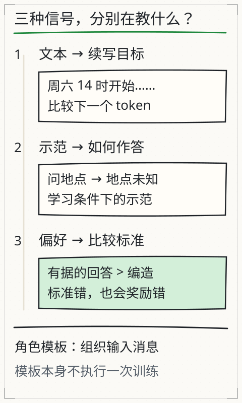
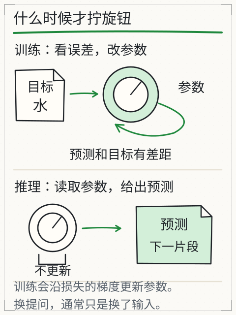

# C25 何时适配参数，何时不该训练

你已经有一个能训练、保存、生成的小 decoder。现在产品经理说：“让它学会听指令。”最直接的反应是“再训练一下”。但训练会改参数，也会带来数据许可、过拟合、评测和回滚问题。C25 要回答的不是“LoRA 好不好”，而是：这次需求到底要不要改参数？如果改，全量 SFT 和冻结底座的 LoRA 各自改了什么？你拿什么证据判断它值得留下？

## 先修桥：C18 的评测纪律 + C24 的底座

C18 已经要求你在动手前冻结验证材料、质量底线和成本上限；C24 给了你一个真实的微型 decoder 和 group-disjoint 的留出集。C25 沿用这两条：

- 任何适配都必须从未参加适配训练的组上报告结果；
- 任何“更好”都必须和基线在相同输入、相同解码设置下比较；
- 参数量、冻结状态、重载一致性是可以直接检查的工程事实，不是感觉。

本章的 SFT 数据在 `sft.jsonl`，全量微调和 LoRA 都由 `train.py adapt` 完成。先运行 `--method both`，把两份结果放在同一张表里看，而不是只看训练损失。

## 数据许可：先问“我能不能用”，再问“好不好用”

本目录的 `corpus.jsonl` 和 `sft.jsonl` 是课程作者编写的原创玩具数据，许可证见 `LICENSE-CORPUS`（CC0-1.0）。它们不含个人信息、第三方书籍段落、模型输出或下载语料。真实项目里，至少要先回答：

1. 数据是谁的？有没有明确的使用授权，允许训练、派生和部署？
2. 是否含个人信息、商业秘密、未公开材料或受版权保护的长文本？
3. 数据来源和版本能否记录？删除/更正请求能否追溯？
4. 训练用途与最终产品用途是否一致？把 A 场景的数据拿去适配 B 场景，未必被授权，也未必有效。
5. 评测集是否独立于训练和调参？用同一批样本既训练又验收，分数没有意义。

如果这些问题没有答案，先不要训练。提示、检索或工具调用往往能在不改参数的情况下满足需求，而且权限边界更容易说清。

## SFT 在教什么：只对回答算损失

监督微调（SFT）使用“提示→回答”的示范。`sft.jsonl` 的一条记录是：

```json
{"id": "sft-small-00", "group": "adjective-small", "split": "train",
 "prompt": "say the small boat .", "response": "the small boat floats ."}
```

编码后把两段接起来：

```text
full:    [BOS, say, the, small, boat, ., the, small, boat, floats, ., EOS]
inputs:  full[:-1]
targets: full[1:] 但提示部分写成 -100
```

具体地，提示有 5 个 token；`response_start = 1 + 5 = 6`。输入位置 0–4 的目标被置为 `-100`，位置 5 开始才预测回答的第一个 token。提示仍然在输入里，模型能看见它；但“复述提示”不算损失。这样模型学的是“给定这条指令，接下来该写什么”，不是“把指令原样抄一遍”。

为什么不能对提示也算损失？因为提示是用户给的，不是模型要生成的；把它算进去会让模型花容量去预测“用户会怎么问”，而且不同模板的提示长度会主导损失。若你确实想训练“续写提示”，那是另一种目标，要明确写出来，不能和指令跟随混在一起。

`adapt` 的 `encode_sft` 还会检查每条记录至少有一个回答目标；如果整条都被 mask 掉，直接报错，而不是悄悄贡献零损失。

## 全量 SFT：所有参数都动

`--method full` 从 `base.pt` 载入，解冻全部参数，用 SFT 训练集更新。默认配置下可训练参数是 **69,760** 个（与 C24 的账本一致）。训练结束后：

- 底座参数哈希会变化，`checks.base_updated=true`；
- `checks.base_frozen=false`；
- 保存的是完整 `state_dict`，重载不需要额外的适配器包装；
- 留出组损失可能下降，也可能上升；只报训练损失不足以说明问题。

全量 SFT 的风险很直接：数据少、步数多、学习率大时，模型可能记住训练样本的搭配，留出组变差；也可能把预训练学到的通用模式改坏（灾难性遗忘）。本课的 SFT 数据只有 45 条训练记录，默认 120 步、批大小 8、学习率 `2e-3`，这些数字只是教学起点，不是“最佳配方”。`--steps`、`--lr` 一改，结论可能就变；所以要记录条件并做单变量对照。

## LoRA：冻结底座，只训练低秩补丁

LoRA 不直接改原权重 `W`，而是在线性层旁加一个低秩更新：

```text
y = W x + (alpha / rank) * B (A x)
```

其中 `A` 的形状是 `[rank, in_features]`，`B` 是 `[out_features, rank]`，`B` 初始化为零。默认 `rank=4`、`alpha=8`，所以缩放是 `8/4=2.0`。刚包装时 `B=0`，`B A x=0`，模型与底座逐位相同；训练只更新 `A`、`B`，底座 `W` 的 `requires_grad` 被设为 `False`。

本课包装的目标是每个 block 的 `attn.qkv`、`attn.proj`、`ff.fc1`、`ff.fc2`，以及 `head`。默认配置的参数账本：

| 位置 | 计算 | 可训练参数 |
| --- | --- | --- |
| 每层 qkv | `4×64 + 192×4` | 1,024 |
| 每层 proj | `4×64 + 64×4` | 512 |
| 每层 fc1 | `4×64 + 128×4` | 768 |
| 每层 fc2 | `4×128 + 64×4` | 768 |
| 每层合计 |  | 3,072 |
| 2 层 |  | 6,144 |
| head | `4×64 + 50×4` | 456 |
| **LoRA 总计** |  | **6,600** |

底座 69,760 个参数全部冻结，加上 6,600 个适配器，包装后的 `parameters.total=76,360`，其中 `trainable=6,600`、`frozen=69,760`。`inspect --checkpoint runs/adapt-lora.pt` 会打印这组数；它和全量 SFT 的 `trainable=69,760` 是两种完全不同的适配方式。

`adapt` 在训练前后各算一次底座参数哈希：`checks.base_checksum_before` 与 `after` 应相等（`base_frozen=true`），而适配器哈希应变化（`lora_changed=true`）。还会检查底座参数的 `.grad` 是否全为 `None`（`base_grads_all_none`）——冻结不是“梯度为零”，而是这些参数根本没有进入优化器。保存时把 LoRA 的 `rank`、`alpha`、目标名和完整 `state_dict` 一起写入；`load_checkpoint` 先重建包装，再 `load_state_dict`，最后比较重载前后 logits（`checks.reload`）。如果只保存适配器权重而载入时没有先包装，键会对不上；如果保存了全路径目标名而载入只接受相对名，也会报“unsupported LoRA target”。本实现两种目标路径都接受，并把新 checkpoint 写成规范的相对目标。

## 全量 SFT 与 LoRA 怎样比较

`--method both` 从同一个 `base.pt` 分别训练两份模型，使用同一份 SFT 数据、同一个种子和同样的步数，输出：

```text
comparison.full.checks.base_updated
comparison.full.parameters.trainable
comparison.full.losses.before / after / delta_val / delta_test
comparison.lora.checks.base_frozen
comparison.lora.checks.base_grads_all_none
comparison.lora.parameters.trainable_after_setup
comparison.lora.losses.before / after / delta_val / delta_test
```

看这张表时，先分清三件事：

1. **工程事实**：哪些参数被更新、冻结是否成立、重载是否一致。这些是硬条件，失败就没有“方法优劣”可谈。
2. **本数据上的测量**：验证/留出损失降了多少。它们只对这组玩具数据和这些超参数成立。
3. **业务价值**：是否真的改善目标错误、是否满足延迟/显存/成本、是否通过独立评测。这部分不能由训练损失代替。

不要预设 LoRA 一定更好。LoRA 可训练参数少，可能更稳，也可能容量不足；全量 SFT 容量大，也可能过拟合或遗忘。rank、alpha、目标层、学习率、步数都会改变结果。比较时只改一个因素，并保留失败记录。

## 什么时候不该训练

- 需求只是“让模型看到新资料”：优先比较提示、RAG、工具调用；它们通常不改参数，资料更新也更容易追溯。
- 评测还没冻结：先做 C18 的验证集和判据；否则你无法判断改动是否值得。
- 数据许可不清：不要用“先训练再补授权”倒推。
- 训练成本高于收益：适配要数据整理、训练、评测、部署和回滚；小任务可能不值得。
- 错误来自检索或工具，而不是模型行为：训练参数不会修正“根本没取到资料”或“权限被拒绝”的问题。
- 需要逐条引用和最新事实：参数化记忆不适合作为唯一来源；保留检索与引用链。

SFT 和偏好训练也不是一回事。SFT 用示范告诉模型“这样回答”；偏好训练用成对比较告诉模型“这两种回答里更偏好哪一种”。本课只做 SFT 和 LoRA，不执行偏好优化，也不把“礼貌”或“自信”当成事实正确。



*图：文本、示范、偏好是三种不同信号：分别教“接下去”“这样答”“哪种更好”。标准本身错了，偏好训练也会照单奖励；角色模板只组织输入，不执行一次训练。*



*图：适配（SFT/LoRA）也只发生在训练一侧，沿损失更新参数；推理始终只读取参数。*

本地对照：[X05 训练与推理](../../../exports/llm/training.html)、[L06 指令跟随](../../../exports/llm/assistant.html)。注意 X05 是 bigram 分数表，L06 的演示回答是教学编写，不是本课 LoRA 的教师输出。

## 改一个条件，看结论会不会变

- **把 prompt token 也算损失**：训练损失可能下降，但模型学的是复述提示；检查 `targets` 里提示段是否仍为 `-100`。
- **让 group 跨 split**：留出组泄漏，验证损失虚低；`validate_sft` 应直接拒绝。
- **LoRA 后再 `apply_lora` 一次**：同一层被包两次，类型检查应报错；不要用“再包一层”来增加容量。
- **从已适配 checkpoint 再 adapt**：`_adapt_one` 会拒绝，避免把全量 SFT 或 LoRA 叠成无法解释的链条。
- **rank=0 或负数**：直接拒绝；低秩更新没有维度。
- **只保存 adapter 不保存 base**：载入时无法重建底座；本课保存完整 state dict 和适配元数据。
- **冻结参数仍放进优化器**：即便 `requires_grad=False`，显式传入也可能出现空梯度或意外；本课只把 `requires_grad` 为真的参数交给 AdamW。
- **学习率过大/步数过多**：训练损失下降、留出损失上升；先做单变量对照，不要同时改数据和步数。

## 独立练习与项目增量

1. 默认 `rank=4` 的 LoRA 可训练参数是 6,600。改成 `rank=8` 后是多少？只包 `qkv` 和 `proj`（再加 head）是多少？不包 head 呢？先手算，再用 `inspect` 核对。
2. 写出 `sft-small-00` 的 `full`、`inputs`、`targets`，标出哪些位置是 `-100`。如果提示长度从 5 变成 6，`response_start` 和第一个有损失的位置怎样变？
3. 同一底座、同一数据、同一种子，分别跑 `adapt --method full` 和 `adapt --method lora`。记录 `parameters.trainable`、`base_updated`/`base_frozen`、`base_grads_all_none`、`reload.bitwise_equal`、`delta_val`、`delta_test`。用一段话说明：哪些结论是工程事实，哪些只是这组数据上的测量。
4. 把 `--steps` 从 120 改成 20 和 300，只改这一个因素，观察全量 SFT 与 LoRA 的留出损失。不要因为某一次结果更好就宣布方法优劣；记录条件和失败。

项目增量：你已经能在同一个底座上完成全量 SFT 和 LoRA，验证冻结、参数更新与重载，并能用留出组而非训练损失来报告结果。C26 会把“另一个模型提供训练信号”的蒸馏接进来，同时保留已有的 KL、T² 和错误教师证据。

答案与参数核算见 [`../deepening/c25-answer.md`](../deepening/c25-answer.md)。上一章：[C24 从零组装最小 decoder](c24.md)；下一章：[C26 蒸馏学到的是什么](c26.md)。

## 来源与边界

- Hu 等，*LoRA: Low-Rank Adaptation of Large Language Models*（2021）：冻结原权重、低秩更新、缩放与秩的选择；本课按该思路实现线性层包装。
- PyTorch 2.14.1 官方文档：`requires_grad` 冻结、`state_dict`、`load_state_dict`、`torch.load(weights_only=True)`、`optim.AdamW` 与梯度清零。
- 本课 `sft.jsonl`、`train.py adapt` 与 `model.py` 的实际实现；所有参数计数可由源码与配置复算。
- 边界：SFT/LoRA 的结果只对本目录的玩具语料、默认超参数和留出组成立。LoRA 不会自动优于全量 SFT，也不会自动解决数据许可、事实正确或检索失败。真实项目还要评估部署成本、隐私、回滚和独立评测；本课没有执行偏好优化、量化、剪枝或真实用户任务。
