# C29 交给别人怎样才算交付

你在自己的笔记本上跑通了产品手册助手：模型能加载、检索能命中、答案带页码。第二天，同事按你写的“运行 `python app.py`”操作，得到的是 `ModuleNotFoundError`；另一位同事启动了服务，健康检查返回 200，但一问问题就 502；还有人把旧版手册的答案发给了现场。你的程序没有坏，坏的是**交付边界**：环境、配置、权限、健康检查、故障处理和回退没有写成别人能执行的东西。

上一章 [C28 为新任务选择最小系统](c28.md) 给出了架构决定；本章把它变成别人能启动、能检查、能回退的交付包。下一章 [C30 不照抄案例的毕业项目](c30.md) 会换一个陌生题材，让你独立走完同样的链路。

本章把 C28 的架构决定变成可交付的一包东西：环境锁定、配置、启动、健康检查、故障注入、回退、隐私与用户说明。下面以产品手册系统为目标，用仓库资料助手演示可复现的服务契约；两者命令要替换，边界不能省。

## 先修检查：从 C28 与基础工程走进来

你应该已经：

- 有 C28 的架构决定、验收集和范围说明；
- 能运行一个本地 Python 程序，理解虚拟环境、依赖、路径和退出码；
- 见过 HTTP 请求/响应，知道状态码、JSON 和端口；
- 知道哪些文件不能进仓库（模型权重、密钥、真实客户数据）。

本章就地补四个小桥：

1. **进程与服务**：`serve` 启动后是一个长期运行的进程，监听 `127.0.0.1:8765`；关闭进程，端口就不再响应。
2. **健康检查**：`GET /health` 返回 200 只说明进程和路由在，不一定说明模型能推理、文档能读取。健康检查要分“存活”与“可用”。
3. **配置**：模型路径、手册路径、端口、读者身份、日志级别都应显式记录；密钥只写环境变量名，不写值。
4. **回退**：保留上一个可运行版本，知道怎么切回去、怎么验证切回成功。回退不是“重新装一遍试试”。



*图：材料、步骤、核验与交付在一条线上：原始材料先进版本化目录，步骤要能被第三人执行，核验留下可回查文件，交付边界决定别人能不能跑起来。每一段都要有文件支撑。*

旧的 [L12 项目交付实验](../../../exports/llm/project.html) 提供四字段报告与缺失/冲突材料，可用来检查核验习惯；它使用网页预置数据，不是本章发布包的实测。

## 交付包长什么样

不要交一个散落的目录。用版本化发布目录：

```text
manual-assistant/
  releases/
    2026-11-08-a/
      app/                  # 你的程序（或指向仓库的固定提交）
      docs/manual-v2.0.md
      documents.json
      requirements.lock     # 实际测试通过的完整依赖
      release.json          # 版本、哈希、启动命令、已知限制
      runbook.md
      user-guide.md
      smoke/
        normal.json
        model-failure.json
        bad-json.json
        rollback.md
    2026-11-07-a/           # 上一个可用版本，用于回退
  current-release.json      # 指向当前发布目录；不是唯一真相，启动脚本仍显式校验
  README.md                 # 快速开始、范围、支持/不支持
```

`release.json` 示例（字段可增减，但不要省略证据）：

```json
{
  "schema": "manual-release/1",
  "release": "2026-11-08-a",
  "created": "2026-11-08",
  "program_commit": "<git commit 或源码包 SHA-256>",
  "python": "3.13.x",
  "platform": "Windows 11 x64 / CPU",
  "model": {
    "path": "<本地模型目录>",
    "config_sha256": "<config.json 哈希>",
    "license_note": "权重不再分发；使用前确认许可"
  },
  "manual": {
    "path": "docs/manual-v2.0.md",
    "version": "2.0",
    "sha256": "<手册文本哈希>"
  },
  "start": "python app/assistant.py serve --reader student --docs documents.json --model <MODEL_DIR> --host 127.0.0.1 --port 8765",
  "health": "GET http://127.0.0.1:8765/health",
  "scope": "只回答 v2.0 手册覆盖的内容；逐字引用；自由改写需人工复核",
  "known_limits": ["扫描页需 OCR", "不执行设备动作", "CPU 延迟依机器而异"]
}
```

关键点：

- `requirements.lock` 是实际测试通过的完整依赖，不是“>=”范围。仓库示例的 `requirements.txt` 可能只是下限；交付时用你环境里的 `python -m pip freeze` 生成锁文件，再在干净环境验证。
- `release.json` 是证据索引，不要让程序偷偷从它读取并覆盖显式参数；启动参数仍要看得见。
- 模型权重、真实日志、密钥、客户数据不进发布包。模型只写路径、来源、哈希和许可说明。

## 干净环境：从零启动

在一个新目录（不复制 `.venv`、`out/`、缓存和旧日志）按 runbook 执行：

```bash
python -m venv .venv
# Windows: .venv\Scripts\activate
# macOS/Linux: source .venv/bin/activate
python -m pip install -r releases/2026-11-08-a/requirements.lock
python --version
python -c "import torch, transformers; print(torch.__version__, transformers.__version__)"
```

然后启动服务。以仓库资料助手为同构示例：

```bash
python book/llm/examples/assistant/assistant.py serve \
  --docs book/llm/examples/assistant/documents.json \
  --reader student \
  --model /path/to/local-model \
  --host 127.0.0.1 --port 8765
```

健康检查：

```bash
curl -s http://127.0.0.1:8765/health
```

实际返回应包含 `status: "ok"`、`provider`、`model`、`docs`、`local_files_only`。但**200 不等于可用**：该服务的模型是首次查询时才加载，健康检查不会证明模型文件完整。再做一次已知问题的就绪查询：

```bash
curl -s -o out/ready.json -w "%{http_code}\n" \
  -X POST http://127.0.0.1:8765/query \
  -H "Content-Type: application/json" \
  -d '{"question":"2026-10-03 的风速是多少？","reader":"student","mode":"fixed","top_k":3}'
```

对这个已知有证据的问题，须返回 200、`status: "answered"` 且报告带可回查的引用，才说明“进程 + 文档 + 模型 + 引用校验”这条链在当前环境可用。只返回 200 但状态为证据不足也不通过就绪检查。格式或引用失败在当前实现中返回 400，源文件失败返回 409，模型不可用返回 502；均保留响应体里的 `status`、`diagnostics.first_failure` 和 `usage`，不要反复重启掩盖。

对产品手册系统，把上面的命令换成你的 `serve` 入口；健康检查至少要报告：进程、版本、手册版本、模型标签、当前读者/权限模式。没有 HTTP 入口的 CLI 也要提供等价的 `healthcheck` 子命令或启动自检。

## 配置与权限

配置分三层：

| 层 | 内容 | 不应包含 |
| --- | --- | --- |
| 代码/发布包 | 路由、默认预算、输出 schema | 密钥、真实客户数据、模型权重 |
| 发布配置 | 手册路径/版本/哈希、模型路径、端口、日志目录 | 个人令牌、未授权文档 |
| 运行时环境 | API 变量名、临时路径、读者身份 | 密钥值打印到日志 |

规则：

- 绝对路径可以出现在本机 `release.json`，但用户说明要写“替换为你的路径”，不要把作者机器的路径当成通用路径；
- 只允许回环地址 `127.0.0.1`，除非另有网络与认证设计；不要默认 `0.0.0.0`；
- 读者/权限必须在检索前检查；服务端不能信任客户端自报的“我是管理员”；
- 环境变量只记录名称，例如 `ASSISTANT_API_BASE`、`ASSISTANT_API_MODEL`、`ASSISTANT_API_KEY`，不记录值；
- 日志默认不写完整问题/答案/文档正文；若必须写，先脱敏并设保留期限。

## 故障注入：至少四种，记录实际结果

不要只测试“服务正常”。按下面的顺序做，每次都保存请求、HTTP 码、响应体和时间：

### 1. 服务停止

启动服务后，另开终端请求一次，然后停止服务（`Ctrl+C` 或关闭进程），再请求：

- 预期：连接被拒绝/超时，不是 200；
- 记录：客户端错误、时间、是否有请求到达服务端；
- 不能推出：服务一定没有执行任何操作。若请求有副作用，需要请求 ID/幂等键查询。

### 2. 模型不可用

用错误的 `--model` 路径启动（或把模型目录改名后启动）。健康检查可能仍返回 200，因为模型未加载；发一次查询：

- 预期：HTTP 502，报告 `model-unavailable`，`diagnostics.first_failure` 指出模型加载失败；
- 记录：健康检查的“假阳性”——这正是为什么需要就绪查询；
- 不能做：回退到示例答案、旧缓存答案或手写答案。

### 3. 坏 JSON

POST 一个非法 JSON，或缺少 `question`/`reader`：

- 预期：400/413，报告 `invalid-request`，不进入模型；
- 记录：请求体大小、错误字段；
- 检查：错误信息不回显密钥或完整文档。

### 4. 源文件缺失/版本不符

把 `documents.json` 指向一个不存在的文件，或改动手册文本但保留旧 `sha256`：

- 预期：`missing-source` 或 `source-version-mismatch`（HTTP 409 或按你的映射）；
- 记录：报告中的文档 ID、期望/实际哈希；
- 不能做：忽略哈希、继续用缓存。

### 5. 越权（如你的系统有读者字段）

用一个无权读取目标手册的读者提问：

- 若权限过滤后没有候选：返回 `insufficient-evidence`，而不是硬凑一段；
- 若管线明确返回 `unauthorized`：HTTP 403；
- 检查：无权限正文没有进入提示/日志/报告。

以实际报告为准，不要为了演示“403”改权限或改代码。

### 6. 超时/未知（可选，条件允许）

若你的客户端有超时，构造一次慢请求或短暂断网：

- 客户端超时只能说明“没等到响应”，不能说明服务没执行；
- 记录请求 ID、客户端取消时间、服务端是否完成；
- 对只读问答没有副作用，但仍要保留未知状态，不能把超时当“没有答案”。

## 回退：实际演练一次

回退不是“把代码改回去再试”。可以使用 [本地发布与回退工具](../examples/delivery/README.md)：它生成全文件哈希清单、校验后切换 `current.json`，并提供 Windows CPU 环境的哈希锁定文件。下文的 `current-release.json` 是通用示例名，使用该工具时对应 `current.json`。用版本目录和显式切换：

1. 确认当前版本：`current-release.json` 指向 `2026-11-08-a`，记录其手册/模型/程序哈希；
2. 触发条件：健康检查连续失败，或就绪查询返回 502/引用校验失败率超阈值，或手册版本错误；
3. 停止当前服务；
4. 把 `current-release.json` 或启动脚本的 `RELEASE_DIR` 指向上一个版本 `2026-11-07-a`；不要依赖符号链接（Windows 权限/路径容易出问题）；
5. 用上一版的 `requirements.lock`（如依赖也变了）启动；
6. 跑同一组健康检查 + 就绪查询 + 至少一个失败用例；
7. 记录：切换时间、旧/新版本哈希、启动日志、查询报告、仍存在的问题；
8. 只有验证通过，才把当前版本标记为“已回退”；失败则继续回退或停止服务。

回退演练的证据应包含：

```text
rollback/
  before-health.json
  before-query.json
  trigger.md
  after-health.json
  after-query.json
  release-old.json
  release-new.json
  result.md
```

`result.md` 写清“为什么回退、切到哪个版本、验证了什么、哪些数据/模型版本不同、是否恢复到可服务状态”。不要只写“已回退”。

## 监测、隐私与费用

最小监测（本地即可）：

- 每个请求一行 JSON：时间、请求 ID、读者、状态、HTTP 码、耗时、检索命中数、模型调用次数、文档版本；
- 不记录完整问题/答案/正文，除非有明确授权和脱敏；
- 健康检查与就绪查询分开；就绪失败要告警到本地日志/终端；
- 磁盘、模型加载时间、内存峰值按需记录；CPU 本地费用记 `null`，不要编一个金额；
- 若使用授权 API，记录 token 用量和单价依据；没有单价就写“未计价”，不要假装免费。

隐私：

- 手册和问题可能含内部信息；默认本地、最小化、限期保留；
- 日志、备份、截图、失败报告同样受权限约束；
- 删除请求要能删到日志/缓存/导出，而不只是主数据库；
- 不把真实客户数据放进教学仓库或公开 issue。

## 用户说明：让别人知道边界

`user-guide.md` 至少写：

- 这个系统做什么、不做什么；
- 支持的手册版本和文件类型；
- 如何提问、如何看引用、如何识别“未知/不可读/冲突”；
- 引用契约：答案只使用逐字引用或人工复核的改写；自由改写不算材料原文；
- 权限：哪些读者能看哪些文档；越权会怎样；
- 失败时怎么办：重启、看健康检查、回退、联系谁；
- 隐私与保留：问题/日志保存多久、是否上传；
- 已知限制：CPU 延迟、扫描页、语言、模型可能出错。

`runbook.md` 至少写：

- 依赖安装命令与锁文件；
- 模型/手册路径与哈希；
- 启动、停止、健康检查、就绪查询；
- 常见故障与对应状态；
- 回退步骤与验证；
- 变更记录（谁、何时、改了什么）。

### 范围声明模板

```text
本交付只处理 <手册名称/版本> 中已授权、可抽取的文字与标注图像。
答案仅由逐字引用或经人工复核的改写组成；未命中、不可读、冲突或越权时返回明确状态，不猜测。
不支持 <PDF 版面/手写/多语言/设备控制/实时数据>。
模型与数据的许可边界见 release.json；权重不再分发。
本说明不构成安全、法律或医疗建议；高风险操作须按组织规程人工确认。
```

## 另一个人从干净环境运行

K5 要求“另一人独立启动与操作”，这不是作者再跑一遍。你需要找一位没有参与实现的人，给他发布包和文档，不口头补步骤，记录：

- 首次执行的命令与输出；
- 卡在哪一步、缺什么依赖/权限；
- 是否能在无作者提示下完成正常查询和一次失败查询；
- 回退是否由他实际执行；
- 他遇到的问题和你的修订。

作者/agent 的烟测只是技术证据，不能记作独立复做通过。没有真人时，保留空白记录并标“待独立复做”，不要填造姓名或完成率。

## 失败反例

1. **健康检查 200 就宣布可用**：模型未加载、文档损坏，第一次查询才 502。要加就绪查询。
2. **requirements 写 `>=`**：干净环境装到新版本，API 变了。交付用实际锁文件。
3. **模型路径写死作者机器**：别人无法启动。路径进配置并写替换说明。
4. **回退只改代码**：模型/手册版本没切，旧答案继续出现。回退要连数据/配置/依赖一起验证。
5. **日志记录完整问题**：内部型号、客户信息泄露。默认脱敏/不记录正文。
6. **把作者自测当独立复做**：K5 不通过。需要另一位真人按文档操作。

## 独立作业

1. 为你的产品手册系统建立 `releases/`、`release.json`、`requirements.lock`、`runbook.md`、`user-guide.md`。
2. 在干净虚拟环境按 runbook 启动，保存健康检查、就绪查询和至少一次失败查询的实际输出。
3. 做四种故障注入：停服务、错模型、坏 JSON、缺失/版本不符（有权限字段再加越权）。保存请求、HTTP 码、响应体。
4. 实际执行一次回退：从上个版本切回，跑健康检查和就绪查询，写 `result.md`。
5. 请另一位同学只按文档操作；记录他卡住的地方，不口头补充。没有真人就保留待办。
6. 写一页范围声明，明确支持/不支持、引用契约、隐私和回退。
7. 对照答案的交付检查表自评，标出未验证项。

答案与检查表见 [C29 答案](../deepening/c29-answer.md)。答案不提供可直接抄的发布包；它给验收点和常见缺步。

## 项目增量：可交付发布包

C30 的毕业项目会直接复用本章结构：

```text
capstone/
  releases/<version>/
    app/
    docs/
    requirements.lock
    release.json
    runbook.md
    user-guide.md
  evidence/
    normal/
    missing/
    conflict/
    unauthorized/
    model-failure/
    bad-json/
    rollback/
  independent-review.md   # 另一位真人的记录；没有就写待办
```

只有发布包、证据和独立复做都齐，才谈 K5；本章本身不授予 K5。

## 来源与限制

- 服务接口、健康检查、状态码与报告字段以 `book/llm/examples/assistant/README.md` 和实际 `--help` 为准；产品手册系统由你实现，命令需替换。
- 本章用资料助手做同构演练，不声称它是产品手册系统，也不声称其模型/文档已在你机器上通过。
- 干净环境、故障注入、回退和独立复做必须实际执行；本章文字不能替代证据。
- 不要求公网、付费托管或云服务；本地回环服务即可。若使用 API，费用与数据驻留由你记录，不编造金额。
- 独立复做需要真人；没有真人时 K5 保持待验，不能用作者自测或 agent 记录补齐。
