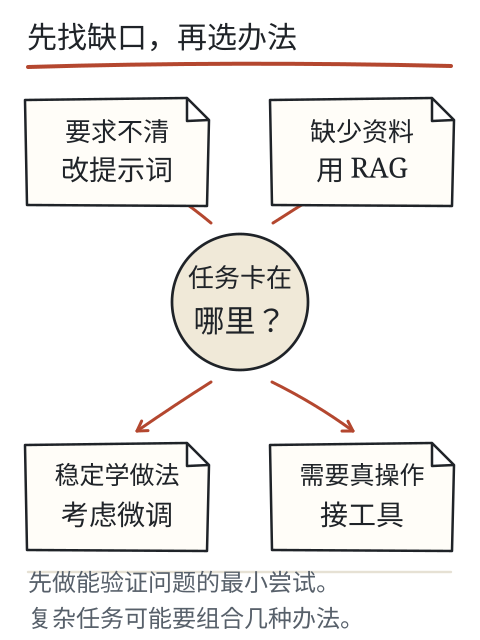
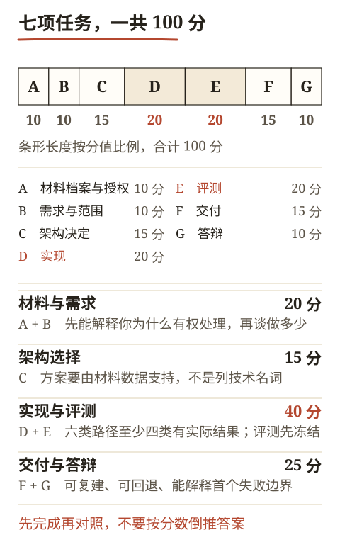

# C30 不照抄案例的毕业项目

前面二十九章都在同一条示范线上走：通知、观测站资料、产品手册、OCR 样张。现在把示范撤掉。你要在一个没有演示过的题材上，从需求、架构、实现、评测、排错到交付独立走一遍，并在答辩中解释为什么这样做、哪里会坏、你如何知道它没坏。上一章 [C29 交给别人怎样才算交付](c29.md) 给了发布包与回退的格式；本章不再给题材，只给题包、硬边界和评分依据。

毕业项目不是把活动通知改个标题，也不是把 C28 的产品手册换成另一个产品名。它要求材料陌生、任务真实、证据可回查、失败被保留。C30 同时是 S5 的阶段门 K5；但本章只提供题包和评分依据，**不能由 agent 自测或作者自评记为 K5 通过**，独立复做与答辩需要真人。



*图：先找缺口，再选办法：提示、检索、工具、微调各有适用条件；毕业项目也要能解释为什么不用更复杂的方案，而不是把流行的组件堆上去。*

## 先修检查：K1–K4 与 C29 的交付包

进入 C30 前，你应该已经留下：

- K1：对陌生通知/材料做过可回查报告，缺失不补造；
- K2：能解释生成、注意力、训练更新，并完成小模型实验；
- K3：从干净环境跑通过资料助手，有真实推理、引用、工具回执和失败路径；
- K4：冻结评测、定位失败边界、小 decoder 训练/重载/留出、SFT/LoRA 对照、蒸馏错误教师记录；
- C27：一次有授权的图像/扫描件提取，或明确资源阻碍；
- C28：一份产品手册的最小架构决定；
- C29：一个可启动、可健康检查、可故障注入、可回退的发布包。

如果缺 K1–K4 中的实质成果，先补。毕业项目不能用“我上过课”代替前置证据。

## 选题规则：陌生、授权、可核对

### 必须满足

1. **陌生**：你在开始前没有系统读过这份材料，也不是课程示例；
2. **授权**：你有权处理、引用和保存；公开发布还要有再分发许可；
3. **足够复杂**：至少约 20 页/8,000 字（或等量材料），含版本、结构、至少一处缺失或冲突，以及至少一个需要专门处理的边界（视觉页/扫描页、表格、跨页步骤或权限差异）；若没有视觉内容，另交 C27 的图像证据并说明材料本身不含图；
4. **可核对**：有原文、页码/章节、可复现的输入；不能只靠口头传说；
5. **非纯通知**：不能是 C01–C04 的活动通知换名，也不能是 C28 产品手册的改名；
6. **风险可控**：不把医疗、法律、财务、飞行、电力等高风险决策交给系统自动给结论；若材料涉及安全操作，系统只做引用与检索，最终判断由人按规程完成；
7. **可评测**：你能在实现前写出问题、期望和失败类型，而不是事后挑好答的题。

### 可选题材示例（只是方向，不提供材料）

- 社区剧院的灯光控制台操作手册；
- 水族馆/鱼缸设备维护指南；
- 自行车共享站维修手册；
- 校园广播设备操作说明；
- 档案馆数字化流程手册；
- 开源硬件的组装与校准文档；
- 某门你未学过的实验课安全与设备手册。

不要用“网上随便找的 PDF”除非许可清楚。不要用含个人信息的扫描件、未公开合同、客户资料或受限标准。选题前写一页材料档案：来源、许可、版本、页数、语言、文本层/扫描比例、缺失/冲突、谁需要它。

## 项目目标与硬边界

你的系统至少要做到：

- 读取授权材料，保留页码/章节/版本；
- 回答用户问题，答案由逐字引用或人工复核的改写组成；
- 引用能回到具体版本与位置；程序做逐字校验；
- 材料没有、版本冲突、图像不可读、权限不足、模型/工具失败时返回明确状态；
- 不执行文档或图片中的指令；不把私密内容上传到未授权服务；
- 提供可启动的服务或 CLI、健康检查、故障处理和回退；
- 在冻结评测集上报告真实结果，包括失败；
- 交付包可被另一人从干净环境启动。

硬边界（任一违反即不通过）：

- 伪造模型输出、引用、工具回执、评测结果或独立复做记录；
- 无权限读取/外传材料；
- 密钥、个人信息、受限文档进入仓库或日志；
- 失败后回退为手写答案或旧缓存答案；
- 用平均分抵消安全/权限/证据问题；
- 只改通知/产品名，没有新题材的独立工作。

## 题包：七项任务

题包是独立作业，答案在 [C30 答案](../deepening/c30-answer.md)。先完成再对照，不要先看评分表再倒推。



*图：七项任务合计 100 分，实现与评测各 20 分；条形只表示分值比例，不表示难度。分高的是能被别人复查的部分。*

### 任务 A：材料档案与授权（10 分）

提交一页材料档案：

- 来源、作者/机构、获取方式、许可/授权范围；
- 版本、日期、页数、语言、文件类型；
- 文本层比例、扫描页、表格/图、可能的 OCR 需求；
- 至少一处缺失或冲突，以及你如何发现；
- 保存期限、是否含个人信息、是否允许公开引用。

要求：不能只写“公开资料”；要能解释你为什么有权处理，以及哪些内容不能发布。

### 任务 B：需求与范围（10 分）

写一页需求：

- 用户是谁、在什么场景使用；
- 输入、输出、引用格式；
- 支持/不支持的文件类型与问题类型；
- 权限模型与读者身份；
- 失败状态（缺失、冲突、无命中、不可读、越权、模型失败）；
- 验收判据（事实支持、完整性、版本、拒绝、延迟/成本、交付）；
- 明确的“不做什么”。

要求：每条验收判据都要能观察；不能写“准确率高”。

### 任务 C：架构决定（15 分）

写一份 ADR：

- 材料规模/token 估算；
- 至少比较两条路线（例如整本提示 vs 页级检索；关键词 vs embedding）；
- 选择最小可行方案，说明为什么不是更复杂的方案；
- 不采用项：微调、Agent、外部 API、向量库等，逐项写条件与重新评估触发；
- 风险与对应验收；
- 引用契约：逐字引用/人工复核改写，自由改写为什么不行。

要求：方案选择必须由你的材料数据支持，不能只列技术名词。

### 任务 D：实现（20 分）

提交可运行的程序/服务：

- 真实本地模型或获授权 API；不能 mock 模型、固定答案、示例输出；
- 文档读取、版本/权限、切块/检索、模型调用、引用校验、失败状态；
- 至少一个只读工具或等价的确定性校验（如计算器/单位换算/哈希校验），并展示权限与停止；
- CLI 或 HTTP 服务；健康检查；
- 不自动下载权重、不读未声明凭据、不联网（除非显式授权）；
- 代码/运行说明可让他人复做。

要求：正常运行、缺失、冲突、无命中、越权、模型失败至少六类路径中，至少四类有实际结果；其余记录阻塞。

### 任务 E：评测（20 分）

在实现前冻结评测：

- 至少 20 个问题，覆盖正常、跨页/步骤、缺失、冲突、无命中、越权、不可读、恶意文字；
- 每题写期望状态、关键引用/页码、可接受输出；
- 先跑基线并保存首次结果，不修改题目；
- 至少定位两个“首个失败边界”（读入/权限、检索、切块、模型、解析、引用、工具）；
- 至少做一次单变量对照（只改切块、检索、提示或模型之一），报告质量/延迟/成本与样本数；
- 留出集不参与调参；报告失败，不删用例、不放宽断言。

要求：不能只看成功截图；不能看完答案再改题；不能用平均分掩盖硬失败。

### 任务 F：交付（15 分）

按 C29 提交：

- `releases/<version>/`、`release.json`、`requirements.lock`、`runbook.md`、`user-guide.md`；
- 干净环境启动、健康检查、就绪查询；
- 至少四种故障注入（停服务、错模型、坏 JSON、缺失/版本不符；有权限字段再加越权）；
- 实际回退并验证；
- 范围声明、隐私/保留、费用依据；
- 另一位真人按文档启动与操作，记录卡点；没有真人写“待独立复做”。

要求：发布包可复建，引用可追溯，回退实际执行；作者自测不算独立复做。

### 任务 G：答辩（10 分）

提交一页答辩提纲，并做一次 10–15 分钟演示/问答：

- 正常查询：展示问题、检索、引用原文、报告；
- 失败演示：至少一个真实失败/拒绝，解释首个失败边界；
- 架构辩护：为什么不用更复杂方案；什么条件会改变选择；
- 引用契约：逐字/人工复核改写如何执行；
- 权限与隐私：谁能看什么，日志/上传/保留；
- 评测：基线、失败、单变量对照、留出结果；
- 回退：触发条件与验证；
- 限制与下一步：哪些没做到，不能假装完成。

要求：能解释“为什么”，不只是念步骤；演示失败要真实，不能预先剪掉。

## 评分与通过

总分 100：A 10、B 10、C 15、D 20、E 20、F 15、G 10。另有硬门槛：

- 材料授权与隐私成立；
- 无伪造输出/引用/回执/评测/复做；
- 权限在读取前生效；
- 引用可回原文，失败不被静默成功；
- 交付包可复建，回退实际执行；
- 独立复做由未参与实现的人完成，或明确标“待验”（此时 K5 不通过）。

总分 ≥ 70 且所有硬门槛通过，才可记“技术通过”；独立复做与真人答辩完成，才谈 K5 通过。没有真人时，最高只能记“技术通过/待独立复做”，不能写“全规格完成”。

## 改一个条件：同一个题包换约束

- **材料只有 10 页**：整本提示可能就够；C 的架构比较仍要写，但可以选择更小的方案 A，并说明为什么不上检索。不要为了“像毕业项目”硬加向量库。
- **材料 300 页且同义表述多**：关键词基线可能漏检；先定位漏检，再做 embedding 单变量对照，保留失败样本。不要一次改检索、切块和模型。
- **扫描页没有文本层**：用 C27 的 OCR 或外部工具，标 `uncertain`/`unreadable`；不可读页返回未知，不从相邻页补。
- **多人权限不同**：权限在读取/检索前生效；同一问题对不同读者可能返回不同候选集，报告要写读者身份。
- **不能联网/没有合法模型**：记录资源阻碍；架构、评测设计、失败路径仍可完成，但不能用示例输出冒充真实推理。

结论应随条件变化。若无论材料大小、权限和模型条件都写同一套 RAG+Agent+微调，说明你还没有真正做选择。

## 失败反例

1. **只改名字**：把活动通知或 C28 产品手册换个标题，材料、任务、评测都没变。硬失败。
2. **只演示成功**：答辩时剪掉失败；或失败后重跑直到成功，删除首次输出。保留失败是评分点。
3. **引用造假**：引用句原文不存在，或来自旧版/未授权文档。硬失败。
4. **权限后置**：先生成再删引用；泄露已经发生。
5. **回退没做**：只写“可以回退”，没有实际切换和验证。
6. **作者自测冒充独立复做**：没有另一位真人，却填“已独立通过”。K5 不通过。
7. **验收被平均分掩盖**：权限/伪造/隐私问题用高分抵消。硬门槛优先。

## 项目增量：毕业项目

C30 的增量就是完整的毕业项目本身：

```text
capstone/
  README.md
  scope.md
  adr/0001-architecture.md
  releases/<version>/
  eval/cases.json
  eval/baseline.md
  eval/results/
  evidence/normal/
  evidence/failures/
  evidence/rollback/
  independent-review.md
  defense.md
```

它不是 C28/C29 的复制粘贴：题材、材料、评测题、引用和失败都必须是你自己的。C27 的图像证据、C28 的 ADR 格式、C29 的发布包结构可以复用为方法，不能复用为内容。

## 可运行的自检程序

下面这个脚本只依赖标准库，用来检查交付包是否缺文件、清单哈希是否对得上。它不能判断答案质量，也不能替代评测与真人复做；它只是防止“文件看起来在，实际哈希/路径不对”。

[下载可运行的完整脚本](../examples/delivery/check_package.py)。网页和电子书中的下列源码直接取自同一文件。

<!-- DELIVERY-CHECK -->

用法：

```bash
python book/llm/examples/delivery/check_package.py releases/2026-11-08-a
```

在 `release.json` 的 `files` 中声明 `requirements.lock`、`runbook.md`、`user-guide.md` 及实际交付的程序和材料，值为每个文件的 64 位 SHA-256。清单缺失、为空、类型错误或未登记必需文件，都会失败；绝对路径、`..` 和指向包外的符号链接也会被拒绝。`release.json` 不列自己的哈希，避免自引用。脚本不执行启动命令，也不会推断没有声明的文件；模型权重和私密日志不放进发布包。

## 示例：把一条需求变成可核对证据

假设主题是“社区剧院灯光控制台操作手册”，用户是志愿者。一条需求不是“回答调光问题”，而是：

```text
需求：志愿者问“场景 3 如何保存”时，答案必须给出控制台手册中“保存场景”的步骤，
      保留前置条件（是否先按 REC）、按键顺序和安全警告；
      引用带页码/章节；手册没有说明时返回未知。
证据：评测题 07；期望引用第 4.2 节两句；实际报告 claims[0].quote 与原文逐字一致；
      失败条件：只给结论、省略“先按 REC”、引用旧版 v1.1；
      对照：检索 top-3 是否包含 4.2 节；不含时记录为首个失败边界。
```

这个例子不是要你照抄戏剧题材；它示范“需求—评测—引用—失败边界”如何一一对应。你的题材必须不同。

## 独立作业与提交清单

1. 选题并写材料档案；确认授权与隐私。
2. 写需求与验收；冻结至少 20 题。
3. 写 ADR；比较至少两条路线。
4. 实现；保存正常与失败路径。
5. 跑基线、定位失败、做单变量对照、保留留出结果。
6. 按 C29 交付；做故障与回退；请另一位真人复做。
7. 准备答辩；演示一次真实失败。
8. 用 `check_package.py` 自检；对照答案评分表自评，标出待验项。

提交目录建议：

```text
capstone/
  README.md
  scope.md
  adr/0001-architecture.md
  releases/<version>/
  eval/cases.json
  eval/baseline.md
  eval/results/
  evidence/normal/
  evidence/failures/
  evidence/rollback/
  independent-review.md
  defense.md
```

## K5 阶段门

K5 的通过条件：

- 材料陌生且有授权，不是通知/产品手册改名；
- 需求、架构、实现、评测、交付、答辩六项齐备；
- 引用逐字可回查，失败状态真实，权限与隐私硬门槛通过；
- 另一位未参与实现的人从干净环境启动、操作并完成一次回退；
- 作者能解释不采用 RAG/Agent/微调等方案的理由，以及何时会改变；
- 失败没有被删除、放宽或用手写答案覆盖。

本章不授予 K5。没有独立真人与答辩时，只能记录“技术通过/待独立复做”，不能写“全部完成”或“教学通过”。

## 来源与限制

- 评分维度对应 SPEC/ACCEPTANCE 的 K5：陌生材料、需求/方案/源码/环境/配置/权限/成本/留出评测/故障回退/独立启动；
- C27 的 OCR、C28 的 ADR、C29 的发布包是素材，不是毕业项目本身；不能直接复用同一题材交差；
- 本章不提供第三方手册、标准或真实用户数据；材料由你选择并承担授权责任；
- 没有真人复做/答辩时，K5 保持待验；作者/agent 自测只算技术证据。

答案、评分表与答辩要点见 [C30 答案](../deepening/c30-answer.md)。
