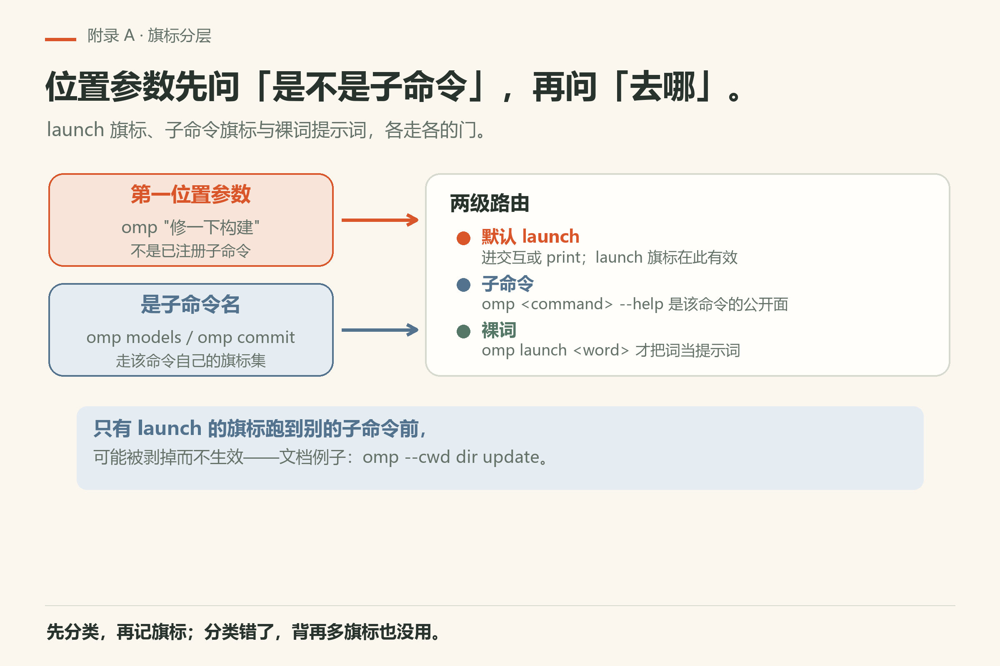
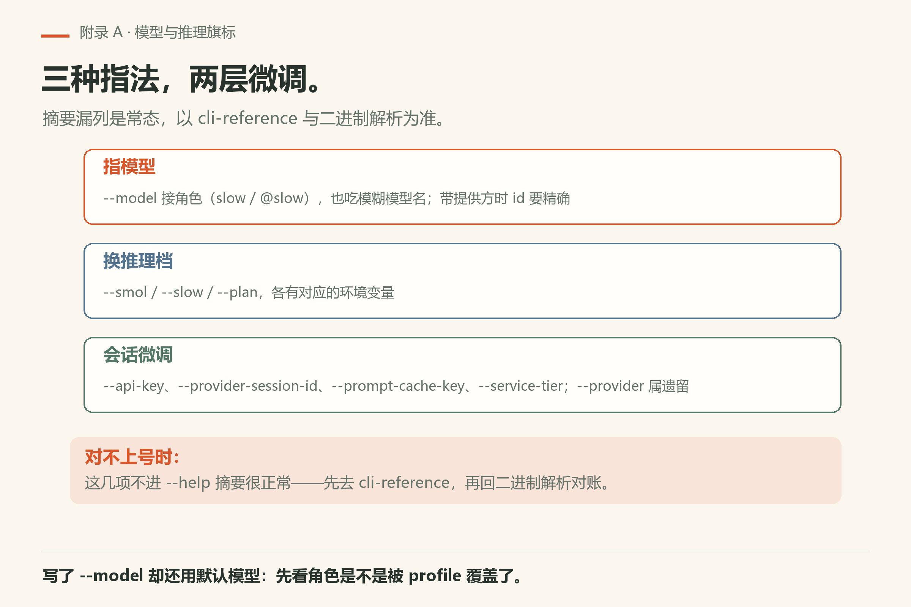
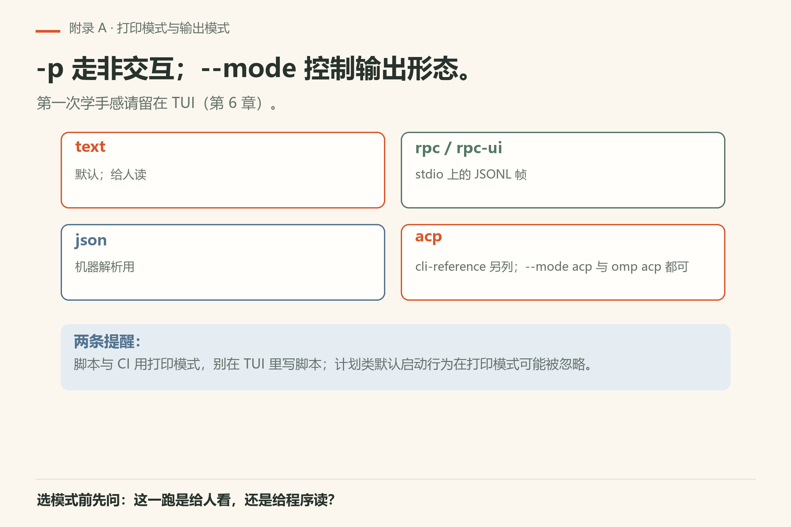
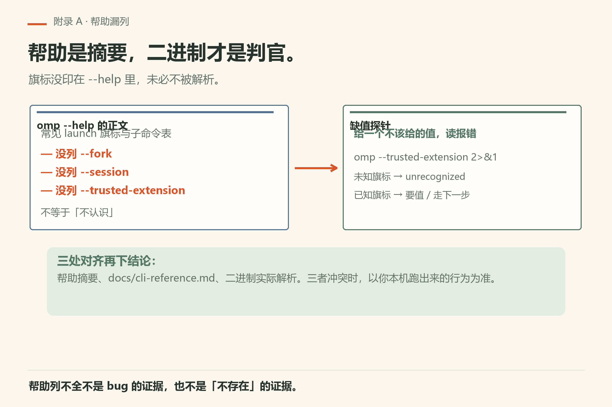
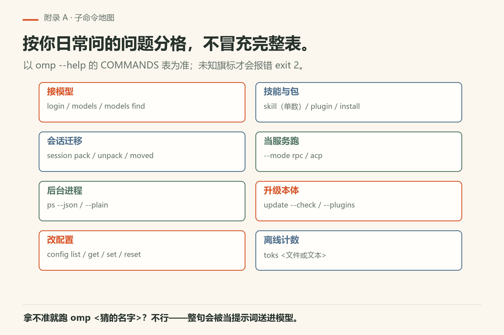

# 附录 A 命令行参数速查

权威全文：`docs/cli-reference.md`。本页帮你建立地图并跟做核对；旗标会变。**冲突时以本机二进制行为为准**；`omp --help` 是常用摘要，不一定列全。子命令清单**不写死条数**，以 `omp --help` 的 COMMANDS 表为准。写作钉 omp v18.15.0；用户本机验证 v18.16.0（详见 `VERIFY.md`）。

> **开门一句话：**查命令行参数按子命令找；旗标以本机 --help 原文为准。

## A.1 调用形态

```sh
omp [command] [flags] [messages...]
```

第一位置参数不是已注册子命令时，通常进默认 launch。所以 `omp "修一下构建"` 开会话，而 `omp models` 走子命令。裸写 `marketplace` / `uninstall` / `extensions` 可能提示改用 `omp plugin …`；真要当提示词，用 `omp launch <word>`。

可识别子命令可以跟在若干 launch 旗标后；仅属于 launch 的旗标出现在其他子命令前时可能被剥掉而不生效（文档示例：`omp --cwd dir update`）。`--profile` 先于子命令路由，因此 `config` / `models` / `update` 也进同一作用域。

运行时帮助：`omp --help` 列用户可见子命令与常用 launch 旗标；`omp <command> --help` 打该命令公开旗标与示例。box 实验室 v18.15.0 实测：`--fork`、`--session`（resume 别名）、`--provider-session-id`、`--prompt-cache-key`、`--trusted-extension` 等可能**不出现在** `--help` 正文，但二进制仍解析；帮助未列时，用 `docs/cli-reference.md` 对照，再用「缺值报错 / 与 `--no-session` 冲突」等探针确认，勿只信帮助摘要。

## A.2 Launch 示例（对照文档）

```sh
omp
omp "List all .ts files in src/"
omp @prompt.md @image.png "天空是什么颜色？"
omp -p "List all .ts files in src/"
omp --continue "我们刚谈到哪？"
```

参数习惯：`@路径` 把文件或图片挂到初始消息。非协议模式下，非 TTY 的 stdin 会读到 EOF 当作提示文本，不必再加 `-` 标记；管道或非 TTY stdin 在未指定 `--mode` 时，常选打印模式。stdin 文本、文本附件与第一条位置消息合成初始提示，其余位置消息作为后续轮次。`--` 结束旗标解析，其后即便长得像旗标，也当正文。

## A.3 会话与工作区旗标

| 旗标 | 含义（摘要） |
|------|----------------|
| `--cwd <dir>` | 启动目录 |
| `--add-dir <dir>` | 额外工作区目录（可重复） |
| `--allow-home` | 允许从家目录启动而不自动切到临时目录 |
| `--profile <name>` | 隔离鉴权、会话、设置与缓存的配置档 |
| `--alias <name>` | 为命名配置档建 shell 快捷方式后退出（需 `--profile` 或 `OMP_PROFILE`） |
| `--config <file>` | 额外 config.yml 风格覆盖层（可重复） |
| `--session-dir <dir>` | 会话存储与查找目录 |
| `--no-session` | 不保存会话（临时） |



*图A-1：第一位置参数先分类：进 launch、进子命令，还是当提示词——三条路各有一套旗标。*

## A.4 会话历史旗标

| 旗标 | 含义（摘要） |
|------|----------------|
| `--continue`, `-c` | 继续上一会话 |
| `--resume [id]`, `-r`, `--session [id]` | 按 id 前缀或路径恢复，或打开选择器 |
| `--restore [id]` | 像 resume，并继续崩溃/被杀时未完成的轮次与子代理；仅交互；不带提示 |
| `--fork <session>` | 分叉已存会话为新会话 |
| `--from-claude` / `--from-codex` | 导入外部产品会话 |
| `--export <session>` | 导出为 HTML 后退出 |
| `--no-title` | 关闭标题自动生成（等同相关环境变量） |

注意：continue/resume/restore/fork 与外来导入需要持久化，不能搭配 `--no-session`；两个 from-* 互斥，且不能与 continue/resume/fork 组合——细节以原文为准。



*图A-5：指模型有三种写法，推理档与会话微调各一层；摘要漏列要回 cli-reference。*

## A.5 模型与推理相关

`--model` 可接角色（如 `slow` / `@slow`）或模糊模型名；带提供方时 id 须精确。另有 `--smol`、`--slow`、`--plan` 及对应环境变量，`--provider`（遗留）、`--api-key`、`--provider-session-id`、`--prompt-cache-key`、`--service-tier` 等。thinking/reasoning 另有专节旗标。后几项可能不在 `--help` 摘要里——以 cli-reference 与二进制解析为准。

## A.6 打印模式与输出模式

`-p` 走非交互。`--mode` 控制输出形态。本机 `--help` 摘要写：`text`（默认）、`json`、`rpc`、`rpc-ui`；cli-reference 另列 `acp`，且二进制接受 `--mode acp`（也可用子命令 `omp acp`）。第一次学手感请留在 TUI（第6章）；脚本与 CI 再用打印模式。计划类默认启动行为在打印模式可能被忽略。



*图A-4：`-p` 走非交互，`--mode` 选输出形态——脚本与 CI 用打印模式。*

## A.7 跟做：十分钟核对

```sh
omp --help | head -n 40
```

把帮助里有、本附录未写的旗标记到附录 E 页边。再抽查：

```sh
omp --help | grep -E 'profile|continue|no-extensions|mode' || true
# 帮助可能漏列：用缺值探针确认二进制是否认识
omp --trusted-extension 2>&1 | head -n 3 || true
omp --fork 2>&1 | head -n 3 || true
```



*图A-2：帮助没列不等于二进制不认识；用缺值探针和 cli-reference 交叉验证。*

## A.8 子命令地图（按用途分格，不冒充完整表）

子命令清单以 `omp --help` 的 COMMANDS 表为准；这里按你日常会问的问题分格，每格只放正文讲过或排障真会用到的几条。想确认某条还在不在，跑 `omp --help` 数 COMMANDS，或 `omp <子命令> --help`。

| 你想干什么 | 先试 | 正文出处 |
|---|---|---|
| 接模型、看有哪些模型 | `omp login <provider>`、`omp models`、`omp models find <pattern>` | 第5章 |
| 查用量与配额 | `omp usage`（`--redact` 打码）、`omp stats` | 第30章、第32章 |
| 管会话、把会话交给别的机器 | `omp session pack` / `unpack` / `moved` / `lease` | 第7章 |
| 管后台进程 | `omp ps`（`--json`、`--plain`） | 第30章 |
| 改配置 | `omp config list` / `get` / `set` / `reset` / `path` | 第23章 |
| 管技能与扩展包 | `omp skill …`（单数）、`omp plugin …`、`omp install` | 第19章、第22章、第29章 |
| 把 omp 当服务跑 | `omp --mode rpc` / `rpc-ui`、`omp acp` | 第28章 |
| 升级 omp 本体 | `omp update`（`--check`、`--plugins`） | 第4章 |
| 离线数 token | `omp toks <文件或文本>` | 第2章 |
| 让 agent 读一条路径或内部 URI | `omp read <path 或 memory://…>` | 第8章、第16章 |
| 审计工具面有没有坏 | `omp plugin doctor` | 第30章 |
| 出网搜索自测 | `omp search` | 第12章 |

拿不准某条命令存不存在时别猜：`omp <猜的名字>` 不会报「未知命令」，整句会被当提示词送进模型（本机 18.16.0 实测 `omp notasubcommand` 停在 `Working...`，`fail/bad-command.txt`）。**未知旗标**才会明确报错、exit 2。



*图A-3：按问题分的子命令地图——接模型、会话迁移、配置、技能包、服务模式。*

## A.9 排障三问与可勾选

1. 我在 launch 还是子命令？
2. profile 是不是想的那顶帽子？
3. 帮助、cli-reference、本书三者冲突时以谁为准？（本机二进制行为；帮助只是摘要）

- [ ] 能解释 launch 路由与 plugin 提示词陷阱
- [ ] 知道 profile 先于路由
- [ ] 跑过帮助核对并记页边
- [ ] 分清交互与打印模式

---
**版本核对清单**：以 `docs/cli-reference.md` 与本机帮助为准。写作钉 omp v18.15.0；用户本机验证 v18.16.0（见 VERIFY.md）。

## 补充跟做：把附录用起来

打开本附录时先做一件小事：对照本机帮助或文档，核对一条具体条目，把结果写进附录 E 风格的页边。只阅读不核对，附录会变成摆设。核对过的条目，在你自己的笔记里打勾，并写上版本字符串与日期。若发现本书过期，优先相信本机二进制，再决定是否改写作树。把这一动作变成习惯，比把附录背诵完整更有用。
