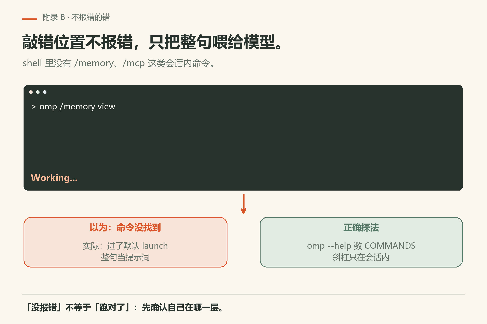
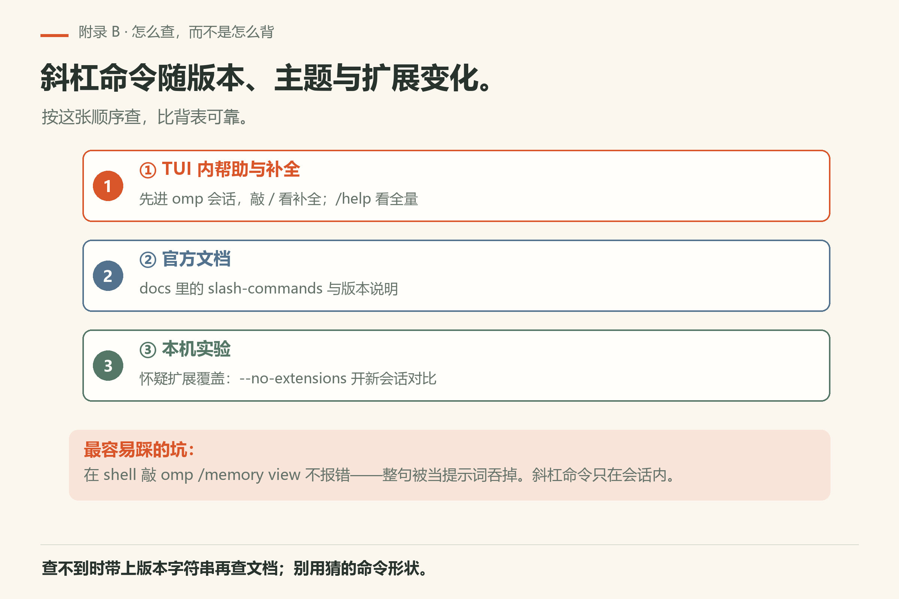
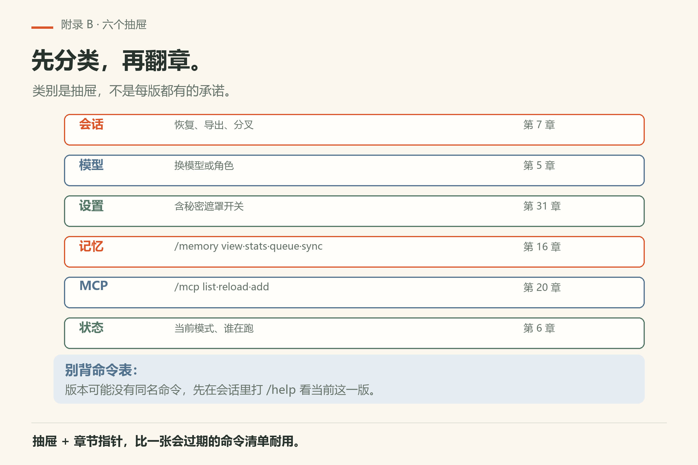
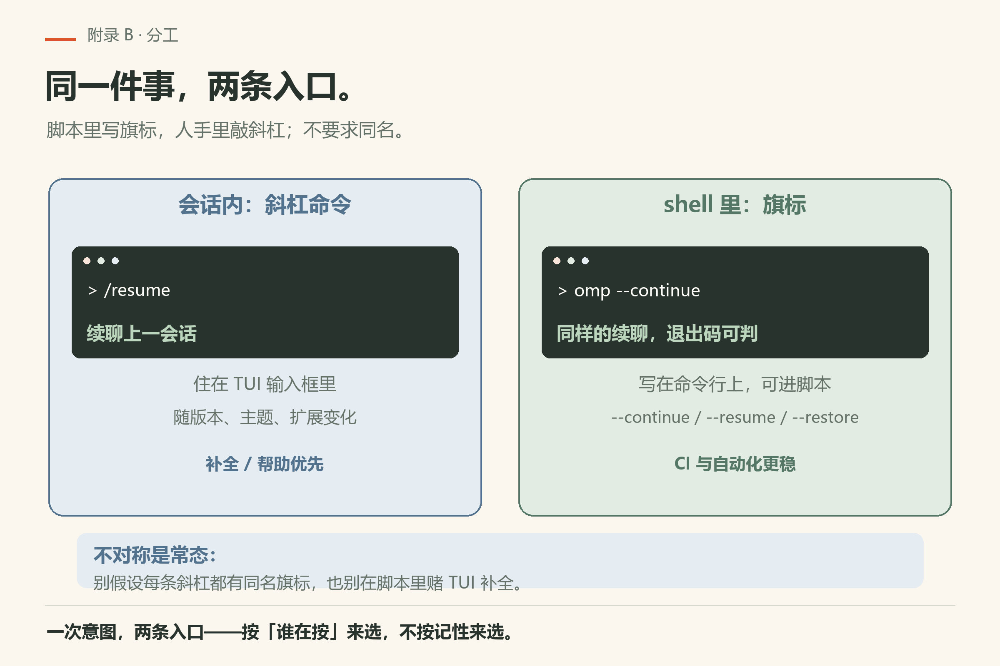

# 附录 B 斜杠命令速查

斜杠命令随版本、主题与扩展变化。本页给查找策略、常见类别与跟做核对法，**不冒充完整表**。权威顺序：TUI 内帮助与补全 → 官方文档 → 扩展说明。

> **开门一句话：**斜杠命令只在会话里有效，和 shell 子命令是两套东西。

**没有 `omp slash` 这类子命令**：斜杠命令住在 TUI 输入框里，不在 shell 里。想在 shell 侧确认某条命令存不存在，跑 `omp --help` 的 COMMANDS 表——那里列的是子命令，不是斜杠命令。

## B.1 怎么查，而不是怎么背

1. 在会话输入 `/` 看补全；
2. 试 `/help`（若你的版本提供）；
3. 扩展贡献的命令以该扩展文档为准；
4. 正文出现过的 `/login`、`/model`、`/settings`、会话类命令，一律用本机实际行为验收。

**shell 里没有的斜杠命令形状**：`/memory`、`/mcp` 这类是会话内命令，不在 `omp --help` 的 COMMANDS 表里。在 shell 敲 `omp memory view` 或 `omp mcp list` 不会报「未知命令」——整句被当提示词送进模型，屏幕停在 `Working...`（本机 18.16.0 实测 `omp notasubcommand` 挂到 90 s 超时，`fail/bad-command.txt`；顶层 COMMANDS 表无 `memory` / `mcp`，见 `help-top.txt`）。

把「本书提过但帮助没有 / 帮助有但本书未提」记进附录 E 页边，写上日期与版本字符串。

*图B-2：斜杠命令在 shell 里不会报错，只会把整句当提示词送进模型。*

*图B-3：先 TUI 帮助与补全，再文档，最后本机实验对比。*

*图B-5：六个抽屉各配一个章节指针，比命令清单耐用。*

## B.2 常见类别（心智抽屉）

把命令按用途装进七个抽屉，找不到时先想「我想干嘛」。

| 类别 | 你用它做什么 | 相关章节 |
|------|----------------|----------|
| 会话 | 恢复、导出、分叉等（亦有 CLI 旗标对照） | 第7章、会话操作文档 |
| 模型 | 切换模型或角色 | 第5章、模型文档 |
| 设置 | 含秘密遮罩等开关 | 第31章、`docs/secrets.md` |
| 记忆 | `/memory view` / `stats` / `queue` / `sync`（仅会话内） | 第16章、`docs/memory.md` |
| MCP | `/mcp list` / `reload` / `add` 等（仅会话内） | 第20章、`docs/mcp-config.md` |
| 状态 | 看当前模式、谁在跑 | 第6章 TUI 地盘 |

类别是抽屉，不是保证每个版本都有同名命令。

## B.3 与 CLI 旗标的分工

同一意图可能既有斜杠也有旗标：例如续聊可用 `--continue`，也可能有会话内命令。脚本里优先旗标；人手在 TUI 里用斜杠更顺。不要假设二者完全对称。

一对具体对照：会话里想续聊，可敲 `/resume`；在 shell 里则写 `--continue` / `--resume`（第7章）。前者敲在输入框里，后者写在命令行上——两边不要求同名。

*图B-1：会话内敲斜杠，脚本里写旗标——两边不要求同名。*

## B.4 与魔法词的区别

斜杠是你下的**命令**；魔法词是提示词里触发的**行为倾向**（第18章、`docs/magic-keywords.md`）。把魔法词写成斜杠，或反过来，都会导致「怎么按了没反应」。

*图B-4：斜杠是你下的命令，魔法词是提示词里的行为倾向——弄混就会「没反应」。*

## B.5 跟做：建立你的一页速查

1. 开一会话，列出帮助中的斜杠命令名（只抄名）；
2. 标出你每周会用的不超过八个；
3. 其余保持「需要时再查」；
4. 扩展新装后，重复步骤 1，防止幽灵命令。

## B.6 失败时

斜杠无响应：先看是否在输入框、是否在问模型而不是命令模式、是否被扩展覆盖坏。用 `--no-extensions` 开新会话对比（第31章）。仍不解，带版本字符串查文档。

若你是在 **shell** 里敲 `omp /memory view` 这类形状，它不会报错，而是把整句当提示词——见 B.1 的说明。斜杠命令不进 shell。

## B.7 可勾选

每条都能当场演示；勾不上就回到对应小节。

- [ ] 会打开帮助或补全
- [ ] 分清斜杠与魔法词
- [ ] 有一页个人八命令速查
- [ ] 页边有版本差异

---
**版本核对清单**：以本机 TUI 帮助为准。写作钉 omp v18.15.0；用户本机验证 v18.16.0（见 VERIFY.md）。

## 补充跟做：把附录用起来

打开本附录时先做一件小事：对照本机帮助或文档，核对一条具体条目，把结果写进附录 E 风格的页边。只阅读不核对，附录会变成摆设。核对过的条目，在你自己的笔记里打勾，并写上版本字符串与日期。若发现本书过期，优先相信本机二进制，再决定是否改写作树。把这一动作变成习惯，比把附录背诵完整更有用。
