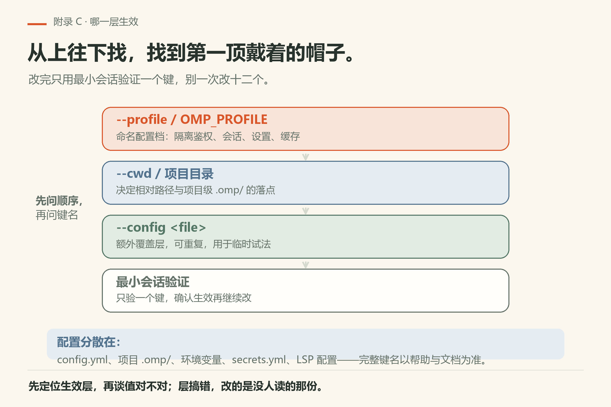
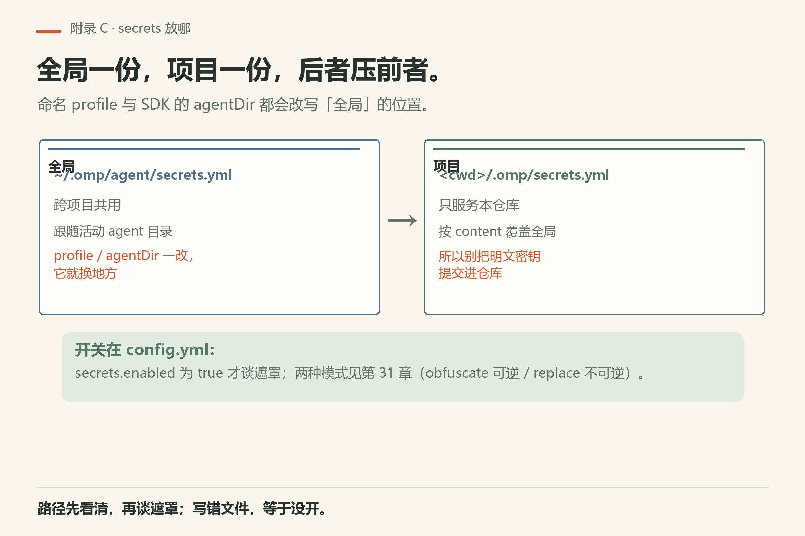
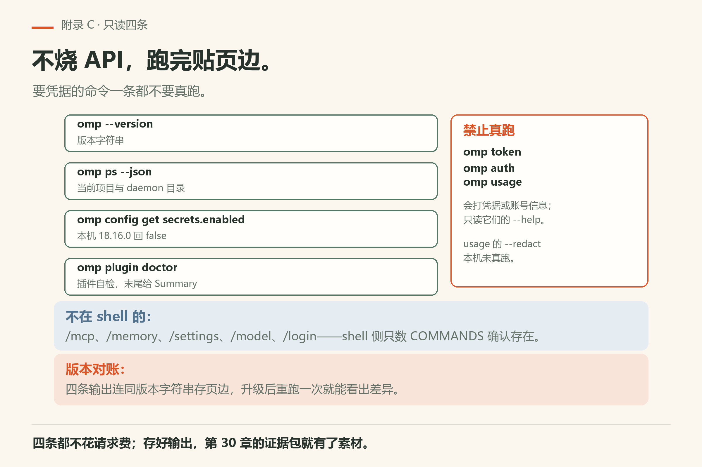

# 附录 C 配置键索引

配置分散在 `config.yml`、项目 `.omp`、环境变量、`secrets.yml`、LSP 配置等处。本页给**索引心智与跟做核对**，完整键名以 `omp-src/docs` 与帮助为准，避免本书变成过期键位表。

**排障命令形状也归本页管**：正文出现的排障命令（`omp ps`、`omp usage --redact`、`omp plugin doctor` 等）都在 `omp --help` 的 COMMANDS 表里。**`omp mcp` / `omp memory` 不在表里**——那是会话内斜杠命令 `/mcp …` / `/memory …`，不能在 shell 里当子命令敲（本机 18.16.0 实测：`omp notasubcommand` 不报错而停在 `Working...`，见 `fail/bad-command.txt`）。

## C.1 先问哪一层生效

启动叠加顺序以官方配置文档为准。实战纪律：

1. 先确认 `--profile` / `OMP_PROFILE` 是不是你以为的那顶；
2. 再看项目目录与 `--cwd`；
3. 再看 `--config` 额外覆盖层；
4. 改完用最小会话验证，不要一次改十二个键。



*图C-1：顺序搞错，改的是没人读的那份配置。*

## C.2 高频主题入口（带着文档走）

| 主题 | 先读 | 本书相关 |
|------|------|----------|
| 模型与提供方 | `docs/models.md`、`docs/providers.md` | 第5章、第32章 |
| 秘密遮罩 | `docs/secrets.md` | 第31章 |
| LSP | `docs/lsp-config.md` | 第11章、第30章 |
| 上下文发现 | `docs/context-files.md` | 第14章、第24章 |
| 环境变量 | `docs/environment-variables.md` | 附录 A 对照 |
| 扩展 | `docs/extensions.md` | 第五篇、第29章 |
| 排障与证据 | 第30章；命令形状见 `omp --help` | 第30章 |

## C.3 secrets 相关键（摘要）

在 `config.yml`：

```yaml
secrets:
  enabled: true
```

细项与 `secrets.yml` schema 见第31章与 `docs/secrets.md`。全局与项目路径不同；项目按 `content` 覆盖全局。不要把明文密钥提交进仓库。

两条路径（与第31章一致）：

| 级别 | 路径 | 用途 |
|------|------|------|
| 全局 | 活动 agent 目录下 `secrets.yml`（常为 `~/.omp/agent/secrets.yml`） | 跨项目 |
| 项目 | `<cwd>/.omp/secrets.yml` | 仅本项目 |

全局路径跟随活动 agent 目录，**命名 profile 与 SDK 显式 agentDir 覆盖都会改它**（文档所述）。



*图C-2：全局路径随活动 agent 目录变化；项目级按 content 覆盖全局。*

## C.4 跟做：只读盘点

口令：

> 只读：列出当前生效配置里与模型、secrets、LSP 相关的键名与非秘密值。秘密值打码。不要改文件。

你对照上表文档，标「认识 / 不认识」。不认识的键先查再动。

## C.5 坏习惯清单

- 把密钥写进可提交配置；
- 在错误 profile 里改了一下午；
- 整份复制他人配置覆盖而不看版本；
- 改完不验证就开长会话。

## C.6 与 SDK 嵌入的关系

SDK `createAgentSession` 也可传入或发现 agentDir、settings 等（第28章）。嵌入宿主时要明确：用发现还是用覆盖，避免「CLI 一套、嵌入另一套」的幽灵差异。


*图C-4：嵌入时明确「发现还是覆盖」，避免 CLI 一套、程序另一套的幽灵差异。*

## C.7 可勾选

- [ ] 能说出查配置的文档入口
- [ ] 改配置有最小验证
- [ ] 密钥不进仓库
- [ ] profile 不混用

## C.8 配置变更的最小验证剧本

每改一个键：开临时会话（或 `--no-session` 若适用）→ 用最小提示触发该键相关行为 → 看卡片或日志是否符合预期 → 再改下一个键。把验证命令写进页边。拒绝「改完再说」的堆叠式配置。

若验证失败：先回滚该键，而不是继续叠加。profile 弄乱时，新建命名配置档对比，比在废墟上修补更快。


*图C-3：每改一个键走五步；失败先回滚该键，别堆叠。*



*图C-5：四条可跑、三条禁止真跑，会话内的斜杠命令 shell 侧只数 COMMANDS。*

## C.9 排障卡：shell 侧能跑的只读命令

第30章的证据包四条都在这。它们**不需要模型**，不产生 API 消耗，跑完把输出存页边：

```sh
omp --version                  # 版本字符串
omp ps --json                  # 当前项目与 daemon 目录
omp config get secrets.enabled # 遮罩开关（本机 18.16.0 回 false）
omp plugin doctor              # 插件自检，末尾给 Summary
```

四条本机 18.16.0 已验（证据 `version.txt` / `ps-json.txt` / `config-get-secrets-enabled.txt` / `plugin-doctor.txt`）。

**跑不了的**：`omp token` / `omp auth` / `omp usage` 会打印凭据或账号信息，**禁止真跑**——只读它们的 `--help`（`help-token.txt` 等）。`omp usage --redact` 的 `--redact` 旗标在 `help-usage.txt` 里有，但**这条命令本身本机未真跑**。

**不在 shell 的**：`/mcp …`、`/memory …`、`/settings`、`/model`、`/login` 都是会话内斜杠命令。想在 shell 侧确认子命令存不存在，跑 `omp --help` 数 COMMANDS。

---
**版本核对清单**：以 omp-src 配置相关文档为准。写作钉 omp v18.15.0；用户本机验证 v18.16.0（见 VERIFY.md）。

## 补充跟做：把附录用起来

打开本附录时先做一件小事：对照本机帮助或文档，核对一条具体条目，把结果写进附录 E 风格的页边。只阅读不核对，附录会变成摆设。核对过的条目，在你自己的笔记里打勾，并写上版本字符串与日期。若发现本书过期，优先相信本机二进制，再决定是否改写作树。把这一动作变成习惯，比把附录背诵完整更有用。
