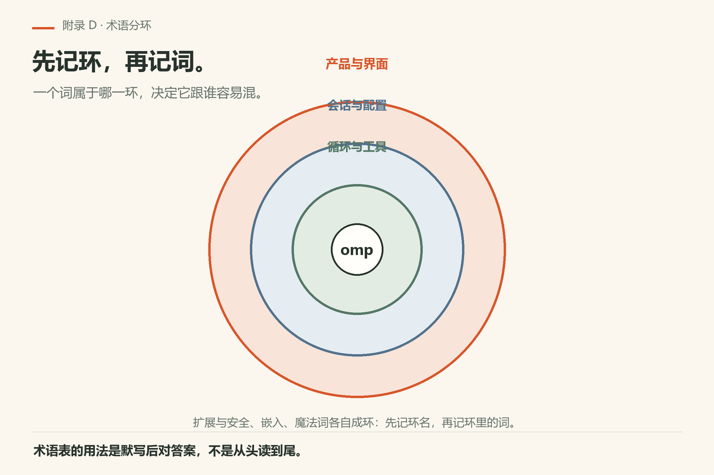
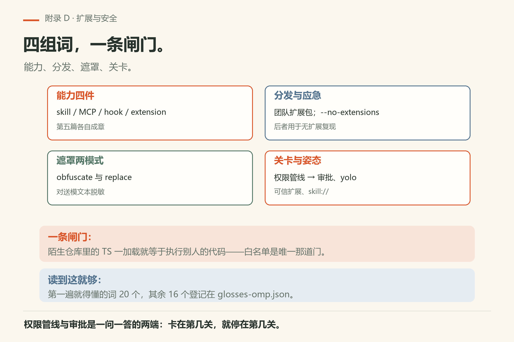
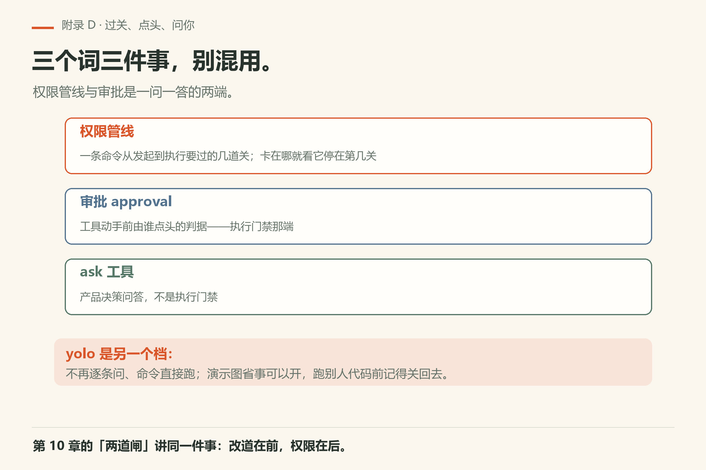
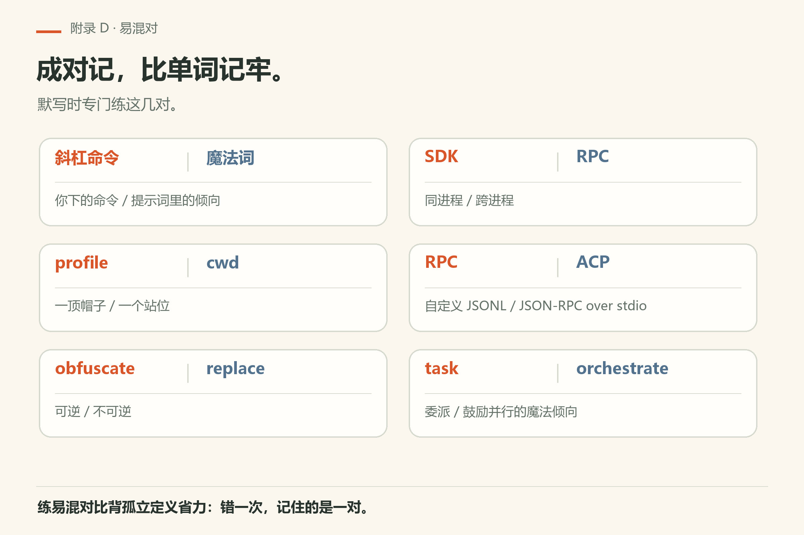

# 附录 D 术语表

只收正文高频词。精确行为以文档为准。闭卷默写十个再对答案，是本附录的跟做方式。

> **开门一句话：**术语表是查的，不是背的；每个词后面都能跳回正文。

*图D-1：先记环名，再记环里的词——环决定它跟谁容易混。*

## D.1 产品与界面

- **omp / oh-my-pi**：本书所说的编码代理产品线；写作钉 v18.15.0；用户本机验证 v18.16.0（见 VERIFY.md）。
- **TUI**：默认文本用户界面；工具结果常渲染为卡片。
- **卡片**：一次工具调用的可扫读呈现；验收时信卡片不信总结腔。
- **print mode / 打印模式**：非交互跑完就退；适合脚本，不适合第一次学手感。
- **launch**：默认启动路径；非子命令位置参数常进这里。
- **智能体外壳 / Agent Harness**：模型外面那圈程序——递工具、管上下文、跑循环；omp 就是这圈外壳的一个实现（第1章）。

## D.2 会话与配置

- **profile / 配置档**：隔离鉴权、会话、设置与缓存的命名空间；`--profile` 先于子命令路由。
- **cwd / 工作目录**：影响上下文发现与相对路径；可用 `--cwd`、`--add-dir`。
- **会话恢复**：`--continue` / `--resume` / `--restore` / `--fork` 等；互斥与持久化约束见 CLI 参考。
- **压缩**：长会话折叠历史；证据要早落盘（第15章、第32章）。
- **上下文文件 / context file**：每次开工自动读进来的项目说明文件；改动会立刻影响下一次回答（第14章）。
- **AGENTS.md / 项目说明文件**：放在仓库里、每次开工自动读进来的规矩；与「技能」的区别是它无条件在场（第14章）。
- **快照 / snapshot**：改写前先把文件或会话存一份底；出问题时的对照物（第9章）。
- **记忆 / memory**：跨会话留下来的线索本；不是历史聊天记录（第16章）。
- **mnemopi / 本地记忆库**：omp 把记忆落在本地 SQLite 的那个后端；删库等于失忆（第16章）。
- **模型角色 / model roles**：给不同的活分别指定用哪个模型；不是「一个模型干到底」（第17章）。

## D.3 代理循环与工具

- **agent 循环**：模型与工具交替直到停止条件。
- **ask**：结构化选项提问。
- **hashline 编辑**：带锚定的编辑；大规模变换优先 AST（第9章、第26章）。
- **task / 子代理**：委派；并行是乘数（第13章、第32章）。
- **LSP / debug**：语言诊断与 DAP 调试（第11章）。
- **工作循环 / agent loop**：模型想一步、调工具、看结果、再想下一步，直到停；它是「循环」而不是一次问答（第1章）。
- **系统提示 / system prompt**：开工前塞给模型的那份岗位说明；改它等于改岗位说明书（第14章）。
- **计划模式 / plan mode**：先只读探路、写出方案，再动手改（第13章）。
- **后台任务 / background task**：丢到后台去跑、主对话不等它的那类活（第13章）。
- **toks / token 计数**：omp 的数 token 子命令，能按文件数也能按句子数；不先量就不知道离窗口上限还有多远（第2章）。

*图D-5：能力、分发、遮罩、关卡四组，闸门只有白名单一道。*

## D.4 扩展与安全

- **skill / MCP / hook / extension**：技能、外部工具协议、钩子、扩展工厂（第五篇）。
- **团队扩展包**：可版本化分发的约定与能力捆（第29章）。
- **`--no-extensions`**：无扩展应急复现（第31章；以帮助为准）。
- **secrets 遮罩**：对送模文本脱敏；`obfuscate` / `replace`（`docs/secrets.md`）。
- **权限管线 / permission pipeline**：一条命令从发起到执行要过的几道关；卡在哪一道就看它停在第几关（第10章）。
- **审批 / approval**：工具动手前由谁点头的判据；与「权限管线」是一问一答的两端（第10章）。
- **全放开模式 / yolo mode**：不再逐条问、命令直接跑的那个档；演示图省事可以开，跑别人代码前记得关回去（第10章）。
- **可信扩展 / trusted extension**：白名单里的扩展才允许加载；陌生仓库里的 TS 一加载就等于执行了别人的代码（第31章）。
- **技能读取地址 / skill URI**：用 `skill://` 加名字直接把技能原文读出来；技能调不出来时先看它能不能被读到（第19章）。
- 本附录**不是**标注清单。正文只给「第一遍读到就得懂」的词加虚线（20 个）；其余 16 个登记在 `glosses-omp.json` 里、只在这里可查——其中 `yolo`、`toks`、`skill://`、`trusted-extension` 四个是因为在正文里基本只以行内代码形态出现（渲染器不给纯小写词加虚线），`工具结果`、`后台任务`、`哈希行锚`、`本地记忆库`、`模型角色`、`打印模式`、`秘密遮罩`、`MCP 服务器`、`帧协议接口`、`编辑器协议`、`子命令`、`诊断` 十二个是查得到就够了、不必每章都提示读者的产品专有名。

## D.5 嵌入

- **SDK**：进程内 `createAgentSession`（`docs/sdk.md`）。包名 `@oh-my-pi/pi-coding-agent`，要求 Bun ≥ 1.4.4。
- **RPC**：分帧请求/响应/事件（`docs/rpc.md`）；stdio 上的 NDJSON，不是 JSON-RPC 2.0。
- **correlation**：请求与响应的对应关系；命令可选带 `id`，响应回显同一个 `id`。
- **ACP**：`omp acp`，Agent Client Protocol，JSON-RPC over stdio；给编辑器驱动 agent 用，不是 RPC。

*图D-4：权限管线管过关、审批管点头、`ask` 管问你——三个词三件事。*

## D.6 魔法词

- **magic keyword**：提示词中的触发词，改变编排倾向（`docs/magic-keywords.md`）；不是斜杠命令。

## D.7 跟做

从最近一章抄十个词闭卷默写，对本文。错词记页边。每月升级二进制后重默写一遍「profile / launch / secrets / task」。

## D.8 可勾选

- [ ] 十词默写
- [ ] 能把词指回章节或文档
- [ ] 分清斜杠与魔法词

## D.9 易混对

| 词 A | 词 B | 别混的原因 |
|------|------|------------|
| 斜杠命令 | 魔法词 | 一个是你下的命令，一个是提示词倾向 |
| profile | cwd | 一个是帽子，一个是站位 |
| obfuscate | replace | 可逆与不可逆 |
| SDK | RPC | 同进程与跨进程 |
| RPC | ACP | 自定义 JSONL 与 JSON-RPC over stdio |
| task | orchestrate | 委派与鼓励并行的魔法倾向 |

*图D-2：成对记比背孤立定义省力：错一次，记住的是一对。*

默写时专门练易混对，比练孤立定义更管用。

---
**版本核对清单**：术语随版本可能改名——以文档为准。写作钉 omp v18.15.0；用户本机验证 v18.16.0（见 VERIFY.md）。

*图D-3：抄十词、闭卷默写、对本文、错词记页边、每月重默写。*

## 补充跟做：把附录用起来

打开本附录时先做一件小事：对照本机帮助或文档，核对一条具体条目，把结果写进附录 E 风格的页边。只阅读不核对，附录会变成摆设。核对过的条目，在你自己的笔记里打勾，并写上版本字符串与日期。若发现本书过期，优先相信本机二进制，再决定是否改写作树。把这一动作变成习惯，比把附录背诵完整更有用。
