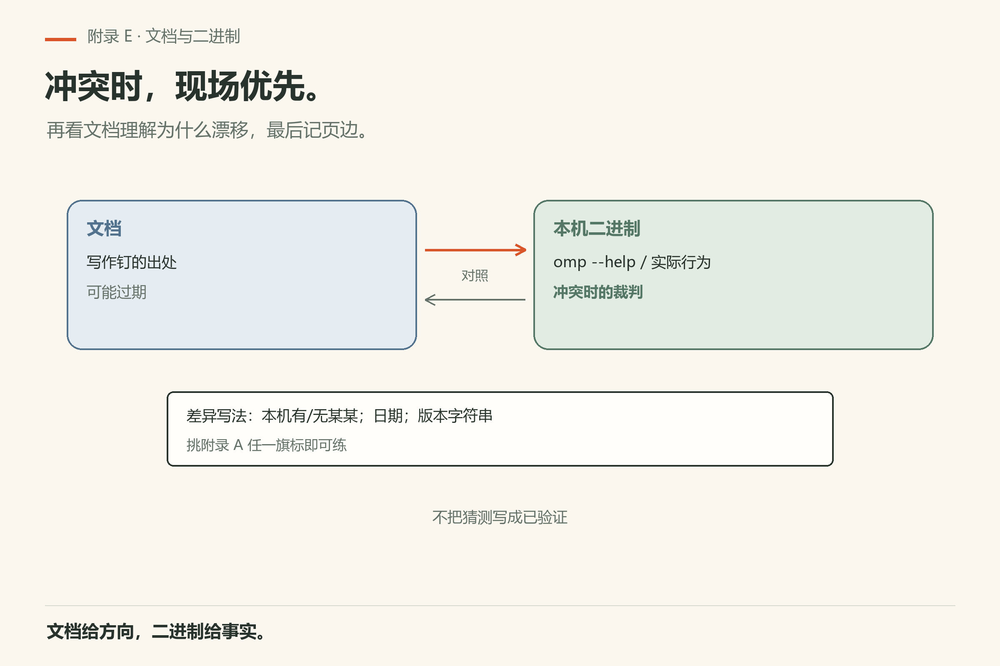

# 附录 E 版本钉扎与页边核对

本书**写作钉** **omp v18.15.0**（`omp-src/docs`）。用户本机已验证 **v18.16.0**（见 `VERIFY.md`）。二进制与文档可能漂移。本附录教你怎么钉、怎么对、怎么记页边。

*图E-1：写作版本与本机版本都要写下来。*

## E.1 钉什么

1. 本书写作钉版本（v18.15.0）与用户本机验证版本（v18.16.0，见 VERIFY.md）；
2. 你本机 `omp --version` / 帮助里的版本字符串；
3. 扩展包声明的兼容范围（第29章）。

Windows + Bun 全局时，可执行文件常见在 `%USERPROFILE%\.bun\bin\omp.exe`（PowerShell：`Get-Command omp`）；这与 curl/`install.ps1` 装到的路径不同，页边要写清安装形态。

三者不一致时，**以你本机二进制帮助与行为为准**，差异记页边。

## E.2 文档 vs 二进制

*图E-2：冲突时现场以二进制为准，再回流文档理解。*

跟做：挑附录 A 任一旗标，对比 `omp --help`。有差异就在该节旁记：「本机有/无某某；日期；版本字符串」。

## E.3 页边笔记字段

*图E-3：章末核对——记版本差异与复验命令，不是记课外作业。*

建议字段：日期与时区、写作版本、本机版本、安装形态、差异摘要、复验命令、退出码、证据位置，以及是否已向上游反馈。记录实际观察，不把推测写成已验证行为。

例如本轮复验记为 UTC 2026-11-05 03:31（America/Adak 2026-11-04 17:31）：Windows、Bun 全局安装，
`omp --version` 返回 `omp/18.16.0`，退出码 0。写作钉仍是 `omp/18.15.0`；两者同时保留。
完整矩阵见 `VERIFY.md`，维护规则见 `overhaul/PIN-POLICY.md`。升级后重跑的日期只更新到实际运行的环境。

*图E-5：四项全勾才算写完；升级后三件事按序重做。*

## E.4 章末核对清单（可复制到每一章）

- [ ] 本章引用的命令在本机帮助中存在
- [ ] 笔记中的旗标无臆造
- [ ] 秘密与路径已打码
- [ ] 版本字符串已记录

## E.5 升级时怎么做

升级后：重跑附录 A 十分钟核对；若依赖扩展，重做第31章无扩展 A/B；翻页边旧差异是否消失；消失就划掉。

## E.6 和压缩包维护

更新全书交付包时排除 `omp-src` 与 `handraw-style`，避免把源码树与风格参考误塞进分发物。本任务不上传作品广场。

## E.7 跟做：一页「真相卡」

在仓库根建 `VERSION-PIN.md`（可选）：本书对标版本、本机版本、上次核对日期、已知差异三条。比口口相传靠谱。

## E.8 可勾选

- [ ] 三处版本都写下来了
- [ ] 至少核对过一个旗标
- [ ] 页边模板用过一次
- [ ] 升级复验有记录
- [ ] 分发排除项清楚

---
**版本核对清单**：写作钉 omp v18.15.0；用户本机验证 v18.16.0（VERIFY.md）；你的页边才是你的真相。

## E.9 上游 README 的二十一项能力，在本书哪里

上游 README 用 21 节介绍能力（钉扎提交 `88a69582c755bd000e8dc0290981fc787a4f400c`）。这张表是读书路线，不是评分表：右列空着表示本书没有展开，遇到就去读上游对应文档。

| # | README 的能力 | 本书位置 |
|---:|---|---|
| 01 | 代码执行带工具调用 | 第 10 章 |
| 02 | 每次写入都接 LSP | 第 11 章 |
| 03 | 驱动真调试器（DAP） | 第 11 章 §11.2 |
| 04 | 流式规则注入 | 未展开 |
| 05 | 一等公民的子代理 | 第 13 章 |
| 06 | 第二个模型做监督 | 第 17 章 |
| 07 | 把会话链接递给人 | 第 7 章 §7.5a |
| 08 | 直接读 PDF | 第 8 章 |
| 09 | 原生二进制与 Windows | 第 4 章 |
| 10 | 带优先级的代码评审 | 第 27 章 |
| 11 | Hashline：按内容哈希改 | 第 9 章 |
| 12 | GitHub 当文件系统 | 第 12 章 |
| 13 | agent 自己维护的记忆 | 第 16 章 |
| 14 | ACP：编辑器驱动 agent | 第 28 章 |
| 15 | 继承其他工具写下的配置 | 第 14 章 |
| 16 | `omp commit`：原子拆分与校验 | 第 27 章 |
| 17 | 读 PR、走 skills、取子代理 JSON | 第 27、19、13 章 |
| 18 | 冲突解决 `/resolve` | 未展开 |
| 19 | 先预览再接受 | 第 6 章 §6.4 |
| 20 | 真浏览器；也能接 Slack | 第 12 章（Slack 未展开） |
| 21 | 桌面操作 | 第 12 章 |

用法：章节顺序不必按表走；把表当索引，读完一章回来划掉一行。表里三处「未展开」是刻意留白——它们的可靠细节需要本机二进制或对应 docs 验证，宁可不写，也不把 README 的宣传语当规范。

*图E-4：21 项能力展开 18 项，三处刻意留白——按页边核对法处理。*

## 补充跟做：把附录用起来

打开本附录时先做一件小事：对照本机帮助或文档，核对一条具体条目，把结果写进附录 E 风格的页边。只阅读不核对，附录会变成摆设。核对过的条目，在你自己的笔记里打勾，并写上版本字符串与日期。若发现本书过期，优先相信本机二进制，再决定是否改写作树。把这一动作变成习惯，比把附录背诵完整更有用。
