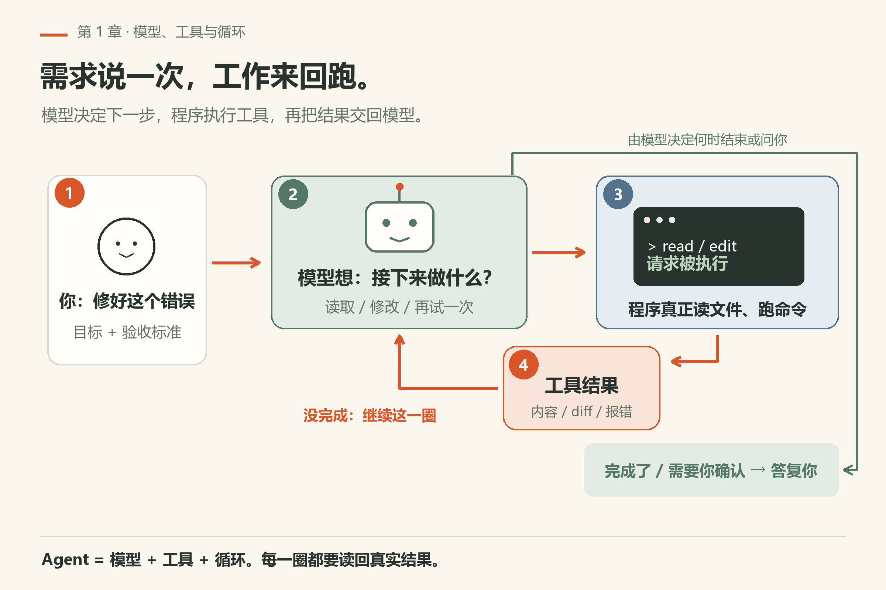
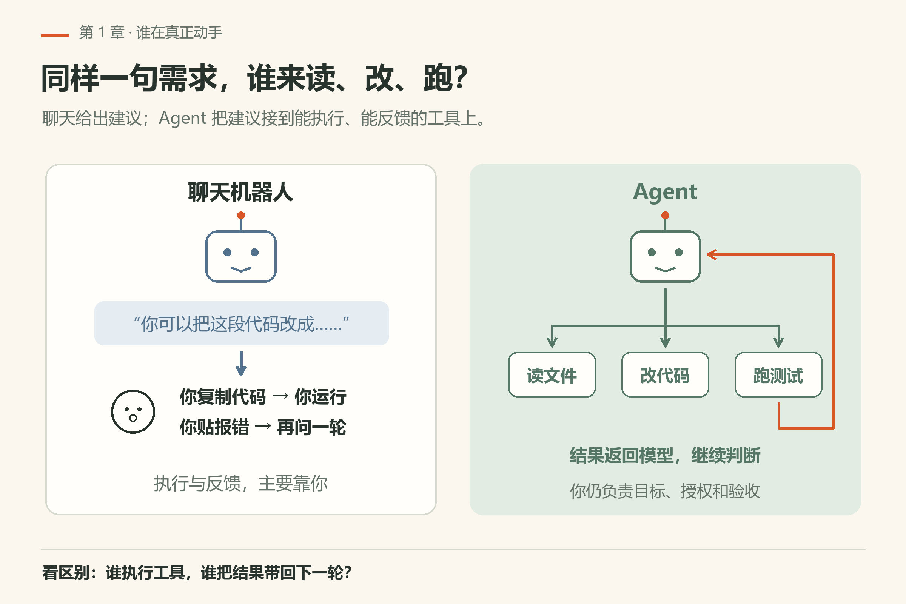
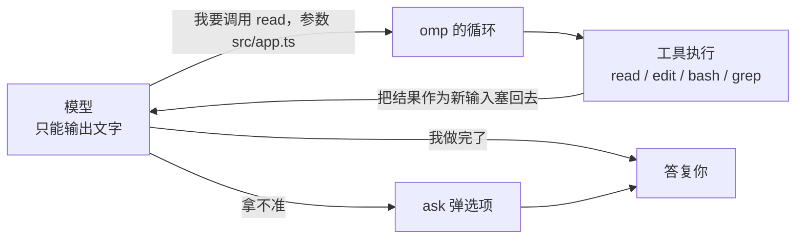
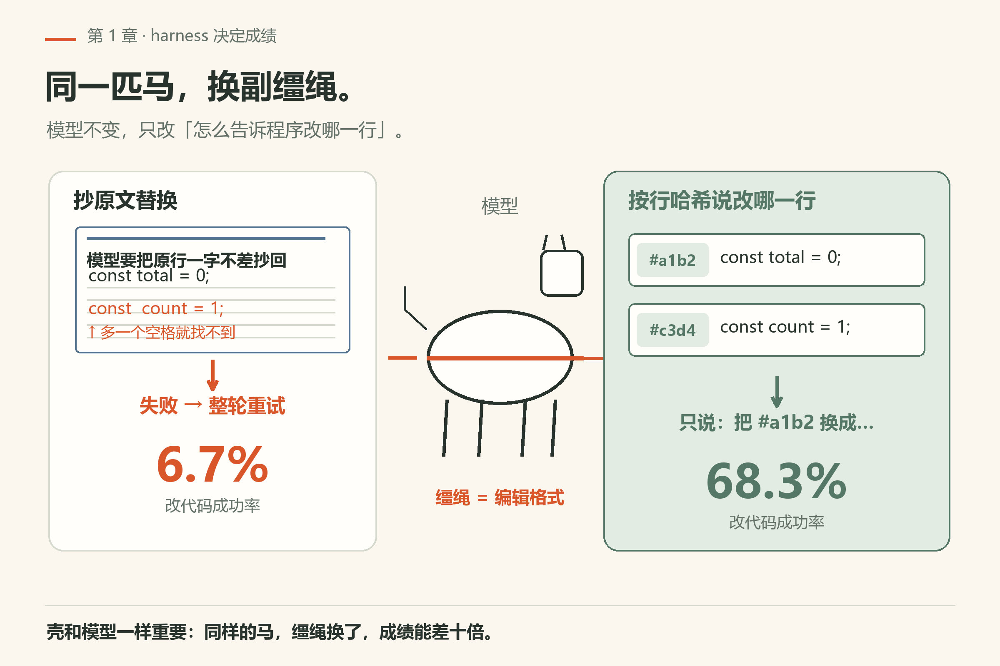
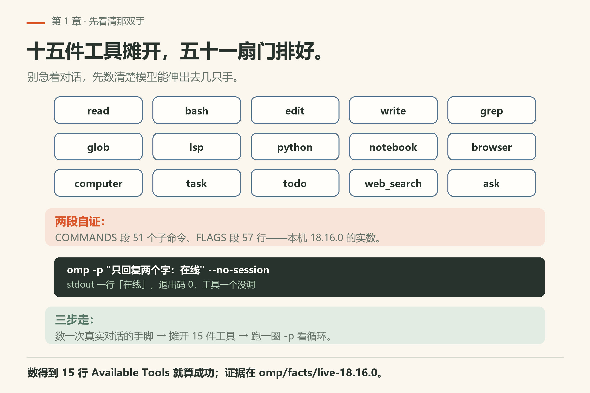
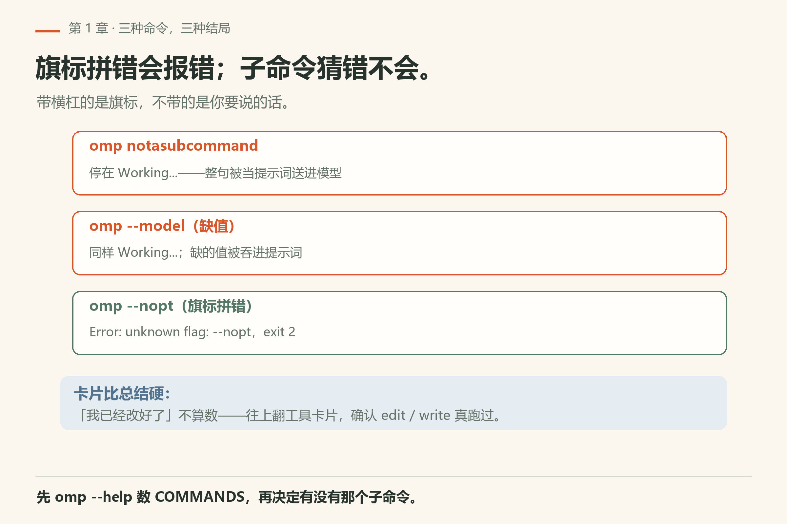

# 第1章 AI 编程 agent 到底在干什么

有人第一次让聊天机器人帮他改代码：“把这个函数改成异步的。”它给了一段代码，看着挺对。复制、粘贴、运行，报错。把报错贴回去，它道歉，再给一段。来回五六次，终于跑通——天已经黑了。

> **开门一句话：**agent 是模型加一圈外壳：它转的是一圈循环，不是你写的那句需求。

这五六趟里，真正动手的是你：复制是你，运行是你，看报错也是你，模型只负责出主意。AI 编程 agent 要解决的就是这件事：把复制、运行、看报错这些活交给程序，让模型自己去做。omp 就是这样一个程序。

## 1.1 聊天和 agent，差的是一双手

聊天机器人只有一张嘴。你问，它答，答完就停。

agent 多了一双手。它能读你硬盘上的文件，能执行命令，能改代码，改完还能自己跑测试看结果。你说一句“把这个函数改成异步的”，它会：

1. 先去读那个文件，看函数长什么样；
2. 想好怎么改；
3. 动手改；
4. 跑一下测试；
5. 测试挂了，看报错，回到第 2 步。

这五步你应该很眼熟，因为这就是你平时自己写代码的流程。agent 并没有发明新流程，它只是替你把这个循环转起来。



*图1-1：agent 的工作循环。① 你说需求只发生一次；真正转圈的是 ②→③→④→②。模型看完工具结果，回到思考，继续决定下一步，直到做完或需要问你。*

左边是聊天，右边是 agent，一眼能看出差别：



*图1-2：左边由你复制、运行和贴回报错；右边由程序执行工具，把结果交回模型。你负责目标、授权和验收。*

## 1.2 拆开看：模型、工具、循环

图下面那行字是这一章最重要的东西：

**Agent = 模型 + 工具 + 循环**

一个一个说。

**模型**是大脑。Claude、GPT、Gemini、Grok 这些都是。模型本身什么都碰不到，它只能输出文字。

**工具**是手。在 omp 里，工具就是一个个有名字的功能：`read` 读文件，`edit` 改文件，`bash` 执行命令，`grep` 搜文本，还有调试器、浏览器等等。写作这本书时 omp 内置了三十多个工具（README 写的是 31），后面第三篇会逐个讲。别把两份清单混了：`omp --help` 末尾那段 Available Tools 只列 15 行常用工具名（本机 18.16.0 数出来的），它是启动摘要，不是全集。

那模型只会输出文字，怎么“用手”？办法很朴素：模型输出一段格式固定的文字，意思是“我要调用 read，参数是 src/app.ts”。omp 看到这段文字，真的去读文件，再把文件内容作为新的输入塞回给模型。模型看到内容，接着想下一步。

**循环**就是把上面这件事一直重复：模型说要用什么工具 → 程序执行 → 结果喂回模型 → 模型再决定。直到模型说“我做完了”，或者它拿不准、调用 `ask` 工具弹个选项问你。



这里有个容易误会的地方：很多人以为 agent 的聪明全来自模型。其实模型只负责“决定下一步做什么”，具体能做什么、做得准不准，取决于工具和循环写得好不好。这正是 omp 花大力气的地方。

## 1.3 同一个模型，换个壳，成绩差十倍

负责组织“模型 + 工具 + 循环”的那层程序，英文叫 harness（原意是马具）。模型是马，harness 是缰绳和马鞍。



*图1-3：同一匹马（模型），换了缰绳（harness），终点成绩可以从 6.7% 跳到 68.3%。*

omp 作者做过一个实验，结果写在项目 README 里：Grok Code Fast 1 这个模型，改代码的成功率在换了 omp 的编辑格式后，从 6.7% 涨到 68.3%。模型没换，提示词也没换，只换了“怎么告诉程序改哪一行”的格式。

为什么差这么多？传统做法让模型把要替换的原文一字不差抄一遍，程序再去文件里找这段原文替换掉。模型只要抄错一个空格，就找不到，只能重试。omp 的做法叫 hashline：读文件时每行带一个短的内容哈希，改的时候模型只需要说“把哈希为某某的那一行换成……”，不用再抄原文。第 9 章会把这个机制拆开讲。

记住这个例子，它说明一件事：**选 agent 的时候，壳和模型一样重要。**

## 1.4 omp 是谁家的孩子

omp 全名 oh-my-pi，作者 Can Bölük（GitHub 上叫 can1357），由 Stencil Labs 维护，MIT 开源。

它是从另一个项目 Pi 分出来的（fork）。Pi 的作者是 Mario Zechner，主打一个精简、可改的终端 agent。omp 在 Pi 的基础上往“开箱即用”的方向走：自带 LSP（编辑器里那套代码诊断和跳转）、调试器、子代理、浏览器控制、持久的 Python/JS 运行环境，还支持六十多家模型提供商。

几个你后面会反复用到的事实，先列在这：

| 项目 | 内容 |
|---|---|
| 命令名 | `omp` |
| 运行方式 | 终端界面（TUI）、单次问答 `omp -p`、Node SDK、RPC/ACP 给其他程序驱动 |
| 主要语言 | TypeScript，性能关键部分用 Rust（约 8 万行） |
| 配置目录 | `~/.omp/agent`（用户级），项目里的 `.omp` |
| 兼容性 | 首次运行会读取 `.claude`、`.cursor`、`.codex` 等目录里已有的规则、skills 和 MCP 配置 |

最后一行对新手很友好：如果你以前用过 Claude Code 或 Cursor，写过的规则文件不用搬，omp 直接认。

## 1.5 本章小实验：先看清那双手在哪

**第一步（不用装任何东西）**：翻一个你最近让聊天机器人改代码的对话，数三个数——复制粘贴了几次、手动运行了几次、把报错贴回去几次。这些次数就是 agent 能替你省掉的部分。

**第二步**：装了 omp 的话，别急着对话，先让程序自己把「手」摊给你看：

```sh
omp --version
omp --help
```

`--version` 打印一行 `omp/18.16.0` 之类的版本号，`--help` 退出码 0 —— 两条都是本机已验（`omp/facts/live-18.16.0/version.txt`、`help-top.txt`）。看 `--help` 的最后一段：`Available Tools (default-enabled unless noted):` 底下逐行列出 `read`、`bash`、`edit`、`write`、`grep`、`glob`、`lsp`、`python`、`notebook`、`browser`、`computer`、`task`、`todo`、`web_search`、`ask`。**数得到这 15 行，就算成功**：这就是模型能伸出去的手，1.2 节讲的「工具」不是抽象词。

想再确认「循环」这一格，把 COMMANDS 段数一遍：

```sh
omp --help | awk '/^COMMANDS/{f=1;next} /^Environment Variables:/{f=0} f' | grep -Ec '^  [a-z][a-z0-9-]+'
```

本机 18.16.0 打出 `51`（同一段脚本还量出 FLAGS 段 57 行，证据 `omp/facts/live-18.16.0/help-section-counts.txt`）。51 个子命令加 15 个工具，就是 omp 的全部「手」；剩下的聪明都在模型那头。

**第三步（要已接好的模型，会花一次请求）**：跑最短的一圈。

```sh
omp -p "只回复两个字：在线" --no-session
```

本机已验：stdout 只有一行 `在线`，退出码 0（`omp/facts/live-18.16.0/print-mode-online.txt`）。一个提示进去、一轮模型、答案打到 stdout、进程退出——工具一个没调，循环只转了一圈。等第 6 章你在 TUI 里看它连着弹五六张工具卡片，回头看这一条，才知道「多了一圈」和「多了一双手」是两件事。



*图1-5：十五件工具、五十一个子命令，再加一圈最短的 -p。*

## 1.6 翻车对照：三种命令，三种结局

omp 的错误处理不对称：拼错的**旗标**会明确报错，猜错的**子命令**不会。这一条差异能省掉你半小时的茫然。

| 翻车做法 | 会看到什么 | 正确做法 |
|---|---|---|
| `omp notasubcommand`，以为在调用某个子命令 | **不报「未知命令」**：整句被当成提示词送进模型，屏幕停在 `Working...`。本机 18.16.0 实测挂到 90 秒被 `timeout` 掐断（124 来自 `timeout`，不是 omp） | `omp` 后面不带横杠的东西是**你要说的话**。先 `omp --help` 数 COMMANDS，再决定有没有这个子命令 |
| `omp --model`，忘写值 | 同样不报错，也是 `Working...`——缺的那个值被吞进提示词（本机已验 `fail/missing-value.txt`） | 写全 `--model=<provider/model>`；无人值守时加 `--max-time`（`omp --help` 给的写法形如 `600` / `10m` / `1h`） |
| `omp --nopt`，旗标拼错 | `Error: unknown flag: --nopt`，随后一行提示去看帮助，退出码 **2**（本机已验 `fail/bad-flag.txt`） | 未知旗标不会静默：照它说的跑 `omp --help`，把旗标原文抄回去 |
| 信最后一句「我已经改好了」 | 文件没动，`git diff` 空 | 往上翻工具卡片，确认 `edit` / `write` 真跑过；卡片比总结硬 |



*图1-4：旗标拼错明确报错 exit 2；子命令猜错被当提示词，停在 `Working...`。*

## 1.7 与御舆同构点

参见御舆第 1 章《智能体编程的新范式》与第 2 章《对话循环》。两边拆的是同一个圈：模型出文字、程序执行、结果回喂、直到任务了结才停。你在 1.2 建立的「模型 + 工具 + 循环」三分法，在那一卷里换了别的叫法，但每一格问的问题一模一样——这一轮谁在决定、谁在执行、什么时候退出。跨书只搬这张三分图，别搬对方的命令名和清单：两套装配边界不同，接口对不上。

下一章讲模型本身那层物理约束：token、上下文窗口，以及它为什么会「忘事」。弄清这些，你才知道什么时候该信 agent，什么时候该盯着它。

---
**版本核对清单**（写作时依据仓库 README / docs，约对应写作钉 v18.15.0；用户本机验证 v18.16.0）：工具数量 31、provider 60+、6.7%→68.3% 数据来源 https://github.com/can1357/oh-my-pi README 与 https://blog.can.ac/2026/02/12/the-harness-problem/ ；四种入口表述以 README「Four entry points」为准。

- [ ] `omp --version`：与本章钉版不一致时，先重数 `--help` 的 COMMANDS / Available Tools 两段（本机 18.16.0：51 / 15）。
- [ ] `omp --nopt`：仍应报 `Error: unknown flag` 并退出 2；若哪天改成静默忽略，1.6 表要重写。
- [ ] `omp notasubcommand`：本机 18.16.0 不报错而进 `Working...`；上游若加了「未知子命令」校验，这一条是最先失效的教学材料。
- [ ] 6.7%→68.3% 只引 README / 博客原文，别在书里换成别的数字。
