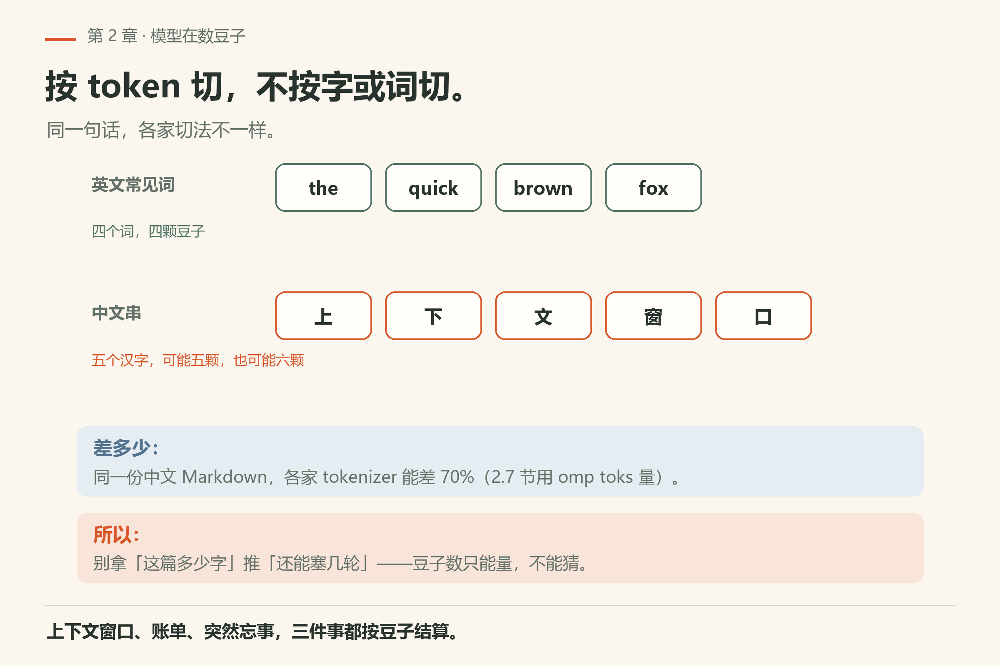
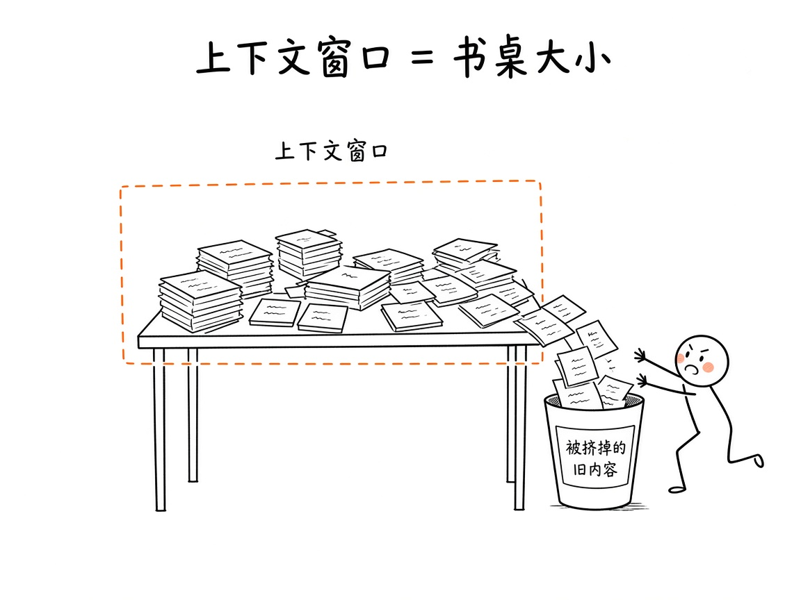
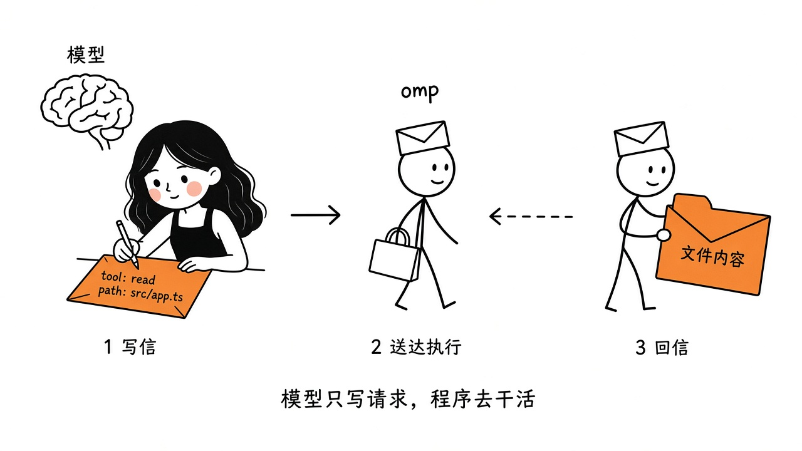

# 第2章 大模型的最小必要知识

你让它改 `src/importer.py`，第一轮它读文件，第二轮它改，第三轮它突然道歉：「抱歉，我没注意到你之前说过的文件名」。你没换模型，也没说错话——是它面前那张桌子堆满了。上一章把 agent 拆成了三块：模型、工具、循环。这一章只盯第一块——模型本身，以及那张桌子的大小。

> **开门一句话：**模型只认 token，不认字节；知道窗口多大、怎么数，才谈得上省。

你不需要会训练模型，也不用背一堆论文名词。只要搞清楚三件事：模型看见的世界有多大、它怎么“伸手”调工具、以及“想得更用力”到底是什么意思。搞清楚这些，后面用 omp 时很多怪现象就说得通了。

## 2.1 模型其实在数豆子：token

模型读文字、写文字，底层都不是按“字”或“词”算的，而是按 **token**。

你可以把它想成切豆子：英文里一个常见单词常常就是一个 token；中文一个汉字有时一个、有时半个，看切法。模型每次能读多少、写多少，账单也按多少，单位都是 token。

为什么你要管这个？因为 agent 一开跑，上下文里塞的不止你说的那句话：系统规则、打开过的文件片段、工具返回的报错、上一轮改了什么……全是 token。跑着跑着“变傻”、突然忘掉刚才约定的函数名，经常就是豆子堆满了书桌。

「一颗豆子多大」没有通用答案：同一份中文 Markdown，各家 tokenizer 数出来的能差出 70%（2.7 节本机量得出来）。所以别拿「我这篇文档多少字」去推「还能塞几轮」，要量。

omp 自己也在数 token：原生层有专门的 tokens 相关实现（README 的 Rust 能力表里能看到），用来估算用量和成本。具体计费还跟你选的模型提供商有关，第 32 章再细讲。



*图2-5：英文词常是一颗，汉字一颗或半颗；同一份中文各家能差七成。*

## 2.2 上下文窗口：一张有限大的书桌

模型一次能“同时看见”的内容，有个上限，叫 **上下文窗口**（context window）。

把它想成一张书桌。桌上能摊开的纸就那么多：你的提问、历史对话、读过的文件、工具刚吐回来的结果。新纸不断往上搁，旧纸就得挪走，或者压到看不见的角落。



*图2-1：上下文窗口像有限的桌面；规则、问题、文件片段和工具结果都占位置。更早的记录即使还在，也可能不在本轮输入中。*

几件和 omp 直接相关的事实：

- 不同模型书桌大小不一样。配置里常见字段是 `contextWindow`；有的模型还提供更大的 `maxContextWindow`，可以用 `/extended-context` 之类的开关去够（见 `docs/models.md`）。
- omp 本地会按自己的预算管理上下文，这跟提供商服务器端的硬上限不是一回事。书桌上明明还有空，对方接口也可能拒收，或者反过来。
- 对话特别长时，omp 会做 **compaction**（压缩）：把旧内容收成更短的摘要，腾地方给新工作。细节在第 15 章。

对新手最实用的一句话：**别假设它记得整场对话。** 重要约定写进项目规则文件（后面第 14 章的 AGENTS.md 等），比口头重复可靠。

## 2.3 工具调用：模型只写信，程序去送信

第 1 章说过：模型碰不到硬盘。那它怎么 `read` 一个文件？

流程像寄信：

1. 模型写出一封格式固定的“信”：我要用哪个工具、参数是什么（例如 `read`，路径 `src/app.ts`）。
2. omp 收到信，真的去执行。
3. 把执行结果写成回信，再塞回给模型。
4. 模型读回信，决定下一封信写什么——或者直接给你最终答复。



*图2-2：模型只负责写请求；真正读文件、跑命令的是 omp。*

这就是 **tool calling**（工具调用）的本质。注意几条边界，后面排查问题时用得着：

- 模型输出的是“请求”，不是魔法。格式写错、参数抄错，工具就会失败，循环里会出现重试。
- 工具白名单由 omp 管。你可以用 `--tools read,edit,bash,…` 收窄可用工具；`--no-tools` 会关掉内置工具（项目里另写的工具模块是另一路发现机制，见 README 安全说明）。
- 有些能力默认关着，要在设置里打开才会进工具列表（例如部分 memory 工具、`github` 等，README 有“Setting-gated”列表）。

你平时在 TUI 里看到的一张张工具卡片，其实就是这些信封被拆开、执行、贴回的可视化。

## 2.4 推理强度：像音量旋钮，而且不是每台机器都有

有的模型支持 **thinking / reasoning**（思考、推理）：在正式回答或调工具之前，先在内部多走几步推理。强度可以调——关、低、中、高——有点像音量旋钮。


*图2-3：推理强度可以拧。不是所有模型都有这颗旋钮；有的提供商暴露的档位也不一样。*

和 omp 日常使用绑在一起的，有一个魔法关键词：

- 在提示里单独写出小写单词 `ultrathink`（前后可以有标点，但不能黏在别的字母或路径里），omp 会注入一段“请仔细多步推理”的隐藏说明。
- 若当前开着自动思考，这一轮还会拉到该模型支持的最高自动思考强度（见 `docs/magic-keywords.md`）。

例子（关键词本身保持小写英文）：

```text
ultrathink 先把失败模式想清楚，再改这个 API
```

几点别搞混：

- `Ultrathink` 大写开头不触发；`ultrathink.ts`、`ultrathink()` 也不触发。
- 它只影响**含有这个词的那一轮**。
- 可以在设置里关掉全部或单个魔法关键词：`omp config set magicKeywords.enabled false` 等。

推理更用力通常更慢、更贵，也不保证更对。简单改个变量名，没必要每次都 `ultrathink`；架构取舍、诡异 bug，值得拧高一档。

## 2.5 书桌上都堆了什么（agent 场景）

聊天机器人的书桌，主要是“你问我答”。agent 的书桌热闹得多。一轮不算长的改 bug，桌上可能同时躺着：

1. **系统侧**：人格与安全约束、当前工具清单说明、项目规则（AGENTS.md 等）。
2. **你刚说的话**（可能还带着 `ultrathink` 触发的隐藏说明）。
3. **读文件的结果**：`read` 回来的不一定是整文件倾倒，omp 会做摘要和挑片段（README 强调 `read` 的 summarized snippets）。
4. **搜索命中**：`grep` / `glob` / `ast_grep` 的列表。
5. **编辑预览与测试输出**：`edit` 的 diff、`bash` 的 stdout/stderr。
6. **子代理回传**（若用了 `task`）：结构化结果，而不是一大段散文。

所以同样是“上下文 128k”，聊天里能扯很久，agent 里可能三五个工具回合就紧张。这不是模型突然变笨，是桌上纸太多。

实用习惯（后面章节会反复用到）：

- 任务说清楚目标和验收标准，少让它漫无目的地全库搜索。
- 大文件先让它定位再精读，而不是“把整个仓库读一遍”。
- 跨会话还要遵守的约定，写进规则文件或记忆系统，不靠聊天窗口当永久硬盘。

## 2.6 串起来：一轮对话里模型在干什么

把这一章和上一章拼在一起，你心里应该有这么一条时间线：

1. 你的话、规则文件、历史摘要，一起铺上书桌（受上下文窗口限制）。
2. 模型决定：直接回答，还是先寄一封工具信。
3. omp 执行工具，回信占书桌新的一角。
4. 若开着思考，内部还会多转几圈再开口。
5. 书桌快满了，就压缩或丢掉旧纸。

## 2.7 本章小实验：把「书桌多大」量出来

omp 自带一套离线分词器，不开网络、不要密钥，就能看同一份文件在各家 tokenizer 下是多少 token：

```sh
omp toks omp/ch02.md
omp toks "The quick brown fox jumps over the lazy dog"
omp toks omp/ch02.md --json
```

第一条本机已验，退出码 0（`omp/facts/live-18.16.0/toks-ch02.txt`）。**看到这些东西就算成功**：开头两行是 `input` 与 `size`（本章那份是 3,771 字符 / 122 行），接着一张表，列名依次是 `encoding`、`models`、`tokens`、`chars/tok`、`vs o200k`。

本机 18.16.0 的那张表里，同一份文件最省的是 `kimi-k2` 1,950 token，最费的是 `claude-v47` / `claude-v5` 3,331 token——**差 70%**，而 `chars/tok` 一列从 1.13 涨到 1.93。`vs o200k` 直接把偏差写成百分比（Claude 那几行 +41.7%，Qwen / DeepSeek / Kimi 那几行是负的）。中文比英文吃 token，这张表就是证据。

第二条演示「参数不是文件时按字面文本算」（`omp toks --help` 原文：*File path, or literal text when it does not name a file*）；第三条给机器读的版本。用 `--json` 把数字喂进你自己的脚本，比拿字符数瞎估靠谱。

再补一个不花 token 的动作：挑一个你正在跟 agent 协作的仓库，`omp toks` 一下里面最大的那个源文件。它一个的 token 数可能就顶得上本章整篇——这就是 2.2 说的「书桌上明明还有空，也可能一轮就挤满」。


*图2-4：系统约束、你说的话、读回片段、搜索命中、编辑与测试输出、子代理回传——桌子就这么大。*

## 2.8 翻车对照：四类会真发生的事

窗口问题是新手第一个真坎；这四类每一个都有出口。

| 翻车做法 | 会看到什么 | 正确做法 |
|---|---|---|
| 按「上下文 128k」换算成字符数往里塞 | 你以为还剩一半，其实早满了：同一份 3,771 字符的本章，`kimi-k2` 数 1,950、`claude-v47` 数 3,331（本机已验） | 先 `omp toks <文件>` 对着目标模型那一行看；`omp toks --help` 本机已验 |
| 把 `ultrathink` 写成 `Ultrathink`，或粘成 `ultrathink()` | 不触发。文档写得很硬：要精确小写，且不能黏在别的字母或路径里 | 单独一个词、小写、独立成句；`omp config list` 查 `magicKeywords.ultrathink` 当前是不是 `true`（设置项见 `docs/magic-keywords.md`） |
| 想「少花 token」就加 `--no-tools` | 工具是真关掉的（`--help` 原文 *Disable all built-in tools*），模型只剩一张嘴：它给你贴补丁文本，不碰磁盘。**这条的具体输出本机未验证**——用 `omp -p "把 README.md 第一行改掉" --no-tools --no-session` 自己看 | 要收窄而不是全关：`--tools read,grep`；想让它能改文件就别关 `edit` / `write` |
| 十轮之后追问「你还记得我一开始说的命名规则吗」 | 它开始道歉或改错文件；旧约定早被压成摘要，甚至整段不在窗口里 | 长期约定写进项目规则文件（第 14 章），别把聊天窗口当硬盘 |

## 2.9 与御舆同构点

参见御舆第 1 章《智能体编程的新范式》与第 2 章《对话循环》。这一章讲的窗口和采样，是两卷共用的物理层：不管哪家 harness，模型每轮能看见的都只有那么多，工具调用也都是一次「请求—执行—回喂」的往返。所以「什么时候该压缩」「该把约定写在哪一层」这类问题，在两卷里是同一条问题，答案各归各的实现。读那边的时候只带这张物理约束的图过去，别把两边的设置项名字互相对应——同名不同义是常态。

下一章我们离开“模型在抽象里怎么工作”，去看 omp 这套程序本身怎么拆：同一个引擎，为什么会有 TUI、`omp -p`、SDK、RPC/ACP 四种外壳，以及底下那堆 TypeScript 包和 Rust 原生层各自干什么。

---
**版本核对清单**（写作钉 v18.15.0；用户本机验证 v18.16.0，见 VERIFY.md）：`ultrathink` 行为以 `docs/magic-keywords.md` 为准；`contextWindow` / `maxContextWindow` / `/extended-context` 以 `docs/models.md` 为准；工具门控与 `--tools` / `--no-tools` 以 README 为准。token 计费随 provider 变化，书中不写死单价。`omp -p --print-thoughts` 可把思考块打进输出（`docs/cli-reference.md`），与魔法关键词 `ultrathink` 是两件事。

- [ ] `omp toks omp/ch02.md`：列名仍是 `encoding / models / tokens / chars/tok / vs o200k`？数字会随分词器表更新，本章引用的是 18.16.0 的 1,950–3,331。
- [ ] `omp toks --help`：确认 `INPUT` 仍是「文件路径，不是路径就当字面文本」。
- [ ] `omp config list`：搜 `magicKeywords`，确认全局与单项开关都为 `true`，否则 2.4 的例子在你机器上不生效。
- [ ] `--no-tools` 关掉工具后的实际表现（2.8 第三行）本机未验证，跑一次再决定是否写成「已验」。
