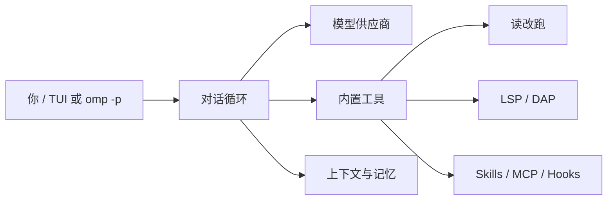
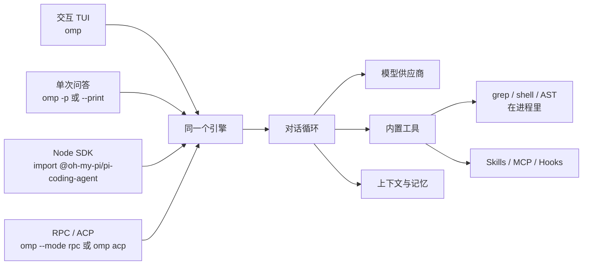
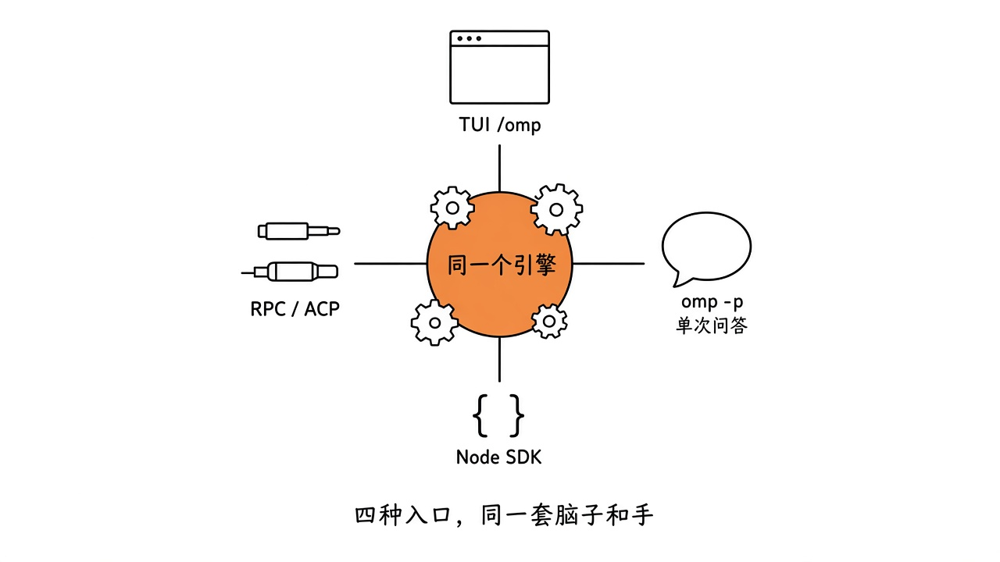
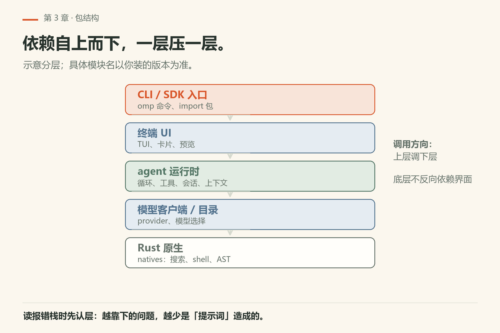
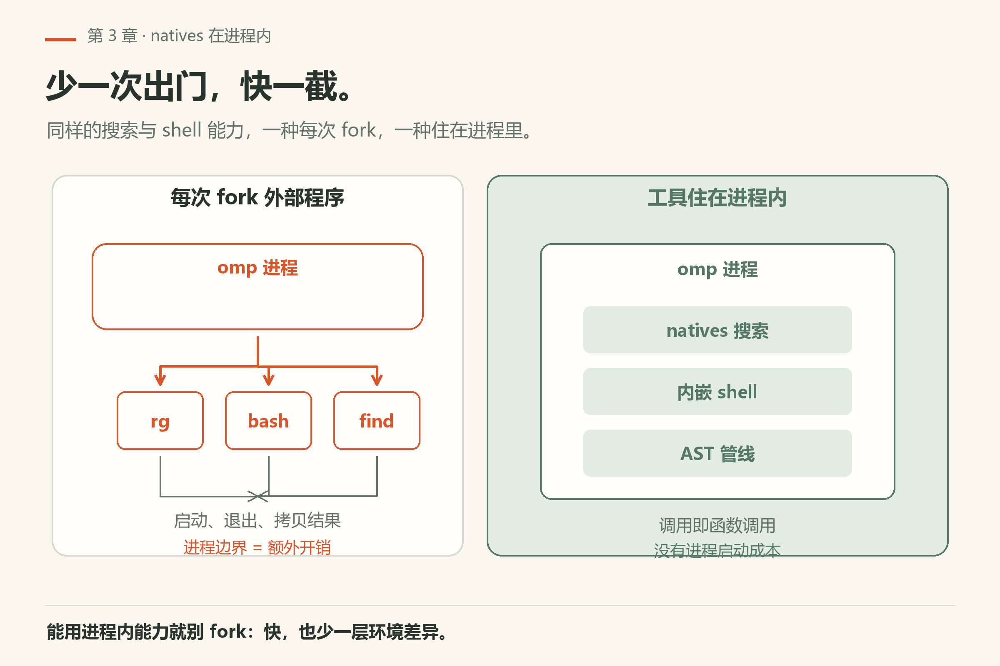
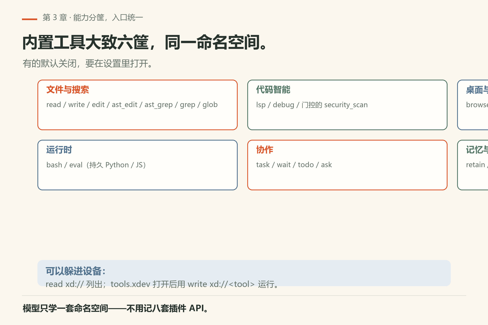
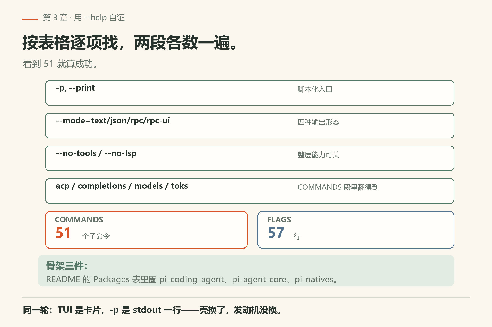

# 第3章 omp 的整体架构

前两章把“agent 是什么、模型在干什么”说清楚了。这一章换镜头：站在 omp 程序外面，看它长什么样。

> **开门一句话：**omp 从启动到调工具是一条链；看懂模块边界，排障才有处下手。

你装好之后敲的是一个命令 `omp`，但底下并不是一团浆糊。它是同一套引擎，外面套了四种用法。源代码是一个 monorepo（单一仓库里放很多包）。跑得快的那部分，很多根本不是“再开一个 shell 去调系统命令”，而是进程里的原生代码。

读完这一章，你不需要能改源码，但再看报错、选入口、决定要不要装扩展时，脑子里会有一张地图。


## 架构速览（Mermaid）

下面这张是**可检索的结构图**（双轨里的 Mermaid 轨）；同章手绘则负责「直觉画面」。



## 3.1 四种入口，同一套脑子和手

README 写得很直白：**同一个引擎，四种封装。**



差别只在外面那层壳，四种入口对应四种用法：

| 入口 | 你怎么启动 | 适合干什么 |
|---|---|---|
| 交互 TUI | 直接 `omp` | 日常结对写代码、看工具卡片、预览编辑 |
| 单次问答 | `omp -p`（或 `--print`） | 脚本里问一句就退出、CI、管道 |
| Node SDK | 在代码里 `import` `@oh-my-pi/pi-coding-agent` | 把 agent 嵌进自己的 Node/TS 程序 |
| RPC / ACP | `omp --mode rpc` 或 `omp acp` | 别的语言/编辑器通过 stdio 遥控 |



*图3-1：外壳可以换，中间那台引擎不变——工具、会话、模型路由还是同一套。*

分开看一眼各自的脾气：

**TUI（默认）**  
进终端界面。工具调用渲染成卡片，编辑会先预览再落盘，拿不准时 agent 可以调 `ask` 弹出结构化选项让你选。大多数人从这里开始就对了。

**`omp -p` / print mode**  
非交互：处理完提示，把最后一轮助手回复写到 stdout，然后退出，不进 TUI。过程中的 `Working...` 走 stderr。官方文档给的典型用法包括：

```sh
omp -p "Summarize the changes in the last commit"
omp -p --print-thoughts "Explain your reasoning for this refactor"
omp -p --mode json "List every TODO in src/" > todos.json
echo "review this diff" | omp -p
```

没有人盯着屏幕点选项时，行为会跟交互模式略有差别：例如 `plan.defaultOnStartup` 在 print mode 里会被忽略（没有计划评审 UI）；需要无人值守的计划+实现可用 `--plan-yolo`。后台任务默认会在会话销毁时被取消，加 `--wait-async`（或配置 `async.printWake`）才会等后台结果并可能再开一轮。细节见 `docs/cli-reference.md`。

**SDK**  
包名是 `@oh-my-pi/pi-coding-agent`。文档示例大致长这样（以仓库 README 为准）：

```ts
import { ModelRegistry, SessionManager, createAgentSession, discoverAuthStorage } from "@oh-my-pi/pi-coding-agent";

const auth = await discoverAuthStorage();
const models = new ModelRegistry(auth);
await models.refresh();

const { session } = await createAgentSession({
  sessionManager: SessionManager.inMemory(),
  authStorage: auth,
  modelRegistry: models,
});
await session.prompt("list .ts files");
```

会话会发出带类型的事件，你可以订阅后自己画 UI。

**RPC**  
`omp --mode rpc`：一行一个 JSON（NDJSON）从 stdin 进、从 stdout 出。非 Node 宿主、或者你想要进程隔离时用。还有 `rpc-ui`（把工具卡片/选择器也做成需要宿主回答的帧）和 `--no-ui` 等变体。

**ACP**  
`omp acp` 走 [Agent Client Protocol](https://github.com/zed-industries/agent-client-protocol)（JSON-RPC over stdio）。编辑器（例如文档里提到的 Zed）可以驱动同一套 agent：读当前缓冲区、经编辑器路径写入、危险操作走权限请求。README 里有一张 omp 工具到 ACP 路由的对照表（`bash`→终端、`read`/`write`→文件系统、`edit`/`bash` 等可能触发 `session/request_permission`）。

记住口诀：**换的是遥控器，不是发动机。**

## 3.2 monorepo 里有哪些包

仓库 https://github.com/can1357/oh-my-pi 是 Bun + TypeScript 工作区，外加一套 Rust crate。用户面对的 npm 包名字带 `@oh-my-pi/` 前缀。和“引擎”最相关的几块可以先记这一张简图：



*图3-2：从上到下大致是 CLI/SDK → 终端 UI → agent 运行时 → 模型客户端/目录 → 最底层 Rust 原生。*

对照 README 的包表（写作时）：

| 包 | 干什么 |
|---|---|
| `@oh-my-pi/pi-coding-agent` | 你安装的 CLI 和 SDK，命令就是 `omp` |
| `@oh-my-pi/pi-tui` | 终端 UI，差分渲染 |
| `@oh-my-pi/pi-agent-core` | agent 运行时：工具调用、状态 |
| `@oh-my-pi/pi-ai` | 多提供商 LLM 客户端、流式输出 |
| `@oh-my-pi/pi-catalog` | 内置模型目录、提供商标识 |
| `@oh-my-pi/pi-natives` | N-API：把 Rust 能力接到 JS |
| `@oh-my-pi/pi-mnemopi` | 本地 SQLite 记忆引擎（可选后端之一） |
| 其他 | `omp-stats`、`omptype`、`snapcompact`、`browser-relay`、`collab-web`……按需出现 |

开发者地图在 `packages/coding-agent/DEVELOPMENT.md`：从 `cli.ts` → `main.ts` → `createAgentSession`，再分叉到 InteractiveMode / print mode / RPC mode。你现在不必顺着源码走，只要知道：**TUI 只是一种 mode，不是另一套 agent。**

## 3.3 为什么 grep、shell、AST 要做进进程里

很多 coding agent 的做法是：模型说“搜一下”，程序就 `fork` 出外部的 `rg`、`find`、`bash`。机器上没有这些二进制就挂；有，每次也要付进程启动的税。Windows 上更麻烦。

omp 的选择不同：把常用实现链进自己的进程。README 原话大意是——ripgrep、glob、find 在进程内；嵌入的 brush 当 bash 用，会话能跨调用保持；还有一批 coreutils 风格的工具（`ls`、`sed`、`sort`、`xargs`、甚至 `jq` 等）跑在 builtins 里，少一次 fork/exec。同一份二进制覆盖 macOS、Linux、Windows，不靠 WSL 桥梁。



*图3-3：左边每次出门请 rg/bash/find；右边工具住在 omp 进程里——少一次出门，快一截，依赖也少一截。*

贡献者文档 `docs/native-crates.md` 把 Rust 侧拆得更细，例如：

- `pi-natives`：顶层 N-API，JS 看见的入口
- `pi-shell` + `pi-builtins`：嵌入 shell 与进程内工具
- `pi-walker`：带 ignore 规则的并行遍历，给搜索和 glob 用
- `pi-ast`：tree-sitter / ast-grep 相关
- `pi-edit`：`edit` 工具背后的补丁/hashline 引擎
- `pi-vfs`：可注入的异步文件系统抽象

写作时 README 写的是大约 **8 万行** Rust 核心。数字会变，但方向不变：**热路径尽量不外包。**

这对你有什么实际影响？

- 在精简环境（容器、Alpine、公司锁定的 Windows）里，omp 仍然能搜、能跑基础命令，少踩“系统没装 rg”的坑。Alpine 装预编译包时仍要注意 `libstdc++`/`libgcc`（安装章节再讲）。
- 性能体感：大仓库里反复 `grep`/`glob`，少掉一串进程创建。
- 排错时：有的行为是原生层的，不是你 shell 配置坏了——别只在 `.bashrc` 里找原因。

## 3.4 工具都挂在同一扇门上

架构上还有一件对使用者很友好的设计：核心工具和 `read`、`bash` 在同一命名空间里。模型不用学八套“专用插件 API”。

README 把内置能力大致分成几筐（写作时总数写的是 31 个内置工具；有的默认关闭，要在设置里打开）：

- **文件与搜索**：`read`、`write`、`edit`、`ast_edit`、`ast_grep`、`grep`、`glob`
- **运行时**：`bash`、`eval`（持久 Python / JS，还能回调 agent 自己的工具）
- **代码智能**：`lsp`、`debug`，以及设置门控的 `security_scan`
- **协作**：`task`、`wait`、`todo`、`ask`
- **桌面与网络**：`browser`、`computer`、`web_search`，以及门控的 `github`、`generate_image`、`tts`
- **记忆与技能**：`retain` / `recall` / `reflect` 等（跟 `memory.backend` 有关），外加 `learn`、`manage_skill` 等

不常用的可发现工具还可以躲在 `xd://` 设备后面：`read xd://` 列出，`tools.xdev` 打开后用 `write xd://<tool>` 运行。第三篇会按筐拆开做实验；这一章只要建立印象——**能力很宽，但入口统一。**



*图3-4：六筐内置工具挂在同一命名空间；门控工具要先在设置里打开。*

## 3.5 一张脑图：请求进来之后

结合 DEVELOPMENT.md 的启动流程，用白话说一遍（细节以后读源码章再抠）：

1. 你敲下 `omp` 或 `omp -p` 或 SDK 里的 `session.prompt`。
2. CLI 解析参数、加载主题/设置/模型目录/会话选项。
3. `createAgentSession` 造出会话对象。
4. 按模式进入 TUI 事件循环、print，或 RPC 服务。
5. 模型开始第 1、2 章里那套循环；要搜文件、改代码、跑命令时，很多工作落到 `pi-natives`。
6. 需要记跨会话事实时，才可能碰到 mnemopi 等记忆后端（默认策略以当时配置为准，第 16 章）。

你暂时只要会选入口：

- 人在屏幕前 → `omp`
- 脚本 / 管道 → `omp -p`
- 自己的 Node 服务 → SDK
- 编辑器或其他语言 → ACP 或 RPC

## 3.6 本章小实验

如果已经装了 omp（没装也没关系，下一篇第 4 章才正式安装）：

```sh
omp --version
omp --help
```

`--help` 退出码 0、`--version` 打出一行 `omp/18.16.0` 形式的版本（本机已验）。在 `--help` 里按这一章的表格逐项找：`-p, --print`、`--mode=<value>`（text / json / rpc / rpc-ui）、`--no-tools`、`--no-lsp`、`COMMANDS` 段里的 `acp`、`completions`、`models`、`toks`。

再数一段，确认「四种入口」和「几十个命令」不是宣传话：

```sh
omp --help | awk '/^COMMANDS/{f=1;next} /^Environment Variables:/{f=0} f' | grep -Ec '^  [a-z][a-z0-9-]+'
```

本机 18.16.0 打出 `51`（同一段脚本量出 FLAGS 段 57 行；证据 `omp/facts/live-18.16.0/help-section-counts.txt`）。**看到 51 就算成功**——一个 CLI 摊开这么多入口，靠的是底下只有一套引擎。

最后用一条不碰磁盘的命令验「外壳可换、发动机不换」：

```sh
omp -p "只回复两个字：在线" --no-session
```

本机已验：stdout 只有 `在线`，退出码 0。同一轮如果你直接敲 `omp` 进 TUI，看到的是卡片和状态栏——输入输出内容一样，呈现方式换了个壳。

再打开仓库 README 的「Packages」表，用笔（或脑内）把 `pi-coding-agent`、`pi-agent-core`、`pi-natives` 三个名字圈出来——这三个几乎是整本书的骨架。



*图3-5：逐项找五类参数，再数 COMMANDS 51 与 FLAGS 57，圈出三个骨架包。*

## 3.7 翻车对照：选错外壳的代价

| 翻车做法 | 会看到什么 | 正确做法 |
|---|---|---|
| 在 CI 里跑 `omp -p "..."`，然后把 stdout 存下来当过程日志 | 文件里只有最后一轮助手回复。`Working...` 之类的过程走 **stderr**，被你没接住（文档所述；本机 `print-mode-online.txt` 只捕 stdout，里面就只有 `在线` 一行） | 要过程就 `omp -p ... > 结果.txt 2> 过程.txt`；要机器解析就 `--mode json` |
| 在 print mode 里等 `ask` 弹选项 | 没人点。`omp --help` 的工具表里 `ask` 就写着 *interactive mode only*；计划评审 UI 也不存在，所以 `plan.defaultOnStartup` 在 print mode 被忽略 | 无人值守用 `--plan-yolo`（先只读规划、自动批准、再换 `--plan-yolo-into` 实现）；等后台结果加 `--wait-async` |
| 想省 token 就 `--no-lsp` | 关掉的不只是诊断：`--help` 原文是 *Disable LSP tools, formatting, and diagnostics*，格式化一起没了，改完的代码风格会漂 | 只想少噪音就留 LSP、调设置；确认影响面先 `omp --help` 读那行原文 |
| 编辑器要接 ACP，你却给它 `--mode rpc` | 两种帧格式不是一套协议，握手就失败 | 编辑器/其它语言走 `omp acp`（JSON-RPC over stdio），程序化控制走 `--mode rpc` / `rpc-ui`；`--mode` 帮助只列 text/json/rpc/rpc-ui，`acp` 是子命令（`VERIFY.md` 记过 18.15.0 上 `--mode acp` 也能起，属未列行为） |
| 觉得「TUI 卡住 = 引擎坏了」 | 引擎和外壳是两层；TUI 只是 mode 之一 | 先用 `omp -p "同一句话" --no-session` 走一次非交互：能出答案就是外壳层的事，去第 30 章排障索引 |

## 3.8 与御舆同构点

参见御舆第 1 章《智能体编程的新范式》，以及附录 A《架构导航地图》。两卷都在回答同一件事：harness 怎么分层——入口、循环、工具、模型客户端各在一层，谁也不越界。差别只在装配边界：哪一层允许你插扩展、哪一层被钉死。读那边的地图时，把你在本章拿到的「四种入口 / 同一引擎」当作对照框。不要对照具体的包名、目录名或清单——那一卷的名字属于它自己的实现，搬过来只会让两边的报错都追不动。

下一篇我们终于动手：安装、接模型、在 TUI 里完成第一次真正改代码。

---
**版本核对清单**（写作钉 v18.15.0；用户本机验证 v18.16.0，见 VERIFY.md）：四种入口原文见 README「Four entry points: interactive, one-shot, RPC, and ACP」；包名以 README Packages 表为准；Rust「~80k lines」与「31 tools / 60+ providers」同属 README 摘要，发版后可能变；原生 crate 职责以 `docs/native-crates.md` 为准；SDK 符号以 README 示例为准（`ModelRegistry`、`SessionManager`、`createAgentSession`、`discoverAuthStorage`）。CLI 细节以 `docs/cli-reference.md` 为准。

- [ ] `omp --help` 的 COMMANDS 段：本机 18.16.0 数得 51 条、FLAGS 段 57 行；对不上就重跑 3.6 的计数命令，别沿用书中数字。
- [ ] `--mode` 帮助仍只列 text / json / rpc / rpc-ui？`acp` 是否还在 COMMANDS 里。
- [ ] README 的「31 tools / ~80k 行 Rust」是摘要口径；与 `omp --help` 的 Available Tools（本机 15 行）不是同一份清单，两处都要标来源。
- [ ] `plan.defaultOnStartup` 在 print mode 被忽略、`--wait-async` 与 `async.printWake` 的关系，重读 `docs/cli-reference.md` 确认没漂。
