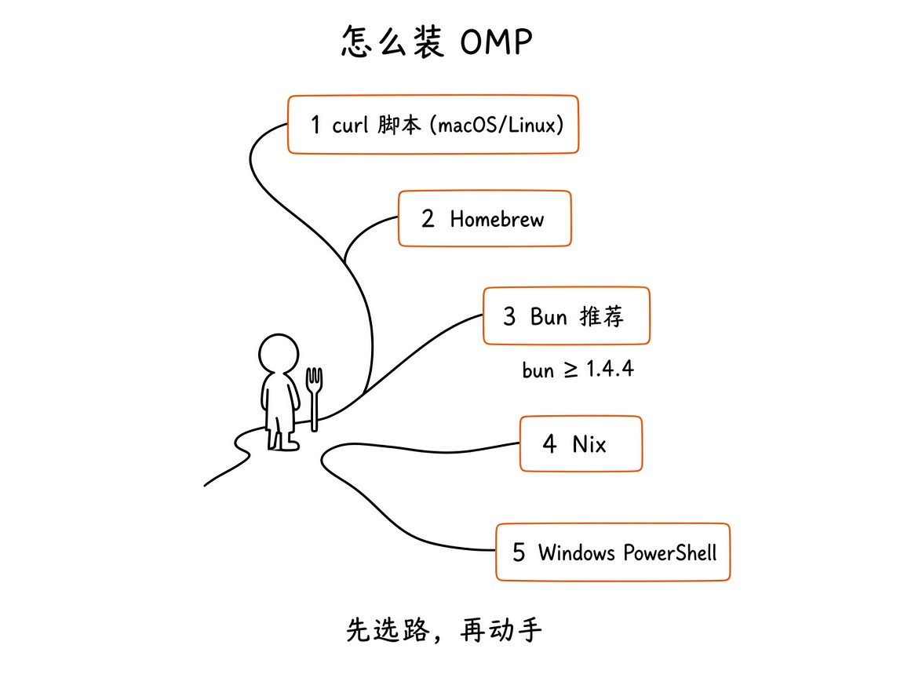
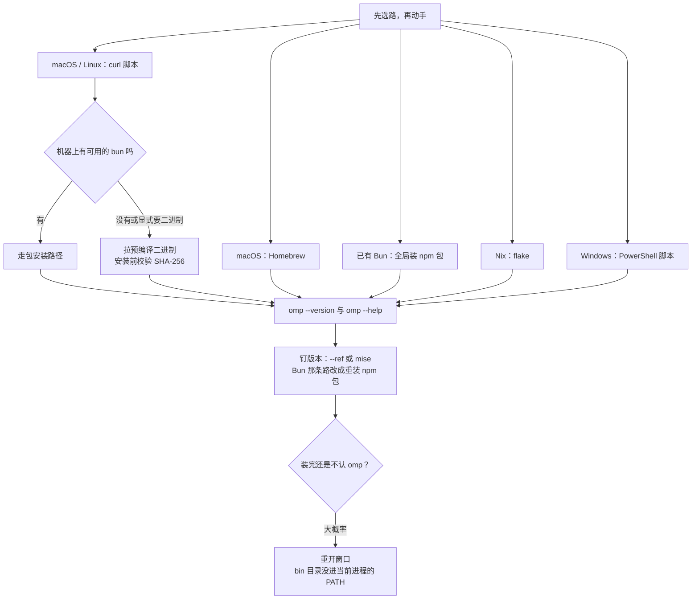
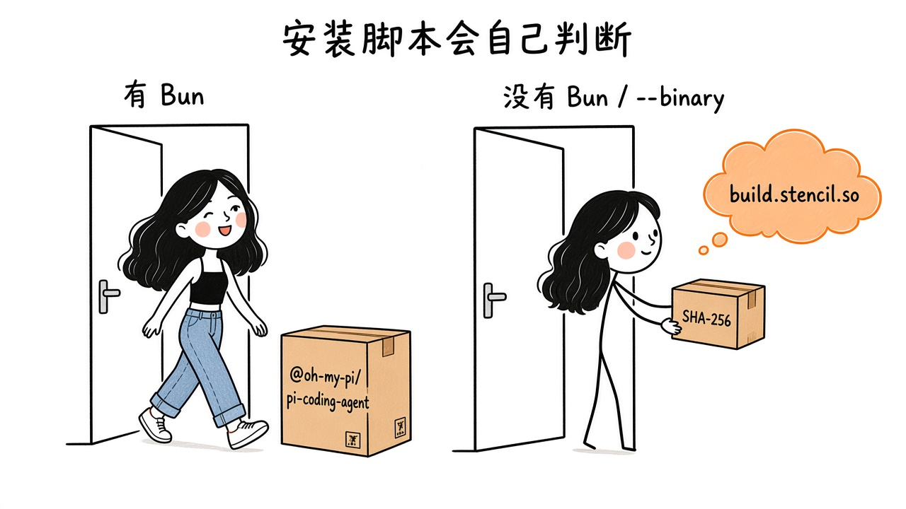
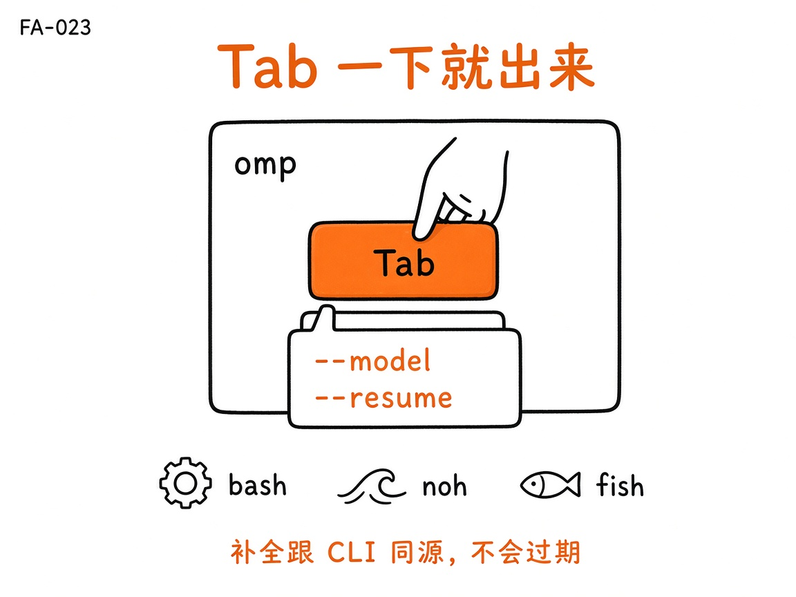

# 第4章 安装与环境

你在公司发的 Windows 笔记本上照教程装 omp。PowerShell 里 `irm https://omp.sh/install.ps1 | iex` 跑完，窗口没报错；你敲 `omp`，得到一句「无法将“omp”项识别为 cmdlet、函数、脚本文件或可运行程序的名称」（这是本机中文 PowerShell 的实测文案，英文界面是 `The term 'omp' is not recognized...`）。你以为脚本失败了，原样又跑一遍——还是不认。真正的差别只在你没重开窗口：装进去的那个 `bin` 目录还没进当前进程的 PATH。

装这个东西没有唯一正确答案，而坑几乎都不在「下载」这一步，在「装到哪、哪个先被找到、怎么钉住版本」。macOS 上有人用 Homebrew，Linux 上有人直接 curl，开发者可能已经有 Bun，Nix 用户有自己的 flake，Windows 也能走 PowerShell。选择太多反而容易卡在门口。下面按「先选路，再动手」来走。



*图4-1：五条常见安装路——curl、Homebrew、Bun、Nix、Windows PowerShell。Bun 版本要求：≥ 1.4.4。*

写作时文档口径：macOS · Linux · Windows，运行时要求 **bun ≥ 1.4.4**。命令以官方 README 的「Install」节为准。



## 4.1 一条最快的路：curl 安装脚本

如果你只想先跑起来，官方推荐入口就是这一行（macOS / Linux）：

```sh
curl -fsSL https://omp.sh/install | sh
```

脚本会自己判断环境：

- 机器上**已有可用的 bun** → 倾向走包安装路径（全局装 `@oh-my-pi/pi-coding-agent` 这一路）。
- **没有 bun**，或者你显式要预编译包 → 从 `build.stencil.so` 拉预编译二进制，安装前校验 **SHA-256**。



*图4-2：安装脚本会自己判断走包还是走预编译二进制。*

想**钉死某个版本**、并且强制二进制：

```sh
curl -fsSL https://omp.sh/install | sh -s -- --binary --ref v<version>
```

把 `<version>` 换成具体 tag（例如写作钉 `v18.15.0`，或你要追平的本机版如 `v18.16.0`——以你当时想钉的 release 为准）。PowerShell 对应参数是 `-Binary -Ref v<version>`（见 4.5）。若你走的是 Bun 全局而不是脚本二进制，钉版本方式改为重装/升级该 npm 包，而不是 `--ref`。

装完先确认：

```sh
omp --version
omp --help
```

能打印版本和帮助，这一章就算过了第一关。

## 4.2 Homebrew

macOS（以及装了 Homebrew 的 Linux）可以直接：

```sh
brew install can1357/tap/omp
```

优点是跟系统其它 brew 包一样好升级、好卸载。缺点是你吃的是 tap 推送节奏，未必跟 GitHub 上刚打的 tag 同步到秒。需要某个精确版本时，curl + `--ref` 或 mise（见 4.6）更合适。

## 4.3 用 Bun 全局安装（推荐给已经在用 Bun 的人）

```sh
bun install -g @oh-my-pi/pi-coding-agent
```

注意三点：

1. **bun ≥ 1.4.4**。版本太旧会踩运行时坑，别省这步：`bun --version`（用户本机验证时为 1.4.4）。
2. 包名是 `@oh-my-pi/pi-coding-agent`，不是随便猜的 `omp` npm 名。
3. 全局安装之后，命令行入口仍是 `omp`。Unix：`which omp`；Windows PowerShell：`Get-Command omp`，常见路径 `%USERPROFILE%\.bun\bin\omp.exe`（例：`C:\Users\<you>\.bun\bin\omp.exe`）。以 `omp --version` 为准。

如果你是从这个仓库自己编译：

```sh
bun setup
bun dev
```

`bun setup` 会装工作区依赖并构建 `@oh-my-pi/pi-natives`。改了 Rust crate 或 `packages/natives` 之后，需要再跑 `bun run build:native`。这是**开发 omp 本身**的路径，普通用户日常不必走。

## 4.4 Nix

不想污染全局、或者机器本身就是 NixOS / 声明式环境：

```sh
nix run github:can1357/oh-my-pi

# 装进当前 profile
# Nix < 2.30: nix profile install
nix profile add github:can1357/oh-my-pi
```

Flake 使用者还可以碰：`packages.<system>.omp`、`overlays.default`、`nixosModules.default`、`homeManagerModules.default`。Home Manager 可以把安装和设置一起声明掉——细节以仓库 flake / README 为准。

开发壳：

```sh
nix develop
bun setup
bun dev
```

构建可分发包：`nix build .#omp`。README 还提到 Wayland 录屏默认关（链接 libpipewire 会明显撑大 closure），以及 LTO 相关 override；你只是「装来用」可以先不管。

## 4.5 Windows（PowerShell）

两条常见路，**先分清你走的是哪条**——路径和升级方式不同。

### 4.5.1 已有 Bun：全局包装（本机实跑常见）

```powershell
bun --version   # 需要 >= 1.4.4
bun install -g @oh-my-pi/pi-coding-agent
Get-Command omp
omp --version
```

- 可执行文件通常在：`%USERPROFILE%\.bun\bin\omp.exe`（`%USERPROFILE%` 展开成你的用户主目录，各人不同）。
- 确认 PATH 含该 `bin`；新开一个 PowerShell 窗口再试 `omp`。
- 升级：再执行一次 `bun install -g @oh-my-pi/pi-coding-agent`（或按你的 bun 全局更新习惯），然后 `omp --version`。
- 用户本机核对（2026-11-02 晚 America/Adak）：Bun 1.4.4 包装，`omp/18.16.0`，`omp -p` 已通——详见 `VERIFY.md`「用户本机核对」。**不要**假设自己一定是 curl/`install.ps1` 装的。

### 4.5.2 官方 install.ps1（预编译 / 脚本）

```powershell
irm https://omp.sh/install.ps1 | iex
```

钉版本、强制二进制时用 PowerShell 参数：`-Binary -Ref v<version>`（与 Unix 脚本的 `--binary --ref` 对称，见 README Install 节）。

### 4.5.3 共性

- 同一个 `omp` 目标覆盖 macOS / Linux / Windows，**不要求 WSL**。
- 没有系统自带的 `rg` / `bash` 也不致命：进程内原生实现就是为这种环境准备的（第 3 章讲过）。
- PowerShell 里用 `Get-Command omp`、`omp --help`；补全若需要，查 `omp completions` 是否提供你的 shell（以当版帮助为准）。

## 4.6 用 mise 钉版本

想在多台机器上锁定同一 release：

```sh
mise use -g github:can1357/oh-my-pi
```

适合「团队统一版本」或「这本书实验要对齐某一个 tag」。跟 curl 的 `--ref` 是同一类诉求，只是入口换成了 mise。

## 4.7 Alpine / musl：先补库再装

这是安装章里最容易让人骂娘的坑。

预编译的 **musl** 二进制会**动态链接** `libstdc++` 和 `libgcc`。原装 Alpine 往往不带这两样。表现通常是：二进制下下来了，一跑就缺共享库。

先装：

```sh
apk add libstdc++ libgcc
```

然后再跑安装脚本或直接执行二进制。


*图4-3：Alpine 上先补齐 `libstdc++` / `libgcc`，再装 omp。（手绘图若把包名画糊了，以本节命令为准。）*

NixOS 或其它「非 FHS、loader 路径上找不到 `libstdc++.so.6`」的环境，本地 tiny 模型那条链路还有 `OMP_NATIVE_LIBRARY_PATH` 的故事（见本地模型文档）；那是后话，安装主程序时先保证能跑 `omp --version`。

## 4.8 Shell 补全：bash / zsh / fish

`omp` **自己生成**补全脚本，数据来自「当前这份 CLI 的命令/旗标元数据」，所以不会跟真实参数表慢慢漂掉。

- 子命令、旗标、枚举值：静态补全。
- `--model` / `--smol` / `--slow` / `--plan`：对着内置模型目录解析。
- `--resume`：对着磁盘上的会话解析。

zsh：

```sh
eval "$(omp completions zsh)"
```

bash：

```sh
eval "$(omp completions bash)"
```

fish：

```sh
omp completions fish > ~/.config/fish/completions/omp.fish
```

把对应行放进你的 rc（`~/.zshrc` 等），新开一个 shell，敲 `omp ` 再按 Tab。



*图4-4：补全跟 CLI 同源，参数表升级了补全也跟着升级。*


## 4.8a 安装脚本在干什么（心里有数就好）

你不需要读完安装脚本源码，但最好知道它在替你做哪些选择：

1. **探测 bun**：有且能用 → 倾向包安装；没有或你传了 `--binary` → 拉预编译包。
2. **校验完整性**：走 `build.stencil.so` 时会查 SHA-256，降低「下到半截或被篡改」的风险。
3. **写入 PATH 可见位置**：具体目录随平台/脚本版本变；验收永远以 `which omp` 为准。
4. **钉版本**：`--ref v<tag>` / `-Ref v<tag>` 把「今天装到的」变成「可复现的」。

这对写书、写教程、排团队事故都重要：口头说「我装了 omp」没有信息量，说「`omp --version` = omp/18.16.0，Bun 全局 `%USERPROFILE%\.bun\bin\omp.exe`」或「curl `--ref v18.15.0` → ~/.local/bin/omp」才有。

## 4.8b 开发者安装 vs 用户安装

| 身份 | 典型命令 | 你得到什么 |
|---|---|---|
| 终端用户 | curl / brew / bun -g / nix profile / mise | 一个能跑的 `omp` |
| omp 贡献者 | clone 仓库 → `bun setup` → `bun dev` | 可改 TS/Rust 的开发树 |
| Nix 贡献者 | `nix develop` 再 `bun setup` | 固定工具链 + 依赖 |

本书第一到第七篇默认你是**终端用户**。只有第七篇读源码章才会假设你有一份 checkout。

## 4.8c 升级与卸载（原则）

官方 README 的安装节以「如何装上」为主。升级路径通常是：

- **Homebrew**：`brew upgrade` 对应该 formula。
- **Bun 全局包**：再执行一次 `bun install -g @oh-my-pi/pi-coding-agent`（或看 bun 的全局更新习惯）。
- **curl 脚本**：再跑一遍；要保守就继续带 `--ref`。
- **mise**：按 mise 的升级/重装工作流走 github 后端。
- **Nix**：翻 flake / profile 里的版本。

卸载则反向：brew uninstall、bun 去掉全局包、mise 去掉工具、nix profile remove、手动删二进制。**会话目录 `~/.omp/` 不会仅仅因为卸载二进制就自动消失**——那是你的数据；要不要删自己决定。

## 4.9 装完怎么验收

按这个顺序扫一遍，比「感觉装好了」靠谱：

```sh
omp --version
omp --help
omp config path
omp completions zsh >/dev/null   # 或 bash / fish，确认子命令存在
which omp                        # Windows PowerShell：Get-Command omp
```

三条本机已验（18.16.0，Git Bash）：`omp --version` 打一行 `omp/18.16.0`；`omp --help` 退出码 0；`omp config path` 打出一行绝对路径，指向当前活动的 agent 目录（本机落在用户主目录下的 `.omp\agent`；你的值随用户名、profile、`PI_CODING_AGENT_DIR` 变）。证据 `omp/facts/live-18.16.0/version.txt`、`config-path.txt`。

**验收的判据不是「命令跑完了」，而是你能不能把这三行输出复述给别人**：版本号、帮助能出来、配置目录在哪。口头说「我装了」没有信息量，说「`omp/18.16.0`，Bun 全局 `%USERPROFILE%\.bun\bin\omp.exe`，`omp config path` 指向 `~/.omp/agent`」才有。

还没接模型之前，`omp` 进 TUI 可能会提醒你登录或设密钥——那是第 5 章的事，不算安装失败。

若命令找不到：检查 PATH（brew 前缀、bun 全局 bin、mise shims、curl 脚本装到的目录）。若是 Alpine 报缺库：回到 4.7。

## 4.10 翻车对照：安装期七种症状

| 翻车做法 | 会看到什么 | 正确做法 |
|---|---|---|
| 装完立刻在**同一个** PowerShell 窗口敲 `omp` | 「无法将“omp”项识别为 cmdlet、函数、脚本文件或可运行程序的名称」；Git Bash 里是 `omp: command not found`（本机已验这两种文案，`omp/facts/live-18.16.0/shell-command-not-found.txt`）。关键：这句是 **shell** 说的，不是 omp 说的——命令根本没跑到 omp 那一步 | 重开窗口；`Get-Command omp`（Unix：`which omp`）确认它落在哪个 `bin`，再核对 PATH 里有这个目录 |
| Alpine / 精简镜像里直接执行预编译二进制 | 缺共享库就退，报的是 loader 找不到 `libstdc++.so.6` 一类；omp 自己一行代码都没执行 | `apk add libstdc++ libgcc` 再跑（README 安装节写明 musl 构建动态链接这两个库；本机非 Alpine，**未复现**） |
| 老的 bun 上装 npm 包 | 装得上，跑起来才报运行时错。**未验证**具体报错文案——先 `bun --version` 看是不是 ≥ 1.4.4，不满足就升 bun，再用 `omp --version` 验收 | 别跳过版本号那一步；本书所有实验都在 `omp/18.16.0` 上跑过 |
| 装好后第一次试命令就敲 `omp notasubcommand`，想确认「有没有这个子命令」 | **不报未知命令**：整句被当成提示词，屏幕停在 `Working...`。本机 18.16.0 实测挂到 90 秒被 `timeout` 掐断（124 来自 `timeout`） | 子命令清单在 `omp --help` 的 COMMANDS 段（本机 51 条）；数一遍比试错快 |
| 改了 `~/.omp/agent/config.yml` 却像没生效 | 多半是活动目录不是你以为的那个：`--profile`、`OMP_PROFILE`、`PI_CODING_AGENT_DIR` 都会把它挪走 | `omp config path` 一行看穿（本机已验：打出一行绝对路径）；命名 profile 会忽略 `PI_CODING_AGENT_DIR`（`docs/environment-variables.md`） |
| 想知道某个键到底被哪一层写了 | 全局、项目、覆盖层、运行时旗标、环境变量叠在一起，改一处不一定赢 | `omp config list --scope global` / `--scope project` 分别列（本机已验：本仓库 cwd 下 project 层为空，global 层 46 行——这份输出里有你机器的私有配置值，**别贴进 issue 或书稿**）。顺序见 4.11 |
| 想复现书里某一版行为 | 你今天装的版本和作者钉的不一致，实验结论对不上 | curl `--ref` / PowerShell `-Ref` / mise 钉 tag；Nix 构建过大或录屏相关看 README 的 Wayland / LTO override |

更完整的故障索引在第七篇排错章；这里只挡「还没装上、或装上了但找不到」这一层。

## 4.11 谁读哪份配置：六层优先级

装上只是起点，第二个坑是「你改的这层，到底赢不赢」。`docs/settings.md` 给的顺序，从低到高是：

```text
内置默认  ←  全局 config.yml  ←  项目 .omp/  ←  --config 覆盖层  ←  运行时旗标  ←  设置声明的环境变量
```

几处细节值得先记住（都出自文档原文）：

- **项目层**先看 `<cwd>/.omp/settings.json`，再看 `<cwd>/.omp/config.yml`；**全局层**是活动 agent 目录里的 `config.yml`（`omp config path` 告诉你活动目录是哪个）。
- `--config=<file>` 可以重复给，后给的覆盖先给的。
- 运行时旗标（`--smol`、`--slow`、`--plan`、`--approval-mode` 等）**不落盘**，只影响当前进程；`--model`、`--thinking` 这类算会话选项，不全都算设置项。
- 环境变量的查找顺序是另一条链：现有进程环境 → 项目 `.env` → agent `.env` → config-root `.env` → `~/.env`，且**后面几步只填空未设置的键**。也就是说 shell 里已经 `export` 过的同名变量，`.env` 覆盖不了它——这是本章最容易踩的一条。

## 4.12 本章小实验

选一条路把 `omp` 装上，然后跟这一串走到底（Windows 把 `which` 换成 `Get-Command`）：

```sh
omp --version          # 期望一行 omp/<版本号>，本机是 omp/18.16.0
omp config path        # 期望一行绝对路径 = 你的活动 agent 目录
omp config list --scope project   # 期望 exit 0；本仓库目录下这一段是空的
which omp
```

四条都在本机 18.16.0 跑过，退出码都是 0（`omp/facts/live-18.16.0/version.txt`、`config-path.txt`、`config-list-scope-project.txt`）。**判据**：第一条给你版本，第二条给你的机器「实际在读哪个目录」——这两条对上了，后面每一章讲配置文件时你才知道自己在改哪个文件。project 层列不出东西不是失败，是本仓库没有 `.omp/config.yml`（只有一个 `.omp/mcp.json`）。

再给自己常用的 shell 接上补全（4.8），新开窗口，敲 `omp ` 按 Tab，能出来 `--model`、`--resume` 这类旗标就算通。`omp completions bash` 的完整脚本本机已验（29,571 字节，`completions-bash.txt`）。

最后钉一次版本：`--binary --ref v<version>` 或 `mise use -g github:can1357/oh-my-pi`，把你钉的 tag 写进你的笔记——后面每章末的「版本核对清单」都要对着它看。

## 4.13 与御舆同构点

参见御舆第 5 章《设置与配置》。两卷在这儿问的是同一条问题：装完之后，**谁读哪份配置、后读的会不会盖掉先读的**。那一卷给的是一整套配置面，这一卷给 omp 的六层顺序和 `.env` 查找链（4.11）。同构的是「分层 + 优先级」这个结构本身，以及那条反直觉的规则——已经存在于进程环境里的变量不会被文件覆盖。具体的文件名、键名、目录位置两边各自成立，别互相照抄。

下一章：插座板上电——接上 provider 和模型。

---
**版本核对清单**：安装命令与平台说明以 `README` / `README.zh-CN`「安装 / Install」为准；`bun ≥ 1.4.4`；Alpine 需 `libstdc++`/`libgcc`；补全命令为 `omp completions {zsh,bash,fish}`；钉版本：`sh -s -- --binary --ref v<version>`（PowerShell：`-Binary -Ref`）；Homebrew tap：`can1357/tap/omp`；Bun 包：`@oh-my-pi/pi-coding-agent`；Nix：`nix run` / `nix profile add github:can1357/oh-my-pi`；mise：`mise use -g github:can1357/oh-my-pi`。写作钉 v18.15.0；用户本机验证 v18.16.0（见 VERIFY.md），发版后数字与 URL 以当时 README 为准。

- [ ] `omp config path`：换机器、换 profile 后先跑它，再决定改哪个配置文件。
- [ ] `omp config list --scope project`：确认项目层有没有键；输出别贴到外部。
- [ ] 设置优先级链（内置默认 ← 全局 ← 项目 ← `--config` ← 运行时 ← 设置环境变量）重读 `docs/settings.md`，本节的中文概括不替代原文。
- [ ] Alpine 缺库那条：本机未复现（Windows / Bun 全局装的机器上没有 musl 路径），容器环境里请按 4.7 实跑一遍再下结论。
