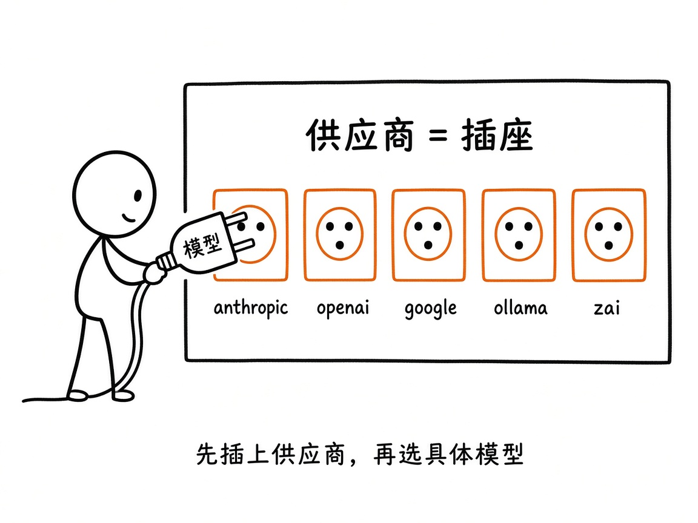
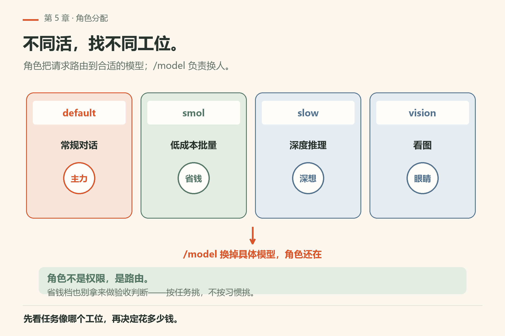
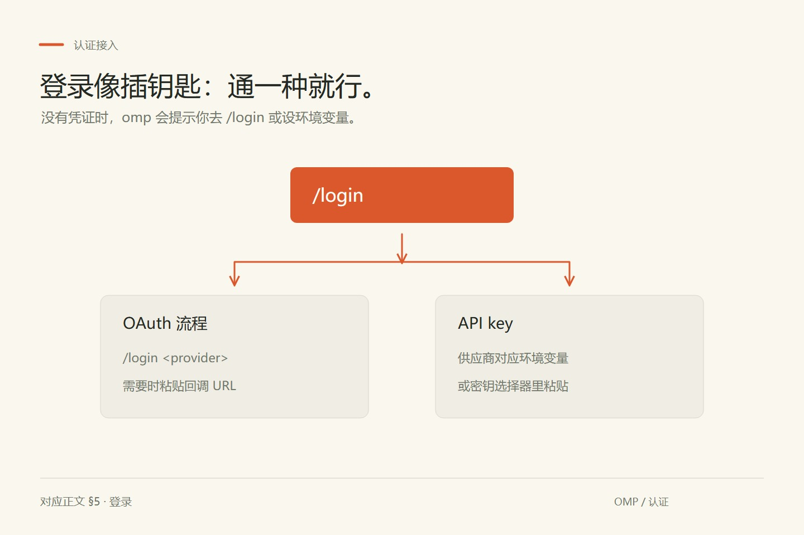
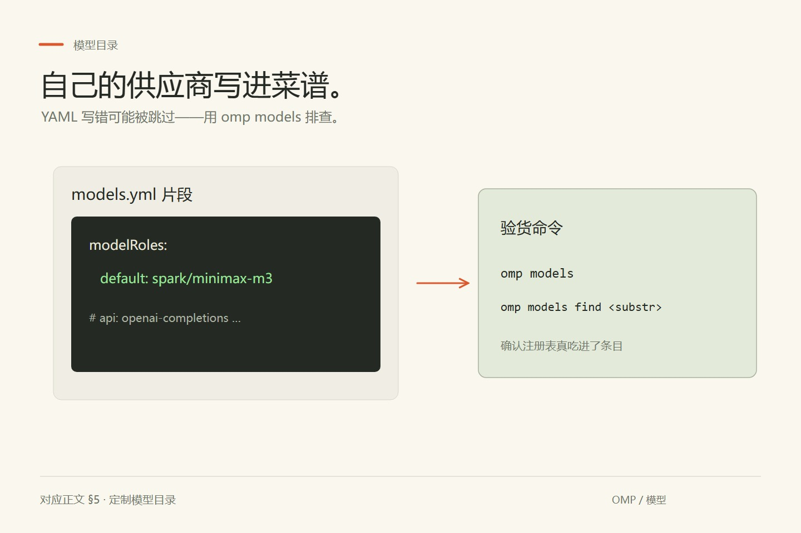
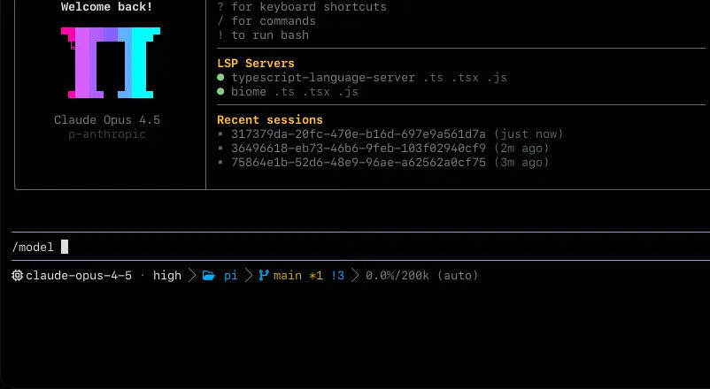

# 第5章 接上模型

你把新的 API key 写进 `~/.omp/agent/.env`，退出重进 omp，它仍然报鉴权失败。你换了个 key 名、又检查了拼写——都没用。真正的原因是十几分钟前你在同一个 shell 里 `export` 过一把旧的：omp 查找环境变量的第一步是**现有进程环境**，`.env` 那几步只负责填那些还没有值的键（`docs/environment-variables.md`）。装好 `omp` 之后差的那件事，不是「有个 key」，而是「让 omp 读到你想的那一个」。

这一章专门讲「怎么把模型接到 omp 上」。先分清两个词，后面不会混：

- **供应商（provider）**：账号或后端命名空间，比如 `anthropic`、`openai`、`google`、`ollama`。
- **模型（model）**：该供应商下面的具体型号，选择器写法是 `provider/model-id`，例如 `anthropic/claude-opus-4-6`。

把供应商想成墙上的插座，模型想成电器插头：先保证插座有电（凭证 / 本地服务起来），再用 `/model` 或角色配置决定插哪一个。



*图5-1：先插上供应商，再选具体模型。禁用某个供应商，等于拔掉整排插座。*

写作时 README 口径是「六十多个提供商、上千个模型，只需一次 `/model`」。具体名单会随发版变，以你本机 `omp models` 和官网 docs 为准。

## 5.1 九种角色：不同活找不同模型

omp 不是「全局只认一个模型」。它按**角色**分配：

| 角色 | 干什么（README 说法） |
|---|---|
| `default` | 常规对话 |
| `smol` | 低成本批量派子智能体 |
| `slow` | 深度推理 |
| `plan` | 计划模式 |
| `commit` | 生成变更日志 |
| `vision` | 看图相关 |
| `task` | 任务相关路由 |
| `advisor` | 第二模型监督 |
| `tiny` | 极小本地模型等轻量活 |

启动时可覆盖：`--smol`、`--slow`、`--plan`。会话里用 **`/model`** 切换当前模型；**`Ctrl+P`** 在当前角色已配置的模型之间循环。



*图5-2：角色像工位牌——主力、省钱、深想各干各的；`/model` 负责换人。*

深想相关还有魔法词 **`ultrathink`**（第四篇会展开）。这一章你只要知道：贵的模型不必全程开着，琐碎活可以丢给 `smol` / 本地。

## 5.2 供应商怎么才算「可用」

`docs/providers.md` 的规则可以记成一句话：

> 没被禁用，并且（无需密钥 **或** 已经有凭证）。

更细一点：

1. 内置目录里的供应商；
2. 再加上你在 `~/.omp/agent/models.yml` 里声明的自定义供应商；
3. 再看 `disabledProviders` / 路径限定等设置会不会把它摘掉；
4. 本地引擎还要**探针打得通**（服务没启动 → 一开始可能空，后来也许还有缓存行，但推理仍需要引擎活着）。

凭证解析有优先级（从高到低的直觉版，细节以 `docs/providers.md` / `docs/secrets.md` 为准）：

1. 运行时 `--api-key`
2. `models.yml` 里配置的 key
3. 已存储的 OAuth
4. `/login` 存下的 API key
5. 扩展配置回退
6. 环境变量 / `.env` 等

所以「我明明在 `.env` 写了密钥，怎么还是用了旧的？」——多半是更高优先级的来源赢了。排查时先看有没有导出的 shell 变量，再按文档列的 `.env` 搜索顺序查。

## 5.3 登录：`/login` 与环境变量

很多供应商走浏览器 OAuth 或交互式贴密钥，入口统一：

```text
/login
/login anthropic
/login factory-droid
```

- `/login`：打开 OAuth / 密钥选择器。
- `/login <provider>`：直达某个供应商。
- 若 OAuth 需要粘贴回调 URL：`/login <redirect-url>` 完成流程。

没有凭证时，omp 会提示你去 `/login` 或设置该供应商对应的环境变量。



*图5-3：OAuth 或 API key，能通一种就行。*

### 三类接入方式（README 认证标签）

1. **`oauth`**：用该平台账号登录（Anthropic、OpenAI Codex、GitHub Copilot、Cursor、Google Gemini CLI / Antigravity 等）。
2. **`plan`**：编程套餐 / 订阅额度（Kimi Code、MiniMax Coding Plan、Z.AI / Zhipu Coding Plan、Alibaba Coding Plan 等）。`/login` 之后额度在会话里用。
3. **`local`**：连本机或局域网 OpenAI 兼容服务，密钥常常可选（Ollama、LM Studio、llama.cpp、vLLM 等）。

前沿 API、编程套餐、本地部署的名单很长，README 用三节列表维护。书里不抄全表——**以你克隆的 README 那三节 + `omp models` 为准**。

几个文档里点名的细节（避免踩坑）：

- **ClinePass**：`CLINE_API_KEY` 或 `/login cline-pass`；`omp usage` 可看配额窗口。
- **Z.AI / 智谱**：`/login zai` 对全球 Coding Plan；`/login zhipu-coding-plan` 对国内 Coding Plan；两者都**不是**在配 `https://open.bigmodel.cn/api/paas/v4` 那种按量 BigModel 端点。
- **Mistral**：环境变量 `MISTRAL_API_KEY`，或 `/login mistral` 走类似 Mistral Vibe CLI 的浏览器登录（记为普通 API key，用量走 Vibe Code 配额叙事——以 providers 文档为准）。

## 5.4 本地模型：Ollama / LM Studio / llama.cpp 等

内置会探测常见本地引擎。文档口径（摘要）：

- 隐式 **Ollama**、**llama.cpp** 模型常用 `openai-responses` 传输面；
- **LM Studio** 走 `openai-completions`；
- macOS arm64 上还有 **Apple Foundation Models** 桥：`apple/on-device`。设备不合格、Apple Intelligence 关着、或构建没带桥 → 没有模型。它的上下文可能偏小，**不会自动选中**；要显式 `--model apple/on-device` 或 `/model`。

本地实例通常**不需要密钥**。服务没启动时，选择器里可能暂时看不到活模型。

把 oMLX 之类挂在「看起来像 LM Studio 的 OpenAI `/v1/models`」上时，可以用 `LM_STUDIO_BASE_URL` 指过去；**不要**把它配成 `ollama` 发现路径（Ollama 走原生 `/api/tags` 等，不是同一套）。

更偏「端侧 tiny / 语音 / 记忆小模型」的实验与目录，见 `docs/local-models.md`（`omp tiny-models`、`omp setup speech`、`OMP_NATIVE_LIBRARY_PATH` 等）。那是进阶，第一次接通先保证一个聊天模型能回你一句就行。

## 5.5 自定义 OpenAI 兼容端点：`models.yml`

公司内网、自建 vLLM、某台 GPU 机器上的兼容网关……都可以写进：

`~/.omp/agent/models.yml`

README 示例：

```yaml
providers:
  spark:
    baseUrl: http://192.168.10.223:8000/v1
    api: openai-completions
    apiKey: dummy
    models:
      - id: minimax-m3
        name: MiniMax M3
        contextWindow: 100000
        maxTokens: 32000
```

然后：

```sh
omp models spark
```

确认能发现。再用 `omp setup` 在选默认模型时选中它，或会话里 `/model` 把 `spark/minimax-m3` 分给 `default`。

也可以直接写配置（`~/.omp/agent/config.yml`）：

```yaml
modelRoles:
  default: spark/minimax-m3
```



*图5-4：自己的供应商写进菜谱；`omp models` 负责验货。*

自定义供应商支持的 `api` 值很多（`openai-completions`、`openai-responses`、`anthropic-messages`、各种 Google / Bedrock / 评判类 API 等），完整枚举见 `docs/models.md`。YAML 写错时注册表可能直接跳过自定义文件——用 `omp models` / `omp models find <substr>` 排查。

显式写了 `ollama` / `lm-studio` / `llama.cpp` 条目时，会**替换**该 ID 的内置发现行为——这是有意设计，不是 bug。


## 5.5a `omp setup`：交互式把默认模型安顿好

懒得手写 `config.yml` 时，跑：

```sh
omp setup
```

按提示选默认模型（包括你刚在 `models.yml` 里加的自定义供应商）。它不会替代你对凭证的理解，但能少撞「已登录却没默认模型」的墙。

语音/听写相关还有 `omp setup speech`（本地 speech / dictation 角色与下载）——属于本地模型进阶，第一次接通聊天模型可以跳过。

## 5.5b 选择器里的 `provider/model` 写法

会话状态和 transcript 会记下**真正执行该轮**的 `provider/model`。同一 `model-id` 若在多家供应商下都存在，必须带 provider 前缀，避免歧义。养成习惯：

```text
anthropic/claude-… 
openai/…
ollama/…
spark/minimax-m3
```

只写裸 id 在「全局恰好只有一个同名」时也许能混过去，但配置一复杂就会选错插座。

## 5.5c 禁用供应商与项目级差异

不想在选择器里看到某些云：

- 全局：`disabledProviders`（设置文档）。
- 项目：带 `path:` 前缀的条目，只影响该路径树。

「禁用供应商」= 拔掉整排插座；若只想藏某几个型号，用模型级的 enable/disable 设置，而不是一刀切掉 provider。完整键名与合并顺序见 `docs/settings.md` / `docs/models.md`。

## 5.6 让路由更好用的四个开关（先混个脸熟）

README 点名的四个：

1. **自定义提供商** — 上一节。
2. **回退链** — `retry.fallbackChains`：主模型 429 / 配额撞墙时，链上下一个接手本轮剩余；冷却后自动恢复。
3. **按路径限定模型** — `enabledModels` / `disabledProviders` 带 `path:` 前缀，某个仓库用另一套模型，不动全局。
4. **轮换凭据** — 同一供应商叠多把钥匙，按会话亲和轮换并分别退避。

第四篇「模型角色路由」会把角色、回退、advisor 摊开。现在你只要会：登录 → `/model` 选一个能聊的 → 需要时写 `models.yml`。

## 5.7 会话里怎么换模型

交互里最常用：

```text
/model
```

打开选择器，按角色或搜索挑选。



*图5-3：上游 README 演示的选择器（`assets/models.webp`）；按角色分组，可直接输入过滤。界面对话框逐版可能调整。*

也可以在启动时：

```sh
omp --model anthropic/claude-opus-4-6
omp --smol
omp --slow
omp --plan
```

列目录、排查「为什么看不见某某」：

```sh
omp models
omp models find ollama
omp models find spark
```

## 5.8 接不上时怎么查

| 现象 | 先做 |
|---|---|
| 选择器里没有某供应商 | 凭证？是否在 `disabledProviders`？本地服务是否在听端口？ |
| 有供应商但没有模型 | 本地引擎是否返回了 `/v1/models` 或原生列表？自定义 YAML 是否被跳过？ |
| 总是用错密钥 | 查优先级：`--api-key` → models.yml → OAuth → `/login` key → 环境 / `.env` |
| Coding Plan 登录成功却不是想要的端点 | 分清 zai / zhipu-coding-plan 与按量 BigModel 等不同入口 |
| Apple on-device 不出现或不自动选 | 设备/桥/上下文限制；显式 `--model apple/on-device` |

`docs/providers.md` 末尾有「Troubleshooting」专节，排错章会再收一次。

## 5.9 翻车对照：请求发出去之前的八种死法

模型没接上的时候，omp 给你的信号很不一致：有的立刻报错，有的根本不报错。表里凡写「本机已验」的，都是 18.16.0 实跑并留了原始输出。

| 翻车做法 | 会看到什么 | 正确做法 |
|---|---|---|
| `omp -p "hi" --model definitely-not-a-model-xyz --no-session` | `Model "definitely-not-a-model-xyz" not found`，随后提示你可以用 `omp models find <pattern>` 搜、或 `omp models` 全列，退出码 **1**（本机已验 `fail/bad-model.txt`） | 别手写模型名。先 `omp models find <关键词>`，把表里那行连 `provider/` 前缀一起抄进 `--model` |
| `omp --model`，忘写值 | **不报错**：`--model` 被当成提示词吞掉，屏幕停在 `Working...`。本机 90 秒后由 `timeout` 掐断（124 来自 `timeout`，不是 omp） | 一律写成 `--model=<provider/model>`；CI 里再加 `--max-time`（帮助给的写法形如 `600` / `10m` / `1h`），别让它挂满构建时长 |
| 脚本里 `omp models find zzz-none-xyz-9876`，只看退出码 | 打出 `No models matching "zzz-none-xyz-9876"`，**退出码却是 0**（本机已验 `models-find-nomatch.txt`） | 判「找到没」要看输出文本或 `--json` 的条数，不能只看 `$?` |
| 在 shell 里 `export` 过旧 key，又把新 key 写进 `.env` | 用的还是旧那把：`$env` 顺序是 进程环境 → 项目 `.env` → agent `.env` → config-root `.env` → `~/.env`，后面几步只填空（文档所述） | 先 `unset` 掉 shell 里的同名变量，或用 `omp login <provider>` 重存凭证（`omp login --help` 本机已验） |
| 把 `modelRoles` 写进 `~/.omp/agent/models.yml` | 不报错，也不生效：注册表只消费 `providers` 这一个根键，其它根键不会配置模型行为（`docs/models.md`） | 自定义**供应商**进 `models.yml`，**角色**进 `config.yml`，两个文件别混用 |
| 想用 CLI 确认角色写对了没，跑 `omp config get modelRoles.default` | `Unknown setting: modelRoles.default`，退出码 **1**；但同一台机器上 `omp config get modelRoles` 是通的，打出一个角色→模型的对象（本机已验 `config-get-modelroles-dot-default.txt`；那份值含私有模型名，书里不抄） | 叶子路径不等于 `config get` 认识的键名。报错时照它的提示跑 `omp config list` 找准确写法，或直接读 `config.yml` |
| 想确认「登录状态」就跑 `omp token` / `omp usage` | 前者按帮助原文就是取某供应商的 API key 或 OAuth token，后者按已鉴权账号列用量——两者都会把敏感内容打进终端、滚进历史和截图 | 只读它们的 `--help`（本机已存）。要迁凭证用 `omp auth export` / `import`，它自己的示例就写着留好秘密；导出的文件别提交 |
| 凭记忆写死某模型的上下文上限 | 同一个 id 在不同供应商下的 `context` / `max-out` 不一样，`omp models` 的表就是按供应商分组给这两列的 | 现场查：`omp models find <关键词>`。注意这张表会带上你机器配的所有供应商名，**别把它贴进书稿或 issue** |

## 5.10 本章小实验

先在终端确认「目录里有什么」，再进 TUI 动模型。这一段不需要你贴任何输出给别人：

```sh
omp models find <关键词>          # 换成你有的一家：本地引擎名、模型名片段都行
omp models find zzz-none-xyz-9876  # 期望 No models matching "..."，退出码仍是 0
omp config get modelRoles          # 期望列出当前角色→模型的解析结果
omp -p "只回复两个字：在线" --no-session
```

四条都在本机 18.16.0 跑过（`omp/facts/live-18.16.0/models-find-nomatch.txt`、`config-get-modelroles-dot-default.txt`、`print-mode-online.txt`）。**怎么算成功**：第一条给你按供应商分组的表（列是 `model` / `context` / `max-out` / `thinking` / `images`）；第二条给你一句 `No models matching`——注意它退出码是 0，别当成查到了；第三条给你每个角色当前落到哪个模型；最后一条 stdout 只有一行 `在线`、退出码 0，说明「凭证 + 角色解析 + 一次请求」这条链整条通了。

后两条依赖你机器上已配好的模型。三条都别往外贴：模型目录和角色解析里带着你私有网关的名字。

接下来照旧走一遍交互面：

1. 对一个你有账号的供应商执行 `/login <provider>`（或导出它的环境变量），直到 `/model` 里能看到具体型号。命令行一侧的对应用 `omp login <provider>`（`omp login --help` 本机已验）。
2. （可选）按 README 示例写一个最小 `models.yml`，用 `omp models <id>` 验证能发现，再把 `modelRoles.default` 指过去。
3. 在 TUI 里用 `Ctrl+P` 和 `/model` 各切换一次，体会「角色内循环」和「打开选择器」的差别。

## 5.11 与御舆同构点

参见御舆第 5 章《设置与配置》与第 13 章《流式架构》。两卷在这一点上是同一条结构：凭证解析和模型解析都发生在**第一个请求之前**，所以「接不上」的现象永远出现在发话之前，而不是话说一半。另一层同构是角色的概念——不同用途用不同档位的模型，配置面按角色分而不按调用点分。至于对方那一卷里具体的登录入口、键名和端点写法，跟 omp 没有对应关系，别做名词翻译；要对照就对照「先鉴权、再解析、后请求」这个次序。

下一章：真正坐进 TUI，看卡片、预览编辑、完成第一次改代码。

---
**版本核对清单**（写作钉 v18.15.0；用户本机验证 v18.16.0，见 VERIFY.md）：provider/model 术语与可用性规则见 `docs/providers.md`；角色列表与三类接入（API / plan / local）见 README「六十多个提供商…」；`/login`、`/model`、`Ctrl+P`、`--smol`/`--slow`/`--plan` 以 README + CLI 文档为准；自定义 YAML 示例路径 `~/.omp/agent/models.yml`；`omp models` / `omp setup`；本地引擎与 Apple on-device 约束见 `docs/providers.md` / `docs/models.md` / `docs/local-models.md`。供应商名单随发版变化，勿把本书列表当永久合同。

- [ ] `omp --version` 与 `omp models find <关键词>` 先跑：角色表 5.1 是 README 口径，你机器上的实际角色键以 `omp config get modelRoles` 为准。
- [ ] `omp models find <不存在的名>` 仍是「一句 No models matching + 退出码 0」？哪天改成非 0，5.9 第三行和 5.10 的判据都要跟着改。
- [ ] `omp -p "..." --model <不存在>` 仍应在**发请求前**挡住（exit 1），这是本章「解析发生在请求之前」的根据。
- [ ] `docs/providers.md` 的可用性规则与凭证优先级链（5.2）是文档口径；本机未逐一跑到，读到的描述请标「文档所述」。
